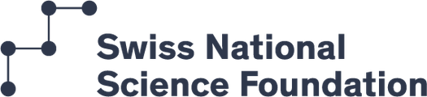

<!-- Placeholder: generic version agreed 9 Oct 2026. Full text to be developed with Bruno after the site is finished. -->

I advise organisations on digital marketing and online consumer behaviour, bringing research evidence to
practical questions about how people discover, engage with and choose brands online.

```{=html}
<div class="offer-grid offer-grid-3">
  <section class="offer">
    <h2>Digital marketing</h2>
    <p>Social media and content strategy grounded in evidence on what drives engagement with brands online.</p>
  </section>
  <section class="offer">
    <h2>Online consumer behaviour</h2>
    <p>Understanding how consumers search, evaluate and decide in digital environments, and what shapes their choices.</p>
  </section>
  <section class="offer">
    <h2>Research and measurement</h2>
    <p>Consumer research designed to give reliable answers, from survey design to the analysis of engagement.</p>
  </section>
</div>
```

```{=html}
<section class="partner-strip" aria-labelledby="ps-title">
  <h2 id="ps-title">Organisations I have worked with</h2>
  <p class="ps-group">Industry and public sector</p>
  <ul class="ps-logos">
    <li><a href="https://www.woolworths.com.au" title="Woolworths" rel="noopener"></a></li>
    <li><a href="https://endfoodwaste.com.au" title="End Food Waste Australia" rel="noopener"></a></li>
    <li><a href="https://eslfaceitgroup.com" title="ESL Gaming" rel="noopener"></a></li>
    <li><a href="https://lublin.eu" title="City of Lublin" rel="noopener"></a></li>
    <li><a href="https://www.jamovi.org" title="jamovi" rel="noopener"></a></li>
  </ul>
  <p class="ps-group">Research funders I advise</p>
  <ul class="ps-logos">
    <li><a href="https://www.arc.gov.au" title="Australian Research Council" rel="noopener"></a></li>
    <li><a href="https://www.ncn.gov.pl/en" title="National Science Centre, Poland" rel="noopener"></a></li>
    <li><a href="https://www.snf.ch/en" title="Swiss National Science Foundation" rel="noopener"></a></li>
  </ul>
</section>
```


