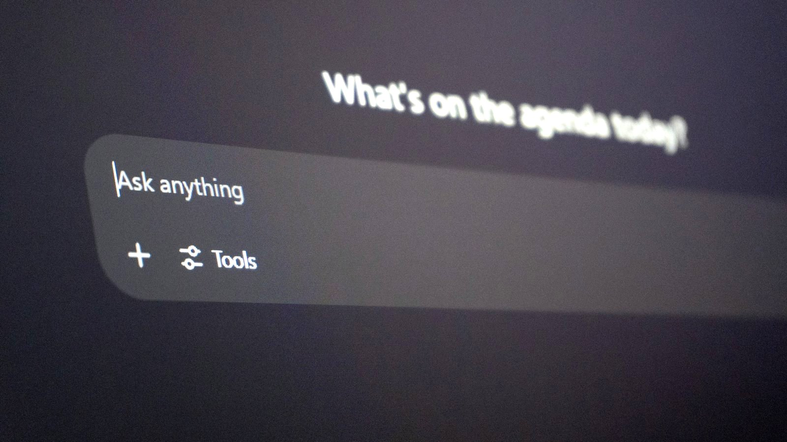

<!-- GENERATED from watch/issues/2026-03-30-ai-search-engines.yml by scripts/build_watch.py. Edit the data file. -->

```{=html}
<p class="mw-kicker">Marketing in 3 · Issue 12 · Week of 30 March 2026</p>
<figure class="mw-hero"><picture><source type="image/webp" sizes="(max-width: 900px) 100vw, 900px" srcset="../../images/web/issue-12-ai-search-engines-960.webp 960w, ../../images/web/issue-12-ai-search-engines-1600.webp 1600w"></picture><figcaption>One box, any question, and fewer links to click. Photo: Zulfugar Karimov on Unsplash.</figcaption></figure>
<section class="mw-answer" aria-label="Short answer"><h2>The short answer</h2><p>Not yet, but it is changing what search ads can reach. In a study that recorded people&#x27;s real searches, 76% still went to Google, and almost all shopping searches did. But people chose AI search for more than half of their advice questions, typed queries nearly three times longer there (11 words against 4), and clicked a link in only 12% of AI searches, against 59% on Google. Short keywords look safe for now; long, specific questions are moving to AI.</p></section>
<section class="mw-takeaways"><h2>Key takeaways</h2><ul><li>Three in four searches still went to Google, and 94% of shopping searches did.</li><li>For advice questions, such as which product suits a need, people chose AI search 54% of the time.</li><li>AI queries averaged 11 words against 4 on Google; only 5% of AI searches were short two-word terms, against 35% on Google.</li><li>People clicked a result in 59% of Google searches but only 12% of AI searches.</li></ul></section>
<section id="what-the-researchers-did"><h2>What the researchers did</h2><p>Search advertising is built on two habits: people type short keywords, and then they click links. AI search
engines, which write an answer instead of listing pages, could break both. Most claims about this so far have
been guesses, so <a class="mw-orcid-link" href="https://orcid.org/0009-0007-5818-4382" title="Gabriel Garlough-Shah on ORCID">Gabriel Garlough-Shah</a> (Northwestern University) and colleagues at the University of Minnesota
watched what people actually do.</p><p>They built a Chrome extension that logged every search, result and click. US adults who had used both kinds of
search engine in the past three months searched as they normally would for 24 hours, using Google and Google
Gemini. Each search was then sorted by what the person wanted: facts (information), something to buy or a
product to look up (shopping), or a recommendation or judgement (advice), such as &quot;what should I consider when
buying a car?&quot;.</p>
<dl class="mw-facts"><div><dt>People</dt><dd>52 US adults (average age 36), recruited through Prolific, who regularly used both kinds of search</dd></div><div><dt>Searches</dt><dd>848 real searches logged between October 2023 and November 2024, about 16 per person</dd></div><div><dt>Engines</dt><dd>Google (traditional search) and Google Gemini (AI search)</dd></div><div><dt>Measured</dt><dd>Which engine people chose, how many words they typed, and whether they clicked a result</dd></div></dl>
</section>
<section id="shopping-stays-on-google-advice-moves-to-ai"><h2>Shopping stays on Google, advice moves to AI</h2><p>Overall, 76% of searches went to Google. The split depended on what people wanted. For shopping searches,
people used Google 94% of the time; for information, 76%. For advice they leaned the other way, choosing AI
search 54% of the time.</p><p>Some of that advice was commercial. Questions such as &quot;what brands are best for architectural shingles?&quot; or
&quot;what is the best dog food for a Shetland sheepdog?&quot; went to the AI. Product-related searches on AI search were
still only about 5% of all searches, but they show the comparing-and-choosing stage of buying starting to move.</p>
<figure class="mw-chart" id="chart-choice"><figcaption class="mw-chart-title">Share of searches done on AI search, by what people wanted</figcaption><div class="mw-chart-svg"><svg viewBox="0 0 680 154" role="img" aria-labelledby="chart-choice-t" font-family="Hanken Grotesk, Arial, sans-serif"><title id="chart-choice-t">Share of searches done on AI search, by what people wanted</title><line x1="250.0" y1="4" x2="250.0" y2="128" stroke="#dde1e8" stroke-width="1"/><text x="250.0" y="146" font-size="12" text-anchor="middle" fill="#5b6476">0</text><line x1="310.0" y1="4" x2="310.0" y2="128" stroke="#dde1e8" stroke-width="1"/><text x="310.0" y="146" font-size="12" text-anchor="middle" fill="#5b6476">10</text><line x1="370.0" y1="4" x2="370.0" y2="128" stroke="#dde1e8" stroke-width="1"/><text x="370.0" y="146" font-size="12" text-anchor="middle" fill="#5b6476">20</text><line x1="430.0" y1="4" x2="430.0" y2="128" stroke="#dde1e8" stroke-width="1"/><text x="430.0" y="146" font-size="12" text-anchor="middle" fill="#5b6476">30</text><line x1="490.0" y1="4" x2="490.0" y2="128" stroke="#dde1e8" stroke-width="1"/><text x="490.0" y="146" font-size="12" text-anchor="middle" fill="#5b6476">40</text><line x1="550.0" y1="4" x2="550.0" y2="128" stroke="#dde1e8" stroke-width="1"/><text x="550.0" y="146" font-size="12" text-anchor="middle" fill="#5b6476">50</text><line x1="610.0" y1="4" x2="610.0" y2="128" stroke="#dde1e8" stroke-width="1"/><text x="610.0" y="146" font-size="12" text-anchor="middle" fill="#5b6476">60</text><g><title>Shopping: 6.3%</title><text x="238" y="27" font-size="13.5" text-anchor="end" fill="#15203b">Shopping</text><rect x="250" y="12" width="37.8" height="22" rx="4" fill="#aab3c5"/><text x="295.8" y="28" font-size="13.5" fill="#15203b">6.3%</text></g><g><title>Information: 23.8%</title><text x="238" y="67" font-size="13.5" text-anchor="end" fill="#15203b">Information</text><rect x="250" y="52" width="142.8" height="22" rx="4" fill="#aab3c5"/><text x="400.8" y="68" font-size="13.5" fill="#15203b">23.8%</text></g><g><title>Advice: 53.6%</title><text x="238" y="107" font-size="13.5" text-anchor="end" fill="#15203b" font-weight="600">Advice</text><rect x="250" y="92" width="321.6" height="22" rx="4" fill="#e0a12a"/><text x="579.6" y="108" font-size="13.5" fill="#15203b" font-weight="600">53.6%</text></g></svg></div><div class="mw-sr"><table><caption>Share of searches done on AI search, by what people wanted</caption><tr><th>Group</th><th>Value (%)</th></tr><tr><th scope="row">Shopping</th><td>6.3</td></tr><tr><th scope="row">Information</th><td>23.8</td></tr><tr><th scope="row">Advice</th><td>53.6</td></tr></table></div><p class="mw-chart-src">848 searches by 52 US adults over 24 hours; the rest went to Google (16 of 253, 102 of 429 and 89 of 166 searches).</p></figure>
</section>
<section id="longer-questions-fewer-clicks"><h2>Longer questions, fewer clicks</h2><p>People searched differently on AI. Queries averaged 11 words on Gemini against 4 on Google, and the gap held
for every type of search: even shopping queries were twice as long on AI (7.4 words against 3.5). Short
&quot;head&quot; terms of two words or fewer, the expensive keywords advertisers bid on most, made up 35% of Google
searches but under 5% of AI searches.</p><p>Clicks dropped sharply. People clicked a result in 59% of Google searches and 12% of AI searches, so Google
produced about 14 times as many clicks. On Google, shopping and advice searches led to the most clicks; on AI
search, every type stayed low, because the answer itself was often enough.</p>
<figure class="mw-chart" id="chart-clicks"><figcaption class="mw-chart-title">Share of searches that ended in a click on a result</figcaption><div class="mw-chart-svg"><svg viewBox="0 0 680 274" role="img" aria-labelledby="chart-clicks-t" font-family="Hanken Grotesk, Arial, sans-serif"><title id="chart-clicks-t">Share of searches that ended in a click on a result</title><line x1="250.0" y1="4" x2="250.0" y2="248" stroke="#dde1e8" stroke-width="1"/><text x="250.0" y="266" font-size="12" text-anchor="middle" fill="#5b6476">0</text><line x1="340.0" y1="4" x2="340.0" y2="248" stroke="#dde1e8" stroke-width="1"/><text x="340.0" y="266" font-size="12" text-anchor="middle" fill="#5b6476">20</text><line x1="430.0" y1="4" x2="430.0" y2="248" stroke="#dde1e8" stroke-width="1"/><text x="430.0" y="266" font-size="12" text-anchor="middle" fill="#5b6476">40</text><line x1="520.0" y1="4" x2="520.0" y2="248" stroke="#dde1e8" stroke-width="1"/><text x="520.0" y="266" font-size="12" text-anchor="middle" fill="#5b6476">60</text><line x1="610.0" y1="4" x2="610.0" y2="248" stroke="#dde1e8" stroke-width="1"/><text x="610.0" y="266" font-size="12" text-anchor="middle" fill="#5b6476">80</text><g><title>Google, shopping: 69.2%</title><text x="238" y="27" font-size="13.5" text-anchor="end" fill="#15203b">Google, shopping</text><rect x="250" y="12" width="311.4" height="22" rx="4" fill="#aab3c5"/><text x="569.4" y="28" font-size="13.5" fill="#15203b">69.2%</text></g><g><title>Google, advice: 66.2%</title><text x="238" y="67" font-size="13.5" text-anchor="end" fill="#15203b">Google, advice</text><rect x="250" y="52" width="297.9" height="22" rx="4" fill="#aab3c5"/><text x="555.9" y="68" font-size="13.5" fill="#15203b">66.2%</text></g><g><title>Google, information: 51.8%</title><text x="238" y="107" font-size="13.5" text-anchor="end" fill="#15203b">Google, information</text><rect x="250" y="92" width="233.1" height="22" rx="4" fill="#aab3c5"/><text x="491.1" y="108" font-size="13.5" fill="#15203b">51.8%</text></g><g><title>AI search, shopping: 14.3%</title><text x="238" y="147" font-size="13.5" text-anchor="end" fill="#15203b" font-weight="600">AI search, shopping</text><rect x="250" y="132" width="64.4" height="22" rx="4" fill="#e0a12a"/><text x="322.4" y="148" font-size="13.5" fill="#15203b" font-weight="600">14.3%</text></g><g><title>AI search, information: 13.9%</title><text x="238" y="187" font-size="13.5" text-anchor="end" fill="#15203b" font-weight="600">AI search, information</text><rect x="250" y="172" width="62.6" height="22" rx="4" fill="#e0a12a"/><text x="320.6" y="188" font-size="13.5" fill="#15203b" font-weight="600">13.9%</text></g><g><title>AI search, advice: 9.7%</title><text x="238" y="227" font-size="13.5" text-anchor="end" fill="#15203b" font-weight="600">AI search, advice</text><rect x="250" y="212" width="43.6" height="22" rx="4" fill="#e0a12a"/><text x="301.6" y="228" font-size="13.5" fill="#15203b" font-weight="600">9.7%</text></g></svg></div><div class="mw-sr"><table><caption>Share of searches that ended in a click on a result</caption><tr><th>Group</th><th>Value (%)</th></tr><tr><th scope="row">Google, shopping</th><td>69.2</td></tr><tr><th scope="row">Google, advice</th><td>66.2</td></tr><tr><th scope="row">Google, information</th><td>51.8</td></tr><tr><th scope="row">AI search, shopping</th><td>14.3</td></tr><tr><th scope="row">AI search, information</th><td>13.9</td></tr><tr><th scope="row">AI search, advice</th><td>9.7</td></tr></table></div><p class="mw-chart-src">623 searches logged before Gemini changed how it displays links. The AI shopping figure rests on only 14 searches.</p></figure>
</section>
<section id="what-it-means-for-search-advertising"><h2>What it means for search advertising</h2><p>The authors draw three conclusions. First, bidding on short head terms on Google is unlikely to suffer soon,
because people still type those into Google. The long tail, longer and more specific phrases, is where volume
may leak to AI. Second, keyword matching fits AI search poorly: an ad bought on &quot;best drills&quot; matches badly with
&quot;what are the best drills for a contractor who works long days, needs to be mobile and works with dense
materials&quot;. Targeting will need to follow intent, not just words. Third, with so few clicks, pay-per-click may
not be the right model for ads inside AI answers.</p><p>For now, the authors say, the most practical lever is making content that AI engines pick up and describe
correctly, often called generative engine optimisation, and making websites easy for AI to read.</p>
</section>
<section id="beyond-the-search-box"><h2>Beyond the search box</h2><p>This is not only a search-advertising problem. My reading, not tested in the paper, is that any brand content
that used to earn a visit, such as buying guides, comparison pages, FAQs and how-to articles, now risks being
summarised in an answer the customer never clicks through. The upside is that AI search takes the long,
situation-rich questions, which reveal far more about the customer than a two-word keyword.</p><p>Google has meanwhile been putting AI answers into its ordinary results pages, so the line
between &quot;Google&quot; and &quot;AI search&quot; is already blurring. The pattern to watch is the one the study shows clearly:
people go to AI when they want a judgement, not a list.</p>
</section>
<section id="how-to-apply-it" class="mw-howto"><p class="mw-rsg-kicker">Marketing in 3 steps</p><h2>Ready. Set. Market.</h2><div class="mw-rsg"><div class="mw-phase"><div class="mw-phase-dot" aria-hidden="true">1</div><div class="mw-phase-tag"><span class="mw-phase-name">Ready</span><span class="mw-phase-sub">Decide and prepare</span></div><ul class="mw-rsg-steps"><li><strong>Sort your search terms by intent.</strong> Split your keywords and landing pages into shopping, information and advice. The advice group, such as &quot;best X for Y&quot; and &quot;should I&quot;, is the one most likely to move to AI search.</li><li><strong>Ask the AI what it says about you.</strong> Put the long questions your customers ask into the main AI search tools. Record whether your brand appears, how it is described and which pages are cited as sources.</li></ul></div><div class="mw-phase"><div class="mw-phase-dot" aria-hidden="true">2</div><div class="mw-phase-tag"><span class="mw-phase-name">Set</span><span class="mw-phase-sub">Build it</span></div><ul class="mw-rsg-steps"><li><strong>Write for long, specific questions.</strong> Create pages that answer real situations: who the product suits, the trade-offs and how it compares. People typed 11-word questions into AI search; give the engine something specific to quote.</li><li><strong>Make your site easy for AI to read.</strong> Keep product facts, prices, availability, specifications and reviews in clear, well-structured pages, so AI engines can find and repeat them accurately.</li></ul></div><div class="mw-phase"><div class="mw-phase-dot" aria-hidden="true">3</div><div class="mw-phase-tag"><span class="mw-phase-name">Market</span><span class="mw-phase-sub">Launch and measure</span></div><ul class="mw-rsg-steps"><li><strong>Hold short keywords, review the long tail.</strong> Keep bidding on proven short terms on Google, where people still type them. Watch long-tail volume and cost each month, and move budget if those searches decline.</li><li><strong>Measure more than clicks.</strong> Only 12% of AI searches led to a click. Track how often AI answers mention or cite you, and follow branded searches and direct visits, rather than judging AI visibility by traffic alone.</li></ul></div></div></section>
<div class="mw-coffee" role="complementary" aria-label="Support Marketing in 3"><div class="mw-coffee-text"><p class="mw-coffee-title">Found this useful?</p><p>Marketing in 3 is free, weekly and ad-free. A coffee keeps it that way.</p></div><a class="mw-coffee-btn" href="https://ko-fi.com/marketingin3" target="_blank" rel="noopener"><svg aria-hidden="true" focusable="false"
  class="lucide lucide-coffee"
  xmlns="http://www.w3.org/2000/svg"
  width="24"
  height="24"
  viewBox="0 0 24 24"
  fill="none"
  stroke="currentColor"
  stroke-width="2"
  stroke-linecap="round"
  stroke-linejoin="round"
>
  <path d="M10 2v2" />
  <path d="M14 2v2" />
  <path d="M16 8a1 1 0 0 1 1 1v8a4 4 0 0 1-4 4H7a4 4 0 0 1-4-4V9a1 1 0 0 1 1-1h14a4 4 0 1 1 0 8h-1" />
  <path d="M6 2v2" />
</svg><span>Buy me a coffee</span><span class="mw-coffee-price">€3</span></a></div>
<section id="what-to-expect"><h2>What to expect</h2><ul class="mw-list"><li><strong>Google remains the shopping channel for now.</strong> In this study 94% of shopping searches went to Google.</li><li><strong>Fewer visits from AI answers.</strong> About one AI search in eight led to a click, so visibility there will not show up as much traffic.</li><li><strong>Gradual pressure on the long tail.</strong> Long, specific searches are the ones moving to AI, so their volume and cost on Google may shift first.</li><li><strong>Less control over your message.</strong> AI engines rewrite what brands say, and the same question can get a different answer each time.</li></ul></section>
<section id="where-it-does-not-work"><h2>Where it does not work</h2><ul class="mw-list"><li><strong>A small group.</strong> The findings come from 52 people, with heavy drop-out from the original 694 surveyed, so they show patterns, not market shares.</li><li><strong>One day of searching, while being watched.</strong> People knew their searches were recorded, used a fresh browser profile and were observed for only 24 hours.</li><li><strong>Fast-moving products.</strong> The data were collected in 2023–2024 with Gemini as a separate tool; AI answers now also appear inside ordinary search pages.</li><li><strong>Machine-coded intent.</strong> Each search&#x27;s purpose was classified by GPT-4, which matched human coders about 87% of the time.</li></ul></section>
<section id="questions"><h2>Questions marketers ask</h2><div class="mw-faq"><h3>Are people using AI search instead of Google?</h3><p>Partly. In a 2026 Journal of Advertising Research study that logged real searches, 76% still went to Google and 24% to Google Gemini. People chose AI search for 54% of advice questions but only 6% of shopping searches (Garlough-Shah et al., 2026).</p></div><div class="mw-faq"><h3>What kinds of searches do people do on AI search engines?</h3><p>Mostly questions where they want a judgement or recommendation, such as which product suits a specific need. These queries are long: AI searches averaged 11 words, against 4 on Google.</p></div><div class="mw-faq"><h3>Do people click links in AI search results?</h3><p>Rarely. In the study, 12% of AI searches led to a click on a result, against 59% of Google searches, so Google produced about 14 times as many searches with a click (275 against 19).</p></div><div class="mw-faq"><h3>How will AI search affect search advertising?</h3><p>The authors expect short keywords on Google to hold up in the near term, while long-tail keywords lose volume to AI. Keyword matching and pay-per-click fit AI answers poorly, so new ad formats and intent-based targeting are likely.</p></div><div class="mw-faq"><h3>What is generative engine optimisation (GEO)?</h3><p>Making your content easy for AI search engines to find, understand and cite accurately, the AI-era counterpart of SEO. The authors suggest it, along with making websites easier for AI to read, as the most practical step for brands today.</p></div></section>
<section id="also-new"><h2>Also new this week</h2><div class="mw-also"><article><p class="mw-also-src"><em>Marketing Science</em> · 2026</p><h3><a href="https://doi.org/10.1287/mksc.2023.0611">Applying large language models to sponsored search advertising</a></h3><p class="mw-also-au">Reisenbichler, M., Reutterer, T., &amp; Schweidel, D. A.</p><p>In two field settings, the authors built a tool on top of an open-source language model to write search ads, with a person reviewing the output. Its ads beat those written by people alone and by standard AI models on clicks, but better-performing ads could also raise the cost per click. AI copywriting for search pays when a human stays in the loop and you watch costs as well as clicks.</p></article><article><p class="mw-also-src"><em>Psychology &amp; Marketing</em> · 2026</p><h3><a href="https://doi.org/10.1002/mar.70105">Optimizing monetization strategies for generative AI firms: Implications for search engagement</a></h3><p class="mw-also-au">Rosendo-Ríos, V., &amp; Shukla, P.</p><p>Four experiments with 1,063 people tested what happens when an AI chat service adds a cheaper, ad-supported plan. With one ad-supported option, free users upgraded but paying subscribers downgraded. Offering two ad-supported options kept subscribers while still moving free users up. How much the ads interrupted in time, not how much screen they took, shaped the response. If ads come to AI search, how they are packaged and timed matters.</p></article></div></section>
<section id="source" class="mw-source"><h2>Source</h2><p class="mw-cite">Garlough-Shah, G., Park, J. I., Hayati, S. A., Kang, D., &amp; Huh, J. (2026). Consumer engagement with AI-powered search engines: Implications for the future of search advertising research and practice. <em>Journal of Advertising Research</em>, <em>66</em>(3), 402–420. <a href="https://doi.org/10.1080/00218499.2025.2589501">https://doi.org/10.1080/00218499.2025.2589501</a></p><p class="mw-note">This brief is written for practitioners from the published article. Numbers are as reported by the authors; read the article for full methods.</p></section>

<section id="keep-reading" class="mw-more"><h2>Keep reading</h2><p class="mw-more-topics">More issues on <a href="../../topics/ai.html">AI</a> · <a href="../../topics/search.html">Search</a> · <a href="../../topics/advertising.html">Advertising</a></p><div class="watch-list"><article class="watch-item"><a class="watch-thumb" href="../../posts/genai-creative-ideation/index.html" tabindex="-1" aria-hidden="true"></a><div><p class="watch-meta">Issue 42 · Week of <time datetime="2026-10-26">26 October 2026</time></p><h3><a href="../../posts/genai-creative-ideation/index.html">Prompt training doubled the ideas, not the quality</a></h3><p>Milano et al. tested 98 advertising professionals: generative AI doubled the number of tagline ideas, but only after prompt training, and quality stayed flat.</p></div></article><article class="watch-item"><a class="watch-thumb" href="../../posts/synthetic-person-disclosure/index.html" tabindex="-1" aria-hidden="true"></a><div><p class="watch-meta">Issue 36 · Week of <time datetime="2026-09-14">14 September 2026</time></p><h3><a href="../../posts/synthetic-person-disclosure/index.html">The label that buys honesty, then spends it on artificiality</a></h3><p>A detailed &quot;this person does not exist&quot; label cut the sense of being manipulated and raised the sense of artificiality. The two effects cancelled out, except among younger viewers.</p></div></article><article class="watch-item"><a class="watch-thumb" href="../../posts/chatgpt-referrals-ecommerce/index.html" tabindex="-1" aria-hidden="true"></a><div><p class="watch-meta">Issue 33 · Week of <time datetime="2026-08-24">24 August 2026</time></p><h3><a href="../../posts/chatgpt-referrals-ecommerce/index.html">ChatGPT sends few shoppers, and they buy less often</a></h3><p>Across 973 online shops and $20 billion in sales, ChatGPT referrals made up under 0.2% of traffic and converted below most channels.</p></div></article></div></section>
<div class="mw-author"><div><p><strong>Bruno Schivinski</strong> is Associate Professor of Marketing at Gdańsk University of Technology. He studies how consumers engage with brands in digital and social media.</p><p><a href="../../../index.html">About Bruno</a> · <a href="../../index.html">All Marketing in 3 issues</a> · <a href="../../subscribe.html">Subscribe</a></p></div></div>
<nav class="mw-pn" aria-label="More issues"><a class="mw-prev" href="../review-platforms-tourist-traps/index.html"><span>Previous issue</span>Reviews close tourist traps and lift the hidden gems</a><a class="mw-next" href="../contextual-advertising-attention/index.html"><span>Next issue</span>Match ads to pages by look, not just by topic</a></nav>
```
