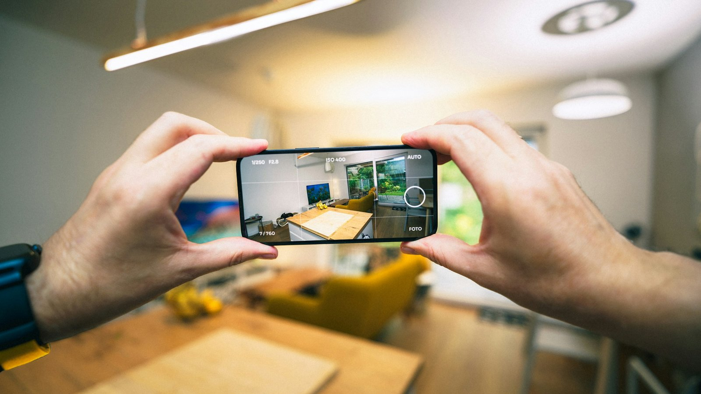

<!-- GENERATED from watch/issues/2024-01-18-ar-brand-closeness.yml by scripts/build_watch.py. Edit the data file. -->

```{=html}
<p class="mw-kicker">Marketing in 3 · <a href="../../2024/index.html">2024 in research</a> · No. 3 · Paper published 18 January 2024</p>
<figure class="mw-hero"><picture><source type="image/webp" sizes="(max-width: 900px) 100vw, 900px" srcset="../../images/web/2024-ar-brand-closeness-960.webp 960w, ../../images/web/2024-ar-brand-closeness-1600.webp 1600w"></picture><figcaption>Seen through a phone, a product can sit in your own living room. That nearness turns out to matter. Photo: Jakub Żerdzicki on Unsplash.</figcaption></figure>
<section class="mw-answer" aria-label="Short answer"><h2>The short answer</h2><div class="mw-ans-grid"><p>It can, by first making the brand feel near. In a German lab experiment, 155 students used a carmaker&#x27;s app with or without its AR view. The AR group sensed the brand nearer, and that sense went with more brand love. A second study, in which 173 women tried on makeup virtually, traced the same path, which ran strongest when the products looked real and the brand was already familiar.</p><div class="mw-ev" role="note" aria-label="Evidence level: 2 of 3 stars, several studies"><span class="ev-k">Evidence level</span><ol><li><span class="ev-s" aria-hidden="true"><b>★</b><i>★</i><i>★</i></span>One study</li><li class="on"><span class="ev-s" aria-hidden="true"><b>★</b><b>★</b><i>★</i></span>Several studies</li><li><span class="ev-s" aria-hidden="true"><b>★</b><b>★</b><b>★</b></span>Meta-analysis</li></ol></div></div></section>
<section class="mw-takeaways"><h2>Key takeaways</h2><ul><li>Switching on the AR view, and changing nothing else in the app, raised how near the brand seemed: a standardised effect of 0.24.</li><li>When everyone used AR, how real the virtual makeup looked was strongly tied to closeness, with a standardised weight of 0.50.</li><li>Knowing the brand did not bring it closer by itself, but it made a convincing AR effect count for more (interaction p = 0.007).</li><li>Love for the brand recorded weeks earlier strongly predicted love afterwards (0.56), yet closeness during the session still added its own push.</li></ul></section>
<section id="what-the-researchers-did"><h2>What the researchers did</h2><p><a class="mw-orcid-link" href="https://orcid.org/0000-0003-2188-6747" title="Philipp A. Rauschnabel on ORCID">Philipp A. Rauschnabel</a> of the Universität der Bundeswehr München and Otto-Friedrich-Universität Bamberg, Verena
Hüttl-Maack of the University of Hohenheim in Stuttgart, <a class="mw-orcid-link" href="https://orcid.org/0000-0002-1796-3933" title="Aaron C. Ahuvia on ORCID">Aaron C. Ahuvia</a> of the University of Michigan-Dearborn and
<a class="mw-orcid-link" href="https://orcid.org/0000-0002-7109-0176" title="Katrin E. Schein on ORCID">Katrin E. Schein</a> of Reutlingen University set out to test a bolder claim for AR than most marketing research had made.
Earlier work showed that AR can lift how much people like a brand. This team asked whether it can help people love one.</p><p>Their reasoning starts with everyday speech. We call a friend close and a cold relationship distant, borrowing words
for space to describe feelings. AR does something a showroom photo cannot: it puts a virtual car on your own driveway
or a shade of lipstick on your own face. The team expected that physical nearness to spill over into the emotional
kind, which sits at the heart of what brand love captures.</p><p>They ran two studies in Germany. In the first, students came to a campus lab and used a carmaker&#x27;s app on an iPad,
either with the AR view that placed the car in the room around them or with the same car on a plain background. In the
second, women tried makeup virtually on their own faces with a beauty retailer&#x27;s app. Here everyone used AR, and each
person rated how real it felt.</p>
<dl class="mw-facts"><div><dt>Study 1</dt><dd>155 students at a German university, randomly split: 76 used the app with AR on, 79 without it</dd></div><div><dt>Study 1 app</dt><dd>The Mercedes cAR app; both versions offered identical cars and tools, and only the backdrop differed</dd></div><div><dt>Study 2</dt><dd>173 female students in Germany, average age 24, data collected in 2019</dd></div><div><dt>Study 2 app</dt><dd>Sephora&#x27;s makeup app with virtual try-on, used on a tablet in the lab for as long as each person wished</dd></div><div><dt>Timing</dt><dd>Brand love asked online first, then again after the lab session, 18 days later on average</dd></div><div><dt>Measured</dt><dd>How physically close the brand felt, brand love on a six-item scale, how real the AR felt, and brand familiarity</dd></div><div><dt>Analysis</dt><dd>Structural equation models, with bootstrapped tests of the indirect route through closeness</dd></div></dl>
</section>
<section id="does-switching-ar-on-bring-the-brand-closer"><h2>Does switching AR on bring the brand closer?</h2><p>Yes. People who saw the car standing in the room said the brand had felt nearer during the session than those who
saw it on a plain screen. Those who felt it near also reported warmer feelings towards it. Once nearness was counted,
the AR view added nothing to brand love directly; its contribution travelled through that sense of nearness, and a
bootstrapped test confirmed the indirect route.</p><p>The design is what makes this convincing. Plenty of AR studies pit an AR app against a website that differs in layout,
content and much else, so it is hard to say what caused any gap. This app let users switch the camera view on or off
while everything else stayed put, which isolates the AR itself.</p>
</section>
<section id="realism-is-what-does-the-work"><h2>Realism is what does the work</h2><p>The makeup study asked a sharper question. Everyone had AR, so the difference lay in how convincing it felt: whether
the products seemed to sit on the skin or looked like a sticker laid over a screen. The team calls this local presence.
Women who found the effect more convincing rated the brand as nearer, and nearness again went hand in hand with love.</p><p>Then came a stricter test. Someone who already adores a brand might simply feel nearer to it, which would turn the
story upside down. Because brand love had been recorded before the session, the team could hold it constant. Closeness
still predicted love afterwards, with a smaller weight but a clear one. Refitting the model with other controls and
other estimation methods left the conclusion unchanged.</p>
<figure class="mw-chart" id="chart-closeness"><figcaption class="mw-chart-title">How strongly feeling close predicted brand love (standardised weight; 0 means no link)</figcaption><div class="mw-chart-svg"><svg viewBox="0 0 685 154" role="img" aria-labelledby="chart-closeness-t" font-family="Hanken Grotesk, Arial, sans-serif"><title id="chart-closeness-t">How strongly feeling close predicted brand love (standardised weight; 0 means no link)</title><line x1="255.0" y1="4" x2="255.0" y2="128" stroke="#dde1e8" stroke-width="1"/><text x="255.0" y="146" font-size="12" text-anchor="middle" fill="#5b6476">0</text><line x1="315.0" y1="4" x2="315.0" y2="128" stroke="#dde1e8" stroke-width="1"/><text x="315.0" y="146" font-size="12" text-anchor="middle" fill="#5b6476">0.1</text><line x1="375.0" y1="4" x2="375.0" y2="128" stroke="#dde1e8" stroke-width="1"/><text x="375.0" y="146" font-size="12" text-anchor="middle" fill="#5b6476">0.2</text><line x1="435.0" y1="4" x2="435.0" y2="128" stroke="#dde1e8" stroke-width="1"/><text x="435.0" y="146" font-size="12" text-anchor="middle" fill="#5b6476">0.3</text><line x1="495.0" y1="4" x2="495.0" y2="128" stroke="#dde1e8" stroke-width="1"/><text x="495.0" y="146" font-size="12" text-anchor="middle" fill="#5b6476">0.4</text><line x1="555.0" y1="4" x2="555.0" y2="128" stroke="#dde1e8" stroke-width="1"/><text x="555.0" y="146" font-size="12" text-anchor="middle" fill="#5b6476">0.5</text><line x1="615.0" y1="4" x2="615.0" y2="128" stroke="#dde1e8" stroke-width="1"/><text x="615.0" y="146" font-size="12" text-anchor="middle" fill="#5b6476">0.6</text><g><title>Car app, AR on or off: 0.351 </title><text x="243" y="27" font-size="13.5" text-anchor="end" fill="#15203b">Car app, AR on or off</text><rect x="255" y="12" width="210.6" height="22" rx="4" fill="#aab3c5"/><text x="473.6" y="28" font-size="13.5" fill="#15203b">0.351</text></g><g><title>Makeup app: 0.485 </title><text x="243" y="67" font-size="13.5" text-anchor="end" fill="#15203b">Makeup app</text><rect x="255" y="52" width="291.0" height="22" rx="4" fill="#aab3c5"/><text x="554.0" y="68" font-size="13.5" fill="#15203b">0.485</text></g><g><title>Makeup app, prior love controlled: 0.314 </title><text x="243" y="107" font-size="13.5" text-anchor="end" fill="#15203b" font-weight="600">Makeup app, prior love controlled</text><rect x="255" y="92" width="188.4" height="22" rx="4" fill="#e0a12a"/><text x="451.4" y="108" font-size="13.5" fill="#15203b" font-weight="600">0.314</text></g></svg></div><div class="mw-sr"><table><caption>How strongly feeling close predicted brand love (standardised weight; 0 means no link)</caption><tr><th>Group</th><th>Value ()</th></tr><tr><th scope="row">Car app, AR on or off</th><td>0.351</td></tr><tr><th scope="row">Makeup app</th><td>0.485</td></tr><tr><th scope="row">Makeup app, prior love controlled</th><td>0.314</td></tr></table></div><p class="mw-chart-src">Study 1, 155 students, and Study 2, 173 women; standardised paths from the published models, all reliable at p ≤ 0.01. The third allows for brand love recorded before the session.</p></figure>
</section>
<section id="familiarity-decides-how-far-ar-can-go"><h2>Familiarity decides how far AR can go</h2><p>Knowing the brand turned out to matter in an unexpected way. In the makeup study, familiarity was tightly bound up with
brand love but hardly related to how close the brand felt. Its role was to amplify: among women who knew the brand
well, a realistic try-on pulled it nearer than the same experience did among women who barely knew it.</p><p>Why would that be? The team gives two reasons. People are comfortable letting the familiar come close, while the unfamiliar
feels riskier and is kept at arm&#x27;s length. And existing knowledge gives the virtual experience more meaning, so it
sticks. Their practical conclusion is that if AR is meant to deepen relationships, a basic level of familiarity should
come first.</p>
<figure class="mw-chart" id="chart-links"><figcaption class="mw-chart-title">How the makeup study&#x27;s measures moved together (correlation; 0 means no link)</figcaption><div class="mw-chart-svg"><svg viewBox="0 0 680 194" role="img" aria-labelledby="chart-links-t" font-family="Hanken Grotesk, Arial, sans-serif"><title id="chart-links-t">How the makeup study&#x27;s measures moved together (correlation; 0 means no link)</title><line x1="250.0" y1="4" x2="250.0" y2="168" stroke="#dde1e8" stroke-width="1"/><text x="250.0" y="186" font-size="12" text-anchor="middle" fill="#5b6476">0</text><line x1="310.0" y1="4" x2="310.0" y2="168" stroke="#dde1e8" stroke-width="1"/><text x="310.0" y="186" font-size="12" text-anchor="middle" fill="#5b6476">0.1</text><line x1="370.0" y1="4" x2="370.0" y2="168" stroke="#dde1e8" stroke-width="1"/><text x="370.0" y="186" font-size="12" text-anchor="middle" fill="#5b6476">0.2</text><line x1="430.0" y1="4" x2="430.0" y2="168" stroke="#dde1e8" stroke-width="1"/><text x="430.0" y="186" font-size="12" text-anchor="middle" fill="#5b6476">0.3</text><line x1="490.0" y1="4" x2="490.0" y2="168" stroke="#dde1e8" stroke-width="1"/><text x="490.0" y="186" font-size="12" text-anchor="middle" fill="#5b6476">0.4</text><line x1="550.0" y1="4" x2="550.0" y2="168" stroke="#dde1e8" stroke-width="1"/><text x="550.0" y="186" font-size="12" text-anchor="middle" fill="#5b6476">0.5</text><line x1="610.0" y1="4" x2="610.0" y2="168" stroke="#dde1e8" stroke-width="1"/><text x="610.0" y="186" font-size="12" text-anchor="middle" fill="#5b6476">0.6</text><g><title>Familiarity and brand love: 0.54 </title><text x="238" y="27" font-size="13.5" text-anchor="end" fill="#15203b">Familiarity and brand love</text><rect x="250" y="12" width="324.0" height="22" rx="4" fill="#aab3c5"/><text x="582.0" y="28" font-size="13.5" fill="#15203b">0.54</text></g><g><title>Closeness and brand love: 0.48 </title><text x="238" y="67" font-size="13.5" text-anchor="end" fill="#15203b" font-weight="600">Closeness and brand love</text><rect x="250" y="52" width="288.0" height="22" rx="4" fill="#e0a12a"/><text x="546.0" y="68" font-size="13.5" fill="#15203b" font-weight="600">0.48</text></g><g><title>Realism and brand love: 0.31 </title><text x="238" y="107" font-size="13.5" text-anchor="end" fill="#15203b">Realism and brand love</text><rect x="250" y="92" width="186.0" height="22" rx="4" fill="#aab3c5"/><text x="444.0" y="108" font-size="13.5" fill="#15203b">0.31</text></g><g><title>Familiarity and closeness: 0.09 </title><text x="238" y="147" font-size="13.5" text-anchor="end" fill="#15203b">Familiarity and closeness</text><rect x="250" y="132" width="54.0" height="22" rx="4" fill="#aab3c5"/><text x="312.0" y="148" font-size="13.5" fill="#15203b">0.09</text></g></svg></div><div class="mw-sr"><table><caption>How the makeup study&#x27;s measures moved together (correlation; 0 means no link)</caption><tr><th>Group</th><th>Value ()</th></tr><tr><th scope="row">Familiarity and brand love</th><td>0.54</td></tr><tr><th scope="row">Closeness and brand love</th><td>0.48</td></tr><tr><th scope="row">Realism and brand love</th><td>0.31</td></tr><tr><th scope="row">Familiarity and closeness</th><td>0.09</td></tr></table></div><p class="mw-chart-src">Study 2, makeup try-on, 173 participants; correlations as reported in the paper&#x27;s appendix.</p></figure>
</section>
<section id="a-shaky-ar-view-may-let-the-brand-down"><h2>A shaky AR view may let the brand down</h2><p>Because realism drove the effect, the authors argue that AR which looks fake can disappoint and even harm a brand. They
urge managers to chase the most convincing experience they can build, with current development tools and good
tracking, and they float the idea of limiting AR features to newer phones with depth sensors such as lidar. That
shrinks reach and may leave some customers feeling shut out, a cost they acknowledge.</p><p>Two cautions sit beside that advice. The makeup study had no group without AR, so it shows that more realism came
with more closeness, not that clumsy AR left people worse off than plain photos would have. And a footnote concedes
that a deliberately simple overlay can be the right choice for jobs such as navigation or work instructions, where
building affection is not the aim.</p>
</section>
<section id="how-to-apply-it" class="mw-howto"><p class="mw-rsg-kicker">Marketing in 3 steps</p><h2>Ready. Set. Market.</h2><div class="mw-rsg"><div class="mw-phase"><div class="mw-phase-dot" aria-hidden="true">1</div><div class="mw-phase-tag"><span class="mw-phase-name">Ready</span><span class="mw-phase-sub">Decide and prepare</span></div><ul class="mw-rsg-steps"><li><strong>Choose the product that gains from being in the room.</strong> List the three to five products your customers most want to see at real size, at home or on themselves. Start with the one that looks best placed in a real room or on a real face.</li><li><strong>Aim it first at people who know you.</strong> Launch the AR feature to existing customers, app users and newsletter readers before cold audiences. Put the link where they already are: in your app, your emails and your product pages.</li></ul></div><div class="mw-phase"><div class="mw-phase-dot" aria-hidden="true">2</div><div class="mw-phase-tag"><span class="mw-phase-name">Set</span><span class="mw-phase-sub">Build it</span></div><ul class="mw-rsg-steps"><li><strong>Make realism the first job.</strong> Spend the budget on true-to-life size, light, shadow and steady tracking before adding features. Try it on five phones, two of them older models, and fix anything that floats, flickers or looks pasted on.</li><li><strong>Put the product within arm&#x27;s reach.</strong> Set the default view so the item lands right beside the person: on the table, in the driveway, on the face. Let people walk around it, turn it and leave it in place.</li></ul></div><div class="mw-phase"><div class="mw-phase-dot" aria-hidden="true">3</div><div class="mw-phase-tag"><span class="mw-phase-name">Market</span><span class="mw-phase-sub">Launch and measure</span></div><ul class="mw-rsg-steps"><li><strong>Send weak phones somewhere else.</strong> Check each visitor&#x27;s device before opening the AR view. If the phone cannot run it smoothly, show a good photo set or a short video instead, and count how many people take that route each week.</li><li><strong>Measure attachment, not just taps.</strong> Ask three short questions straight after an AR session and again a month later. How close does the brand feel? How strongly do they feel for it? Would they be sorry to see it go? Compare the answers with people who only saw photos.</li></ul></div></div></section>
<div class="mw-coffee" role="complementary" aria-label="Support Marketing in 3"><div class="mw-coffee-text"><p class="mw-coffee-title">Found this useful?</p><p>Marketing in 3 is free and ad-free, with new issues every Monday and Thursday. A coffee keeps it that way.</p></div><a class="mw-coffee-btn" href="https://ko-fi.com/marketingin3" target="_blank" rel="noopener"><svg aria-hidden="true" focusable="false"
  class="lucide lucide-coffee"
  xmlns="http://www.w3.org/2000/svg"
  width="24"
  height="24"
  viewBox="0 0 24 24"
  fill="none"
  stroke="currentColor"
  stroke-width="2"
  stroke-linecap="round"
  stroke-linejoin="round"
>
  <path d="M10 2v2" />
  <path d="M14 2v2" />
  <path d="M16 8a1 1 0 0 1 1 1v8a4 4 0 0 1-4 4H7a4 4 0 0 1-4-4V9a1 1 0 0 1 1-1h14a4 4 0 1 1 0 8h-1" />
  <path d="M6 2v2" />
</svg><span>Buy me a coffee</span><span class="mw-coffee-price">€3</span></a></div>
<form class="mw-email mw-email-inline" action="https://qewbdm3gpjxh42mawu5n6ac37m0hlcgm.lambda-url.ap-southeast-2.on.aws/subscribe" method="post"><div class="mw-email-text"><p class="mw-email-title">Get it by email</p><p>New issues every Monday and Thursday, in your inbox. Free, no ads, unsubscribe anytime.</p></div><div class="mw-email-row"><label class="visually-hidden" for="m3-email-inline">Email address</label><input id="m3-email-inline" type="email" name="email" required autocomplete="email" inputmode="email" placeholder="you@example.com" maxlength="254"><input class="mw-hp" type="text" name="website" tabindex="-1" autocomplete="off" aria-hidden="true"><input type="hidden" name="source" value=""><button type="submit">Subscribe</button></div><p class="mw-email-status" role="status" aria-live="polite"></p><p class="mw-email-note">Your address is used only to send Marketing in 3. You will get one email to confirm.</p></form><script>(function(){if(window.m3Email)return;window.m3Email=1;
var M={"check": "Almost done. Check your inbox for an email from issues@marketingin3.com and tap the link to confirm.", "invalid": "That email address does not look right. Please check it and try again.", "slow": "Too many tries in a short time. Please wait a few minutes and try again.", "busy": "Too many tries in a short time. Please wait a few minutes and try again.", "error": "Something went wrong. Please try again in a moment.", "undeliverable": "That address cannot receive email from us. Please try another one.", "confirming": "Confirming your subscription…", "ok": "You are subscribed. The next issue arrives in your inbox on Monday or Thursday, whichever comes first.", "expired": "This confirmation link has expired or was already used. Enter your address again for a fresh one."};
function ep(f){return f.getAttribute('action').replace(/\/subscribe$/,'');}
function say(f,k){var s=f.querySelector('.mw-email-status');if(!s)return;s.textContent=M[k]||M.error;
s.className='mw-email-status is-'+(k==='ok'||k==='check'?'ok':(k==='confirming'?'wait':'bad'));}
function gc(e){try{if(window.mwTrack)window.mwTrack(e);}catch(x){}try{if(window.goatcounter&&goatcounter.count)goatcounter.count({path:e,title:e,event:true});}catch(x){}}
document.querySelectorAll('form.mw-email').forEach(function(f){
var src=f.querySelector('input[name=source]');if(src)src.value=location.pathname;
f.addEventListener('submit',function(e){if(!window.fetch)return;e.preventDefault();
var b=f.querySelector('button');b.disabled=true;
var data={email:f.email.value,website:f.website.value,source:location.pathname};
fetch(f.getAttribute('action'),{method:'POST',headers:{'content-type':'application/json'},body:JSON.stringify(data)})
.then(function(r){return r.json().catch(function(){return {status:'error'};});})
.then(function(j){say(f,j.status);if(j.status==='check'){f.classList.add('is-done');gc('email-subscribe');}})
.catch(function(){say(f,'error');}).then(function(){b.disabled=false;});});});
var q=new URLSearchParams(location.search),f=document.querySelector('form.mw-email');if(!f)return;
['check','invalid','slow','error'].forEach(function(k){if(q.get(k))say(f,k);});
var t=q.get('t');if(t){say(f,'confirming');
fetch(ep(f)+'/confirm',{method:'POST',headers:{'content-type':'application/json'},body:JSON.stringify({t:t})})
.then(function(r){return r.json().catch(function(){return {status:'error'};});})
.then(function(j){say(f,j.status);if(j.status==='ok'){f.classList.add('is-done');gc('email-confirmed');}
if(history.replaceState)history.replaceState(null,'',location.pathname+'#email');})
.catch(function(){say(f,'error');});}
})();</script>
<section id="what-to-expect"><h2>What to expect</h2><ul class="mw-list"><li><strong>A few minutes can be enough.</strong> Most people in the car study spent only two to four minutes with the app before answering. Long, elaborate sessions are not a precondition.</li><li><strong>Love pays off slowly.</strong> Earlier research ties brand love to loyalty, word of mouth, forgiveness and a willingness to pay more. Look for AR&#x27;s return in those slower measures rather than in this week&#x27;s sales.</li><li><strong>Younger, keener users may respond most.</strong> Even among students in their twenties, the older ones felt the car brand less close. The authors note that less tech-savvy customers may respond differently.</li><li><strong>Realism has a price.</strong> Lifelike 3D models, lighting and tracking cost more than a quick overlay. On our reading of the results, that is where most of an AR budget belongs.</li></ul></section>
<section id="where-it-does-not-work"><h2>Where it does not work</h2><ul class="mw-list"><li><strong>Young students in one country.</strong> Both samples were German university students; the car study was 77% men and the makeup study was all women.</li><li><strong>Two brands, one year.</strong> A famous carmaker and a beauty retailer, with data gathered in 2019. Lesser-known brands, other categories and audiences now used to daily AR filters may react differently.</li><li><strong>Realism was rated, not varied.</strong> In the makeup study people judged realism themselves, so it shows a link rather than proof that better rendering creates closeness.</li><li><strong>Feelings, not purchases.</strong> Nobody&#x27;s visits, purchases or spending were tracked; the outcomes are what people reported about the brand.</li><li><strong>Phones and tablets only.</strong> Smart glasses, headsets and virtual mirrors in stores were not tested.</li></ul></section>
<section id="questions"><h2>Questions marketers ask</h2><div class="mw-faq"><h3>Does augmented reality make consumers love a brand more?</h3><p>It can. Seeing a product placed in their own surroundings left people sensing the brand close by, which in turn predicted stronger brand love, both in a car app test and in a makeup try-on study (Rauschnabel et al., 2024).</p></div><div class="mw-faq"><h3>What is local presence in AR?</h3><p>It is how convincingly a virtual object seems to be really there in your surroundings. A flat label floating over the camera image scores low; a lipstick shade that looks as though it is on your lips scores high. It differs from distance: an object can be near you yet unconvincing.</p></div><div class="mw-faq"><h3>Why would a brand feeling near make people love it?</h3><p>People tend to bond with whoever is physically around them, such as neighbours or colleagues down the corridor, and the mind readily treats physical nearness as emotional nearness. Bringing a brand into someone&#x27;s own space taps both habits.</p></div><div class="mw-faq"><h3>Should little-known brands use AR?</h3><p>They need not avoid it. The love-building effect was stronger among people who knew the brand, but AR can also serve goals such as awareness or sales that this research did not measure. A niche brand may be well known to the small group it sells to, and business brands can use AR at trade fairs or in sales meetings.</p></div></section>
<section id="also-new"><h2>Also new at the time</h2><div class="mw-also"><article><p class="mw-also-src"><em>European Journal of Marketing</em> · 2024</p><h3><a href="https://doi.org/10.1108/ejm-03-2022-0172">The effect of sponsored video customization on video shares: the critical moderating role of influencer and brand characteristics</a></h3><p class="mw-also-au">Chen et al.</p><p>Coding 365 real sponsored videos, this team rated how far each one was tailored to its sponsor and counted how often viewers passed it on. Heavily tailored videos were shared more when the brand was long established or the product a considered purchase. The same tailoring cost shares when the creator was a mega influencer or a recognised expert, whose audiences seem to read a made-to-order video as a sales pitch. The bigger the creator&#x27;s name, the lighter the sponsor&#x27;s touch may need to be.</p></article><article><p class="mw-also-src"><em>Journal of Public Policy &amp; Marketing</em> · 2024</p><h3><a href="https://doi.org/10.1177/07439156231224731">The “Dark Side” of General Health and Fitness-Related Self-Service Technologies: A Systematic Review of the Literature and Directions for Future Research</a></h3><p class="mw-also-au">Chen et al.</p><p>Fitness apps and activity trackers are sold as aids to wellbeing, and this review gathers 65 studies on what can go wrong for the people wearing them. Goal reminders, harsh feedback, leaderboards and pictures of idealised bodies were linked to guilt, stress, disordered eating and social withdrawal among some users. The authors sketch a framework in which these design features spark emotional reactions that can grow into real harm, depending on why and how intensely someone uses the app. The nudge that keeps most users engaged can push a vulnerable few too far, which is worth weighing before the next engagement feature ships.</p></article></div></section>
<section id="source" class="mw-source"><h2>Source</h2><p class="mw-cite">Rauschnabel, P. A., Hüttl-Maack, V., Ahuvia, A. C., &amp; Schein, K. E. (2024). Augmented reality marketing and consumer‒brand relationships: How closeness drives brand love. <em>Psychology &amp; Marketing</em>, <em>41</em>(4), 819-837. <a href="https://doi.org/10.1002/mar.21953">https://doi.org/10.1002/mar.21953</a></p><p class="mw-note">This brief is written for practitioners from the published article. Open access (CC BY 4.0): free to read at the publisher. Numbers are as reported by the authors; read the article for full methods.</p></section>

<section id="keep-reading" class="mw-more"><h2>Keep reading</h2><p class="mw-more-topics">More issues on <a href="../../topics/retail.html">Retail</a> · <a href="../../topics/advertising.html">Advertising</a></p><div class="watch-list"><article class="watch-item"><a class="watch-thumb" href="../../posts/prospecting-retargeting/index.html" tabindex="-1" aria-hidden="true"></a><div><p class="watch-meta">Issue 24 · <time datetime="2026-06-22">Week of 22 June 2026</time></p><h3><a href="../../posts/prospecting-retargeting/index.html">The dashboard said 7.47. The experiment said nothing.</a></h3><p>Facebook reported a return of 7.47 on retargeting. A field experiment across 210 markets found the retargeting budget could be cut to zero without losing a single order.</p></div></article><article class="watch-item"><a class="watch-thumb" href="../../posts/returnless-partial-refunds/index.html" tabindex="-1" aria-hidden="true"></a><div><p class="watch-meta">Issue 44 · <time datetime="2026-11-02">Monday 2 November 2026</time></p><h3><a href="../../posts/returnless-partial-refunds/index.html">Keep it, get part back: returns that pay off later</a></h3><p>Fang et al. tested keep-it partial refunds on 853,521 online shoppers: the first return cost more, but later spending left a net gain of $1.44 per customer.</p></div></article><article class="watch-item"><a class="watch-thumb" href="../../posts/genai-creative-ideation/index.html" tabindex="-1" aria-hidden="true"></a><div><p class="watch-meta">Issue 42 · <time datetime="2026-10-26">Week of 26 October 2026</time></p><h3><a href="../../posts/genai-creative-ideation/index.html">Prompt training doubled the ideas, not the quality</a></h3><p>Milano et al. tested 98 advertising professionals: generative AI doubled the number of tagline ideas, but only after prompt training, and quality stayed flat.</p></div></article></div></section>
<div class="mw-author"><div><p><strong>Bruno Schivinski</strong> is Associate Professor of Marketing at Gdańsk University of Technology. He studies how consumers engage with brands in digital and social media.</p><p><a href="../../../index.html">About Bruno</a> · <a href="../../index.html">All Marketing in 3 issues</a> · <a href="../../subscribe.html">Subscribe</a></p></div></div>
<nav class="mw-pn" aria-label="More issues"><a class="mw-prev" href="../meme-brand-placement/index.html"><span>Previous issue</span>Why memes work better when the brand shows</a><a class="mw-next" href="../religion-city-branding/index.html"><span>Next issue</span>Faith wins likes for a city brand, not conversation</a></nav>
```
