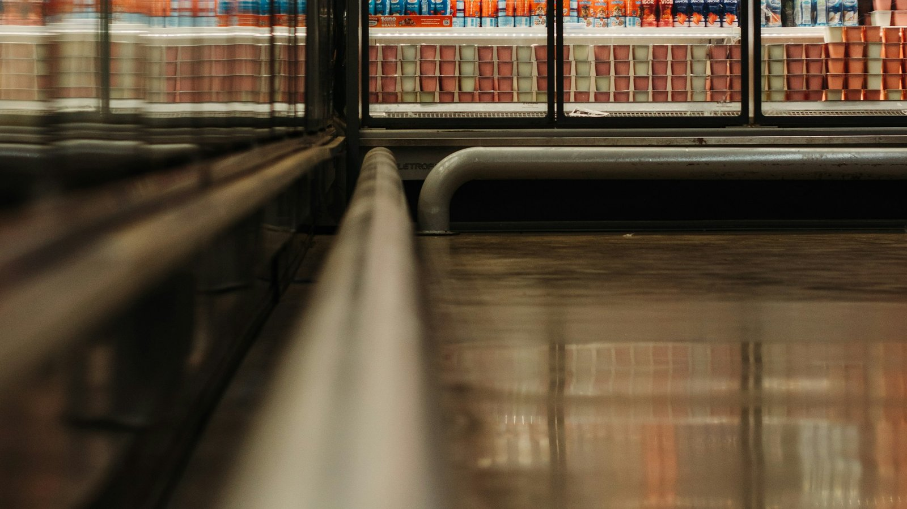

<!-- GENERATED from watch/issues/2026-04-27-autonomous-stores-prosocial.yml by scripts/build_watch.py. Edit the data file. -->

```{=html}
<p class="mw-kicker">Marketing in 3 · Issue 16 · Week of 27 April 2026</p>
<figure class="mw-hero"><picture><source type="image/webp" sizes="(max-width: 900px) 100vw, 900px" srcset="../../images/web/issue-16-autonomous-stores-prosocial-960.webp 960w, ../../images/web/issue-16-autonomous-stores-prosocial-1600.webp 1600w"></picture><figcaption>Everything you need, and nobody to talk to. Photo: Eduardo Soares on Unsplash.</figcaption></figure>
<section class="mw-answer" aria-label="Short answer"><h2>The short answer</h2><div class="mw-ans-grid"><p>Yes, a little, and it adds up. Across nine experiments in Singapore, the US, the UK and China, people who had just been in an AI-run store, hotel or restaurant gave less time and money to good causes than people served by staff. Outside two real convenience stores, shoppers from the staff-free one pledged about 40% fewer volunteer hours. The missing human contact left them feeling less connected to others. Shopping with family, explaining how the tech helps customers, and charity appeals that stress what the giver gets back all closed the gap.</p><div class="mw-ev" role="note" aria-label="Evidence level: 2 of 3 stars, several studies"><span class="ev-k">Evidence level</span><ol><li><span class="ev-s" aria-hidden="true"><b>★</b><i>★</i><i>★</i></span>One study</li><li class="on"><span class="ev-s" aria-hidden="true"><b>★</b><b>★</b><i>★</i></span>Several studies</li><li><span class="ev-s" aria-hidden="true"><b>★</b><b>★</b><b>★</b></span>Meta-analysis</li></ol></div></div></section>
<section class="mw-takeaways"><h2>Key takeaways</h2><ul><li>Shoppers didn&#x27;t see it coming: 76% said a staff-free store would make no difference to their willingness to donate.</li><li>Even a humanoid robot receptionist didn&#x27;t help: 45% agreed to do a longer, more useful hotel survey after meeting the robot, against 61% after meeting a person.</li><li>In a real autonomous store, one line saying the technology was there to make shopping easier lifted volunteer pledges from 0.28 to 0.59 hours a month.</li><li>A Red Cross appeal framed as &quot;benefits for you and your family&quot; worked as well after an AI store as after a staffed one.</li></ul></section>
<section id="what-the-researchers-did"><h2>What the researchers did</h2><p>Cashierless shops, robot hotel desks and smart-shelf supermarkets are spreading fast, and most studies of them
ask one thing: do customers like them? Usually they do. <a class="mw-orcid-link" href="https://orcid.org/0000-0003-3848-6061" title="Xiaoyan (Jenny) Liu on ORCID">Xiaoyan (Jenny) Liu</a> (Southwestern University of Finance
and Economics), <a class="mw-orcid-link" href="https://orcid.org/0000-0002-0223-8923" title="Chi Hoang on ORCID">Chi Hoang</a> (ESCP Business School) and <a class="mw-orcid-link" href="https://orcid.org/0000-0003-0883-0167" title="Sharon Ng on ORCID">Sharon Ng</a> (Nanyang Technological University) asked a
different question: what happens to people after they walk out?</p><p>Their focus was everyday kindness: writing a note to an orphan, volunteering a few hours, dropping money in a
charity tin. They ran nine experiments, three of them in real places, comparing an AI-run version of a store,
hotel or restaurant with the same place run by staff. Then they tested what brings generosity back.</p>
<dl class="mw-facts"><div><dt>Studies</dt><dd>Nine experiments, including field studies at two neighbouring convenience stores and a campus hotel in Singapore</dd></div><div><dt>People</dt><dd>About 3,200 participants across four countries</dd></div><div><dt>Settings</dt><dd>Grocery and convenience stores, a hotel with a humanoid robot, and a robot-staffed restaurant</dd></div><div><dt>Generosity measured by</dt><dd>Letters written, volunteer hours pledged, donation amounts and choosing a longer, more helpful survey</dd></div></dl>
</section>
<section id="fewer-people-less-giving"><h2>Fewer people, less giving</h2><p>The neatest test happened on a university campus in Singapore, where one retail brand runs two convenience
stores side by side, with the same layout and the same prices. One has staff; the other has none. Researchers
waited outside both and invited shoppers to sign up as student buddies. People coming out of the staffed shop
offered far more of their time, a gap that held after accounting for age, gender and shopping habits.</p><p>Online, the pattern repeated. Americans who imagined a trip to an AI-equipped grocery store wrote shorter
encouraging letters to children supported by a charity than those who imagined a staffed store or simply
recalled their last shop. A follow-up hotel study compared self-service check-in kiosks, a robot and a human
desk: both machine versions led to smaller donations, and the robot was no improvement on the kiosk.</p>
<figure class="mw-chart" id="chart-hours"><figcaption class="mw-chart-title">Volunteer hours pledged per month by shoppers leaving each store</figcaption><div class="mw-chart-svg"><svg viewBox="0 0 680 114" role="img" aria-labelledby="chart-hours-t" font-family="Hanken Grotesk, Arial, sans-serif"><title id="chart-hours-t">Volunteer hours pledged per month by shoppers leaving each store</title><line x1="250.0" y1="4" x2="250.0" y2="88" stroke="#dde1e8" stroke-width="1"/><text x="250.0" y="106" font-size="12" text-anchor="middle" fill="#5b6476">0</text><line x1="310.0" y1="4" x2="310.0" y2="88" stroke="#dde1e8" stroke-width="1"/><text x="310.0" y="106" font-size="12" text-anchor="middle" fill="#5b6476">0.5</text><line x1="370.0" y1="4" x2="370.0" y2="88" stroke="#dde1e8" stroke-width="1"/><text x="370.0" y="106" font-size="12" text-anchor="middle" fill="#5b6476">1</text><line x1="430.0" y1="4" x2="430.0" y2="88" stroke="#dde1e8" stroke-width="1"/><text x="430.0" y="106" font-size="12" text-anchor="middle" fill="#5b6476">1.5</text><line x1="490.0" y1="4" x2="490.0" y2="88" stroke="#dde1e8" stroke-width="1"/><text x="490.0" y="106" font-size="12" text-anchor="middle" fill="#5b6476">2</text><line x1="550.0" y1="4" x2="550.0" y2="88" stroke="#dde1e8" stroke-width="1"/><text x="550.0" y="106" font-size="12" text-anchor="middle" fill="#5b6476">2.5</text><line x1="610.0" y1="4" x2="610.0" y2="88" stroke="#dde1e8" stroke-width="1"/><text x="610.0" y="106" font-size="12" text-anchor="middle" fill="#5b6476">3</text><g><title>Staffed convenience store: 2.79 hours</title><text x="238" y="27" font-size="13.5" text-anchor="end" fill="#15203b">Staffed convenience store</text><rect x="250" y="12" width="334.8" height="22" rx="4" fill="#aab3c5"/><text x="592.8" y="28" font-size="13.5" fill="#15203b">2.79</text></g><g><title>Staff-free convenience store: 1.60 hours</title><text x="238" y="67" font-size="13.5" text-anchor="end" fill="#15203b" font-weight="600">Staff-free convenience store</text><rect x="250" y="52" width="192.0" height="22" rx="4" fill="#e0a12a"/><text x="450.0" y="68" font-size="13.5" fill="#15203b" font-weight="600">1.60</text></g></svg></div><div class="mw-sr"><table><caption>Volunteer hours pledged per month by shoppers leaving each store</caption><tr><th>Group</th><th>Value (hours)</th></tr><tr><th scope="row">Staffed convenience store</th><td>2.79</td></tr><tr><th scope="row">Staff-free convenience store</th><td>1.6</td></tr></table></div><p class="mw-chart-src">Study 1b: 131 shoppers approached outside two neighbouring stores of one brand in Singapore.</p></figure>
</section>
<section id="why-the-missing-small-talk"><h2>Why: the missing small talk</h2><p>A quick hello at the till seems trivial, but it reminds us we&#x27;re part of a community. In a UK study, people who
pictured an autonomous grocery store felt far less connected to others (2.83 against 4.64, out of 7),
and were less keen to buy a £1 felt flower made by orphans for charity. That loss of connection, not a sense of
threat from the technology, explained the drop.</p><p>Two checks back this up. When participants were first nudged to think about how much they rely on other people,
a robot-run restaurant no longer dented their wish to volunteer for the Salvation Army. And people didn&#x27;t simply
dislike the automated stores: they often rated them as highly as, or higher than, the staffed ones.</p>
</section>
<section id="three-ways-to-win-the-warmth-back"><h2>Three ways to win the warmth back</h2><p><strong>Shop together.</strong> Chinese participants who pictured shopping alone in an AI store were less willing to
volunteer with older neighbours (7.08 against 7.69, out of 9). Picture the same trip with family, and
the gap disappeared.</p><p><strong>Say who the technology is for.</strong> Back at the Singapore stores, some shoppers in the autonomous shop saw a short
message, adapted from the retailer&#x27;s own press release, saying the system was introduced to make shopping faster
and easier for customers. Their volunteer pledges climbed back to the level of the staffed store. A UK replication
with donations in pounds showed the same thing.</p><p><strong>Ask donors what&#x27;s in it for them.</strong> A charity appeal stressing benefits to the whole community lost ground after
an AI store visit (6.79 against 7.39 out of 9). The same first-aid-kit project, pitched as protecting &quot;you and
your family&quot;, did not.</p>
<figure class="mw-chart" id="chart-framing"><figcaption class="mw-chart-title">Amount people would donate to feed low-income families, by store (UK)</figcaption><div class="mw-chart-svg"><svg viewBox="0 0 713 154" role="img" aria-labelledby="chart-framing-t" font-family="Hanken Grotesk, Arial, sans-serif"><title id="chart-framing-t">Amount people would donate to feed low-income families, by store (UK)</title><line x1="283.0" y1="4" x2="283.0" y2="128" stroke="#dde1e8" stroke-width="1"/><text x="283.0" y="146" font-size="12" text-anchor="middle" fill="#5b6476">0</text><line x1="373.0" y1="4" x2="373.0" y2="128" stroke="#dde1e8" stroke-width="1"/><text x="373.0" y="146" font-size="12" text-anchor="middle" fill="#5b6476">1</text><line x1="463.0" y1="4" x2="463.0" y2="128" stroke="#dde1e8" stroke-width="1"/><text x="463.0" y="146" font-size="12" text-anchor="middle" fill="#5b6476">2</text><line x1="553.0" y1="4" x2="553.0" y2="128" stroke="#dde1e8" stroke-width="1"/><text x="553.0" y="146" font-size="12" text-anchor="middle" fill="#5b6476">3</text><line x1="643.0" y1="4" x2="643.0" y2="128" stroke="#dde1e8" stroke-width="1"/><text x="643.0" y="146" font-size="12" text-anchor="middle" fill="#5b6476">4</text><g><title>Staffed store: 3.05 pounds</title><text x="271" y="27" font-size="13.5" text-anchor="end" fill="#15203b">Staffed store</text><rect x="283" y="12" width="274.5" height="22" rx="4" fill="#aab3c5"/><text x="565.5" y="28" font-size="13.5" fill="#15203b">3.05</text></g><g><title>AI store, no explanation: 1.88 pounds</title><text x="271" y="67" font-size="13.5" text-anchor="end" fill="#15203b" font-weight="600">AI store, no explanation</text><rect x="283" y="52" width="169.2" height="22" rx="4" fill="#e0a12a"/><text x="460.2" y="68" font-size="13.5" fill="#15203b" font-weight="600">1.88</text></g><g><title>AI store, framed as helping customers: 2.69 pounds</title><text x="271" y="107" font-size="13.5" text-anchor="end" fill="#15203b">AI store, framed as helping customers</text><rect x="283" y="92" width="242.1" height="22" rx="4" fill="#aab3c5"/><text x="533.1" y="108" font-size="13.5" fill="#15203b">2.69</text></g></svg></div><div class="mw-sr"><table><caption>Amount people would donate to feed low-income families, by store (UK)</caption><tr><th>Group</th><th>Value (pounds)</th></tr><tr><th scope="row">Staffed store</th><td>3.05</td></tr><tr><th scope="row">AI store, no explanation</th><td>1.88</td></tr><tr><th scope="row">AI store, framed as helping customers</th><td>2.69</td></tr></table></div><p class="mw-chart-src">Study 5b: 451 UK adults, donations of £0 to £10 after imagining a shopping trip.</p></figure>
</section>
<section id="far-from-the-checkout"><h2>Far from the checkout</h2><p>The authors studied shops, a hotel and a restaurant, but the same trade-off shows up anywhere a person has been
replaced by a screen. Taking our own step past the data: app-only banks, contactless hotel stays, parcel lockers,
chatbot-only customer service and self-checkout lanes all remove the small human moments this study points to.</p><p>That matters for more than charity tins. Brands that run cause campaigns, round-up-at-the-till schemes or
community programmes through automated channels may be asking for generosity at exactly the moment people feel
least connected. And for retailers who sell themselves as &quot;part of the neighbourhood&quot;, the human touch may be
doing more work than the efficiency case suggests.</p>
</section>
<section id="how-to-apply-it" class="mw-howto"><p class="mw-rsg-kicker">Marketing in 3 steps</p><h2>Ready. Set. Market.</h2><div class="mw-rsg"><div class="mw-phase"><div class="mw-phase-dot" aria-hidden="true">1</div><div class="mw-phase-tag"><span class="mw-phase-name">Ready</span><span class="mw-phase-sub">Decide and prepare</span></div><ul class="mw-rsg-steps"><li><strong>Map the human moments you are removing.</strong> List every point where a customer used to talk to a person, from greeting to payment to help, and note which ones automation will take away.</li><li><strong>Keep one light human touch.</strong> Decide which single contact point stays human, such as a host at the door or a staff member on the floor. The authors point to Booths, a British grocer that brought human cashiers back.</li></ul></div><div class="mw-phase"><div class="mw-phase-dot" aria-hidden="true">2</div><div class="mw-phase-tag"><span class="mw-phase-name">Set</span><span class="mw-phase-sub">Build it</span></div><ul class="mw-rsg-steps"><li><strong>Design for shopping together.</strong> Make autonomous formats friendlier to groups and families with shared baskets, group offers or seating, so customers bring their own connection with them.</li><li><strong>Explain the tech in customer terms.</strong> On signs, apps and receipts, say how the system helps shoppers: open late, no queues, quicker in and out. Avoid language about cost savings or efficiency.</li></ul></div><div class="mw-phase"><div class="mw-phase-dot" aria-hidden="true">3</div><div class="mw-phase-tag"><span class="mw-phase-name">Market</span><span class="mw-phase-sub">Launch and measure</span></div><ul class="mw-rsg-steps"><li><strong>Rewrite appeals near automated touchpoints.</strong> If you run donation prompts, round-ups or charity partnerships in self-service channels, lead with what the giver gains, such as feeling good or protecting their own family.</li><li><strong>Measure giving, not just satisfaction.</strong> Track charity round-ups, volunteer sign-ups or community participation before and after automating, next to your usual customer metrics.</li></ul></div></div></section>
<div class="mw-coffee" role="complementary" aria-label="Support Marketing in 3"><div class="mw-coffee-text"><p class="mw-coffee-title">Found this useful?</p><p>Marketing in 3 is free and ad-free, with new issues every Monday and Thursday. A coffee keeps it that way.</p></div><a class="mw-coffee-btn" href="https://ko-fi.com/marketingin3" target="_blank" rel="noopener"><svg aria-hidden="true" focusable="false"
  class="lucide lucide-coffee"
  xmlns="http://www.w3.org/2000/svg"
  width="24"
  height="24"
  viewBox="0 0 24 24"
  fill="none"
  stroke="currentColor"
  stroke-width="2"
  stroke-linecap="round"
  stroke-linejoin="round"
>
  <path d="M10 2v2" />
  <path d="M14 2v2" />
  <path d="M16 8a1 1 0 0 1 1 1v8a4 4 0 0 1-4 4H7a4 4 0 0 1-4-4V9a1 1 0 0 1 1-1h14a4 4 0 1 1 0 8h-1" />
  <path d="M6 2v2" />
</svg><span>Buy me a coffee</span><span class="mw-coffee-price">€3</span></a></div>
<form class="mw-email mw-email-inline" action="https://qewbdm3gpjxh42mawu5n6ac37m0hlcgm.lambda-url.ap-southeast-2.on.aws/subscribe" method="post"><div class="mw-email-text"><p class="mw-email-title">Get it by email</p><p>New issues every Monday and Thursday, in your inbox. Free, no ads, unsubscribe anytime.</p></div><div class="mw-email-row"><label class="visually-hidden" for="m3-email-inline">Email address</label><input id="m3-email-inline" type="email" name="email" required autocomplete="email" inputmode="email" placeholder="you@example.com" maxlength="254"><input class="mw-hp" type="text" name="website" tabindex="-1" autocomplete="off" aria-hidden="true"><input type="hidden" name="source" value=""><button type="submit">Subscribe</button></div><p class="mw-email-status" role="status" aria-live="polite"></p><p class="mw-email-note">Your address is used only to send Marketing in 3. You will get one email to confirm.</p></form><script>(function(){if(window.m3Email)return;window.m3Email=1;
var M={"check": "Almost done. Check your inbox for an email from issues@marketingin3.com and tap the link to confirm.", "invalid": "That email address does not look right. Please check it and try again.", "slow": "Too many tries in a short time. Please wait a few minutes and try again.", "busy": "Too many tries in a short time. Please wait a few minutes and try again.", "error": "Something went wrong. Please try again in a moment.", "undeliverable": "That address cannot receive email from us. Please try another one.", "confirming": "Confirming your subscription…", "ok": "You are subscribed. The next issue arrives in your inbox on Monday or Thursday, whichever comes first.", "expired": "This confirmation link has expired or was already used. Enter your address again for a fresh one."};
function ep(f){return f.getAttribute('action').replace(/\/subscribe$/,'');}
function say(f,k){var s=f.querySelector('.mw-email-status');if(!s)return;s.textContent=M[k]||M.error;
s.className='mw-email-status is-'+(k==='ok'||k==='check'?'ok':(k==='confirming'?'wait':'bad'));}
function gc(e){try{if(window.mwTrack)window.mwTrack(e);}catch(x){}try{if(window.goatcounter&&goatcounter.count)goatcounter.count({path:e,title:e,event:true});}catch(x){}}
document.querySelectorAll('form.mw-email').forEach(function(f){
var src=f.querySelector('input[name=source]');if(src)src.value=location.pathname;
f.addEventListener('submit',function(e){if(!window.fetch)return;e.preventDefault();
var b=f.querySelector('button');b.disabled=true;
var data={email:f.email.value,website:f.website.value,source:location.pathname};
fetch(f.getAttribute('action'),{method:'POST',headers:{'content-type':'application/json'},body:JSON.stringify(data)})
.then(function(r){return r.json().catch(function(){return {status:'error'};});})
.then(function(j){say(f,j.status);if(j.status==='check'){f.classList.add('is-done');gc('email-subscribe');}})
.catch(function(){say(f,'error');}).then(function(){b.disabled=false;});});});
var q=new URLSearchParams(location.search),f=document.querySelector('form.mw-email');if(!f)return;
['check','invalid','slow','error'].forEach(function(k){if(q.get(k))say(f,k);});
var t=q.get('t');if(t){say(f,'confirming');
fetch(ep(f)+'/confirm',{method:'POST',headers:{'content-type':'application/json'},body:JSON.stringify({t:t})})
.then(function(r){return r.json().catch(function(){return {status:'error'};});})
.then(function(j){say(f,j.status);if(j.status==='ok'){f.classList.add('is-done');gc('email-confirmed');}
if(history.replaceState)history.replaceState(null,'',location.pathname+'#email');})
.catch(function(){say(f,'error');});}
})();</script>
<section id="what-to-expect"><h2>What to expect</h2><ul class="mw-list"><li><strong>Small dips, many customers.</strong> The drop per person was modest, but across thousands of daily visits it can noticeably shrink donations and sign-ups.</li><li><strong>Satisfaction surveys will miss it.</strong> Customers rated the automated stores just as well, so the cost hides from the usual dashboards.</li><li><strong>Charity partners may feel it first.</strong> The authors expect collection tins and sign-up desks next to autonomous stores to do worse unless the appeal is reworked.</li><li><strong>Fixes are cheap.</strong> A message, an appeal tweak or a group offer costs little compared with restaffing a store.</li></ul></section>
<section id="where-it-does-not-work"><h2>Where it does not work</h2><ul class="mw-list"><li><strong>Mostly imagined shopping trips.</strong> Six of the nine studies asked people to picture a store; only the Singapore studies used real ones.</li><li><strong>Young, local field samples.</strong> The real-store studies involved university students on one campus.</li><li><strong>Short-term only.</strong> Generosity was measured minutes after the visit; whether the effect lasts, or fades with habit, is unknown.</li><li><strong>Mostly intentions.</strong> Several measures were stated willingness to give rather than money actually handed over.</li></ul></section>
<section id="questions"><h2>Questions marketers ask</h2><div class="mw-faq"><h3>Do cashierless or self-checkout stores make people less generous?</h3><p>Somewhat. That&#x27;s the conclusion of nine experiments published in the Journal of Marketing. For example, people who imagined shopping in an AI-run grocery store wrote encouraging letters of about 29 words to children in care, against 32 to 34 words for those picturing a staffed store or recalling their last shop (Liu, Hoang and Ng, 2026).</p></div><div class="mw-faq"><h3>Why would store staffing affect charitable giving?</h3><p>Brief exchanges with staff make people feel connected to others. Without them, that feeling drops, and a weaker sense of connection makes people less inclined to help.</p></div><div class="mw-faq"><h3>Would a friendly humanoid robot solve the problem?</h3><p>No. In the hotel studies, a robot receptionist and a self-service kiosk both led to less helpful behaviour than a human receptionist.</p></div><div class="mw-faq"><h3>How can retailers keep the efficiency without the social cost?</h3><p>Encourage shopping with family or friends, explain the technology as something that serves customers, and keep at least one human contact point in the journey.</p></div><div class="mw-faq"><h3>How should charities fundraise near automated stores?</h3><p>Lead with what donors gain, such as protection for their own family or the good feeling of giving. In the study, that framing removed the gap; the authors also found appeals inviting people to take the recipient&#x27;s perspective helped.</p></div></section>
<section id="also-new"><h2>Also new this week</h2><div class="mw-also"><article><p class="mw-also-src"><em>Journal of Retailing</em> · 2026</p><h3><a href="https://doi.org/10.1016/j.jretai.2026.04.002">Smart mobile advertising at the point of purchase: Digital shopping cart displays increase sales</a></h3><p class="mw-also-au">Streicher, M. C., Büttner, O. B., &amp; Estes, Z.</p><p>In a real store, ads on screens built into shopping carts raised both how much and how often shoppers bought the advertised products, and also lifted sales of other products in the same category. Ads placed centrally on the screen worked about as well as ads matched to the aisle the shopper was in. The cart itself has become a media channel, right where the decision happens.</p></article><article><p class="mw-also-src"><em>Journal of Service Research</em> · 2026</p><h3><a href="https://doi.org/10.1177/10946705261432142">Speaking like home: How regional language adaptations in robots enhance trust and willingness to pay</a></h3><p class="mw-also-au">van Doorn, J., &amp; Telussa, G.</p><p>Older people preferred service robots that spoke their regional dialect rather than the national language, and caregivers would pay about 30% more for a companion robot that could do so. The dialect also raised trust among the general public, but only when the voice sounded humanlike; with a robotic voice it backfired. Local language wins hearts, provided the machine sounds like a person.</p></article></div></section>
<section id="source" class="mw-source"><h2>Source</h2><p class="mw-cite">Liu, X. J., Hoang, C., &amp; Ng, S. (2026). Automated versus human-operated: Impact of AI-driven autonomous stores on prosocial behavior. <em>Journal of Marketing</em>. <a href="https://doi.org/10.1177/00222429261445436">https://doi.org/10.1177/00222429261445436</a></p><p class="mw-note">This brief is written for practitioners from the published article. Numbers are as reported by the authors; read the article for full methods.</p></section>

<section id="keep-reading" class="mw-more"><h2>Keep reading</h2><p class="mw-more-topics">More issues on <a href="../../topics/ai.html">AI</a> · <a href="../../topics/retail.html">Retail</a> · <a href="../../topics/service.html">Service</a></p><div class="watch-list"><article class="watch-item"><a class="watch-thumb" href="../../posts/agentic-marketing-relationships/index.html" tabindex="-1" aria-hidden="true"></a><div><p class="watch-meta">Issue 34 · <time datetime="2026-08-31">Week of 31 August 2026</time></p><h3><a href="../../posts/agentic-marketing-relationships/index.html">When your customer&#x27;s AI agent does the shopping</a></h3><p>Customers are starting to delegate shopping to AI agents. A Journal of Marketing framework sets out five things firms must get right, and six KPIs.</p></div></article><article class="watch-item"><a class="watch-thumb" href="../../posts/human-or-ai-service/index.html" tabindex="-1" aria-hidden="true"></a><div><p class="watch-meta">Issue 15 · <time datetime="2026-04-20">Week of 20 April 2026</time></p><h3><a href="../../posts/human-or-ai-service/index.html">When the front line all looks alike, some customers choose the bot</a></h3><p>Facing all-White staff, 50% of non-White customers chose a digital kiosk, against 36% with non-White staff. What it means for service design and AI options.</p></div></article><article class="watch-item"><a class="watch-thumb" href="../../posts/ai-negotiation-bots/index.html" tabindex="-1" aria-hidden="true"></a><div><p class="watch-meta">Issue 8 · <time datetime="2026-03-02">Week of 2 March 2026</time></p><h3><a href="../../posts/ai-negotiation-bots/index.html">The AI negotiator that wins the deal and loses the relationship</a></h3><p>An AI bargainer earned 39% of the pie against 33% for humans and seemed more human than people, yet every bot hurt how people felt about the deal.</p></div></article></div></section>
<div class="mw-author"><div><p><strong>Bruno Schivinski</strong> is Associate Professor of Marketing at Gdańsk University of Technology. He studies how consumers engage with brands in digital and social media.</p><p><a href="../../../index.html">About Bruno</a> · <a href="../../index.html">All Marketing in 3 issues</a> · <a href="../../subscribe.html">Subscribe</a></p></div></div>
<nav class="mw-pn" aria-label="More issues"><a class="mw-prev" href="../human-or-ai-service/index.html"><span>Previous issue</span>When the front line all looks alike, some customers choose the bot</a><a class="mw-next" href="../gaming-device-audience/index.html"><span>Next issue</span>Four screens, four audiences: reading the gaming channel</a></nav>
```
