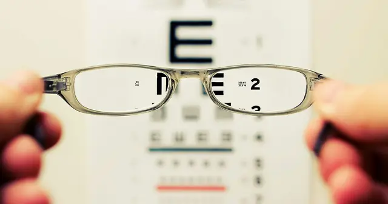

<!-- GENERATED from watch/issues/2026-11-26-b2b-sales-online-ordering.yml by scripts/build_watch.py. Edit the data file. -->

```{=html}
<p class="mw-kicker">Marketing in 3 · 2026 · No. 51 · Thursday 26 November 2026</p>
<figure class="mw-hero"><picture><source type="image/webp" sizes="(max-width: 900px) 100vw, 900px" srcset="../../images/web/issue-51-b2b-sales-online-ordering-960.webp 960w, ../../images/web/issue-51-b2b-sales-online-ordering-1600.webp 1600w"></picture><figcaption>A restaurant manager with her order pad. Business customers like her can now reorder online, and the sales visit has to offer something else. Photo: Vitaly Gariev on Unsplash.</figcaption></figure>
<section class="mw-answer" aria-label="Short answer"><h2>The short answer</h2><div class="mw-ans-grid"><p>Because the visits paid off. When small restaurant customers of a large US food distributor started ordering online, they moved 28% of their purchases to the website, yet their sales reps cut in-person order meetings by only 9%. Reps used the time once spent writing up orders to advise customers, and each account&#x27;s gross margin grew by about 7% a quarter.</p><div class="mw-ev" role="note" aria-label="Evidence level: 1 of 3 stars, one study"><span class="ev-k">Evidence level</span><ol><li class="on"><span class="ev-s" aria-hidden="true"><b>★</b><i>★</i><i>★</i></span>One study</li><li><span class="ev-s" aria-hidden="true"><b>★</b><b>★</b><i>★</i></span>Several studies</li><li><span class="ev-s" aria-hidden="true"><b>★</b><b>★</b><b>★</b></span>Meta-analysis</li></ol></div></div></section>
<section class="mw-takeaways"><h2>Key takeaways</h2><ul><li>Average sales per in-person order fell by $219, while customers bought from 0.22 more product categories each quarter: visits shifted from order taking to advice.</li><li>A customer that switched to online ordering returned $269 less product a quarter, and the distributor sold $212 less of it below cost.</li><li>Customers whose online orders and rep visits fell in the same week gave a margin lift of $557 a quarter, against $156 for those whose orders and visits rarely coincided.</li><li>For every ten customers who moved online, a rep served one more customer, on a typical book of about 40 accounts.</li></ul></section>
<section id="what-the-researchers-did"><h2>What the researchers did</h2><p><a class="mw-orcid-link" href="https://orcid.org/0009-0009-6645-0075" title="Irene Nahm on ORCID">Irene Nahm</a> of the University of Minnesota&#x27;s Carlson School of Management, <a class="mw-orcid-link" href="https://orcid.org/0000-0002-8797-3512" title="Phillip Wiseman on ORCID">Phillip Wiseman</a> of Texas Tech
University and <a class="mw-orcid-link" href="https://orcid.org/0000-0002-2931-544X" title="Michael Ahearne on ORCID">Michael Ahearne</a> and <a class="mw-orcid-link" href="https://orcid.org/0000-0002-6385-7189" title="Seshadri Tirunillai on ORCID">Seshadri Tirunillai</a> of the University of Houston worked with a Fortune 500
company that supplies food, kitchen equipment and cleaning products to restaurants. Until October 2016 every
order went through a salesperson who visited the customer&#x27;s premises. Then the company opened an online store
with the same catalogue, the same prices and the same commission for the rep, whichever way the order came in.</p><p>Customers could not sign up on their own. Their salesperson created the account and usually helped with the first
online order, and after that the customer was free to buy online, in person or both. Because customers joined at
different times over a year, the team could compare each new online buyer with similar customers who had not yet
switched, weighting the comparison to allow for the kinds of customers and reps who moved first.</p>
<dl class="mw-facts"><div><dt>Company</dt><dd>Fortune 500 food-service distributor, one major US metropolitan district</dd></div><div><dt>Customers</dt><dd>4,079 independently owned small restaurants, mostly $500,000 to $1 million in yearly sales</dd></div><div><dt>Sales force</dt><dd>113 outside salespeople paid a salary plus commission on gross margin</dd></div><div><dt>Data</dt><dd>1,866,651 quarterly product purchases, July 2016 to December 2017</dd></div><div><dt>Went online</dt><dd>1,995 customers between October 2016 and September 2017</dd></div><div><dt>Published</dt><dd>Online 14 March 2026 (subscription)</dd></div></dl>
</section>
<section id="fewer-orders-written-up-the-visits-kept"><h2>Fewer orders written up, the visits kept</h2><p>Before going online, a typical customer had about ten and a half in-person order meetings with its rep each
quarter. After the switch, that number fell by less than one. Earlier studies found that reps often see an online
channel as a threat to their role, and the authors see that uncertainty as the reason they kept coming back:
meeting the customer was the surest way to learn what the change meant for the relationship.</p><p>What happened inside those meetings changed more than their number. Less business was written up at each visit,
so the time went elsewhere. One rep told the researchers that with ordering moved online, &quot;I can talk to them
about how to improve menus.&quot; Both reps the team shadowed doubted that customers buy more simply because ordering
online is easier, which points to the advice, not the website, as the source of any gain.</p>
</section>
<section id="where-the-margin-came-from"><h2>Where the margin came from</h2><p>Gross margin from each customer that went online rose by $242.30 a quarter on average (Nahm et al., 2026). Two signs of better advice moved with it. Customers sent back less of what they bought, which suggests
orders matched their needs more closely, and fewer products went out below cost, which suggests reps could defend
the price of what they sold.</p><p>The lift was not a one-quarter bump. Tracking customers for up to seven quarters after they went online, the
authors found a statistically significant gain in four of them and a positive estimate in all. Checks with other
estimation methods, sales volume in place of margin, and a comparison against customers who never went online
all pointed the same way.</p>
</section>
<section id="when-visits-and-online-orders-line-up"><h2>When visits and online orders line up</h2><p>The gain was far from even. It was largest where a rep&#x27;s visit and the customer&#x27;s online purchases came close
together, which fits a pattern the authors describe: the rep discusses a product on site, and the customer orders it
online later without being pressed to buy on the spot. Customers who bought half or more of their volume online,
and those who bought new products online, also brought much bigger margin gains.</p><p>For the heaviest online buyers, in-person order meetings fell by about 29%, still less than the share of business
that had moved to the website. Even so, the authors warn managers against judging a customer&#x27;s move online only
by how much it is used. Lighter users produced smaller but real gains.</p>
<figure class="mw-chart" id="chart-margin_by_group"><figcaption class="mw-chart-title">Extra gross margin per customer per quarter after going online, by group (US dollars)</figcaption><div class="mw-chart-svg"><svg viewBox="0 0 680 194" role="img" aria-labelledby="chart-margin_by_group-t" font-family="Hanken Grotesk, Arial, sans-serif"><title id="chart-margin_by_group-t">Extra gross margin per customer per quarter after going online, by group (US dollars)</title><line x1="250.0" y1="4" x2="250.0" y2="168" stroke="#dde1e8" stroke-width="1"/><text x="250.0" y="186" font-size="12" text-anchor="middle" fill="#5b6476">0</text><line x1="310.0" y1="4" x2="310.0" y2="168" stroke="#dde1e8" stroke-width="1"/><text x="310.0" y="186" font-size="12" text-anchor="middle" fill="#5b6476">100</text><line x1="370.0" y1="4" x2="370.0" y2="168" stroke="#dde1e8" stroke-width="1"/><text x="370.0" y="186" font-size="12" text-anchor="middle" fill="#5b6476">200</text><line x1="430.0" y1="4" x2="430.0" y2="168" stroke="#dde1e8" stroke-width="1"/><text x="430.0" y="186" font-size="12" text-anchor="middle" fill="#5b6476">300</text><line x1="490.0" y1="4" x2="490.0" y2="168" stroke="#dde1e8" stroke-width="1"/><text x="490.0" y="186" font-size="12" text-anchor="middle" fill="#5b6476">400</text><line x1="550.0" y1="4" x2="550.0" y2="168" stroke="#dde1e8" stroke-width="1"/><text x="550.0" y="186" font-size="12" text-anchor="middle" fill="#5b6476">500</text><line x1="610.0" y1="4" x2="610.0" y2="168" stroke="#dde1e8" stroke-width="1"/><text x="610.0" y="186" font-size="12" text-anchor="middle" fill="#5b6476">600</text><g><title>Online share of volume: high: 493 </title><text x="238" y="27" font-size="13.5" text-anchor="end" fill="#15203b" font-weight="600">Online share of volume: high</text><rect x="250" y="12" width="295.8" height="22" rx="4" fill="#e0a12a"/><text x="553.8" y="28" font-size="13.5" fill="#15203b" font-weight="600">493</text></g><g><title>Online share of volume: low: 175 </title><text x="238" y="67" font-size="13.5" text-anchor="end" fill="#15203b">Online share of volume: low</text><rect x="250" y="52" width="105.0" height="22" rx="4" fill="#aab3c5"/><text x="363.0" y="68" font-size="13.5" fill="#15203b">175</text></g><g><title>New products bought online: high: 504 </title><text x="238" y="107" font-size="13.5" text-anchor="end" fill="#15203b" font-weight="600">New products bought online: high</text><rect x="250" y="92" width="302.4" height="22" rx="4" fill="#e0a12a"/><text x="560.4" y="108" font-size="13.5" fill="#15203b" font-weight="600">504</text></g><g><title>New products bought online: low: 183 </title><text x="238" y="147" font-size="13.5" text-anchor="end" fill="#15203b">New products bought online: low</text><rect x="250" y="132" width="109.8" height="22" rx="4" fill="#aab3c5"/><text x="367.8" y="148" font-size="13.5" fill="#15203b">183</text></g></svg></div><div class="mw-sr"><table><caption>Extra gross margin per customer per quarter after going online, by group (US dollars)</caption><tr><th>Group</th><th>Value ()</th></tr><tr><th scope="row">Online share of volume: high</th><td>493</td></tr><tr><th scope="row">Online share of volume: low</th><td>175</td></tr><tr><th scope="row">New products bought online: high</th><td>504</td></tr><tr><th scope="row">New products bought online: low</th><td>183</td></tr></table></div><p class="mw-chart-src">Customers split at the 75th percentile of each measure (Table 5); high online share means half or more of volume bought online. All effects significant (p &lt; 0.05); the confidence intervals of high and low groups overlap in part.</p></figure>
</section>
<section id="room-for-more-customers"><h2>Room for more customers</h2><p>Time saved on order taking was not all spent on the same accounts. Looking across each rep&#x27;s whole book, the
team found that reps whose customers moved online went on to serve more customers in the following quarter. The
authors expect the extra accounts to come from new customers and from reviving dormant ones, and they suggest managers use this when setting
incentives, deciding how much freed time should go to winning new accounts and how much to growing existing
ones.</p>
</section>
<section id="what-sales-leaders-can-take-from-it"><h2>What sales leaders can take from it</h2><p>The company presented the online store to its reps as support for their work, not a replacement, kept prices and
commission identical across channels, and had reps set up each account themselves. The authors cannot test each
of these choices separately, but they credit them with avoiding conflict between the two channels and keeping reps
on side.</p><p>Their most specific advice is to tell reps when their customers order online. A dashboard or alert that shows
recent online orders lets a rep schedule a visit shortly before or after, to talk through how the products are
being used and what might go with them. Rolling out to the customers most likely to combine online orders with
regular visits first should, the authors suggest, bring the largest early returns.</p>
</section>
<section id="how-to-apply-it" class="mw-howto"><p class="mw-rsg-kicker">Marketing in 3 steps</p><h2>Ready. Set. Market.</h2><div class="mw-rsg"><div class="mw-phase"><div class="mw-phase-dot" aria-hidden="true">1</div><div class="mw-phase-tag"><span class="mw-phase-name">Ready</span><span class="mw-phase-sub">Decide and prepare</span></div><ul class="mw-rsg-steps"><li><strong>Explain the online store to your reps first.</strong> Tell the sales team, before any customer hears of it, that the online store will handle routine reorders so their visits can focus on advice. Launch only when ordering, delivery and invoicing work end to end.</li><li><strong>Pay the same commission on online orders.</strong> Credit every online order from a rep&#x27;s accounts to that rep at the usual commission rate. Make sure no target or bonus rewards reps only for heavy online use.</li></ul></div><div class="mw-phase"><div class="mw-phase-dot" aria-hidden="true">2</div><div class="mw-phase-tag"><span class="mw-phase-name">Set</span><span class="mw-phase-sub">Build it</span></div><ul class="mw-rsg-steps"><li><strong>Let reps open each customer&#x27;s account.</strong> Have the rep create the login during a visit and place the first online order together with the customer, so the website arrives as part of the relationship.</li><li><strong>Send reps a weekly list of online orders.</strong> Give each rep a dashboard or email every Monday showing what their customers ordered online the week before. Ask them to visit or call each active customer within the same week.</li></ul></div><div class="mw-phase"><div class="mw-phase-dot" aria-hidden="true">3</div><div class="mw-phase-tag"><span class="mw-phase-name">Market</span><span class="mw-phase-sub">Launch and measure</span></div><ul class="mw-rsg-steps"><li><strong>Bring one idea to every visit.</strong> Replace order taking with one concrete suggestion per visit: a product the customer has not tried, a better way to use what they already buy, or a fix for a recent problem with an order.</li><li><strong>Track four numbers per account each quarter.</strong> For every account that orders online, compare margin, returns, sales at a loss and the number of product categories bought with the quarter before. Hand reps new accounts as their visit schedules free up.</li></ul></div></div></section>
<div class="mw-coffee" role="complementary" aria-label="Support Marketing in 3"><div class="mw-coffee-text"><p class="mw-coffee-title">Found this useful?</p><p>Marketing in 3 is free and ad-free, with new issues every Monday and Thursday. A coffee keeps it that way.</p></div><a class="mw-coffee-btn" href="https://ko-fi.com/marketingin3" target="_blank" rel="noopener"><svg aria-hidden="true" focusable="false"
  class="lucide lucide-coffee"
  xmlns="http://www.w3.org/2000/svg"
  width="24"
  height="24"
  viewBox="0 0 24 24"
  fill="none"
  stroke="currentColor"
  stroke-width="2"
  stroke-linecap="round"
  stroke-linejoin="round"
>
  <path d="M10 2v2" />
  <path d="M14 2v2" />
  <path d="M16 8a1 1 0 0 1 1 1v8a4 4 0 0 1-4 4H7a4 4 0 0 1-4-4V9a1 1 0 0 1 1-1h14a4 4 0 1 1 0 8h-1" />
  <path d="M6 2v2" />
</svg><span>Buy me a coffee</span><span class="mw-coffee-price">€3</span></a></div>
<form class="mw-email mw-email-inline" action="https://qewbdm3gpjxh42mawu5n6ac37m0hlcgm.lambda-url.ap-southeast-2.on.aws/subscribe" method="post"><div class="mw-email-text"><p class="mw-email-title">Get it by email</p><p>New issues every Monday and Thursday, in your inbox. Free, no ads, unsubscribe anytime.</p></div><div class="mw-email-row"><label class="visually-hidden" for="m3-email-inline">Email address</label><input id="m3-email-inline" type="email" name="email" required autocomplete="email" inputmode="email" placeholder="you@example.com" maxlength="254"><input class="mw-hp" type="text" name="website" tabindex="-1" autocomplete="off" aria-hidden="true"><input type="hidden" name="source" value=""><button type="submit">Subscribe</button></div><p class="mw-email-status" role="status" aria-live="polite"></p><p class="mw-email-note">Your address is used only to send Marketing in 3. You will get one email to confirm.</p></form><script>(function(){if(window.m3Email)return;window.m3Email=1;
var M={"check": "Almost done. Check your inbox for an email from issues@marketingin3.com and tap the link to confirm.", "invalid": "That email address does not look right. Please check it and try again.", "slow": "Too many tries in a short time. Please wait a few minutes and try again.", "busy": "Too many tries in a short time. Please wait a few minutes and try again.", "error": "Something went wrong. Please try again in a moment.", "undeliverable": "That address cannot receive email from us. Please try another one.", "confirming": "Confirming your subscription…", "ok": "You are subscribed. The next issue arrives in your inbox on Monday or Thursday, whichever comes first.", "expired": "This confirmation link has expired or was already used. Enter your address again for a fresh one."};
function ep(f){return f.getAttribute('action').replace(/\/subscribe$/,'');}
function say(f,k){var s=f.querySelector('.mw-email-status');if(!s)return;s.textContent=M[k]||M.error;
s.className='mw-email-status is-'+(k==='ok'||k==='check'?'ok':(k==='confirming'?'wait':'bad'));}
function gc(e){try{if(window.mwTrack)window.mwTrack(e);}catch(x){}try{if(window.goatcounter&&goatcounter.count)goatcounter.count({path:e,title:e,event:true});}catch(x){}}
document.querySelectorAll('form.mw-email').forEach(function(f){
var src=f.querySelector('input[name=source]');if(src)src.value=location.pathname;
f.addEventListener('submit',function(e){if(!window.fetch)return;e.preventDefault();
var b=f.querySelector('button');b.disabled=true;
var data={email:f.email.value,website:f.website.value,source:location.pathname};
fetch(f.getAttribute('action'),{method:'POST',headers:{'content-type':'application/json'},body:JSON.stringify(data)})
.then(function(r){return r.json().catch(function(){return {status:'error'};});})
.then(function(j){say(f,j.status);if(j.status==='check'){f.classList.add('is-done');gc('email-subscribe');}})
.catch(function(){say(f,'error');}).then(function(){b.disabled=false;});});});
var q=new URLSearchParams(location.search),f=document.querySelector('form.mw-email');if(!f)return;
['check','invalid','slow','error'].forEach(function(k){if(q.get(k))say(f,k);});
var t=q.get('t');if(t){say(f,'confirming');
fetch(ep(f)+'/confirm',{method:'POST',headers:{'content-type':'application/json'},body:JSON.stringify({t:t})})
.then(function(r){return r.json().catch(function(){return {status:'error'};});})
.then(function(j){say(f,j.status);if(j.status==='ok'){f.classList.add('is-done');gc('email-confirmed');}
if(history.replaceState)history.replaceState(null,'',location.pathname+'#email');})
.catch(function(){say(f,'error');});}
})();</script>
<section id="what-to-expect"><h2>What to expect</h2><ul class="mw-list"><li><strong>Visits continue.</strong> Reps keep meeting customers who order online, and the meetings become about advice and service more than writing up orders.</li><li><strong>A margin gain that lasts.</strong> In this study the estimated lift stayed positive across the quarters observed, so judge a rollout over a year, not one quarter.</li><li><strong>Bigger returns where reps follow online activity.</strong> Customers whose visits are timed around their online orders gain the most.</li><li><strong>Spare capacity for growth.</strong> Reps whose customers go online can take on more accounts, which managers can steer through targets and pay.</li></ul></section>
<section id="where-it-does-not-work"><h2>Where it does not work</h2><ul class="mw-list"><li><strong>One company, one city.</strong> All data come from one distributor&#x27;s small restaurant customers in a single US metropolitan district.</li><li><strong>Data from 2016 and 2017.</strong> Customer habits with online ordering have changed since then, so the size of the effects may differ today.</li><li><strong>Advice inferred, not observed.</strong> Interaction quality is read from sales records such as returns, below-cost sales and product range; nobody recorded what was said in meetings.</li><li><strong>A particular rollout.</strong> Same prices, same commission and rep-created accounts may be part of why it worked; firms that price online orders differently or bypass reps may see other results.</li></ul></section>
<section id="questions"><h2>Questions marketers ask</h2><div class="mw-faq"><h3>Does B2B e-commerce replace sales reps?</h3><p>Not in this study. After a US food distributor opened an online store, reps kept calling on the restaurants that used it almost as often as before and turned the meetings into advice. Gross margin per customer rose, returns fell and customers bought from more product categories (Nahm et al., 2026).</p></div><div class="mw-faq"><h3>Why would a sales rep keep visiting a customer who orders online?</h3><p>Partly to understand what the change means for the relationship, and partly because the visit becomes more useful. With fewer orders to write up, reps spent the time on advice, which showed up as wider product ranges, fewer returns and fewer sales at a loss.</p></div><div class="mw-faq"><h3>How much online ordering does a customer need before the benefits show?</h3><p>Less than many managers assume. The authors report a meaningful margin lift even for customers buying roughly 10% of their volume online, and larger gains for heavier online buyers, so low usage is no reason to write the switch off.</p></div><div class="mw-faq"><h3>How should sales reps use online order data?</h3><p>As a prompt for timing visits. Margin gains were largest where a rep&#x27;s visit came in the same week as the customer&#x27;s online purchases, so the authors recommend dashboards or alerts that flag new online orders to the rep.</p></div><div class="mw-faq"><h3>What is online channel integration in B2B sales?</h3><p>It is the moment a business customer that could only buy through a salesperson also starts buying through the supplier&#x27;s website, while keeping the same rep. The study tracks what happens to that relationship over the following quarters.</p></div></section>
<section id="also-new"><h2>Also new this week</h2><div class="mw-also"><article><p class="mw-also-src"><em>International Journal of Research in Marketing</em> · 2025</p><h3><a href="https://doi.org/10.1016/j.ijresmar.2025.10.003">Implementing e-commerce channels in business-to-business selling</a></h3><p class="mw-also-au">Kassemeier, Alavi, &amp; Habel</p><p>A natural experiment at an industrial distributor (20,280 observations from 845 salespeople) and two online experiments with 551 salespeople examined what adding an e-commerce channel does to the sales force. Salespeople covered more customers afterwards, but the quality of their consultation fell, and both effects depended on their tenure and past success in winning customers. Paying salespeople on e-commerce revenue strengthened the coverage gain and reduced the loss in consultation quality, while managers&#x27; promotion of the channel had no measurable effect. Read beside the lead study, it shows how much depends on the way a rollout is designed and paid.</p></article><article><p class="mw-also-src"><em>Journal of Service Research</em> · 2026</p><h3><a href="https://doi.org/10.1177/10946705261449559">Hybrid Selling: The Optimal Mix of Face-to-Face and Remote Sales Calls with Existing B2B Customers</a></h3><p class="mw-also-au">Ergun &amp; Schmitz</p><p>Two field studies with a leading European B2B manufacturer looked at salespeople who serve the same customer partly in person and partly by video or phone. CRM data on 3,565 customers showed an inverted U: some remote calls helped, too many hurt. A second study matching survey and CRM data for 651 more customers found that the best mix could lift performance by up to 27% over in-person selling alone, while an all-remote approach cut it by up to 32% in some settings. Product complexity, customer channel preferences and the rep&#x27;s knowledge of past interactions decided where the balance lay.</p></article></div></section>
<section id="source" class="mw-source"><h2>Source</h2><p class="mw-cite">Nahm, I., Wiseman, P., Ahearne, M., &amp; Tirunillai, S. (2026). High Tech, Not Low Touch: Empowering the B2B Sales Force Through Online Channel Integration. <em>Journal of Marketing</em>. <a href="https://doi.org/10.1177/00222429261436003">https://doi.org/10.1177/00222429261436003</a></p><p class="mw-note">This brief is written for practitioners from the published article. Numbers are as reported by the authors; read the article for full methods.</p></section>
<section id="related-research" class="mw-related"><h2>Related research on this site</h2><ul><li><a href="../../../papers/social-media-b2b-sales-research-agenda.html">Reflections on “social media: Influencing customer satisfaction in B2B sales” and a research agenda</a><span>Industrial Marketing Management</span></li></ul></section>
<section id="keep-reading" class="mw-more"><h2>Keep reading</h2><p class="mw-more-topics">More issues on <a href="../../topics/retail.html">Retail</a> · <a href="../../topics/service.html">Service</a></p><div class="watch-list"><article class="watch-item"><a class="watch-thumb" href="../../posts/returnless-partial-refunds/index.html" tabindex="-1" aria-hidden="true"></a><div><p class="watch-meta">2026 · No. 44 · <time datetime="2026-11-02">Monday 2 November 2026</time></p><h3><a href="../../posts/returnless-partial-refunds/index.html">Keep it, get part back: returns that pay off later</a></h3><p>Fang et al. tested keep-it partial refunds on 853,521 online shoppers: the first return cost more, but later spending left a net gain of $1.44 per customer.</p></div></article><article class="watch-item"><a class="watch-thumb" href="../../posts/agentic-marketing-relationships/index.html" tabindex="-1" aria-hidden="true"></a><div><p class="watch-meta">2026 · No. 34 · <time datetime="2026-08-31">Week of 31 August 2026</time></p><h3><a href="../../posts/agentic-marketing-relationships/index.html">When your customer&#x27;s AI agent does the shopping</a></h3><p>Customers are starting to delegate shopping to AI agents. A Journal of Marketing framework sets out five things firms must get right, and six KPIs.</p></div></article><article class="watch-item"><a class="watch-thumb" href="../../posts/bad-review-experience/index.html" tabindex="-1" aria-hidden="true"></a><div><p class="watch-meta">2026 · No. 27 · <time datetime="2026-07-13">Week of 13 July 2026</time></p><h3><a href="../../posts/bad-review-experience/index.html">The review keeps working after the sale</a></h3><p>People who read bad reviews before listening paid $17.29 to see a show, against $20.45 for people who read none. The review changes the experience, not just the purchase.</p></div></article></div></section>
<div class="mw-author"><div><p><strong>Bruno Schivinski</strong> is Associate Professor of Marketing at Gdańsk University of Technology. He studies how consumers engage with brands in digital and social media.</p><p><a href="../../../index.html">About Bruno</a> · <a href="../../index.html">All Marketing in 3 issues</a> · <a href="../../subscribe.html">Subscribe</a></p></div></div>
<nav class="mw-pn" aria-label="More issues"><a class="mw-prev" href="../brand-jokes-self-or-rival/index.html"><span>Previous issue</span>Brand jokes aimed at itself or a rival</a></nav>
```
