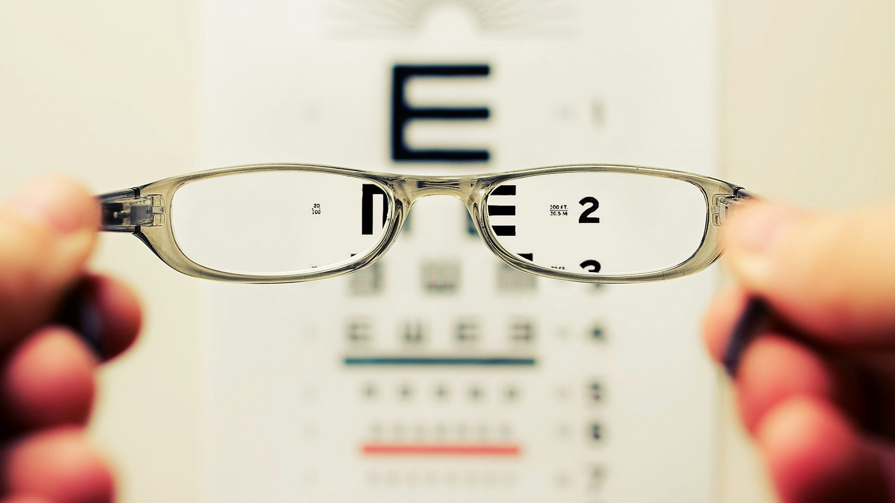

<!-- GENERATED from watch/issues/2026-07-13-bad-review-experience.yml by scripts/build_watch.py. Edit the data file. -->

```{=html}
<p class="mw-kicker">Marketing in 3 · Issue 27 · Week of 13 July 2026</p>
<figure class="mw-hero"><figcaption>The authors&#x27; own phrase for it is a negative lens. Once it is on, everything you look at wears it. Photo: David Travis on Unsplash.</figcaption></figure>
<section class="mw-answer" aria-label="Short answer"><h2>The short answer</h2><p>Yes, for the customer who buys it anyway. Across five experiments and six more in the appendix, people who read negative reviews before using a product enjoyed it less than people who used the same product having read nothing. Not merely rated it lower, enjoyed it less, which the authors establish with a design that separates the two. Positive reviews did not work in reverse: people who read them had the same experience as people who read none. Bad reviews are the only ones that follow the customer home.</p></section>
<section class="mw-takeaways"><h2>Key takeaways</h2><ul><li>Shown part of a ventriloquist show, people who had read bad reviews would pay $17.29 to see the rest. People who read none would pay $20.45.</li><li>Even readers who saw the bad reviews only after finishing the book rated it 2.87 out of 5, against 3.41 for those who saw none.</li><li>One bad review among three good ones dragged ratings from 3.58 to 3.32. One good review among three bad ones moved nothing, 2.60 against 2.61.</li><li>The effect survived a full day&#x27;s gap: reviews read 24 hours before the experience still cost the product 3.06 against 3.81.</li></ul></section>
<section id="what-the-researchers-did"><h2>What the researchers did</h2><p>Research on reviews stops at the till. We know a great deal about how reviews move purchases and almost
nothing about what they do afterwards, because of an unspoken assumption that once you have the thing in your
hands, your own senses take over.</p><p>Dena Yadin, Nira Munichor, Elanor Williams and Inbal Stockheim went looking for the afterlife. Their setup is
the same every time and it is the right one: everybody gets the identical product, and the only thing that
differs is which reviews they read first. Any difference in how much they enjoy it therefore belongs to the
reviews and not to the thing itself.</p><p>Across the main studies people watched music clips, read a book excerpt, listened to a holiday song and
watched part of a ventriloquist act. The supplementary studies add earbuds, a virtual tour and an origami kit.
The reviews were real, written by earlier participants who had genuinely rated the same material, which
matters: these are not researcher-written caricatures of a bad review.</p><p>Their survey work also establishes that this is not a rare situation. Most people read reviews after buying,
after being given something as a gift, and during or after using a product.</p>
<dl class="mw-facts"><div><dt>Main studies</dt><dd>Five, plus six supplementary replications and several more reported in the appendix</dd></div><div><dt>People</dt><dd>4,291 across the five main studies alone, recruited through Prolific</dd></div><div><dt>Design</dt><dd>Everyone experiences the identical product; only the reviews they read beforehand change</dd></div><div><dt>Reviews used</dt><dd>Real reviews written by earlier participants, shown with a two-star or four-star average</dd></div><div><dt>Measured</dt><dd>Star rating, a five-item enjoyment index, what people recalled, what they wrote, and what they would pay</dd></div></dl>
</section>
<section id="bad-reviews-work-good-ones-do-not"><h2>Bad reviews work. Good ones do not.</h2><p>Study one put 719 people in front of one of two music clips, one pretested as better and one as worse, after
showing them five negative reviews, five positive reviews, or nothing at all.</p><p>Those who saw the negative set came away liking the clip less than the group shown no reviews at all. The
positive set landed its readers exactly where that no-review group sat, with a gap nowhere near significance. That
lopsidedness is the finding the whole paper is built on.</p><p>It held for the good clip and the bad clip alike, with no interaction between them, and that is what rules out
the comfortable explanation. If this were about expectations being met or missed you would expect
bad reviews attached to a good product to produce a pleasant surprise. They did not. The experience bends
towards the review rather than away from it.</p><p>Six supplementary studies then tried to break it and failed. Framing the product as useful or as fun, letting
people choose it or assigning it, matching the positive and negative reviews word for word so only the valence
differed, using one-star and five-star extremes, and inserting delays of minutes and then of a full day. Every
one reproduced the same shape.</p>
<figure class="mw-chart" id="chart-asymmetry"><figcaption class="mw-chart-title">How much people enjoyed the same music clip, by what they read first, out of 7</figcaption><div class="mw-chart-svg"><svg viewBox="0 0 680 154" role="img" aria-labelledby="chart-asymmetry-t" font-family="Hanken Grotesk, Arial, sans-serif"><title id="chart-asymmetry-t">How much people enjoyed the same music clip, by what they read first, out of 7</title><line x1="250.0" y1="4" x2="250.0" y2="128" stroke="#dde1e8" stroke-width="1"/><text x="250.0" y="146" font-size="12" text-anchor="middle" fill="#5b6476">0</text><line x1="301.4" y1="4" x2="301.4" y2="128" stroke="#dde1e8" stroke-width="1"/><text x="301.4" y="146" font-size="12" text-anchor="middle" fill="#5b6476">1</text><line x1="352.9" y1="4" x2="352.9" y2="128" stroke="#dde1e8" stroke-width="1"/><text x="352.9" y="146" font-size="12" text-anchor="middle" fill="#5b6476">2</text><line x1="404.3" y1="4" x2="404.3" y2="128" stroke="#dde1e8" stroke-width="1"/><text x="404.3" y="146" font-size="12" text-anchor="middle" fill="#5b6476">3</text><line x1="455.7" y1="4" x2="455.7" y2="128" stroke="#dde1e8" stroke-width="1"/><text x="455.7" y="146" font-size="12" text-anchor="middle" fill="#5b6476">4</text><line x1="507.1" y1="4" x2="507.1" y2="128" stroke="#dde1e8" stroke-width="1"/><text x="507.1" y="146" font-size="12" text-anchor="middle" fill="#5b6476">5</text><line x1="558.6" y1="4" x2="558.6" y2="128" stroke="#dde1e8" stroke-width="1"/><text x="558.6" y="146" font-size="12" text-anchor="middle" fill="#5b6476">6</text><line x1="610.0" y1="4" x2="610.0" y2="128" stroke="#dde1e8" stroke-width="1"/><text x="610.0" y="146" font-size="12" text-anchor="middle" fill="#5b6476">7</text><g><title>Five negative reviews: 3.03 out of 7</title><text x="238" y="27" font-size="13.5" text-anchor="end" fill="#15203b" font-weight="600">Five negative reviews</text><rect x="250" y="12" width="155.8" height="22" rx="4" fill="#e0a12a"/><text x="413.8" y="28" font-size="13.5" fill="#15203b" font-weight="600">3.03</text></g><g><title>Five positive reviews: 3.65 out of 7</title><text x="238" y="67" font-size="13.5" text-anchor="end" fill="#15203b">Five positive reviews</text><rect x="250" y="52" width="187.7" height="22" rx="4" fill="#aab3c5"/><text x="445.7" y="68" font-size="13.5" fill="#15203b">3.65</text></g><g><title>No reviews at all: 3.77 out of 7</title><text x="238" y="107" font-size="13.5" text-anchor="end" fill="#15203b">No reviews at all</text><rect x="250" y="92" width="193.9" height="22" rx="4" fill="#aab3c5"/><text x="451.9" y="108" font-size="13.5" fill="#15203b">3.77</text></g></svg></div><div class="mw-sr"><table><caption>How much people enjoyed the same music clip, by what they read first, out of 7</caption><tr><th>Group</th><th>Value (out of 7)</th></tr><tr><th scope="row">Five negative reviews</th><td>3.03</td></tr><tr><th scope="row">Five positive reviews</th><td>3.65</td></tr><tr><th scope="row">No reviews at all</th><td>3.77</td></tr></table></div><p class="mw-chart-src">Study 1: 719 participants, five-item enjoyment index. The gap between positive reviews and none was not significant.</p></figure>
</section>
<section id="it-is-the-experience-not-the-write-up"><h2>It is the experience, not the write-up</h2><p>Here is the obvious objection, and the authors take it seriously enough to build a study around it. Maybe
nobody&#x27;s experience changed at all. Maybe people simply adjust what they say to match what everyone else
said.</p><p>So study two gave 999 people the same book excerpt and varied only when the bad reviews appeared: before
choosing a book, after choosing but before reading, halfway through, or after finishing and just before giving
a rating. That last group cannot have had their reading experience altered, since the reading was over. Any
drop in their ratings is pure reporting.</p><p>Their ratings did drop, which tells you conformity is real. But they dropped less than everyone else&#x27;s. The
people who read the reviews before or during their reading came out at 2.60 to 2.68, while the people who read
them at the end came out at 2.87. Reporting explains part of this and cannot explain all of it.</p><p>One more thing worth lifting out of that study. Reading the reviews halfway through was as damaging as reading
them at the start. The lens fits at any point you put it on.</p>
</section>
<section id="one-is-enough"><h2>One is enough</h2><p>In the real world reviews are mixed, and the practical question is whether one bad one among several good ones
actually matters. Study three, with 597 people, answered it cleanly by holding the set size at four and
changing only the fourth review.</p><p>Swapping one of four positive reviews for a negative one pulled ratings down measurably. Swapping one of four
negative reviews for a positive one did nothing whatsoever. The two conditions came out a hundredth of a point
apart.</p><p>That is negativity dominance in its purest form, and it is the result I would put in front of anyone who
believes a wall of five-star reviews provides cover. It does not. The one-star review in the middle of it is
still doing its work on the person who buys.</p>
</section>
<section id="what-is-actually-going-on"><h2>What is actually going on</h2><p>Study four explains the mechanism, and the measure is elegantly simple. After listening to a holiday song,
376 people were asked to quickly list five things they remembered about it, then to mark each one as something
they liked or disliked.</p><p>Everybody listed five things. What changed was how many of them were complaints. The people who had read
negative reviews filled more of their five slots with things they disliked, and that proportion statistically
carried the effect through to how much they said they enjoyed the song.</p><p>So the reviews are not planting an opinion. They are redirecting attention. You go in primed to notice the
thin vocal and the cheap drum machine, you duly notice them, and a song made of the same notes as everyone
else&#x27;s comes out worse. The authors call it a negative lens, and the lens is made of what you are looking for.</p><p>There is a second-order effect here that marketers should sit with. Everyone in these studies wrote a review of
their own afterwards, and the ones primed by complaints wrote harsher ones. The thing feeds itself.</p>
<figure class="mw-chart" id="chart-recall"><figcaption class="mw-chart-title">Share of the five remembered details that were complaints</figcaption><div class="mw-chart-svg"><svg viewBox="0 0 680 154" role="img" aria-labelledby="chart-recall-t" font-family="Hanken Grotesk, Arial, sans-serif"><title id="chart-recall-t">Share of the five remembered details that were complaints</title><line x1="250.0" y1="4" x2="250.0" y2="128" stroke="#dde1e8" stroke-width="1"/><text x="250.0" y="146" font-size="12" text-anchor="middle" fill="#5b6476">0</text><line x1="322.0" y1="4" x2="322.0" y2="128" stroke="#dde1e8" stroke-width="1"/><text x="322.0" y="146" font-size="12" text-anchor="middle" fill="#5b6476">10</text><line x1="394.0" y1="4" x2="394.0" y2="128" stroke="#dde1e8" stroke-width="1"/><text x="394.0" y="146" font-size="12" text-anchor="middle" fill="#5b6476">20</text><line x1="466.0" y1="4" x2="466.0" y2="128" stroke="#dde1e8" stroke-width="1"/><text x="466.0" y="146" font-size="12" text-anchor="middle" fill="#5b6476">30</text><line x1="538.0" y1="4" x2="538.0" y2="128" stroke="#dde1e8" stroke-width="1"/><text x="538.0" y="146" font-size="12" text-anchor="middle" fill="#5b6476">40</text><line x1="610.0" y1="4" x2="610.0" y2="128" stroke="#dde1e8" stroke-width="1"/><text x="610.0" y="146" font-size="12" text-anchor="middle" fill="#5b6476">50</text><g><title>After negative reviews: 38%</title><text x="238" y="27" font-size="13.5" text-anchor="end" fill="#15203b" font-weight="600">After negative reviews</text><rect x="250" y="12" width="273.6" height="22" rx="4" fill="#e0a12a"/><text x="531.6" y="28" font-size="13.5" fill="#15203b" font-weight="600">38%</text></g><g><title>After positive reviews: 27%</title><text x="238" y="67" font-size="13.5" text-anchor="end" fill="#15203b">After positive reviews</text><rect x="250" y="52" width="194.4" height="22" rx="4" fill="#aab3c5"/><text x="452.4" y="68" font-size="13.5" fill="#15203b">27%</text></g><g><title>After no reviews: 22%</title><text x="238" y="107" font-size="13.5" text-anchor="end" fill="#15203b">After no reviews</text><rect x="250" y="92" width="158.4" height="22" rx="4" fill="#aab3c5"/><text x="416.4" y="108" font-size="13.5" fill="#15203b">22%</text></g></svg></div><div class="mw-sr"><table><caption>Share of the five remembered details that were complaints</caption><tr><th>Group</th><th>Value (%)</th></tr><tr><th scope="row">After negative reviews</th><td>38</td></tr><tr><th scope="row">After positive reviews</th><td>27</td></tr><tr><th scope="row">After no reviews</th><td>22</td></tr></table></div><p class="mw-chart-src">Study 4: 376 participants listed five things they recalled about a song, then marked each as liked or disliked.</p></figure>
</section>
<section id="the-fix-costs-one-sentence"><h2>The fix costs one sentence</h2><p>Study five is the practical one, and the intervention is almost insultingly cheap. 1,600 people read either
positive or negative reviews before hearing the song. Half of them were additionally told, in advance, that
reviews can colour an experience and asked to reach their own verdict.</p><p>For the half who had seen the complaints, that single prompt recovered a good share of the loss. Among the
people who read positive reviews it changed nothing at all, which is what makes it safe to deploy: it cannot
cost you anything on the products whose reviews are already good.</p><p>Timing is the catch. The prompt has to arrive before the impression forms, not after, because negativity is
famously hard to dislodge once it has taken hold. In practice that means the gap between the order and the
first use, which for most businesses is the confirmation email, the packaging insert or the first screen of an
app.</p><p>Going past what was tested, the implication for review management is broader than it looks. The usual
cost-benefit on replying to a bad review is about the next prospect reading the thread. This paper says
there is a second bill arriving: the people who read it, bought anyway, and will now enjoy your product less
and write a worse review because of it. That changes which reviews are worth answering and how quickly.</p>
<figure class="mw-chart" id="chart-remedy"><figcaption class="mw-chart-title">Enjoyment after negative reviews, with and without a prompt to judge for yourself, out of 7</figcaption><div class="mw-chart-svg"><svg viewBox="0 0 685 114" role="img" aria-labelledby="chart-remedy-t" font-family="Hanken Grotesk, Arial, sans-serif"><title id="chart-remedy-t">Enjoyment after negative reviews, with and without a prompt to judge for yourself, out of 7</title><line x1="255.0" y1="4" x2="255.0" y2="88" stroke="#dde1e8" stroke-width="1"/><text x="255.0" y="106" font-size="12" text-anchor="middle" fill="#5b6476">0</text><line x1="306.4" y1="4" x2="306.4" y2="88" stroke="#dde1e8" stroke-width="1"/><text x="306.4" y="106" font-size="12" text-anchor="middle" fill="#5b6476">1</text><line x1="357.9" y1="4" x2="357.9" y2="88" stroke="#dde1e8" stroke-width="1"/><text x="357.9" y="106" font-size="12" text-anchor="middle" fill="#5b6476">2</text><line x1="409.3" y1="4" x2="409.3" y2="88" stroke="#dde1e8" stroke-width="1"/><text x="409.3" y="106" font-size="12" text-anchor="middle" fill="#5b6476">3</text><line x1="460.7" y1="4" x2="460.7" y2="88" stroke="#dde1e8" stroke-width="1"/><text x="460.7" y="106" font-size="12" text-anchor="middle" fill="#5b6476">4</text><line x1="512.1" y1="4" x2="512.1" y2="88" stroke="#dde1e8" stroke-width="1"/><text x="512.1" y="106" font-size="12" text-anchor="middle" fill="#5b6476">5</text><line x1="563.6" y1="4" x2="563.6" y2="88" stroke="#dde1e8" stroke-width="1"/><text x="563.6" y="106" font-size="12" text-anchor="middle" fill="#5b6476">6</text><line x1="615.0" y1="4" x2="615.0" y2="88" stroke="#dde1e8" stroke-width="1"/><text x="615.0" y="106" font-size="12" text-anchor="middle" fill="#5b6476">7</text><g><title>No prompt: 3.07 out of 7</title><text x="243" y="27" font-size="13.5" text-anchor="end" fill="#15203b">No prompt</text><rect x="255" y="12" width="157.9" height="22" rx="4" fill="#aab3c5"/><text x="420.9" y="28" font-size="13.5" fill="#15203b">3.07</text></g><g><title>Prompted to decide for themselves: 3.59 out of 7</title><text x="243" y="67" font-size="13.5" text-anchor="end" fill="#15203b" font-weight="600">Prompted to decide for themselves</text><rect x="255" y="52" width="184.6" height="22" rx="4" fill="#e0a12a"/><text x="447.6" y="68" font-size="13.5" fill="#15203b" font-weight="600">3.59</text></g></svg></div><div class="mw-sr"><table><caption>Enjoyment after negative reviews, with and without a prompt to judge for yourself, out of 7</caption><tr><th>Group</th><th>Value (out of 7)</th></tr><tr><th scope="row">No prompt</th><td>3.07</td></tr><tr><th scope="row">Prompted to decide for themselves</th><td>3.59</td></tr></table></div><p class="mw-chart-src">Study 5: 1,600 participants. The same prompt made no difference to people who had read positive reviews.</p></figure>
</section>
<section id="how-to-apply-it" class="mw-howto"><p class="mw-rsg-kicker">Marketing in 3 steps</p><h2>Ready. Set. Market.</h2><div class="mw-rsg"><div class="mw-phase"><div class="mw-phase-dot" aria-hidden="true">1</div><div class="mw-phase-tag"><span class="mw-phase-name">Ready</span><span class="mw-phase-sub">Decide and prepare</span></div><ul class="mw-rsg-steps"><li><strong>Read what your buyers actually read.</strong> Open your own product page as a shopper would. Note the three reviews shown first. Those are the ones doing the work, not your average score.</li><li><strong>Sort the complaints into two piles.</strong> Go through those reviews and mark each complaint as a fact you can fix, like it arrived late or the strap broke, or a matter of taste, like too sweet or too loud. The first pile is a product job. The second pile needs the steps below.</li></ul></div><div class="mw-phase"><div class="mw-phase-dot" aria-hidden="true">2</div><div class="mw-phase-tag"><span class="mw-phase-name">Set</span><span class="mw-phase-sub">Build it</span></div><ul class="mw-rsg-steps"><li><strong>Write one line inviting them to judge.</strong> Put a single sentence in the order confirmation or on the box. Tell the customer that other people&#x27;s opinions are only opinions and ask them to make up their own mind. One sentence. Do not mention any review and do not sound defensive.</li><li><strong>Answer the worst review in public.</strong> Reply underneath the most visible negative review in two or three lines, naming what you changed. The next person reads the complaint and the answer at the same moment.</li></ul></div><div class="mw-phase"><div class="mw-phase-dot" aria-hidden="true">3</div><div class="mw-phase-tag"><span class="mw-phase-name">Market</span><span class="mw-phase-sub">Launch and measure</span></div><ul class="mw-rsg-steps"><li><strong>Send the line before they open the box.</strong> The message only works in the gap between buying and first use. Once they have tried it, the impression is set and the line is wasted.</li><li><strong>Track returns and second orders.</strong> Watch returns, refunds and repeat purchase on the products carrying the worst visible reviews. Damage done after the sale shows up there, never in your conversion rate.</li></ul></div></div></section>
<section id="what-to-expect"><h2>What to expect</h2><ul class="mw-list"><li><strong>Good reviews will not do the opposite job.</strong> Collecting more five-star reviews protects the sale, but it buys you nothing in the experience itself. Only the bad ones carry over.</li><li><strong>The harm reaches people who never bought.</strong> Anyone who reads the reviews and then uses the product, a guest, a gift recipient, a colleague, carries the same lens in.</li><li><strong>It compounds through the next review.</strong> Readers of negative reviews wrote more negative reviews themselves, which is how one complaint becomes a trend line.</li><li><strong>The prompt is free to try and hard to get wrong.</strong> It helped where the reviews were bad and did nothing where they were good, so the downside in the tests was zero.</li></ul></section>
<section id="where-it-does-not-work"><h2>Where it does not work</h2><ul class="mw-list"><li><strong>Short experiences, not long ownership.</strong> Music clips, a book excerpt, a song, part of a show, earbuds and an origami kit. Nothing here runs over the months of living with a purchase.</li><li><strong>Mostly self-reported enjoyment.</strong> The willingness-to-pay study is the one behavioural outcome. The rest is what people say about the experience, however carefully the design separates that from the experience.</li><li><strong>Online panels throughout.</strong> Prolific participants given a product to try, not shoppers spending their own money in a shop.</li><li><strong>The fix was tested in the lab, in one line.</strong> Nobody has yet run it as a real packaging insert or confirmation email, where tone and placement will matter.</li></ul></section>
<section id="questions"><h2>Questions marketers ask</h2><div class="mw-faq"><h3>Do negative reviews affect people who have already bought the product?</h3><p>Yes. Hand two groups the identical product and let only one group see the complaints beforehand, and that group comes away liking it less. The pattern held whether they picked the product or were assigned it, and whether the complaints arrived minutes or a full day earlier (Yadin, Munichor, Williams &amp; Stockheim, 2026, Journal of Marketing Research).</p></div><div class="mw-faq"><h3>Do positive reviews improve the experience in the same way?</h3><p>No, and the lopsidedness is the heart of the paper. Glowing reviews left enjoyment sitting exactly where it would have been with no reviews at all, across every study here. Praise sells the thing. It does not improve the thing.</p></div><div class="mw-faq"><h3>Is this just people repeating what the reviews said?</h3><p>Partly, and the researchers measured how much. One group met the complaints only once the reading was over, so nothing about their experience could have shifted, and their scores still fell. But they fell less than for everyone who met them earlier, leaving a gap that conformity cannot account for.</p></div><div class="mw-faq"><h3>Why do bad reviews change the experience?</h3><p>They redirect attention. Asked for five details about a song they had just heard, listeners primed by complaints filled more of those slots with faults, and that shift in what they noticed is what carried through to enjoyment. A review hands you something to look for rather than an opinion to hold.</p></div><div class="mw-faq"><h3>What can a brand actually do about it?</h3><p>Invite the buyer to form their own view, and do it early. One sentence to that effect, delivered before the experience began, clawed back much of the loss in testing while doing nothing where the reviews were already favourable. The hard part is placement, since it must arrive in the gap before they try the thing.</p></div></section>
<section id="also-new"><h2>Also new this week</h2><div class="mw-also"><article><p class="mw-also-src"><em>International Journal of Research in Marketing</em> · 2026</p><h3><a href="https://doi.org/10.1016/j.ijresmar.2026.05.003">&quot;I&#x27;m definitely on my best behavior now!&quot; Two-sided online review systems as a driver for desirable customer behaviors</a></h3><p class="mw-also-au">Marder, B. L., Angell, R. J., Erz, A., &amp; Lavertu, L.</p><p>When the driver can rate you back, you behave better. Eight experiments find customers on two-sided review platforms are more courteous, more polite and easier to deal with, because the prospect of being reviewed raises how they think they are coming across. The effect needs one condition: the customer has to intend to use the platform again. A rating of the customer is a behaviour tool as much as a reputation one.</p></article><article><p class="mw-also-src"><em>Journal of Research in Interactive Marketing</em> · 2026</p><h3><a href="https://doi.org/10.1108/jrim-11-2025-0738">Human or artificial? How AI review labeling shapes trust and consumer interaction in food delivery platforms</a></h3><p class="mw-also-au">Zhong, Z., &amp; Ha, H.-Y.</p><p>Two experiments on food delivery find that labelling a review as AI-assisted lowers trust in it and, through that, purchase intention. Holding the review text constant and varying only the disclosure produced the same drop, so the label is doing the damage rather than the writing. The penalty was heavier on premium-priced items in the first experiment, where a higher price means more to lose.</p></article></div></section>
<section id="source" class="mw-source"><h2>Source</h2><p class="mw-cite">Yadin, D., Munichor, N., Williams, E. F., &amp; Stockheim, I. (2026). Haunted by a Bad Review: The Afterlife of Reading (Negative) Reviews in Consumer Experience. <em>Journal of Marketing Research</em>. <a href="https://doi.org/10.1177/00222437261457045">https://doi.org/10.1177/00222437261457045</a></p><p class="mw-note">This brief is written for practitioners from the published article. Open access (CC BY-NC 4.0): free to read at the publisher. Numbers are as reported by the authors; read the article for full methods.</p></section>

<div class="mw-author"><div><p><strong>Bruno Schivinski</strong> is Associate Professor of Marketing at Gdańsk University of Technology. He studies how consumers engage with brands in digital and social media.</p><p><a href="../../../index.html">About Bruno</a> · <a href="../../index.html">All Marketing in 3 issues</a> · <a href="../../subscribe.html">Subscribe</a></p></div></div>
<nav class="mw-pn" aria-label="More issues"><a class="mw-prev" href="../influencer-transgressions/index.html"><span>Previous issue</span>The brand walks. The influencer burns.</a><a class="mw-next" href="../synthetic-person-disclosure/index.html"><span>Next issue</span>The label that buys honesty, then spends it on artificiality</a></nav>
```
