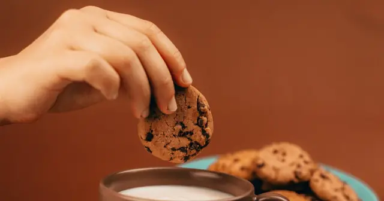

<!-- GENERATED from watch/issues/2026-11-23-brand-jokes-self-or-rival.yml by scripts/build_watch.py. Edit the data file. -->

```{=html}
<p class="mw-kicker">Marketing in 3 · 2026 · No. 50 · Monday 23 November 2026</p>
<figure class="mw-hero"><picture><source type="image/webp" sizes="(max-width: 900px) 100vw, 900px" srcset="../../images/web/issue-50-brand-jokes-self-or-rival-960.webp 960w, ../../images/web/issue-50-brand-jokes-self-or-rival-1600.webp 1600w"></picture><figcaption>A laugh at something on screen. Whom the joke targets shapes what viewers then think of the brand behind it. Photo: Yudha Aprilian on Unsplash.</figcaption></figure>
<section class="mw-answer" aria-label="Short answer"><h2>The short answer</h2><div class="mw-ans-grid"><p>Usually itself. In three experiments with 1,590 people, a brand post that poked fun at one of the brand&#x27;s own past decisions was liked more, and lifted opinions of the brand more, than the identical joke pointed at a competitor. Mocking a rival made the brand look mean, and that cost cancelled out the extra likes. The advantage was largest for brands seen as sincere or competent.</p><div class="mw-ev" role="note" aria-label="Evidence level: 2 of 3 stars, several studies"><span class="ev-k">Evidence level</span><ol><li><span class="ev-s" aria-hidden="true"><b>★</b><i>★</i><i>★</i></span>One study</li><li class="on"><span class="ev-s" aria-hidden="true"><b>★</b><b>★</b><i>★</i></span>Several studies</li><li><span class="ev-s" aria-hidden="true"><b>★</b><b>★</b><b>★</b></span>Meta-analysis</li></ol></div></div></section>
<section class="mw-takeaways"><h2>Key takeaways</h2><ul><li>Compared with a plain product post, a jab at a competitor raised post liking by 0.56 points (out of 7) but left opinions of the brand where they were.</li><li>Turning that joke on the posting brand raised post liking by 1.25 over the plain post and brand evaluation by 0.31.</li><li>A fictional coffee roaster rated 5.49 out of 7 for competence but 3.23 for market power still gained from self-directed jokes, so the benefit does not depend on market leadership.</li><li>The fit advantage of self-directed jokes appeared only once a brand&#x27;s sincerity or competence rating passed about 4.0; for brands rated lower, the target of the joke made no difference to fit.</li></ul></section>
<section id="what-the-researcher-did"><h2>What the researcher did</h2><p><a class="mw-orcid-link" href="https://orcid.org/0009-0004-4264-4581" title="Michael Moorhouse on ORCID">Michael Moorhouse</a> of Wilfrid Laurier University&#x27;s Lazaridis School of Business and Economics in Waterloo, Canada,
looked at a familiar habit of brands on social media: teasing a competitor in public. Earlier studies mostly varied
how harsh such jokes are while keeping a rival as the target. This paper keeps the joke the same and
changes only its target, so that the brand either mocks one of its own decisions or the identical decision by a
competitor.</p><p>The argument is that the target tells people what kind of character the brand is. Teasing a rival casts the
brand as an aggressor, which many people find mean however funny the line. A joke at its own expense can come
across as self-assured instead. Each study measured liking for the post, its fit with the brand&#x27;s
personality, how mean it seemed and the resulting opinion of the brand.</p>
<dl class="mw-facts"><div><dt>Studies</dt><dd>Three online experiments with random assignment</dd></div><div><dt>Participants</dt><dd>590 Prolific adults, 600 university students and 400 Prolific adults</dd></div><div><dt>Brands</dt><dd>Four car makers, six restaurant and coffee chains, and a fictitious coffee roaster</dd></div><div><dt>What changed</dt><dd>Only the target of the joke: the posting brand or a named competitor</dd></div><div><dt>Post format</dt><dd>Static posts in the style of X</dd></div><div><dt>Published</dt><dd>Online 7 October 2026 (subscription)</dd></div></dl>
</section>
<section id="one-joke-two-targets"><h2>One joke, two targets</h2><p>In the first study, participants saw a post from Tesla, Toyota, Mercedes-Benz or Jeep that recalled a design
decision: rectangular cupholders, signed off with the hashtag #notallideasaregoodideas. Half saw the brand say it
had made that choice, and half saw it blame Ford for the same cupholders. Before the post, everyone rated their
familiarity with each brand and their liking for it, so the analysis could account for existing
attitudes.</p><p>The self-directed post did better on every outcome measured. People liked it more, found it funnier and
rated the brand more favourably afterwards (Moorhouse, 2026). Perceived meanness carried most of the
difference: blaming Ford made the post seem mean-spirited, and that pulled down both liking and brand opinion. How well
the post suited the brand&#x27;s personality played a smaller part, and only reached marginal significance in this study.</p>
</section>
<section id="likes-for-the-rival-joke-but-no-lift-for-the-brand"><h2>Likes for the rival joke, but no lift for the brand</h2><p>The second study switched to McDonald&#x27;s, Burger King, Chick-fil-A, Dairy Queen, Taco Bell and Starbucks, and added a
plain post announcing a new avocado toast as a comparison. The two humorous versions joked that the item had once
been on the menu, either at the posting brand or at Subway. This time both jokes were judged equally funny, so
amusement cannot explain what followed.</p><p>Both jokes earned more liking than the plain announcement, and the self-directed one earned the most. Brand
evaluation moved less. Only the self-directed joke improved it; the jab at Subway produced no better
brand ratings than the plain post. The mediation analysis showed why: the rival joke gained through higher liking
and lost through higher meanness, two pulls in opposite directions with similar force.</p>
</section>
<section id="which-brands-gain-most-from-joking-about-themselves"><h2>Which brands gain most from joking about themselves</h2><p>Participants in the second study also rated each brand&#x27;s personality on Aaker&#x27;s five dimensions. Two of them
shaped the result. The more sincere a brand seemed, meaning honest, wholesome and down-to-earth, the better a
self-directed joke fitted it compared with a jab at a rival. Competence, meaning reliable, intelligent and
successful, had the same effect.</p><p>Excitement, sophistication and ruggedness did not change how far the two kinds of joke differed in fit. Rugged brands
did, however, get a higher fit score for either joke, which suggests that teasing in general suits a tough,
outdoorsy image. The author reads the sincerity and competence results as expectations about conduct: warm
brands are expected to avoid public attacks, and capable brands are expected to stay composed.</p>
<dl class="mw-facts"><div><dt>Moderated the effect</dt><dd>Sincerity, competence</dd></div><div><dt>Did not moderate</dt><dd>Excitement, sophistication, ruggedness</dd></div><div><dt>Higher fit for any joke</dt><dd>Ruggedness (excitement marginal)</dd></div></dl>
</section>
<section id="a-small-brand-a-minor-flaw-and-a-serious-one"><h2>A small brand, a minor flaw and a serious one</h2><p>Real brands come with existing reputations, and market leaders may get more leeway to tease. The third study therefore invented a
small, technically minded coffee roaster called Method Roasters and a rival called MasterBlend. The posts joked
either about crooked bag labels, a minor flaw, or about espresso extraction times that swing from 30 seconds to
5 minutes, a flaw people rated as more important when buying coffee.</p><p>Self-directed jokes beat jokes at MasterBlend on liking, fit, meanness, funniness and brand evaluation, and the
importance of the flaw made no significant difference. Looked at separately, the brand evaluation benefit was clear
for the bag labels and only marginal for the espresso timing, while liking, fit and meanness still favoured the
self-directed post for both.</p>
<figure class="mw-chart" id="chart-coffee_brand"><figcaption class="mw-chart-title">Ratings after a post from a fictitious coffee brand, by target of the joke (1 to 7)</figcaption><div class="mw-chart-svg"><svg viewBox="0 0 706 194" role="img" aria-labelledby="chart-coffee_brand-t" font-family="Hanken Grotesk, Arial, sans-serif"><title id="chart-coffee_brand-t">Ratings after a post from a fictitious coffee brand, by target of the joke (1 to 7)</title><line x1="276.0" y1="4" x2="276.0" y2="168" stroke="#dde1e8" stroke-width="1"/><text x="276.0" y="186" font-size="12" text-anchor="middle" fill="#5b6476">1</text><line x1="336.0" y1="4" x2="336.0" y2="168" stroke="#dde1e8" stroke-width="1"/><text x="336.0" y="186" font-size="12" text-anchor="middle" fill="#5b6476">2</text><line x1="396.0" y1="4" x2="396.0" y2="168" stroke="#dde1e8" stroke-width="1"/><text x="396.0" y="186" font-size="12" text-anchor="middle" fill="#5b6476">3</text><line x1="456.0" y1="4" x2="456.0" y2="168" stroke="#dde1e8" stroke-width="1"/><text x="456.0" y="186" font-size="12" text-anchor="middle" fill="#5b6476">4</text><line x1="516.0" y1="4" x2="516.0" y2="168" stroke="#dde1e8" stroke-width="1"/><text x="516.0" y="186" font-size="12" text-anchor="middle" fill="#5b6476">5</text><line x1="576.0" y1="4" x2="576.0" y2="168" stroke="#dde1e8" stroke-width="1"/><text x="576.0" y="186" font-size="12" text-anchor="middle" fill="#5b6476">6</text><line x1="636.0" y1="4" x2="636.0" y2="168" stroke="#dde1e8" stroke-width="1"/><text x="636.0" y="186" font-size="12" text-anchor="middle" fill="#5b6476">7</text><g><title>Post liking, joke about itself: 4.05 </title><text x="264" y="27" font-size="13.5" text-anchor="end" fill="#15203b" font-weight="600">Post liking, joke about itself</text><rect x="276" y="12" width="183.0" height="22" rx="4" fill="#e0a12a"/><text x="467.0" y="28" font-size="13.5" fill="#15203b" font-weight="600">4.05</text></g><g><title>Post liking, joke about a rival: 3.30 </title><text x="264" y="67" font-size="13.5" text-anchor="end" fill="#15203b">Post liking, joke about a rival</text><rect x="276" y="52" width="138.0" height="22" rx="4" fill="#aab3c5"/><text x="422.0" y="68" font-size="13.5" fill="#15203b">3.30</text></g><g><title>Brand evaluation, joke about itself: 4.67 </title><text x="264" y="107" font-size="13.5" text-anchor="end" fill="#15203b" font-weight="600">Brand evaluation, joke about itself</text><rect x="276" y="92" width="220.2" height="22" rx="4" fill="#e0a12a"/><text x="504.2" y="108" font-size="13.5" fill="#15203b" font-weight="600">4.67</text></g><g><title>Brand evaluation, joke about a rival: 4.16 </title><text x="264" y="147" font-size="13.5" text-anchor="end" fill="#15203b">Brand evaluation, joke about a rival</text><rect x="276" y="132" width="189.6" height="22" rx="4" fill="#aab3c5"/><text x="473.6" y="148" font-size="13.5" fill="#15203b">4.16</text></g></svg></div><div class="mw-sr"><table><caption>Ratings after a post from a fictitious coffee brand, by target of the joke (1 to 7)</caption><tr><th>Group</th><th>Value ()</th></tr><tr><th scope="row">Post liking, joke about itself</th><td>4.05</td></tr><tr><th scope="row">Post liking, joke about a rival</th><td>3.3</td></tr><tr><th scope="row">Brand evaluation, joke about itself</th><td>4.67</td></tr><tr><th scope="row">Brand evaluation, joke about a rival</th><td>4.16</td></tr></table></div><p class="mw-chart-src">Study 3, 400 Prolific participants, results pooled across the minor and the important flaw. Both differences significant (p &lt; 0.001).</p></figure>
</section>
<section id="what-social-media-teams-can-take-from-it"><h2>What social media teams can take from it</h2><p>A dashboard that counts likes, comments and shares would score a dig at a competitor as a success. These experiments
suggest the gain stays on the post. The author advises checking how audiences read a post, not only how many
react, and treating comments that call the brand petty, mean or off-brand as a sign that engagement figures hide
damage to the brand.</p><p>For brands built on honesty or reliability, the practical test before posting is whether the line sounds like
something the brand would plausibly say. Many jokes written about a competitor can be rewritten about the brand
itself. The paper adds three cautions: brands with a weak quality image may only confirm doubts by mocking
themselves, minor flaws are the safest material, and frequent self-mockery can turn into a self-defeating style.</p>
</section>
<section id="how-to-apply-it" class="mw-howto"><p class="mw-rsg-kicker">Marketing in 3 steps</p><h2>Ready. Set. Market.</h2><div class="mw-rsg"><div class="mw-phase"><div class="mw-phase-dot" aria-hidden="true">1</div><div class="mw-phase-tag"><span class="mw-phase-name">Ready</span><span class="mw-phase-sub">Decide and prepare</span></div><ul class="mw-rsg-steps"><li><strong>Sort your recent jokes by target.</strong> Pull every humorous post from the last six months and tag each one by whom it mocks: your own brand, a competitor, customers or nobody in particular. Note which ones drew complaints.</li><li><strong>Write down how your brand treats others.</strong> Agree three words for the brand&#x27;s voice and one sentence on how it speaks about rivals and customers. Check every joke against that sentence before it is scheduled.</li></ul></div><div class="mw-phase"><div class="mw-phase-dot" aria-hidden="true">2</div><div class="mw-phase-tag"><span class="mw-phase-name">Set</span><span class="mw-phase-sub">Build it</span></div><ul class="mw-rsg-steps"><li><strong>Rewrite rival jokes about yourself.</strong> Take each draft that mocks a competitor and rewrite it about a small quirk of your own, such as old packaging, a clumsy product name or a past design choice. Keep the wording close to the original so the line stays funny.</li><li><strong>Choose safe material.</strong> Keep a short list of approved flaws the team may joke about. Leave out anything touching safety, hygiene, data security or the core quality of what you sell.</li></ul></div><div class="mw-phase"><div class="mw-phase-dot" aria-hidden="true">3</div><div class="mw-phase-tag"><span class="mw-phase-name">Market</span><span class="mw-phase-sub">Launch and measure</span></div><ul class="mw-rsg-steps"><li><strong>Read the comments, not only the counts.</strong> For each humorous post, record likes and shares, then read the first 100 comments and count words such as petty, mean, rude or desperate. Compare the count with your regular posts.</li><li><strong>Check brand opinion every quarter.</strong> Run a short follower survey each quarter on how people rate the brand, and set it beside your engagement report. Keep self-directed jokes to roughly one post in ten so they stay fresh.</li></ul></div></div></section>
<div class="mw-coffee" role="complementary" aria-label="Support Marketing in 3"><div class="mw-coffee-text"><p class="mw-coffee-title">Found this useful?</p><p>Marketing in 3 is free and ad-free, with new issues every Monday and Thursday. A coffee keeps it that way.</p></div><a class="mw-coffee-btn" href="https://ko-fi.com/marketingin3" target="_blank" rel="noopener"><svg aria-hidden="true" focusable="false"
  class="lucide lucide-coffee"
  xmlns="http://www.w3.org/2000/svg"
  width="24"
  height="24"
  viewBox="0 0 24 24"
  fill="none"
  stroke="currentColor"
  stroke-width="2"
  stroke-linecap="round"
  stroke-linejoin="round"
>
  <path d="M10 2v2" />
  <path d="M14 2v2" />
  <path d="M16 8a1 1 0 0 1 1 1v8a4 4 0 0 1-4 4H7a4 4 0 0 1-4-4V9a1 1 0 0 1 1-1h14a4 4 0 1 1 0 8h-1" />
  <path d="M6 2v2" />
</svg><span>Buy me a coffee</span><span class="mw-coffee-price">€3</span></a></div>
<form class="mw-email mw-email-inline" action="https://qewbdm3gpjxh42mawu5n6ac37m0hlcgm.lambda-url.ap-southeast-2.on.aws/subscribe" method="post"><div class="mw-email-text"><p class="mw-email-title">Get it by email</p><p>New issues every Monday and Thursday, in your inbox. Free, no ads, unsubscribe anytime.</p></div><div class="mw-email-row"><label class="visually-hidden" for="m3-email-inline">Email address</label><input id="m3-email-inline" type="email" name="email" required autocomplete="email" inputmode="email" placeholder="you@example.com" maxlength="254"><input class="mw-hp" type="text" name="website" tabindex="-1" autocomplete="off" aria-hidden="true"><input type="hidden" name="source" value=""><button type="submit">Subscribe</button></div><p class="mw-email-status" role="status" aria-live="polite"></p><p class="mw-email-note">Your address is used only to send Marketing in 3. You will get one email to confirm.</p></form><script>(function(){if(window.m3Email)return;window.m3Email=1;
var M={"check": "Almost done. Check your inbox for an email from issues@marketingin3.com and tap the link to confirm.", "invalid": "That email address does not look right. Please check it and try again.", "slow": "Too many tries in a short time. Please wait a few minutes and try again.", "busy": "Too many tries in a short time. Please wait a few minutes and try again.", "error": "Something went wrong. Please try again in a moment.", "undeliverable": "That address cannot receive email from us. Please try another one.", "confirming": "Confirming your subscription…", "ok": "You are subscribed. The next issue arrives in your inbox on Monday or Thursday, whichever comes first.", "expired": "This confirmation link has expired or was already used. Enter your address again for a fresh one."};
function ep(f){return f.getAttribute('action').replace(/\/subscribe$/,'');}
function say(f,k){var s=f.querySelector('.mw-email-status');if(!s)return;s.textContent=M[k]||M.error;
s.className='mw-email-status is-'+(k==='ok'||k==='check'?'ok':(k==='confirming'?'wait':'bad'));}
function gc(e){try{if(window.mwTrack)window.mwTrack(e);}catch(x){}try{if(window.goatcounter&&goatcounter.count)goatcounter.count({path:e,title:e,event:true});}catch(x){}}
document.querySelectorAll('form.mw-email').forEach(function(f){
var src=f.querySelector('input[name=source]');if(src)src.value=location.pathname;
f.addEventListener('submit',function(e){if(!window.fetch)return;e.preventDefault();
var b=f.querySelector('button');b.disabled=true;
var data={email:f.email.value,website:f.website.value,source:location.pathname};
fetch(f.getAttribute('action'),{method:'POST',headers:{'content-type':'application/json'},body:JSON.stringify(data)})
.then(function(r){return r.json().catch(function(){return {status:'error'};});})
.then(function(j){say(f,j.status);if(j.status==='check'){f.classList.add('is-done');gc('email-subscribe');}})
.catch(function(){say(f,'error');}).then(function(){b.disabled=false;});});});
var q=new URLSearchParams(location.search),f=document.querySelector('form.mw-email');if(!f)return;
['check','invalid','slow','error'].forEach(function(k){if(q.get(k))say(f,k);});
var t=q.get('t');if(t){say(f,'confirming');
fetch(ep(f)+'/confirm',{method:'POST',headers:{'content-type':'application/json'},body:JSON.stringify({t:t})})
.then(function(r){return r.json().catch(function(){return {status:'error'};});})
.then(function(j){say(f,j.status);if(j.status==='ok'){f.classList.add('is-done');gc('email-confirmed');}
if(history.replaceState)history.replaceState(null,'',location.pathname+'#email');})
.catch(function(){say(f,'error');});}
})();</script>
<section id="what-to-expect"><h2>What to expect</h2><ul class="mw-list"><li><strong>More likes, not fewer.</strong> In every study the self-directed version drew more liking than the version aimed at a competitor, so switching targets does not cost engagement.</li><li><strong>Gains that dashboards miss.</strong> The benefit shows up in brand opinion, which needs a survey or brand-lift test to see.</li><li><strong>Bigger returns for warm or capable brands.</strong> Brands known for honesty or reliability stand to gain most; for rugged brands, teasing of any kind tends to fit.</li><li><strong>Limits to self-mockery.</strong> A brand already seen as low in quality risks confirming its flaws, and joking about itself too often can start to look like low confidence.</li></ul></section>
<section id="where-it-does-not-work"><h2>Where it does not work</h2><ul class="mw-list"><li><strong>Single posts, not conversations.</strong> Participants saw one static post; replies from the targeted brand, other users or influencers were not included.</li><li><strong>One joke format per study.</strong> Each study used a single joke structure, so harsher wording or other formats may behave differently.</li><li><strong>Students for the personality test.</strong> The brand personality findings come from students at one North American university.</li><li><strong>Measured in one sitting.</strong> Fit, meanness, liking and brand opinion were all rated in the same survey straight after the post, which limits what the data say about which judgement comes first.</li></ul></section>
<section id="questions"><h2>Questions marketers ask</h2><div class="mw-faq"><h3>Should brands make fun of competitors on social media?</h3><p>It can win likes, but in these experiments it did not help the brand. When a post teasing a rival was set against an ordinary announcement, it drew more liking yet did not improve brand ratings, because people judged it mean (Moorhouse, 2026). A self-directed version of the joke did better on liking and on brand opinion.</p></div><div class="mw-faq"><h3>What is self-deprecating humour in brand marketing?</h3><p>It is a brand joking about its own flaws, such as a past design choice, an awkward product or a menu item that did not work. In three experiments, posts of this kind seemed less mean and fitted the brand better than identical jokes aimed at a rival.</p></div><div class="mw-faq"><h3>Why does mocking a competitor hurt brand evaluation?</h3><p>People see a brand that belittles another brand in public as having crossed a social line. That sense of meanness lowers how much they like the post and, through it, what they think of the brand. This penalty grew when the jab clashed with the brand&#x27;s personality.</p></div><div class="mw-faq"><h3>Which brands benefit most from self-deprecating humour?</h3><p>Those that people regard as sincere or competent. For them, a self-directed joke fits expectations of warmth or composure far better than an attack on a rival. Brands whose quality is already in doubt should be careful, since joking about their flaws may confirm them.</p></div><div class="mw-faq"><h3>Do likes show whether a humorous brand post worked?</h3><p>Not on their own. In one of the experiments, a competitor-directed joke earned more likes than a plain post but left brand opinions unchanged. Measuring brand opinion separately, through surveys or brand-lift tests, shows whether the engagement helped the brand.</p></div></section>
<section id="also-new"><h2>Also new this week</h2><div class="mw-also"><article><p class="mw-also-src"><em>Journal of Interactive Marketing</em> · 2026</p><h3><a href="https://doi.org/10.1177/10949968261475153">Digital Canvases: How Meme Typologies Reveal Ideological Terrain for Marketers</a></h3><p class="mw-also-au">Chen, Bradford, Schiele, &amp; Hu</p><p>A qualitative analysis of Instagram memes examined how different meme types line up with the ideological positions consumers hold. The authors add two subtypes of expressive memes: one that shows emotional honesty while accepting dominant norms, and one that uses symbolic, often humorous resistance to them. Memes appear as spaces where consumers work out identity and contest norms, and the authors are clear that the analysis does not show memes changing beliefs or behaviour. For brands, the typology offers a way to match tone to the community a meme speaks for.</p></article><article><p class="mw-also-src"><em>Journal of Interactive Marketing</em> · 2026</p><h3><a href="https://doi.org/10.1177/10949968261418878">Managing Firm Social Media Communications Around Fast-Paced Product Launches</a></h3><p class="mw-also-au">Ungureanu, van Oest, &amp; Pauwels</p><p>Using daily social media data on video game launches by major publishers, this study examined engagement when one launch overlaps with the next. Overlaps lowered engagement rates for publishers and product accounts but raised them for the games&#x27; creators. Spillovers ran one way: publisher and creator posts lifted engagement on product accounts, and creator posts lifted publishers, but not the reverse. The authors&#x27; advice divides the work by timing, with creators posting more before launch and publishers more after it.</p></article></div></section>
<section id="source" class="mw-source"><h2>Source</h2><p class="mw-cite">Moorhouse, M. (2026). Laugh with me, not at them: why changing the target of disparaging brand humor on social media matters beyond engagement. <em>Journal of Research in Interactive Marketing</em>. <a href="https://doi.org/10.1108/jrim-04-2026-0274">https://doi.org/10.1108/jrim-04-2026-0274</a></p><p class="mw-note">This brief is written for practitioners from the published article. Numbers are as reported by the authors; read the article for full methods.</p></section>
<section id="related-research" class="mw-related"><h2>Related research on this site</h2><ul><li><a href="../../../papers/social-media-communication-brand-perceptions.html">The effect of social media communication on consumer perceptions of brands</a><span>Journal of Marketing Communications</span></li></ul></section>
<section id="keep-reading" class="mw-more"><h2>Keep reading</h2><p class="mw-more-topics">More issues on <a href="../../topics/social-media.html">Social media</a> · <a href="../../topics/creative.html">Creative</a> · <a href="../../topics/advertising.html">Advertising</a></p><div class="watch-list"><article class="watch-item"><a class="watch-thumb" href="../../posts/implied-motion-ad-photos/index.html" tabindex="-1" aria-hidden="true"></a><div><p class="watch-meta">2024 · No. 36 · <time datetime="2024-09-17">Paper published 17 September 2024</time></p><h3><a href="../../posts/implied-motion-ad-photos/index.html">Why action shots beat still poses in ads</a></h3><p>Bünzli et al. find action shots made Instagram ads more engaging and persuasive in seven US experiments, and movement along a curve drew people in most.</p></div></article><article class="watch-item"><a class="watch-thumb" href="../../posts/meme-brand-placement/index.html" tabindex="-1" aria-hidden="true"></a><div><p class="watch-meta">2024 · No. 2 · <time datetime="2024-01-09">Paper published 9 January 2024</time></p><h3><a href="../../posts/meme-brand-placement/index.html">Why memes work better when the brand shows</a></h3><p>Razzaq et al. find memes that show the brand clearly earn more liking and sharing intent, most of all for little-known brands and captions written to &quot;you&quot;.</p></div></article><article class="watch-item"><a class="watch-thumb" href="../../posts/slow-motion-short-videos/index.html" tabindex="-1" aria-hidden="true"></a><div><p class="watch-meta">2023 · No. 18 · <time datetime="2023-05-16">Paper published 16 May 2023</time></p><h3><a href="../../posts/slow-motion-short-videos/index.html">When slow motion makes a short video more appealing</a></h3><p>Stuppy et al. find slow motion makes short looping clips more liked and lifts brand choice, as long as the movement is complex and the content pleasant.</p></div></article></div></section>
<div class="mw-author"><div><p><strong>Bruno Schivinski</strong> is Associate Professor of Marketing at Gdańsk University of Technology. He studies how consumers engage with brands in digital and social media.</p><p><a href="../../../index.html">About Bruno</a> · <a href="../../index.html">All Marketing in 3 issues</a> · <a href="../../subscribe.html">Subscribe</a></p></div></div>
<nav class="mw-pn" aria-label="More issues"><a class="mw-prev" href="../algorithmic-evaluation-weaker-applicants/index.html"><span>Previous issue</span>Who stops applying when an algorithm decides</a></nav>
```
