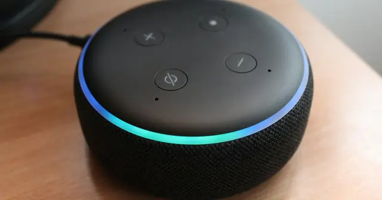

<!-- GENERATED from watch/issues/2026-08-24-chatgpt-referrals-ecommerce.yml by scripts/build_watch.py. Edit the data file. -->

```{=html}
<p class="mw-kicker">Marketing in 3 · Issue 33 · Week of 24 August 2026</p>
<figure class="mw-hero"><picture><source type="image/webp" sizes="(max-width: 900px) 100vw, 900px" srcset="../../images/web/issue-33-chatgpt-referrals-ecommerce-960.webp 960w, ../../images/web/issue-33-chatgpt-referrals-ecommerce-1600.webp 1600w"></picture><figcaption>Where a shopper asks matters as much as what they ask. This study tracks the ones who start with a chatbot. Photo: Jakub Żerdzicki on Unsplash.</figcaption></figure>
<section class="mw-answer" aria-label="Short answer"><h2>The short answer</h2><p>Not yet. A year after launch, visitors sent by ChatGPT were fewer than 0.2% of traffic. They converted more often than paid social visitors but less often than every other channel, and they spent less per visit. The picture is better for complex products and is improving over time. For most shops it is a small channel worth watching rather than a new engine for sales.</p></section>
<section class="mw-takeaways"><h2>Key takeaways</h2><ul><li>Across 973 sites, ChatGPT sent under 0.2% of traffic, about 200 times less than Google&#x27;s organic search.</li><li>Compared with ChatGPT visitors, organic search visitors were 13% more likely to buy and affiliate visitors 86% more likely. Only paid social did worse.</li><li>In complex categories such as finance, vehicles and business services, ChatGPT&#x27;s share of traffic was 4.6 times higher and its conversion rate beat several traditional channels.</li><li>Over the year, conversion rose while order values fell, so revenue per visit improved only modestly.</li></ul></section>
<section id="what-the-researchers-did"><h2>What the researchers did</h2><p>In August 2024, ChatGPT began adding links to online shops when a user showed they wanted to buy something. Ask for an
espresso machine and you get a comparison and buy links for your country. These links are organic, not paid for
by advertisers. Marketers called it a new channel before anyone knew how well it worked.</p><p>Maximilian Kaiser, at the University of Hamburg and the analytics firm Grips Intelligence, and Christian Schulze, at
Frankfurt School of Finance &amp; Management, got inside the analytics accounts of 973 online shops. They could see which
channel brought each visitor and what the visitor did next, for a full year.</p><p>They compared ChatGPT referrals with eight established channels: paid search, organic search, direct, email,
referral sites, affiliates, paid social and a catch-all &quot;other&quot;. They looked at money (how many visits end in a
purchase, how large the order is, how much a visit earns) and at behaviour (bounces, time on site, pages viewed).</p>
<dl class="mw-facts"><div><dt>Period</dt><dd>August 2024 to July 2025, with the main analysis on the six months to early August 2025</dd></div><div><dt>Shops</dt><dd>973 e-commerce websites across 24 categories and every continent, with $20 billion in yearly revenue</dd></div><div><dt>Volume</dt><dd>More than 50,000 purchases from ChatGPT referrals, against 164 million from traditional channels</dd></div><div><dt>Measure</dt><dd>Last-click attribution: the channel of the final visit before purchase gets the credit</dd></div><div><dt>Method</dt><dd>Regression models that account for how few ChatGPT visits each shop receives in a week</dd></div></dl>
</section>
<section id="a-small-channel-that-buys-less-often"><h2>A small channel that buys less often</h2><p>Start with scale. ChatGPT supplied less than 0.2% of all visits in the data. Over the six month main window it sent
about 4 million visits, where paid search sent about 1.5 billion. More than nine in ten of the AI-driven visits came
from ChatGPT. Perplexity, Gemini, Copilot and the rest were negligible.</p><p>Next, quality. The raw numbers look bad for ChatGPT, but they mislead. Half of the weekly ChatGPT figures contained
zero purchases, so simple averages are a poor guide. After the authors accounted for how many visits sat behind
each number, and for differences between shops, devices and months, the gaps narrowed. ChatGPT visitors still
converted less often than every channel except paid social.</p><p>The chart shows the odds of a visit ending in a purchase, with ChatGPT set to 100. Paid social comes in at 47,
about half as likely. Organic search is 13% higher. Affiliate visitors are nearly twice as likely.</p>
<figure class="mw-chart" id="chart-conversion"><figcaption class="mw-chart-title">Likelihood that a visit ends in a purchase, ChatGPT = 100</figcaption><div class="mw-chart-svg"><svg viewBox="0 0 680 394" role="img" aria-labelledby="chart-conversion-t" font-family="Hanken Grotesk, Arial, sans-serif"><title id="chart-conversion-t">Likelihood that a visit ends in a purchase, ChatGPT = 100</title><line x1="250.0" y1="4" x2="250.0" y2="368" stroke="#dde1e8" stroke-width="1"/><text x="250.0" y="386" font-size="12" text-anchor="middle" fill="#5b6476">0</text><line x1="340.0" y1="4" x2="340.0" y2="368" stroke="#dde1e8" stroke-width="1"/><text x="340.0" y="386" font-size="12" text-anchor="middle" fill="#5b6476">50</text><line x1="430.0" y1="4" x2="430.0" y2="368" stroke="#dde1e8" stroke-width="1"/><text x="430.0" y="386" font-size="12" text-anchor="middle" fill="#5b6476">100</text><line x1="520.0" y1="4" x2="520.0" y2="368" stroke="#dde1e8" stroke-width="1"/><text x="520.0" y="386" font-size="12" text-anchor="middle" fill="#5b6476">150</text><line x1="610.0" y1="4" x2="610.0" y2="368" stroke="#dde1e8" stroke-width="1"/><text x="610.0" y="386" font-size="12" text-anchor="middle" fill="#5b6476">200</text><g><title>Paid social: 47 </title><text x="238" y="27" font-size="13.5" text-anchor="end" fill="#15203b">Paid social</text><rect x="250" y="12" width="84.6" height="22" rx="4" fill="#aab3c5"/><text x="342.6" y="28" font-size="13.5" fill="#15203b">47</text></g><g><title>ChatGPT: 100 </title><text x="238" y="67" font-size="13.5" text-anchor="end" fill="#15203b" font-weight="600">ChatGPT</text><rect x="250" y="52" width="180.0" height="22" rx="4" fill="#e0a12a"/><text x="438.0" y="68" font-size="13.5" fill="#15203b" font-weight="600">100</text></g><g><title>Organic search: 113 </title><text x="238" y="107" font-size="13.5" text-anchor="end" fill="#15203b">Organic search</text><rect x="250" y="92" width="203.4" height="22" rx="4" fill="#aab3c5"/><text x="461.4" y="108" font-size="13.5" fill="#15203b">113</text></g><g><title>Referral sites: 124 </title><text x="238" y="147" font-size="13.5" text-anchor="end" fill="#15203b">Referral sites</text><rect x="250" y="132" width="223.2" height="22" rx="4" fill="#aab3c5"/><text x="481.2" y="148" font-size="13.5" fill="#15203b">124</text></g><g><title>Email: 132 </title><text x="238" y="187" font-size="13.5" text-anchor="end" fill="#15203b">Email</text><rect x="250" y="172" width="237.6" height="22" rx="4" fill="#aab3c5"/><text x="495.6" y="188" font-size="13.5" fill="#15203b">132</text></g><g><title>Direct: 133 </title><text x="238" y="227" font-size="13.5" text-anchor="end" fill="#15203b">Direct</text><rect x="250" y="212" width="239.4" height="22" rx="4" fill="#aab3c5"/><text x="497.4" y="228" font-size="13.5" fill="#15203b">133</text></g><g><title>Other: 144 </title><text x="238" y="267" font-size="13.5" text-anchor="end" fill="#15203b">Other</text><rect x="250" y="252" width="259.2" height="22" rx="4" fill="#aab3c5"/><text x="517.2" y="268" font-size="13.5" fill="#15203b">144</text></g><g><title>Paid search: 145 </title><text x="238" y="307" font-size="13.5" text-anchor="end" fill="#15203b">Paid search</text><rect x="250" y="292" width="261.0" height="22" rx="4" fill="#aab3c5"/><text x="519.0" y="308" font-size="13.5" fill="#15203b">145</text></g><g><title>Affiliate: 186 </title><text x="238" y="347" font-size="13.5" text-anchor="end" fill="#15203b">Affiliate</text><rect x="250" y="332" width="334.8" height="22" rx="4" fill="#aab3c5"/><text x="592.8" y="348" font-size="13.5" fill="#15203b">186</text></g></svg></div><div class="mw-sr"><table><caption>Likelihood that a visit ends in a purchase, ChatGPT = 100</caption><tr><th>Group</th><th>Value ()</th></tr><tr><th scope="row">Paid social</th><td>47</td></tr><tr><th scope="row">ChatGPT</th><td>100</td></tr><tr><th scope="row">Organic search</th><td>113</td></tr><tr><th scope="row">Referral sites</th><td>124</td></tr><tr><th scope="row">Email</th><td>132</td></tr><tr><th scope="row">Direct</th><td>133</td></tr><tr><th scope="row">Other</th><td>144</td></tr><tr><th scope="row">Paid search</th><td>145</td></tr><tr><th scope="row">Affiliate</th><td>186</td></tr></table></div><p class="mw-chart-src">Table 3, six month data. Regression coefficients on conversion, converted to relative likelihood against ChatGPT (e.g. +13% for organic search, +86% for affiliate, 53% lower for paid social).</p></figure>
</section>
<section id="people-stay-briefly-but-they-do-not-leave-at-once"><h2>People stay briefly but they do not leave at once</h2><p>Engagement tells a mixed story. ChatGPT visitors bounced less than visitors from most channels. Email visitors were 20%
more likely to leave after one page, and organic search visitors 13% less likely. So the traffic is not junk, in the
sense of arriving by mistake.</p><p>Those visitors looked at fewer pages than every channel except paid social. Time on site landed in the middle.
Probably ChatGPT has already done the comparing, so the visitor arrives with a specific
product in mind and has less to browse.</p><p>Revenue per visit tells the same story as conversion. ChatGPT earned more per visit than paid social and less than
the other seven channels. Average order value was noisier, and for some channels the difference was not
statistically reliable.</p>
</section>
<section id="complex-products-fare-better"><h2>Complex products fare better</h2><p>The study then asked where ChatGPT works best. The authors sorted shops by how complex their products are. Finance,
vehicles, business and consumer services, law and government, and jobs counted as complex. News, sport and
entertainment counted as simple.</p><p>On complex sites, ChatGPT&#x27;s share of traffic was 4.6 times higher. Its conversion rate also beat paid social,
referral, email, organic search and direct traffic, and its revenue per visit moved closer to search. On simple sites
the gap was widest. Their explanation is that a chatbot adds most when the buyer has a lot of information to
weigh and adds friction when the purchase is routine.</p><p>They also split shops by how tech-savvy their visitors are. Where visitors skew toward technology fans, ChatGPT&#x27;s
traffic share was 3.8 times higher. Where visitors are younger, it was 5.5 times higher. In both groups the conversion
gap to other channels shrank.</p><p>This part of the study is exploratory. The split uses shop-level categories, not individual shoppers, so it points to
a likely explanation without proving it.</p>
<figure class="mw-chart" id="chart-share"><figcaption class="mw-chart-title">How many times higher ChatGPT&#x27;s traffic share is</figcaption><div class="mw-chart-svg"><svg viewBox="0 0 680 154" role="img" aria-labelledby="chart-share-t" font-family="Hanken Grotesk, Arial, sans-serif"><title id="chart-share-t">How many times higher ChatGPT&#x27;s traffic share is</title><line x1="250.0" y1="4" x2="250.0" y2="128" stroke="#dde1e8" stroke-width="1"/><text x="250.0" y="146" font-size="12" text-anchor="middle" fill="#5b6476">0</text><line x1="310.0" y1="4" x2="310.0" y2="128" stroke="#dde1e8" stroke-width="1"/><text x="310.0" y="146" font-size="12" text-anchor="middle" fill="#5b6476">1</text><line x1="370.0" y1="4" x2="370.0" y2="128" stroke="#dde1e8" stroke-width="1"/><text x="370.0" y="146" font-size="12" text-anchor="middle" fill="#5b6476">2</text><line x1="430.0" y1="4" x2="430.0" y2="128" stroke="#dde1e8" stroke-width="1"/><text x="430.0" y="146" font-size="12" text-anchor="middle" fill="#5b6476">3</text><line x1="490.0" y1="4" x2="490.0" y2="128" stroke="#dde1e8" stroke-width="1"/><text x="490.0" y="146" font-size="12" text-anchor="middle" fill="#5b6476">4</text><line x1="550.0" y1="4" x2="550.0" y2="128" stroke="#dde1e8" stroke-width="1"/><text x="550.0" y="146" font-size="12" text-anchor="middle" fill="#5b6476">5</text><line x1="610.0" y1="4" x2="610.0" y2="128" stroke="#dde1e8" stroke-width="1"/><text x="610.0" y="146" font-size="12" text-anchor="middle" fill="#5b6476">6</text><g><title>Complex vs simple products: 4.6 </title><text x="238" y="27" font-size="13.5" text-anchor="end" fill="#15203b" font-weight="600">Complex vs simple products</text><rect x="250" y="12" width="276.0" height="22" rx="4" fill="#e0a12a"/><text x="534.0" y="28" font-size="13.5" fill="#15203b" font-weight="600">4.6</text></g><g><title>Top vs bottom tech-savvy shops: 3.8 </title><text x="238" y="67" font-size="13.5" text-anchor="end" fill="#15203b">Top vs bottom tech-savvy shops</text><rect x="250" y="52" width="228.0" height="22" rx="4" fill="#aab3c5"/><text x="486.0" y="68" font-size="13.5" fill="#15203b">3.8</text></g><g><title>Younger vs older visitor shops: 5.5 </title><text x="238" y="107" font-size="13.5" text-anchor="end" fill="#15203b">Younger vs older visitor shops</text><rect x="250" y="92" width="330.0" height="22" rx="4" fill="#aab3c5"/><text x="588.0" y="108" font-size="13.5" fill="#15203b">5.5</text></g></svg></div><div class="mw-sr"><table><caption>How many times higher ChatGPT&#x27;s traffic share is</caption><tr><th>Group</th><th>Value ()</th></tr><tr><th scope="row">Complex vs simple products</th><td>4.6</td></tr><tr><th scope="row">Top vs bottom tech-savvy shops</th><td>3.8</td></tr><tr><th scope="row">Younger vs older visitor shops</th><td>5.5</td></tr></table></div><p class="mw-chart-src">Sections 6.1 and 6.2: complex against simple product categories, top against bottom quartile of technophile visitors, and younger against older visitors.</p></figure>
</section>
<section id="conversion-up-order-values-down"><h2>Conversion up, order values down</h2><p>The channel changed during the year. Conversion at ChatGPT visits climbed steadily, while conversion at other channels
held steady apart from holiday peaks. Order values moved the other way. Average order value from ChatGPT drifted
down, which offset much of the conversion gain.</p><p>The net result was a modest rise in revenue per visit. The authors projected the trend forward. In most scenarios,
ChatGPT&#x27;s conversion rate gets close to organic search within another year without matching it. Revenue per visit matches organic search only
under the most optimistic projection. They stress that projections are uncertain.</p><p>The same pairing, higher conversion and lower order value, shows up in the shops with the most tech-savvy visitors.
That is why the authors point to growing skill with chatbots as the likely driver: people who use them well buy more often,
and they buy cheaper things.</p><p>Early industry reports had pointed in opposite directions, from conversion rates several times higher than search to
rates lower than other channels. This study is the first of its size and sides with the cautious end.</p>
</section>
<section id="how-to-apply-it" class="mw-howto"><p class="mw-rsg-kicker">Marketing in 3 steps</p><h2>Ready. Set. Market.</h2><div class="mw-rsg"><div class="mw-phase"><div class="mw-phase-dot" aria-hidden="true">1</div><div class="mw-phase-tag"><span class="mw-phase-name">Ready</span><span class="mw-phase-sub">Decide and prepare</span></div><ul class="mw-rsg-steps"><li><strong>Find your AI referrals.</strong> In your web analytics, open the report that lists visits by source. Filter for sources from AI chat tools such as ChatGPT. Write down visits, orders and revenue for the last 90 days.</li><li><strong>Compare with two other channels.</strong> Make a table with three rows: AI chat, organic search and email. For each, list visits, conversion rate and revenue per visit. If AI chat has fewer than 30 orders, treat its rate as noise and wait another month.</li></ul></div><div class="mw-phase"><div class="mw-phase-dot" aria-hidden="true">2</div><div class="mw-phase-tag"><span class="mw-phase-name">Set</span><span class="mw-phase-sub">Build it</span></div><ul class="mw-rsg-steps"><li><strong>Check where those visitors land.</strong> List the ten pages that receive the most AI chat visits. Open each on your phone. Each should show a price, stock status and a clear buy button without scrolling.</li><li><strong>Make complex products easy to compare.</strong> Pick your five products that need the most explaining. On each page add a short comparison table and a plain-language summary of who it suits. A chatbot can quote clear facts, and a shopper arrives ready to decide.</li></ul></div><div class="mw-phase"><div class="mw-phase-dot" aria-hidden="true">3</div><div class="mw-phase-tag"><span class="mw-phase-name">Market</span><span class="mw-phase-sub">Launch and measure</span></div><ul class="mw-rsg-steps"><li><strong>Tag your own links.</strong> Where you can influence the link, such as a link you share in a chat or newsletter, add a tracking tag so the source shows separately in your reports. Check the next day that it appears.</li><li><strong>Review monthly on three numbers.</strong> Each month, record conversion rate, average order value and revenue per visit for AI chat. If conversion rises while order value falls, check which products those buyers choose before you increase effort on the channel.</li></ul></div></div></section>
<section id="what-to-expect"><h2>What to expect</h2><ul class="mw-list"><li><strong>Small numbers, so patience.</strong> Even a busy shop may see only a handful of AI-referred orders a week, which makes monthly figures swing.</li><li><strong>Better results in considered purchases.</strong> Expect the strongest results where buyers compare many details, and weaker ones for routine buys.</li><li><strong>Cheaper baskets for now.</strong> The trend in the data was more orders of lower value. Do not read a rising conversion rate as growth in revenue.</li><li><strong>Credit shows up late.</strong> Last-click reports give ChatGPT credit only when it was the final visit, so earlier influence stays hidden.</li></ul></section>
<section id="where-it-does-not-work"><h2>Where it does not work</h2><ul class="mw-list"><li><strong>Descriptive, not causal.</strong> The study shows how channels compare. It cannot say that ChatGPT causes shoppers to buy less or more than they otherwise would.</li><li><strong>Last-click credit.</strong> A shopper who researches in ChatGPT and buys later through search is counted as search. That understates the chat channel&#x27;s role in discovery.</li><li><strong>A young channel.</strong> The data stop in mid 2025. Instant checkout, shopping agents and paid ads in ChatGPT arrived afterwards and could change the picture.</li><li><strong>Data from one firm.</strong> The data were supplied by Grips Intelligence, which employs the first author, and shops that share analytics may differ from those that do not.</li></ul></section>
<section id="questions"><h2>Questions marketers ask</h2><div class="mw-faq"><h3>How much traffic does ChatGPT send to online shops?</h3><p>Very little so far. Across 973 shops in a year, it supplied under 0.2% of visits, about 200 times less than Google&#x27;s organic search (Kaiser &amp; Schulze, 2026, Marketing Science).</p></div><div class="mw-faq"><h3>Do ChatGPT visitors convert better than visitors from search?</h3><p>Not on average. Organic search visitors were about 13% more likely to buy than ChatGPT visitors. Paid social was the only channel that did worse than ChatGPT.</p></div><div class="mw-faq"><h3>Which products suit ChatGPT referrals?</h3><p>Complex ones. In categories such as finance, vehicles and business services, ChatGPT&#x27;s share of traffic was 4.6 times higher and its conversion rate beat several established channels.</p></div><div class="mw-faq"><h3>Will ChatGPT referrals keep improving?</h3><p>The trend was upward for conversion and downward for order value. Projections say conversion approaches organic search within a year, without a guarantee, and new features could change the path.</p></div><div class="mw-faq"><h3>Why do industry reports disagree with this study?</h3><p>Earlier reports covered far fewer sites and gave answers that ranged widely. This study covers 973 shops and adjusts for how few ChatGPT visits each shop receives, which makes simple averages unreliable.</p></div></section>
<section id="also-new"><h2>Also new this week</h2><div class="mw-also"><article><p class="mw-also-src"><em>Psychology &amp; Marketing</em> · 2026</p><h3><a href="https://doi.org/10.1002/mar.70165">The AI Agent in the Room: Rethinking Consumer Decision-Making in the Age of Autonomous AI</a></h3><p class="mw-also-au">Bilgihan, Ostinelli, Lorenz, &amp; Zhang</p><p>An editorial that defines an AI agent by three features: autonomy, memory that adapts, and links to other tools. It separates advisory agents, which recommend, from transactional agents, which buy for you. Mapping six years of research, the authors find most studies look at reactions to recommendations and few look at how people prompt agents or how trust builds. Plan for a customer who may no longer make the final click.</p></article><article><p class="mw-also-src"><em>Psychology &amp; Marketing</em> · 2026</p><h3><a href="https://doi.org/10.1002/mar.70185">Beyond Black Boxes: AI Certification Labels Increase Adoption through Trust</a></h3><p class="mw-also-au">de Almeida, Glaum, Hildred, &amp; Scott</p><p>Across three studies, a simple &quot;trustworthy AI&quot; certification label raised both thinking-based and feeling-based trust in an AI system and the intention to use it, with thinking-based trust carrying the effect. Labels that listed the principles behind the certificate did better, and seeing labelled systems lowered trust in unlabelled ones. If you want people to rely on an AI feature, show them why it can be trusted.</p></article></div></section>
<section id="source" class="mw-source"><h2>Source</h2><p class="mw-cite">Kaiser, M., &amp; Schulze, C. (2026). Frontiers: ChatGPT Referrals to E-Commerce Websites: How Do LLMs Compare Against Traditional Channels?. <em>Marketing Science</em>, <em>45</em>(4), 699-715. <a href="https://doi.org/10.1287/mksc.2025.0489">https://doi.org/10.1287/mksc.2025.0489</a></p><p class="mw-note">This brief is written for practitioners from the published article. Open access (CC BY 4.0): free to read at the publisher. Numbers are as reported by the authors; read the article for full methods.</p></section>

<section id="keep-reading" class="mw-more"><h2>Keep reading</h2><p class="mw-more-topics">More issues on <a href="../../topics/ai.html">AI</a> · <a href="../../topics/retail.html">Retail</a> · <a href="../../topics/search.html">Search</a></p><div class="watch-list"><article class="watch-item"><a class="watch-thumb" href="../../posts/voice-shopping-default/index.html" tabindex="-1" aria-hidden="true"></a><div><p class="watch-meta">Issue 10 · Week of <time datetime="2026-03-16">16 March 2026</time></p><h3><a href="../../posts/voice-shopping-default/index.html">When the assistant speaks first, it sells</a></h3><p>Half of 484 voice shoppers bought the first product Alexa offered. What that means for brands, retailers and any AI assistant that recommends one option at a time.</p></div></article><article class="watch-item"><a class="watch-thumb" href="../../posts/autonomous-stores-prosocial/index.html" tabindex="-1" aria-hidden="true"></a><div><p class="watch-meta">Issue 16 · Week of <time datetime="2026-04-27">27 April 2026</time></p><h3><a href="../../posts/autonomous-stores-prosocial/index.html">No cashier, less kindness: the hidden cost of autonomous stores</a></h3><p>Shoppers leaving a staff-free store pledged about 40% fewer volunteer hours than those leaving a staffed one. Why it happens, and three fixes.</p></div></article><article class="watch-item"><a class="watch-thumb" href="../../posts/human-or-ai-service/index.html" tabindex="-1" aria-hidden="true"></a><div><p class="watch-meta">Issue 15 · Week of <time datetime="2026-04-20">20 April 2026</time></p><h3><a href="../../posts/human-or-ai-service/index.html">When the front line all looks alike, some customers choose the bot</a></h3><p>Facing all-White staff, 50% of non-White customers chose a digital kiosk, against 36% with non-White staff. What it means for service design and AI options.</p></div></article></div></section>
<div class="mw-author"><div><p><strong>Bruno Schivinski</strong> is Associate Professor of Marketing at Gdańsk University of Technology. He studies how consumers engage with brands in digital and social media.</p><p><a href="../../../index.html">About Bruno</a> · <a href="../../index.html">All Marketing in 3 issues</a> · <a href="../../subscribe.html">Subscribe</a></p></div></div>
<nav class="mw-pn" aria-label="More issues"><a class="mw-prev" href="../generative-ai-consumer-reviews/index.html"><span>Previous issue</span>When ChatGPT went dark, reviews got shorter</a><a class="mw-next" href="../synthetic-person-disclosure/index.html"><span>Next issue</span>The label that buys honesty, then spends it on artificiality</a></nav>
```
