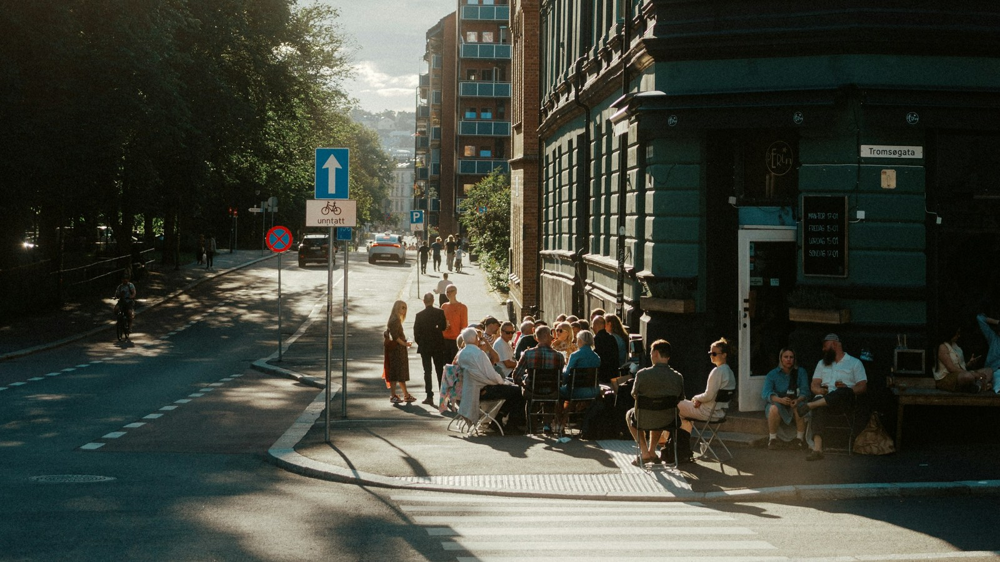

<!-- GENERATED from watch/issues/2026-12-03-city-coolness-social-media.yml by scripts/build_watch.py. Edit the data file. -->

```{=html}
<p class="mw-kicker">Marketing in 3 · Issue 53 · Thursday 3 December 2026</p>
<figure class="mw-hero"><picture><source type="image/webp" sizes="(max-width: 900px) 100vw, 900px" srcset="../../images/web/issue-53-city-coolness-960.webp 960w, ../../images/web/issue-53-city-coolness-1600.webp 1600w"></picture><figcaption>Cool shows up on the street long before it shows up on a feed. Photo: Eirik Skarstein on Unsplash.</figcaption></figure>
<section class="mw-answer" aria-label="Short answer"><h2>The short answer</h2><p>Residents called their city cool mostly for how well it works day to day, more than for its scenery or landmarks. In my survey of 537 people following their city&#x27;s accounts, feeling that the city was cool led them to read, like, share and post about it more. It did not make them feel more attached to it. For a place that wants attention and action, work on the practical side first. For one that wants love, cool is the wrong tool.</p></section>
<section class="mw-takeaways"><h2>Key takeaways</h2><ul><li>Practical strengths such as services, transport, jobs and clean streets did the most to make a city seem cool, and looks did the least.</li><li>A city seen as cool drew more reading and attention from its residents, and more sharing, liking and posting.</li><li>Cool did not buy emotional attachment. The one thing linked to feeling attached was how the city looks.</li><li>Caring what others think of the city had the biggest total pull on attention, and most of that pull was direct.</li></ul></section>
<section id="what-we-did"><h2>What we did</h2><p>A note first: this issue covers a paper I co-wrote, and I am its first author. The team was <a class="mw-orcid-link" href="https://orcid.org/0000-0002-6404-5916" title="Xiufang (Leah) Li on ORCID">Xiufang (Leah) Li</a> and
<a class="mw-orcid-link" href="https://orcid.org/0000-0003-4287-9810" title="Abdullah M. Alahmari on ORCID">Abdullah M. Alahmari</a> of RMIT University in Melbourne, where I was based at the time, <a class="mw-orcid-link" href="https://orcid.org/0009-0008-3395-4739" title="Quynh Phuong Nguyen on ORCID">Quynh Phuong Nguyen</a> of Foreign
Trade University in Hanoi and Gdańsk University of Technology, <a class="mw-orcid-link" href="https://orcid.org/0000-0002-8314-1727" title="Barbara Czarnecka on ORCID">Barbara Czarnecka</a> of London South Bank University and
<a class="mw-orcid-link" href="https://orcid.org/0000-0001-8362-4430" title="Sandra Maria Correira Loureiro on ORCID">Sandra Maria Correira Loureiro</a> of ISCTE-IUL in Lisbon.</p><p>Cities now compete like brands, and residents are part of the audience. They look at their city&#x27;s posts, take photos
of it and tell others what it is like. We wanted to know why some residents lean in and others scroll past. Our idea
was that a city&#x27;s features do not move people directly. People first judge whether the place is cool, meaning
attractive, desirable and something they would like to be linked with, and that judgement drives what they do online.</p><p>We asked people in Saudi Arabia who follow their city on social media to rate it. Four things were measured: how the
city looks, how well it works, how well it fits who they are, and how much it matters to the people around them.
Then we asked how cool they thought it was and how much they paid attention to the city online, how attached they felt
and how often they liked, shared or posted about it.</p>
<dl class="mw-facts"><div><dt>Sample</dt><dd>537 residents of Saudi Arabian cities, 55.3% women, half aged 25 to 34</dd></div><div><dt>Recruited</dt><dd>Over four weeks through social media channels and forums, with an English-language online survey</dd></div><div><dt>City features rated</dt><dd>Physical (scenery, historic sites, architecture), functional (services, transport, business, shops, culture), individual value and social value</dd></div><div><dt>Coolness</dt><dd>Usefulness, high status, popularity and subculture, combined into one score for how cool the city seems</dd></div><div><dt>Engagement</dt><dd>Attention (cognitive), attachment (emotional) and actions such as liking, sharing and posting (behavioural)</dd></div><div><dt>Method</dt><dd>Structural equation modelling, with 5,000 bootstrap samples to test the indirect paths</dd></div></dl>
</section>
<section id="a-city-that-works-is-a-city-that-seems-cool"><h2>A city that works is a city that seems cool</h2><p>All four features made residents more likely to call their city cool, but not equally. Functional strengths led by a
distance: clean surroundings, jobs and business, shops and cafes, transport, cultural activities and public services.
Next came how well the city fits a person&#x27;s own taste and identity, then how much the place counts with others.
Looks came last, and only just made it as a real effect.</p><p>City marketing spends a lot on scenery and landmarks. In this survey, residents did not rate a city as cool because
it was pretty. They rated it as cool because it worked, and because it made them feel they belonged in it.</p>
<figure class="mw-chart" id="chart-drivers"><figcaption class="mw-chart-title">How strongly each city feature made residents see the city as cool</figcaption><div class="mw-chart-svg"><svg viewBox="0 0 680 194" role="img" aria-labelledby="chart-drivers-t" font-family="Hanken Grotesk, Arial, sans-serif"><title id="chart-drivers-t">How strongly each city feature made residents see the city as cool</title><line x1="250.0" y1="4" x2="250.0" y2="168" stroke="#dde1e8" stroke-width="1"/><text x="250.0" y="186" font-size="12" text-anchor="middle" fill="#5b6476">0</text><line x1="322.0" y1="4" x2="322.0" y2="168" stroke="#dde1e8" stroke-width="1"/><text x="322.0" y="186" font-size="12" text-anchor="middle" fill="#5b6476">0.1</text><line x1="394.0" y1="4" x2="394.0" y2="168" stroke="#dde1e8" stroke-width="1"/><text x="394.0" y="186" font-size="12" text-anchor="middle" fill="#5b6476">0.2</text><line x1="466.0" y1="4" x2="466.0" y2="168" stroke="#dde1e8" stroke-width="1"/><text x="466.0" y="186" font-size="12" text-anchor="middle" fill="#5b6476">0.3</text><line x1="538.0" y1="4" x2="538.0" y2="168" stroke="#dde1e8" stroke-width="1"/><text x="538.0" y="186" font-size="12" text-anchor="middle" fill="#5b6476">0.4</text><line x1="610.0" y1="4" x2="610.0" y2="168" stroke="#dde1e8" stroke-width="1"/><text x="610.0" y="186" font-size="12" text-anchor="middle" fill="#5b6476">0.5</text><g><title>Functional (how well it works): 0.42 </title><text x="238" y="27" font-size="13.5" text-anchor="end" fill="#15203b" font-weight="600">Functional (how well it works)</text><rect x="250" y="12" width="302.4" height="22" rx="4" fill="#e0a12a"/><text x="560.4" y="28" font-size="13.5" fill="#15203b" font-weight="600">0.42</text></g><g><title>Individual value (fits me): 0.31 </title><text x="238" y="67" font-size="13.5" text-anchor="end" fill="#15203b">Individual value (fits me)</text><rect x="250" y="52" width="223.2" height="22" rx="4" fill="#aab3c5"/><text x="481.2" y="68" font-size="13.5" fill="#15203b">0.31</text></g><g><title>Social value (matters to others): 0.26 </title><text x="238" y="107" font-size="13.5" text-anchor="end" fill="#15203b">Social value (matters to others)</text><rect x="250" y="92" width="187.2" height="22" rx="4" fill="#aab3c5"/><text x="445.2" y="108" font-size="13.5" fill="#15203b">0.26</text></g><g><title>Physical (how it looks): 0.09 </title><text x="238" y="147" font-size="13.5" text-anchor="end" fill="#15203b">Physical (how it looks)</text><rect x="250" y="132" width="64.8" height="22" rx="4" fill="#aab3c5"/><text x="322.8" y="148" font-size="13.5" fill="#15203b">0.09</text></g></svg></div><div class="mw-sr"><table><caption>How strongly each city feature made residents see the city as cool</caption><tr><th>Group</th><th>Value ()</th></tr><tr><th scope="row">Functional (how well it works)</th><td>0.42</td></tr><tr><th scope="row">Individual value (fits me)</th><td>0.31</td></tr><tr><th scope="row">Social value (matters to others)</th><td>0.26</td></tr><tr><th scope="row">Physical (how it looks)</th><td>0.09</td></tr></table></div><p class="mw-chart-src">Standardised path coefficients from the structural model, N = 537. All four paths were statistically significant.</p></figure>
</section>
<section id="cool-buys-attention-and-action-not-affection"><h2>Cool buys attention and action, not affection</h2><p>Once a city seemed cool, residents followed it more closely. They paid more attention to its posts and were more
likely to like, comment, share and post their own content about it. Coolness was the bridge: practical strengths had no
direct effect on either attention or action. They only worked because they made the city seem cool first.</p><p>Then came the surprise. Seeing the city as cool did nothing for how attached residents felt to it. The only thing
linked to emotional engagement was how the city looks, and that link ran directly, without passing through
coolness. So a city can seem cool without being loved, and it can be loved for its streets and skyline without being
thought cool.</p><p>One more result is worth noting. Residents who care what others think of their city paid it the most attention of all,
and most of that effect did not come through coolness.</p>
<figure class="mw-chart" id="chart-engagement"><figcaption class="mw-chart-title">How each kind of engagement responded to a cool city</figcaption><div class="mw-chart-svg"><svg viewBox="0 0 727 154" role="img" aria-labelledby="chart-engagement-t" font-family="Hanken Grotesk, Arial, sans-serif"><title id="chart-engagement-t">How each kind of engagement responded to a cool city</title><line x1="297.0" y1="4" x2="297.0" y2="128" stroke="#dde1e8" stroke-width="1"/><text x="297.0" y="146" font-size="12" text-anchor="middle" fill="#5b6476">0</text><line x1="348.4" y1="4" x2="348.4" y2="128" stroke="#dde1e8" stroke-width="1"/><text x="348.4" y="146" font-size="12" text-anchor="middle" fill="#5b6476">0.1</text><line x1="399.9" y1="4" x2="399.9" y2="128" stroke="#dde1e8" stroke-width="1"/><text x="399.9" y="146" font-size="12" text-anchor="middle" fill="#5b6476">0.2</text><line x1="451.3" y1="4" x2="451.3" y2="128" stroke="#dde1e8" stroke-width="1"/><text x="451.3" y="146" font-size="12" text-anchor="middle" fill="#5b6476">0.3</text><line x1="502.7" y1="4" x2="502.7" y2="128" stroke="#dde1e8" stroke-width="1"/><text x="502.7" y="146" font-size="12" text-anchor="middle" fill="#5b6476">0.4</text><line x1="554.1" y1="4" x2="554.1" y2="128" stroke="#dde1e8" stroke-width="1"/><text x="554.1" y="146" font-size="12" text-anchor="middle" fill="#5b6476">0.5</text><line x1="605.6" y1="4" x2="605.6" y2="128" stroke="#dde1e8" stroke-width="1"/><text x="605.6" y="146" font-size="12" text-anchor="middle" fill="#5b6476">0.6</text><line x1="657.0" y1="4" x2="657.0" y2="128" stroke="#dde1e8" stroke-width="1"/><text x="657.0" y="146" font-size="12" text-anchor="middle" fill="#5b6476">0.7</text><g><title>Attention (cognitive): 0.62 </title><text x="285" y="27" font-size="13.5" text-anchor="end" fill="#15203b" font-weight="600">Attention (cognitive)</text><rect x="297" y="12" width="318.9" height="22" rx="4" fill="#e0a12a"/><text x="623.9" y="28" font-size="13.5" fill="#15203b" font-weight="600">0.62</text></g><g><title>Action: like, share, post (behavioural): 0.54 </title><text x="285" y="67" font-size="13.5" text-anchor="end" fill="#15203b" font-weight="600">Action: like, share, post (behavioural)</text><rect x="297" y="52" width="277.7" height="22" rx="4" fill="#e0a12a"/><text x="582.7" y="68" font-size="13.5" fill="#15203b" font-weight="600">0.54</text></g><g><title>Attachment (emotional), no effect: 0.00 </title><text x="285" y="107" font-size="13.5" text-anchor="end" fill="#15203b">Attachment (emotional), no effect</text><rect x="297" y="92" width="2.0" height="22" rx="4" fill="#aab3c5"/><text x="307.0" y="108" font-size="13.5" fill="#15203b">0.00</text></g></svg></div><div class="mw-sr"><table><caption>How each kind of engagement responded to a cool city</caption><tr><th>Group</th><th>Value ()</th></tr><tr><th scope="row">Attention (cognitive)</th><td>0.62</td></tr><tr><th scope="row">Action: like, share, post (behavioural)</th><td>0.54</td></tr><tr><th scope="row">Attachment (emotional), no effect</th><td>0.0</td></tr></table></div><p class="mw-chart-src">Standardised path coefficients, N = 537. The estimate for emotional engagement was -0.24 and not statistically different from zero, so it is shown as zero.</p></figure>
</section>
<section id="why-i-think-a-cool-city-is-a-different-job-from-a-loved-one"><h2>Why I think a cool city is a different job from a loved one</h2><p>What follows is my opinion, not something we measured. Cool is a quick, social judgement. People decide it in a glance
and pass it on in a post. Love is slow. It comes from memory, time and the people you know, which is why I read the
missing emotional link as sensible rather than disappointing. A city that chases cool and expects devotion has set
itself the wrong goal.</p><p>I also take a practical lesson. If how well a place works day to day does most to make it cool, then good city marketing
starts well before the post, in the quality of the transport, the services and the street. A campaign can only
repeat what residents already feel.</p><p>What I would test next is real behaviour. We asked people what they do, and we asked them once, in one country in a
period of fast change. I would like to see the same model in a city whose brand grew from the bottom up, with actual posting data
alongside the survey.</p>
</section>
<section id="how-to-apply-it" class="mw-howto"><p class="mw-rsg-kicker">Marketing in 3 steps</p><h2>Ready. Set. Market.</h2><div class="mw-rsg"><div class="mw-phase"><div class="mw-phase-dot" aria-hidden="true">1</div><div class="mw-phase-tag"><span class="mw-phase-name">Ready</span><span class="mw-phase-sub">Decide and prepare</span></div><ul class="mw-rsg-steps"><li><strong>Score your place on four things.</strong> Ask at least 30 people who know the place to rate it from 1 to 5 on how it looks, how well it runs, how well it fits people like them and how much it counts with their friends and neighbours. Note your lowest score.</li><li><strong>Check how cool it seems.</strong> In the same survey, ask people to rate from 1 to 5 how cool the place is. Record the average as your starting point.</li></ul></div><div class="mw-phase"><div class="mw-phase-dot" aria-hidden="true">2</div><div class="mw-phase-tag"><span class="mw-phase-name">Set</span><span class="mw-phase-sub">Build it</span></div><ul class="mw-rsg-steps"><li><strong>Lead with how the place works.</strong> Pick your strongest practical feature, such as transport, services, jobs or clean streets. Publish one post a week that shows it in use, from a resident&#x27;s point of view.</li><li><strong>Make it a place for people like them.</strong> Feature residents telling their own stories, and run one local event a month where people can meet. This builds the sense of fit and belonging that also makes a place seem cool.</li></ul></div><div class="mw-phase"><div class="mw-phase-dot" aria-hidden="true">3</div><div class="mw-phase-tag"><span class="mw-phase-name">Market</span><span class="mw-phase-sub">Launch and measure</span></div><ul class="mw-rsg-steps"><li><strong>Ask for attention first, then action.</strong> Start each campaign with an easy request, such as a poll or a question. Follow it a week later with a hashtag that invites people to share their own photos.</li><li><strong>Track attention, action and feeling separately.</strong> Each month, count views and reads, then shares and posts, then replies that express feelings. Repeat the cool rating every quarter. For feelings, add memory-based content such as old photos and local history.</li></ul></div></div></section>
<div class="mw-coffee" role="complementary" aria-label="Support Marketing in 3"><div class="mw-coffee-text"><p class="mw-coffee-title">Found this useful?</p><p>Marketing in 3 is free and ad-free, with new issues every Monday and Thursday. A coffee keeps it that way.</p></div><a class="mw-coffee-btn" href="https://ko-fi.com/marketingin3" target="_blank" rel="noopener"><svg aria-hidden="true" focusable="false"
  class="lucide lucide-coffee"
  xmlns="http://www.w3.org/2000/svg"
  width="24"
  height="24"
  viewBox="0 0 24 24"
  fill="none"
  stroke="currentColor"
  stroke-width="2"
  stroke-linecap="round"
  stroke-linejoin="round"
>
  <path d="M10 2v2" />
  <path d="M14 2v2" />
  <path d="M16 8a1 1 0 0 1 1 1v8a4 4 0 0 1-4 4H7a4 4 0 0 1-4-4V9a1 1 0 0 1 1-1h14a4 4 0 1 1 0 8h-1" />
  <path d="M6 2v2" />
</svg><span>Buy me a coffee</span><span class="mw-coffee-price">€3</span></a></div>
<section id="what-to-expect"><h2>What to expect</h2><ul class="mw-list"><li><strong>More attention, then more action.</strong> A place that seems cool tends to be read first and shared second, so judge the plan on both.</li><li><strong>Reputation built on basics.</strong> Residents credit the practical side first, so posts that show services working will carry more weight than pretty ones.</li><li><strong>No shortcut to loyalty.</strong> Cool posts will not make people attached, so plan separate content for belonging and memory.</li><li><strong>Slow movement.</strong> How people see a place changes over months, so repeat the rating each quarter and judge by the trend.</li></ul></section>
<section id="where-it-does-not-work"><h2>Where it does not work</h2><ul class="mw-list"><li><strong>One country.</strong> All the residents lived in Saudi Arabian cities during a period of rapid state-led development, so other places may differ.</li><li><strong>English-language online survey.</strong> Recruiting online in English may have favoured better-educated and more affluent respondents.</li><li><strong>Reported, not observed.</strong> People described their own behaviour and attitudes, and no real posting data was collected.</li><li><strong>Patterns, not proof.</strong> Everyone answered once, so the survey cannot show that cool causes more engagement.</li></ul></section>
<section id="questions"><h2>Questions marketers ask</h2><div class="mw-faq"><h3>What makes a city seem cool?</h3><p>In this survey, the practical side did most: services, transport, jobs, shops and clean streets. How well a city fits a person and how much it counts with others came next, and looks came last (Schivinski et al., 2026, Journal of Product &amp; Brand Management).</p></div><div class="mw-faq"><h3>Does a cool city get more social media engagement?</h3><p>Yes, on two counts: attention and action. Residents who saw their city as cool followed it more closely and shared and posted more.</p></div><div class="mw-faq"><h3>Do cool cities make residents feel more attached?</h3><p>No. Calling the city cool did not raise emotional attachment. The one link to attachment in the study was the city&#x27;s physical look.</p></div><div class="mw-faq"><h3>Do the findings apply outside Saudi Arabia?</h3><p>The study covers one country, so that is untested. The authors expect the process, from city features to coolness to engagement, to hold elsewhere, and say it needs checking in other cities and cultures.</p></div><div class="mw-faq"><h3>Can I read the paper for free?</h3><p>Yes. It is open access, and a free copy of the full text is on the paper page together with the survey items.</p></div></section>
<section id="also-new"><h2>Also new this week</h2><div class="mw-also"><article><p class="mw-also-src"><em>Journal of the Academy of Marketing Science</em> · 2026</p><h3><a href="https://doi.org/10.1007/s11747-026-01181-1">Process and outcome frames in firms&#x27; environmental posts and consumer engagement</a></h3><p class="mw-also-au">Tran et al.</p><p>Across seven studies, including a field experiment and over 12,000 environmental posts on X by 110 US firms, this research compares posts that describe what a firm did with posts that state the result. Either frame raises engagement, but mixing them backfires. A warm tone helps the &quot;what we did&quot; frame most, and a competent tone helps the &quot;what we achieved&quot; frame win engagement with the firm itself.</p></article><article><p class="mw-also-src"><em>International Journal of Advertising</em> · 2026</p><h3><a href="https://doi.org/10.1080/02650487.2026.2700928">Can too many hashtags backfire? Understanding audiences&#x27; perceptions of hashtags on Instagram</a></h3><p class="mw-also-au">Jin &amp; Kim</p><p>In three experiments, Instagram posts stuffed with hashtags earned less favourable attitudes because they looked less authentic. The penalty hit non-followers but not followers, and it faded when a post was clearly sponsored. A useful check before you brief a hashtag campaign.</p></article></div></section>
<section id="source" class="mw-source"><h2>Source</h2><p class="mw-cite">Schivinski, B., Li, X. (L.), Alahmari, A. M., Nguyen, Q. P., Czarnecka, B., &amp; Loureiro, S. M. C. (2026). City branding&#x27;s influence on social media engagement: the cool factor. <em>Journal of Product &amp; Brand Management</em>, <em>35</em>(1), 99-115. <a href="https://doi.org/10.1108/JPBM-04-2025-5959">https://doi.org/10.1108/JPBM-04-2025-5959</a></p><p class="mw-note">This brief is written for practitioners from the published article. Open access (CC BY 4.0): free to read at the publisher. Numbers are as reported by the authors; read the article for full methods.</p></section>
<section id="on-this-site" class="mw-related"><h2>The paper, in full, on this site</h2><ul><li><a href="../../../papers/city-branding-cool-factor.html">City branding’s influence on social media engagement: the cool factor</a><span>Journal of Product &amp; Brand Management</span></li></ul></section>
<section id="keep-reading" class="mw-more"><h2>Keep reading</h2><p class="mw-more-topics">More issues on <a href="../../topics/social-media.html">Social media</a> · <a href="../../topics/ugc.html">UGC</a></p><div class="watch-list"><article class="watch-item"><a class="watch-thumb" href="../../posts/brand-followers-ai/index.html" tabindex="-1" aria-hidden="true"></a><div><p class="watch-meta">Issue 43 · <time datetime="2026-10-29">Thursday 29 October 2026</time></p><h3><a href="../../posts/brand-followers-ai/index.html">Five kinds of brand follower, and why AI hasn&#x27;t changed them</a></h3><p>Schivinski&#x27;s machine learning study of 1,356 brand followers found five engagement patterns driven by commitment, and they still matter in the age of AI.</p></div></article><article class="watch-item"><a class="watch-thumb" href="../../posts/ai-disclosure-labels/index.html" tabindex="-1" aria-hidden="true"></a><div><p class="watch-meta">Issue 25 · <time datetime="2026-06-29">Week of 29 June 2026</time></p><h3><a href="../../posts/ai-disclosure-labels/index.html">The label does not read as artificial. It reads as lazy.</a></h3><p>Posts carrying TikTok&#x27;s AI label collected 7% to 8% fewer likes at the same reach. Not because people distrust AI. Because the label says the creator did not try.</p></div></article><article class="watch-item"><a class="watch-thumb" href="../../posts/video-thumbnails/index.html" tabindex="-1" aria-hidden="true"></a><div><p class="watch-meta">Issue 22 · <time datetime="2026-06-08">Week of 8 June 2026</time></p><h3><a href="../../posts/video-thumbnails/index.html">Busy enough to be interesting, tidy enough to be read</a></h3><p>Thumbnails with a middling amount going on won the clicks at 5.48 out of 7. Middling colour harmony lost them at 3.41. Two dials, pulling opposite ways.</p></div></article></div></section>
<div class="mw-author"><div><p><strong>Bruno Schivinski</strong> is Associate Professor of Marketing at Gdańsk University of Technology. He studies how consumers engage with brands in digital and social media.</p><p><a href="../../../index.html">About Bruno</a> · <a href="../../index.html">All Marketing in 3 issues</a> · <a href="../../subscribe.html">Subscribe</a></p></div></div>
<nav class="mw-pn" aria-label="More issues"><a class="mw-prev" href="../influencer-oversharing-credibility/index.html"><span>Previous issue</span>Personal stories cost trust when they drift off topic</a></nav>
```
