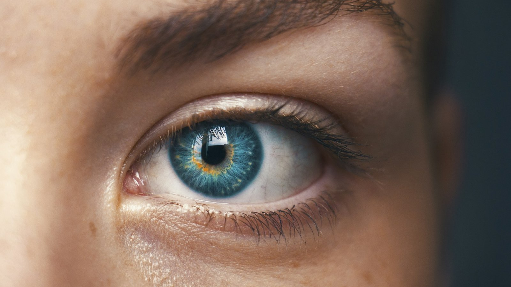

<!-- GENERATED from watch/issues/2026-04-06-contextual-advertising-attention.yml by scripts/build_watch.py. Edit the data file. -->

```{=html}
<p class="mw-kicker">Marketing in 3 · Issue 13 · Week of 6 April 2026</p>
<figure class="mw-hero"><picture><source type="image/webp" sizes="(max-width: 900px) 100vw, 900px" srcset="../../images/web/issue-13-contextual-advertising-attention-960.webp 960w, ../../images/web/issue-13-contextual-advertising-attention-1600.webp 1600w"></picture><figcaption>Attention is the currency; the page around the ad decides how much it earns. Photo: Amanda Dalbjörn on Unsplash.</figcaption></figure>
<section class="mw-answer" aria-label="Short answer"><h2>The short answer</h2><p>Yes, a lot. In eye-tracking data on 3,531 digital magazine ads, the editorial page next to an ad explained a third or more of how long people looked at it. Ads shown beside content got about 1.2 seconds less attention than the same ads shown alone. A model that matched ads to pages on both visual look and topic raised predicted attention by up to 10%, while matching by product category or text alone did no better than current practice.</p></section>
<section class="mw-takeaways"><h2>Key takeaways</h2><ul><li>Features of the surrounding page accounted for 33% to 43% of predicted attention to an ad, and about 20% of attention to its brand.</li><li>Next to editorial content, ads drew about 1.2 seconds less gaze than when shown alone: the page competes for attention.</li><li>Placing ads by both visual and topic fit raised predicted attention by 4.8% within a magazine and 10.1% when any magazine could be chosen.</li><li>Matching by product and media category, or by text and keywords alone, did no better than how the ads were actually placed.</li></ul></section>
<section id="what-the-researchers-did"><h2>What the researchers did</h2><p>Contextual advertising, placing an ad next to content that suits it, is a market worth more than 200 billion US
dollars a year. In practice, ads are usually matched to content by product and media category: fashion ads in
lifestyle titles, kitchen ads on cooking pages. Jianping Ye and Michel Wedel (University of Maryland) and Rik
Pieters (Tilburg University and Católica Lisbon) asked whether that is the best way to win attention.</p><p>They used one of the largest eye-tracking databases studied so far: 3,531 display ads from 29 Dutch digital
magazines, each viewed by 80 to 100 people as they leafed through the pages. From images of each ad and the page
opposite it, they extracted dozens of features, from size, colour texture and visual clutter to the topics shown,
described by an AI model that reads both words and pictures. A machine-learning model then learned to predict how
long people looked at the ad and at its brand. Finally, they tested which placements would win the most
attention.</p>
<dl class="mw-facts"><div><dt>Data</dt><dd>3,531 display ads in 29 digital magazines, 71 product categories and 812 brands; about 3,600 Dutch consumers</dd></div><div><dt>Measured</dt><dd>Seconds of eye gaze on the whole ad and on its brand name or logo</dd></div><div><dt>Checks</dt><dd>55 very different ads (banners, native, outdoor) and a controlled experiment with 715 people</dd></div><div><dt>Tool</dt><dd>AdGazer, with free code and a public web app that predicts gaze from an ad and page image</dd></div></dl>
</section>
<section id="the-page-around-your-ad-matters"><h2>The page around your ad matters</h2><p>The model predicted attention well: its predictions correlated .83 with real gaze on ads and .80 with gaze on
brands, better than two widely used image-recognition models. It also held up on ads it had never seen, such as
banners, native ads and outdoor posters.</p><p>The size of the ad and of its brand, text and picture still mattered most. But features of the surrounding page
accounted for 33% to 43% of predicted attention to the ad, and about 20% of attention to the brand. Counting how
ad and page features work together, the context was behind about half of ad attention.</p><p>And the page competes. In a controlled experiment where 24 ads were placed at random beside editorial pages, the
same ads drew about 1.2 seconds less gaze, and their brands about a quarter of a second less, than when shown
alone. Good matching is a way to reduce that loss.</p>
<figure class="mw-chart" id="chart-context"><figcaption class="mw-chart-title">Seconds of gaze on the same ads, shown alone or beside a page</figcaption><div class="mw-chart-svg"><svg viewBox="0 0 680 194" role="img" aria-labelledby="chart-context-t" font-family="Hanken Grotesk, Arial, sans-serif"><title id="chart-context-t">Seconds of gaze on the same ads, shown alone or beside a page</title><line x1="250.0" y1="4" x2="250.0" y2="168" stroke="#dde1e8" stroke-width="1"/><text x="250.0" y="186" font-size="12" text-anchor="middle" fill="#5b6476">0</text><line x1="340.0" y1="4" x2="340.0" y2="168" stroke="#dde1e8" stroke-width="1"/><text x="340.0" y="186" font-size="12" text-anchor="middle" fill="#5b6476">1</text><line x1="430.0" y1="4" x2="430.0" y2="168" stroke="#dde1e8" stroke-width="1"/><text x="430.0" y="186" font-size="12" text-anchor="middle" fill="#5b6476">2</text><line x1="520.0" y1="4" x2="520.0" y2="168" stroke="#dde1e8" stroke-width="1"/><text x="520.0" y="186" font-size="12" text-anchor="middle" fill="#5b6476">3</text><line x1="610.0" y1="4" x2="610.0" y2="168" stroke="#dde1e8" stroke-width="1"/><text x="610.0" y="186" font-size="12" text-anchor="middle" fill="#5b6476">4</text><g><title>Ad, shown alone: 3.18 seconds</title><text x="238" y="27" font-size="13.5" text-anchor="end" fill="#15203b">Ad, shown alone</text><rect x="250" y="12" width="286.2" height="22" rx="4" fill="#aab3c5"/><text x="544.2" y="28" font-size="13.5" fill="#15203b">3.18</text></g><g><title>Ad, beside editorial page: 1.96 seconds</title><text x="238" y="67" font-size="13.5" text-anchor="end" fill="#15203b" font-weight="600">Ad, beside editorial page</text><rect x="250" y="52" width="176.4" height="22" rx="4" fill="#e0a12a"/><text x="434.4" y="68" font-size="13.5" fill="#15203b" font-weight="600">1.96</text></g><g><title>Brand, shown alone: 0.72 seconds</title><text x="238" y="107" font-size="13.5" text-anchor="end" fill="#15203b">Brand, shown alone</text><rect x="250" y="92" width="64.8" height="22" rx="4" fill="#aab3c5"/><text x="322.8" y="108" font-size="13.5" fill="#15203b">0.72</text></g><g><title>Brand, beside editorial page: 0.49 seconds</title><text x="238" y="147" font-size="13.5" text-anchor="end" fill="#15203b" font-weight="600">Brand, beside editorial page</text><rect x="250" y="132" width="44.1" height="22" rx="4" fill="#e0a12a"/><text x="302.1" y="148" font-size="13.5" fill="#15203b" font-weight="600">0.49</text></g></svg></div><div class="mw-sr"><table><caption>Seconds of gaze on the same ads, shown alone or beside a page</caption><tr><th>Group</th><th>Value (seconds)</th></tr><tr><th scope="row">Ad, shown alone</th><td>3.18</td></tr><tr><th scope="row">Ad, beside editorial page</th><td>1.96</td></tr><tr><th scope="row">Brand, shown alone</th><td>0.72</td></tr><tr><th scope="row">Brand, beside editorial page</th><td>0.49</td></tr></table></div><p class="mw-chart-src">Controlled experiment: 24 ads, each placed at random beside 2 of 23 editorial pages, 715 Dutch consumers.</p></figure>
</section>
<section id="topic-matching-alone-does-not-win-attention"><h2>Topic matching alone does not win attention</h2><p>The researchers then reassigned 749 ads to the available pages in 95 magazine issues, using the model to predict
attention for each pairing. The placements actually used in the data were no better than random. Re-placing
ads by product and media category, or by text and keywords only, the way most contextual targeting works, did
not improve on them either.</p><p>What worked was visual fit. Matching only on how ad and page look, the logic of native advertising, raised
predicted attention by about 5% when any magazine could be chosen. Using both look and topic together raised it
by 4.8% within a single magazine and by 10.1% across magazines. Choosing the magazine with the ad in mind
doubled the gain.</p>
<figure class="mw-chart" id="chart-placement"><figcaption class="mw-chart-title">Predicted gain in ad attention over current placement, by matching method</figcaption><div class="mw-chart-svg"><svg viewBox="0 0 680 194" role="img" aria-labelledby="chart-placement-t" font-family="Hanken Grotesk, Arial, sans-serif"><title id="chart-placement-t">Predicted gain in ad attention over current placement, by matching method</title><line x1="250.0" y1="4" x2="250.0" y2="168" stroke="#dde1e8" stroke-width="1"/><text x="250.0" y="186" font-size="12" text-anchor="middle" fill="#5b6476">0</text><line x1="310.0" y1="4" x2="310.0" y2="168" stroke="#dde1e8" stroke-width="1"/><text x="310.0" y="186" font-size="12" text-anchor="middle" fill="#5b6476">2</text><line x1="370.0" y1="4" x2="370.0" y2="168" stroke="#dde1e8" stroke-width="1"/><text x="370.0" y="186" font-size="12" text-anchor="middle" fill="#5b6476">4</text><line x1="430.0" y1="4" x2="430.0" y2="168" stroke="#dde1e8" stroke-width="1"/><text x="430.0" y="186" font-size="12" text-anchor="middle" fill="#5b6476">6</text><line x1="490.0" y1="4" x2="490.0" y2="168" stroke="#dde1e8" stroke-width="1"/><text x="490.0" y="186" font-size="12" text-anchor="middle" fill="#5b6476">8</text><line x1="550.0" y1="4" x2="550.0" y2="168" stroke="#dde1e8" stroke-width="1"/><text x="550.0" y="186" font-size="12" text-anchor="middle" fill="#5b6476">10</text><line x1="610.0" y1="4" x2="610.0" y2="168" stroke="#dde1e8" stroke-width="1"/><text x="610.0" y="186" font-size="12" text-anchor="middle" fill="#5b6476">12</text><g><title>Product and media category: 0.6%</title><text x="238" y="27" font-size="13.5" text-anchor="end" fill="#15203b">Product and media category</text><rect x="250" y="12" width="18.0" height="22" rx="4" fill="#aab3c5"/><text x="276.0" y="28" font-size="13.5" fill="#15203b">0.6%</text></g><g><title>Text and keywords only: 0.9%</title><text x="238" y="67" font-size="13.5" text-anchor="end" fill="#15203b">Text and keywords only</text><rect x="250" y="52" width="27.0" height="22" rx="4" fill="#aab3c5"/><text x="285.0" y="68" font-size="13.5" fill="#15203b">0.9%</text></g><g><title>Visual look only (native): 4.9%</title><text x="238" y="107" font-size="13.5" text-anchor="end" fill="#15203b">Visual look only (native)</text><rect x="250" y="92" width="147.0" height="22" rx="4" fill="#aab3c5"/><text x="405.0" y="108" font-size="13.5" fill="#15203b">4.9%</text></g><g><title>Look and topic (AdGazer): 10.1%</title><text x="238" y="147" font-size="13.5" text-anchor="end" fill="#15203b" font-weight="600">Look and topic (AdGazer)</text><rect x="250" y="132" width="303.0" height="22" rx="4" fill="#e0a12a"/><text x="561.0" y="148" font-size="13.5" fill="#15203b" font-weight="600">10.1%</text></g></svg></div><div class="mw-sr"><table><caption>Predicted gain in ad attention over current placement, by matching method</caption><tr><th>Group</th><th>Value (%)</th></tr><tr><th scope="row">Product and media category</th><td>0.6</td></tr><tr><th scope="row">Text and keywords only</th><td>0.9</td></tr><tr><th scope="row">Visual look only (native)</th><td>4.9</td></tr><tr><th scope="row">Look and topic (AdGazer)</th><td>10.1</td></tr></table></div><p class="mw-chart-src">749 ads re-placed across 95 issues of 29 magazines. Within one magazine the gains were 0.1%, 0.4%, 2.7% and 4.8%; only the last two were reliable.</p></figure>
</section>
<section id="beyond-the-magazine-page"><h2>Beyond the magazine page</h2><p>The study covers digital magazines viewed on a desktop screen, but the decision it improves is everywhere: which
ad goes next to which content. My reading, not tested in the paper, is that the same logic applies to retail
media pages, publisher sites, in-app placements and digital out-of-home screens, wherever you can see the ad and
its surroundings before you buy. Matching on what the page is about is not enough; what it looks like matters as
much.</p><p>The bigger shift is cost. Predicting attention used to need an eye-tracking lab. Here each image is processed in
about 1.5 seconds, so screening many ad-and-page combinations before a campaign becomes realistic.</p>
</section>
<section id="how-to-apply-it" class="mw-howto"><p class="mw-rsg-kicker">Marketing in 3 steps</p><h2>Ready. Set. Market.</h2><div class="mw-rsg"><div class="mw-phase"><div class="mw-phase-dot" aria-hidden="true">1</div><div class="mw-phase-tag"><span class="mw-phase-name">Ready</span><span class="mw-phase-sub">Decide and prepare</span></div><ul class="mw-rsg-steps"><li><strong>Stop matching on category alone.</strong> In this study, placing ads by product and media category, or by keywords, did no better than the placements in use. Treat category fit as a starting point, not the plan.</li><li><strong>Collect your options as images.</strong> For each campaign, gather screenshots of the ad versions and of the pages or slots you could buy. The tool works from what people actually see.</li></ul></div><div class="mw-phase"><div class="mw-phase-dot" aria-hidden="true">2</div><div class="mw-phase-tag"><span class="mw-phase-name">Set</span><span class="mw-phase-sub">Build it</span></div><ul class="mw-rsg-steps"><li><strong>Score the pairings before buying.</strong> Use the authors&#x27; free AdGazer web app or code, or a similar attention-prediction tool, to estimate ad and brand gaze for each ad-and-page pairing and shortlist the strongest.</li><li><strong>Match the look as well as the theme.</strong> Pick pages whose visual style, colour and amount of clutter suit the ad, as well as its subject. Visual fit alone added about 5%; visual and topic fit together added up to 10%.</li></ul></div><div class="mw-phase"><div class="mw-phase-dot" aria-hidden="true">3</div><div class="mw-phase-tag"><span class="mw-phase-name">Market</span><span class="mw-phase-sub">Launch and measure</span></div><ul class="mw-rsg-steps"><li><strong>Choose media with the ad in mind.</strong> The gain doubled when ads could go to any title rather than into slots of a media vehicle booked in advance. Decide placement and media together, not one after the other.</li><li><strong>Check against real attention.</strong> The model predicts; it does not prove cause. Test your top placements with real dwell-time or eye-tracking data, and track brand attention separately, because the page affects it less than attention to the ad.</li></ul></div></div></section>
<section id="what-to-expect"><h2>What to expect</h2><ul class="mw-list"><li><strong>Gains of 5% to 10% in attention.</strong> That is what better placement predicted here; the authors cite earlier research linking 10% more gaze to roughly 1% to 5% more sales.</li><li><strong>A smaller effect on the brand.</strong> Context drove about a third or more of ad attention but only about a fifth of brand attention.</li><li><strong>Context costs attention by default.</strong> Ads next to content got less gaze than ads alone, so a poor match is a real loss, not a neutral choice.</li><li><strong>Low cost to try.</strong> The code and web app are free, and scoring an ad takes seconds.</li></ul></section>
<section id="where-it-does-not-work"><h2>Where it does not work</h2><ul class="mw-list"><li><strong>Magazines on a desktop screen.</strong> The data come from digital magazines viewed in a lab in the Netherlands; results may differ for phones, social media feeds, video or search.</li><li><strong>Prediction, not cause.</strong> Feature contributions show what predicts attention, not what causes it, so they suggest hypotheses to test.</li><li><strong>Simulated placements.</strong> The 5% to 10% gains are model predictions from re-assigning ads, not results from a live campaign.</li><li><strong>Attention is not sales.</strong> The study measured gaze; the links to sales and revenue come from other research.</li></ul></section>
<section id="questions"><h2>Questions marketers ask</h2><div class="mw-faq"><h3>Does the content around an ad affect how much attention it gets?</h3><p>Yes. In eye-tracking data on 3,531 digital magazine ads, features of the surrounding page accounted for 33% to 43% of predicted attention to the ad, and ads beside editorial content got about 1.2 seconds less gaze than when shown alone (Ye, Wedel and Pieters, 2026, Journal of Marketing).</p></div><div class="mw-faq"><h3>Does contextual advertising improve attention?</h3><p>It can, if the match is done well. Placing ads by both the visual look and the topic of the page raised predicted attention by 4.8% within a magazine and 10.1% across magazines. Matching by category or keywords alone did not help.</p></div><div class="mw-faq"><h3>Is keyword-based contextual targeting enough?</h3><p>Not for attention, in this study. Matching ads to pages on text features alone did no better than the placements actually used. Image features of the ad and page mattered more.</p></div><div class="mw-faq"><h3>How can I predict how much attention an ad will get?</h3><p>Attention-prediction models trained on eye-tracking data can estimate it from images. The authors&#x27; AdGazer predicted real gaze with correlations of about .8 and is available as free code and a web app.</p></div><div class="mw-faq"><h3>What is the difference between native and contextual advertising?</h3><p>Native advertising matches the look of the ad to the page so it blends in; contextual advertising matches the subject. In this study, visual matching alone added about 5% attention, and combining both added up to 10%.</p></div></section>
<section id="also-new"><h2>Also new this week</h2><div class="mw-also"><article><p class="mw-also-src"><em>Journal of Advertising Research</em> · 2026</p><h3><a href="https://doi.org/10.1080/00218499.2025.2588040">When in-feed ads carry a location tag: The effectiveness of local in-feed ads on offline and mobile sales</a></h3><p class="mw-also-au">Zhang, S., &amp; Ou, Y.-C.</p><p>A quick-service restaurant chain in China ran social media in-feed ads tagged as being within 3 km of the store. Comparing 3 advertised stores with 26 similar ones, the ads raised in-store sales but lowered mobile-app sales, with effects depending on store age and review volume. A location tag pulls people through the door, so judge local ads on total sales, not just the channel they ran in.</p></article><article><p class="mw-also-src"><em>International Journal of Advertising</em> · 2026</p><h3><a href="https://doi.org/10.1080/02650487.2026.2624918">The carousel effect: Leveraging sideways swiping for enhanced ad effectiveness in social media</a></h3><p class="mw-also-au">Rohrbach, S., Bruns, D., &amp; Langner, T.</p><p>In four studies, including a real-world mobile eye-tracking study, carousel ads that people swiped through drew more attention and better brand recall than other in-feed formats, and longer carousels held attention longer. People were more likely to swipe ads from brands they already liked. Carousels reward strong brands; weaker brands need a first card that earns the swipe.</p></article></div></section>
<section id="source" class="mw-source"><h2>Source</h2><p class="mw-cite">Ye, J., Wedel, M., &amp; Pieters, R. (2026). AdGazer: Improving contextual advertising with theory-informed machine learning. <em>Journal of Marketing</em>, <em>90</em>(4), 122–144. <a href="https://doi.org/10.1177/00222429251396114">https://doi.org/10.1177/00222429251396114</a></p><p class="mw-note">This brief is written for practitioners from the published article. Numbers are as reported by the authors; read the article for full methods.</p></section>

<section id="keep-reading" class="mw-more"><h2>Keep reading</h2><p class="mw-more-topics">More issues on <a href="../../topics/advertising.html">Advertising</a> · <a href="../../topics/ai.html">AI</a> · <a href="../../topics/creative.html">Creative</a></p><div class="watch-list"><article class="watch-item"><a class="watch-thumb" href="../../posts/generative-ai-ad-images/index.html" tabindex="-1" aria-hidden="true"></a><div><p class="watch-meta">Issue 1 · Week of <time datetime="2026-01-12">12 January 2026</time></p><h3><a href="../../posts/generative-ai-ad-images/index.html">Generative AI images that actually engage</a></h3><p>Fine-tuned on top-rated ads, generative AI made ad images that beat conventional ads in pretests and lifted Meta click-through by 49%. How to apply it, and when it fails.</p></div></article><article class="watch-item"><a class="watch-thumb" href="../../posts/synthetic-person-disclosure/index.html" tabindex="-1" aria-hidden="true"></a><div><p class="watch-meta">Issue 36 · Week of <time datetime="2026-09-14">14 September 2026</time></p><h3><a href="../../posts/synthetic-person-disclosure/index.html">The label that buys honesty, then spends it on artificiality</a></h3><p>A detailed &quot;this person does not exist&quot; label cut the sense of being manipulated and raised the sense of artificiality. The two effects cancelled out, except among younger viewers.</p></div></article><article class="watch-item"><a class="watch-thumb" href="../../posts/deepfake-ugc-recognition/index.html" tabindex="-1" aria-hidden="true"></a><div><p class="watch-meta">Issue 21 · Week of <time datetime="2026-06-01">1 June 2026</time></p><h3><a href="../../posts/deepfake-ugc-recognition/index.html">Caught, not told: the worst way for an AI actor to be found out</a></h3><p>Viewers who worked out the actor was AI rated the ad 2.83 against 4.59. Being told afterwards hurt far less, and priming people made them twice as likely to notice.</p></div></article></div></section>
<div class="mw-author"><div><p><strong>Bruno Schivinski</strong> is Associate Professor of Marketing at Gdańsk University of Technology. He studies how consumers engage with brands in digital and social media.</p><p><a href="../../../index.html">About Bruno</a> · <a href="../../index.html">All Marketing in 3 issues</a> · <a href="../../subscribe.html">Subscribe</a></p></div></div>
<div class="mw-support" role="complementary" aria-label="Support Marketing in 3"><div class="mw-support-icon"><svg aria-hidden="true" focusable="false"
  class="lucide lucide-beer"
  xmlns="http://www.w3.org/2000/svg"
  width="24"
  height="24"
  viewBox="0 0 24 24"
  fill="none"
  stroke="currentColor"
  stroke-width="2"
  stroke-linecap="round"
  stroke-linejoin="round"
>
  <path d="M17 11h1a3 3 0 0 1 0 6h-1" />
  <path d="M9 12v6" />
  <path d="M13 12v6" />
  <path d="M14 7.5c-1 0-1.44.5-3 .5s-2-.5-3-.5-1.72.5-2.5.5a2.5 2.5 0 0 1 0-5c.78 0 1.57.5 2.5.5S9.44 2 11 2s2 1.5 3 1.5 1.72-.5 2.5-.5a2.5 2.5 0 0 1 0 5c-.78 0-1.5-.5-2.5-.5Z" />
  <path d="M5 8v12a2 2 0 0 0 2 2h8a2 2 0 0 0 2-2V8" />
</svg></div><p>If this issue saved you a meeting or sharpened a campaign, buy me a coffee. It keeps Marketing in 3 free, weekly and ad-free.</p><div class="mw-support-btns"><a class="mw-support-btn mw-support-btn-main" href="https://ko-fi.com/marketingin3" target="_blank" rel="noopener"><svg aria-hidden="true" focusable="false"
  class="lucide lucide-coffee"
  xmlns="http://www.w3.org/2000/svg"
  width="24"
  height="24"
  viewBox="0 0 24 24"
  fill="none"
  stroke="currentColor"
  stroke-width="2"
  stroke-linecap="round"
  stroke-linejoin="round"
>
  <path d="M10 2v2" />
  <path d="M14 2v2" />
  <path d="M16 8a1 1 0 0 1 1 1v8a4 4 0 0 1-4 4H7a4 4 0 0 1-4-4V9a1 1 0 0 1 1-1h14a4 4 0 1 1 0 8h-1" />
  <path d="M6 2v2" />
</svg><span class="mw-support-label">Buy me a coffee</span><span class="mw-support-price">€3</span></a></div></div>
<nav class="mw-pn" aria-label="More issues"><a class="mw-prev" href="../ai-search-engines/index.html"><span>Previous issue</span>AI search takes the questions, Google keeps the keywords</a><a class="mw-next" href="../personalization-embarrassment/index.html"><span>Next issue</span>When &quot;just for you&quot; backfires</a></nav>
```
