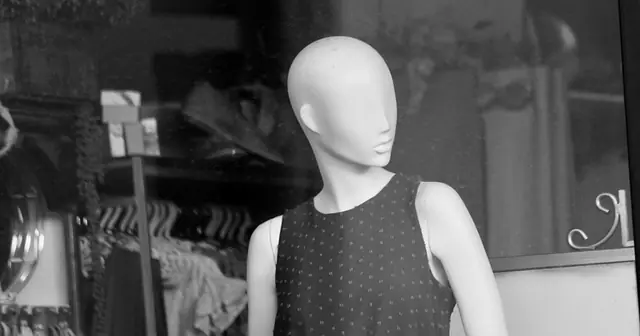

<!-- GENERATED from watch/issues/2024-01-30-diverse-virtual-influencers.yml by scripts/build_watch.py. Edit the data file. -->

```{=html}
<p class="mw-kicker">Marketing in 3 · <a href="../../2024/index.html">2024 in research</a> · No. 5 · Paper published 30 January 2024</p>
<figure class="mw-hero"><picture><source type="image/webp" sizes="(max-width: 900px) 100vw, 900px" srcset="../../images/web/2024-diverse-virtual-influencers-960.webp 960w, ../../images/web/2024-diverse-virtual-influencers-1600.webp 1600w"></picture><figcaption>A face can be built from nothing. Whose face it is remains the brand&#x27;s choice. Photo (a 3D render): Steve A Johnson on Unsplash.</figcaption></figure>
<section class="mw-answer" aria-label="Short answer"><h2>The short answer</h2><div class="mw-ans-grid"><p>Yes, on the measures that build an audience. In two online experiments with 413 US adults, a computer-made influencer described as having Down syndrome, and a group of virtual influencers mixed in age, gender and race, drew stronger intentions to follow them and tell others about them than versions without that diversity did. They struck people as fresher and more likeable. Buying plans rose for an unknown coffee brand, but not directly for a famous chain.</p><div class="mw-ev" role="note" aria-label="Evidence level: 2 of 3 stars, several studies"><span class="ev-k">Evidence level</span><ol><li><span class="ev-s" aria-hidden="true"><b>★</b><i>★</i><i>★</i></span>One study</li><li class="on"><span class="ev-s" aria-hidden="true"><b>★</b><b>★</b><i>★</i></span>Several studies</li><li><span class="ev-s" aria-hidden="true"><b>★</b><b>★</b><b>★</b></span>Meta-analysis</li></ol></div></div></section>
<section class="mw-takeaways"><h2>Key takeaways</h2><ul><li>Describing the virtual influencer as having Down syndrome nearly doubled people&#x27;s intention to follow her, a rise of 93% on the same seven-point scale.</li><li>A cast of four virtual influencers of different ages, genders and ethnic backgrounds lifted both word of mouth and follow intentions by about a third (33%) for a famous coffee chain.</li><li>Buying plans rose 50% for the unknown coffee brand but only about 10% for the famous chain, too small a change for the authors to treat as real.</li><li>Nobody mistook these characters for people: on a scale from human (1) to AI-generated (7), every version scored between 6.18 and 6.30.</li></ul></section>
<section id="what-the-researchers-did"><h2>What the researchers did</h2><p>Carla Ferraro, <a class="mw-orcid-link" href="https://orcid.org/0000-0001-9192-3676" title="Sean Sands on ORCID">Sean Sands</a> and Nives Zubcevic-Basic, marketing academics at Melbourne&#x27;s Swinburne University of
Technology, teamed up with <a class="mw-orcid-link" href="https://orcid.org/0000-0002-6218-0866" title="Colin Campbell on ORCID">Colin Campbell</a>, a marketing professor at California&#x27;s University of San Diego School
of Business, to study two shifts hitting influencer marketing at the same time. Brands face growing calls to show a wider range of people. And they can now sign influencers who do not exist:
characters built with computer graphics, often with generative AI, and run by a team behind the scenes. By the
industry figures the authors cite, spending on influencers grew from 1.7 billion US dollars in 2016 to 16.4 billion in 2022.
The team asked whether giving a virtual character a diverse identity changes how people respond to it, and to the
brand it promotes.</p><p>The first experiment introduced Tammy, a virtual influencer with five years of posting and a following in the
hundreds of thousands, about to promote a new roast for a local coffee shop. For half the participants, her profile
added that she has Down syndrome and hopes to make social media more inclusive. Everyone then saw a typical post.</p><p>The second experiment moved to a brand almost every American knows. Starbucks, people read, had signed four virtual
influencers to promote its new autumn blend on Instagram. In one version all four were white women in their early
twenties. In the other they were aged 29 to 44, two men and two women from three ethnic backgrounds, and one of the
men had a disability.</p>
<dl class="mw-facts"><div><dt>Study 1</dt><dd>189 American adults recruited through Prolific, after 11 who failed an attention check were dropped; average age 38, just under half women</dd></div><div><dt>Study 2</dt><dd>224 American adults, also from Prolific, after 11 who wrote irrelevant answers to a check question were dropped; average age 37</dd></div><div><dt>Design</dt><dd>Diverse or not diverse, assigned at random: one virtual influencer in Study 1, a group of four in Study 2</dd></div><div><dt>Brands</dt><dd>A local coffee shop the US participants would not know (Study 1); Starbucks (Study 2)</dd></div><div><dt>Measured</dt><dd>Intention to follow the influencer, to tell others about them and to buy from the brand, plus how novel and how likeable the influencer seemed, all on seven-point scales</dd></div><div><dt>Checks</dt><dd>The diverse Tammy was rated far more diverse than the other version: 5.43 against 2.95 out of 7</dd></div></dl>
</section>
<section id="one-character-one-added-detail"><h2>One character, one added detail</h2><p>In the first experiment a short addition to Tammy&#x27;s profile, with a picture to match, moved every outcome. People told about her
Down syndrome were more inclined to follow her, more inclined to mention her to friends, and more inclined to buy
the coffee she was about to promote. In proportion, the biggest jump came in following, which is the currency an
influencer&#x27;s whole business runs on.</p><p>The brand gained alongside the influencer. Participants had no prior view of this small coffee shop, so their
reaction to Tammy had room to carry over to it. That transfer of goodwill from creator to brand is exactly what a
sponsorship fee is meant to buy.</p>
<figure class="mw-chart" id="chart-study1"><figcaption class="mw-chart-title">Study 1: average intentions by version of the influencer (1 to 7 scale)</figcaption><div class="mw-chart-svg"><svg viewBox="0 0 680 274" role="img" aria-labelledby="chart-study1-t" font-family="Hanken Grotesk, Arial, sans-serif"><title id="chart-study1-t">Study 1: average intentions by version of the influencer (1 to 7 scale)</title><line x1="250.0" y1="4" x2="250.0" y2="248" stroke="#dde1e8" stroke-width="1"/><text x="250.0" y="266" font-size="12" text-anchor="middle" fill="#5b6476">1</text><line x1="310.0" y1="4" x2="310.0" y2="248" stroke="#dde1e8" stroke-width="1"/><text x="310.0" y="266" font-size="12" text-anchor="middle" fill="#5b6476">2</text><line x1="370.0" y1="4" x2="370.0" y2="248" stroke="#dde1e8" stroke-width="1"/><text x="370.0" y="266" font-size="12" text-anchor="middle" fill="#5b6476">3</text><line x1="430.0" y1="4" x2="430.0" y2="248" stroke="#dde1e8" stroke-width="1"/><text x="430.0" y="266" font-size="12" text-anchor="middle" fill="#5b6476">4</text><line x1="490.0" y1="4" x2="490.0" y2="248" stroke="#dde1e8" stroke-width="1"/><text x="490.0" y="266" font-size="12" text-anchor="middle" fill="#5b6476">5</text><line x1="550.0" y1="4" x2="550.0" y2="248" stroke="#dde1e8" stroke-width="1"/><text x="550.0" y="266" font-size="12" text-anchor="middle" fill="#5b6476">6</text><line x1="610.0" y1="4" x2="610.0" y2="248" stroke="#dde1e8" stroke-width="1"/><text x="610.0" y="266" font-size="12" text-anchor="middle" fill="#5b6476">7</text><g><title>Follow, no diversity: 1.61 </title><text x="238" y="27" font-size="13.5" text-anchor="end" fill="#15203b">Follow, no diversity</text><rect x="250" y="12" width="36.6" height="22" rx="4" fill="#aab3c5"/><text x="294.6" y="28" font-size="13.5" fill="#15203b">1.61</text></g><g><title>Follow, Down syndrome: 3.11 </title><text x="238" y="67" font-size="13.5" text-anchor="end" fill="#15203b" font-weight="600">Follow, Down syndrome</text><rect x="250" y="52" width="126.6" height="22" rx="4" fill="#e0a12a"/><text x="384.6" y="68" font-size="13.5" fill="#15203b" font-weight="600">3.11</text></g><g><title>Talk about, no diversity: 2.32 </title><text x="238" y="107" font-size="13.5" text-anchor="end" fill="#15203b">Talk about, no diversity</text><rect x="250" y="92" width="79.2" height="22" rx="4" fill="#aab3c5"/><text x="337.2" y="108" font-size="13.5" fill="#15203b">2.32</text></g><g><title>Talk about, Down syndrome: 3.58 </title><text x="238" y="147" font-size="13.5" text-anchor="end" fill="#15203b" font-weight="600">Talk about, Down syndrome</text><rect x="250" y="132" width="154.8" height="22" rx="4" fill="#e0a12a"/><text x="412.8" y="148" font-size="13.5" fill="#15203b" font-weight="600">3.58</text></g><g><title>Buy, no diversity: 2.22 </title><text x="238" y="187" font-size="13.5" text-anchor="end" fill="#15203b">Buy, no diversity</text><rect x="250" y="172" width="73.2" height="22" rx="4" fill="#aab3c5"/><text x="331.2" y="188" font-size="13.5" fill="#15203b">2.22</text></g><g><title>Buy, Down syndrome: 3.33 </title><text x="238" y="227" font-size="13.5" text-anchor="end" fill="#15203b" font-weight="600">Buy, Down syndrome</text><rect x="250" y="212" width="139.8" height="22" rx="4" fill="#e0a12a"/><text x="397.8" y="228" font-size="13.5" fill="#15203b" font-weight="600">3.33</text></g></svg></div><div class="mw-sr"><table><caption>Study 1: average intentions by version of the influencer (1 to 7 scale)</caption><tr><th>Group</th><th>Value ()</th></tr><tr><th scope="row">Follow, no diversity</th><td>1.61</td></tr><tr><th scope="row">Follow, Down syndrome</th><td>3.11</td></tr><tr><th scope="row">Talk about, no diversity</th><td>2.32</td></tr><tr><th scope="row">Talk about, Down syndrome</th><td>3.58</td></tr><tr><th scope="row">Buy, no diversity</th><td>2.22</td></tr><tr><th scope="row">Buy, Down syndrome</th><td>3.33</td></tr></table></div><p class="mw-chart-src">Study 1, 189 US adults, values read from the published figure. All three differences were statistically reliable.</p></figure>
</section>
<section id="what-changed-for-a-famous-brand"><h2>What changed for a famous brand</h2><p>Swapping four look-alike influencers for a varied group made people keener to follow the group and to mention it
to others, though by less than Tammy&#x27;s profile did. The difference between the two groups was hard to miss:
people rated the varied group far broader in culture (5.51 against 2.04 out of 7) and in age (4.90 against 1.93).</p><p>Buying plans were another story. They started higher for this household name, and the varied group did not shift
them in a way the authors could rely on. Their explanation is that people already hold settled opinions about a
brand this familiar, which leaves the influencers less room to change them.</p>
<figure class="mw-chart" id="chart-study2"><figcaption class="mw-chart-title">Study 2: average intentions by make-up of the influencer group (1 to 7 scale)</figcaption><div class="mw-chart-svg"><svg viewBox="0 0 680 274" role="img" aria-labelledby="chart-study2-t" font-family="Hanken Grotesk, Arial, sans-serif"><title id="chart-study2-t">Study 2: average intentions by make-up of the influencer group (1 to 7 scale)</title><line x1="250.0" y1="4" x2="250.0" y2="248" stroke="#dde1e8" stroke-width="1"/><text x="250.0" y="266" font-size="12" text-anchor="middle" fill="#5b6476">1</text><line x1="310.0" y1="4" x2="310.0" y2="248" stroke="#dde1e8" stroke-width="1"/><text x="310.0" y="266" font-size="12" text-anchor="middle" fill="#5b6476">2</text><line x1="370.0" y1="4" x2="370.0" y2="248" stroke="#dde1e8" stroke-width="1"/><text x="370.0" y="266" font-size="12" text-anchor="middle" fill="#5b6476">3</text><line x1="430.0" y1="4" x2="430.0" y2="248" stroke="#dde1e8" stroke-width="1"/><text x="430.0" y="266" font-size="12" text-anchor="middle" fill="#5b6476">4</text><line x1="490.0" y1="4" x2="490.0" y2="248" stroke="#dde1e8" stroke-width="1"/><text x="490.0" y="266" font-size="12" text-anchor="middle" fill="#5b6476">5</text><line x1="550.0" y1="4" x2="550.0" y2="248" stroke="#dde1e8" stroke-width="1"/><text x="550.0" y="266" font-size="12" text-anchor="middle" fill="#5b6476">6</text><line x1="610.0" y1="4" x2="610.0" y2="248" stroke="#dde1e8" stroke-width="1"/><text x="610.0" y="266" font-size="12" text-anchor="middle" fill="#5b6476">7</text><g><title>Follow, look-alike group: 2.21 </title><text x="238" y="27" font-size="13.5" text-anchor="end" fill="#15203b">Follow, look-alike group</text><rect x="250" y="12" width="72.6" height="22" rx="4" fill="#aab3c5"/><text x="330.6" y="28" font-size="13.5" fill="#15203b">2.21</text></g><g><title>Follow, varied group: 2.95 </title><text x="238" y="67" font-size="13.5" text-anchor="end" fill="#15203b" font-weight="600">Follow, varied group</text><rect x="250" y="52" width="117.0" height="22" rx="4" fill="#e0a12a"/><text x="375.0" y="68" font-size="13.5" fill="#15203b" font-weight="600">2.95</text></g><g><title>Talk about, look-alike group: 2.51 </title><text x="238" y="107" font-size="13.5" text-anchor="end" fill="#15203b">Talk about, look-alike group</text><rect x="250" y="92" width="90.6" height="22" rx="4" fill="#aab3c5"/><text x="348.6" y="108" font-size="13.5" fill="#15203b">2.51</text></g><g><title>Talk about, varied group: 3.35 </title><text x="238" y="147" font-size="13.5" text-anchor="end" fill="#15203b" font-weight="600">Talk about, varied group</text><rect x="250" y="132" width="141.0" height="22" rx="4" fill="#e0a12a"/><text x="399.0" y="148" font-size="13.5" fill="#15203b" font-weight="600">3.35</text></g><g><title>Buy, look-alike group: 3.49 </title><text x="238" y="187" font-size="13.5" text-anchor="end" fill="#15203b">Buy, look-alike group</text><rect x="250" y="172" width="149.4" height="22" rx="4" fill="#aab3c5"/><text x="407.4" y="188" font-size="13.5" fill="#15203b">3.49</text></g><g><title>Buy, varied group: 3.85 </title><text x="238" y="227" font-size="13.5" text-anchor="end" fill="#15203b">Buy, varied group</text><rect x="250" y="212" width="171.0" height="22" rx="4" fill="#aab3c5"/><text x="429.0" y="228" font-size="13.5" fill="#15203b">3.85</text></g></svg></div><div class="mw-sr"><table><caption>Study 2: average intentions by make-up of the influencer group (1 to 7 scale)</caption><tr><th>Group</th><th>Value ()</th></tr><tr><th scope="row">Follow, look-alike group</th><td>2.21</td></tr><tr><th scope="row">Follow, varied group</th><td>2.95</td></tr><tr><th scope="row">Talk about, look-alike group</th><td>2.51</td></tr><tr><th scope="row">Talk about, varied group</th><td>3.35</td></tr><tr><th scope="row">Buy, look-alike group</th><td>3.49</td></tr><tr><th scope="row">Buy, varied group</th><td>3.85</td></tr></table></div><p class="mw-chart-src">Study 2, 224 US adults; means taken from the paper&#x27;s chart. The authors did not count the buying difference as reliable.</p></figure>
</section>
<section id="why-a-diverse-character-pulls-people-in"><h2>Why a diverse character pulls people in</h2><p>The authors traced the effect through two reactions. One is novelty: a diverse virtual influencer struck people as
more original, more memorable, more interesting and less like the influencers they were used to. The other is
likeability: the character came across as warmer and friendlier. In both experiments, each reaction went with
stronger intentions on every outcome.</p><p>The balance between them shifted with the set-up. For Tammy on her own, warmth did more of the work for
following and buying. For the group of four, surprise mattered more for following and word of mouth, which fits
a cast whose range is the first thing anyone notices. Even for the famous chain, where buying plans showed no
reliable direct rise, both reactions still edged them up through small indirect gains.</p>
<figure class="mw-chart" id="chart-routes"><figcaption class="mw-chart-title">How much of the rise in follow intentions ran through each reaction (scale points)</figcaption><div class="mw-chart-svg"><svg viewBox="0 0 680 194" role="img" aria-labelledby="chart-routes-t" font-family="Hanken Grotesk, Arial, sans-serif"><title id="chart-routes-t">How much of the rise in follow intentions ran through each reaction (scale points)</title><line x1="250.0" y1="4" x2="250.0" y2="168" stroke="#dde1e8" stroke-width="1"/><text x="250.0" y="186" font-size="12" text-anchor="middle" fill="#5b6476">0</text><line x1="340.0" y1="4" x2="340.0" y2="168" stroke="#dde1e8" stroke-width="1"/><text x="340.0" y="186" font-size="12" text-anchor="middle" fill="#5b6476">0.25</text><line x1="430.0" y1="4" x2="430.0" y2="168" stroke="#dde1e8" stroke-width="1"/><text x="430.0" y="186" font-size="12" text-anchor="middle" fill="#5b6476">0.5</text><line x1="520.0" y1="4" x2="520.0" y2="168" stroke="#dde1e8" stroke-width="1"/><text x="520.0" y="186" font-size="12" text-anchor="middle" fill="#5b6476">0.75</text><line x1="610.0" y1="4" x2="610.0" y2="168" stroke="#dde1e8" stroke-width="1"/><text x="610.0" y="186" font-size="12" text-anchor="middle" fill="#5b6476">1</text><g><title>Novelty, Study 1: 0.49 </title><text x="238" y="27" font-size="13.5" text-anchor="end" fill="#15203b">Novelty, Study 1</text><rect x="250" y="12" width="176.4" height="22" rx="4" fill="#aab3c5"/><text x="434.4" y="28" font-size="13.5" fill="#15203b">0.49</text></g><g><title>Likeability, Study 1: 0.92 </title><text x="238" y="67" font-size="13.5" text-anchor="end" fill="#15203b" font-weight="600">Likeability, Study 1</text><rect x="250" y="52" width="331.2" height="22" rx="4" fill="#e0a12a"/><text x="589.2" y="68" font-size="13.5" fill="#15203b" font-weight="600">0.92</text></g><g><title>Novelty, Study 2: 0.43 </title><text x="238" y="107" font-size="13.5" text-anchor="end" fill="#15203b" font-weight="600">Novelty, Study 2</text><rect x="250" y="92" width="154.8" height="22" rx="4" fill="#e0a12a"/><text x="412.8" y="108" font-size="13.5" fill="#15203b" font-weight="600">0.43</text></g><g><title>Likeability, Study 2: 0.20 </title><text x="238" y="147" font-size="13.5" text-anchor="end" fill="#15203b">Likeability, Study 2</text><rect x="250" y="132" width="72.0" height="22" rx="4" fill="#aab3c5"/><text x="330.0" y="148" font-size="13.5" fill="#15203b">0.20</text></g></svg></div><div class="mw-sr"><table><caption>How much of the rise in follow intentions ran through each reaction (scale points)</caption><tr><th>Group</th><th>Value ()</th></tr><tr><th scope="row">Novelty, Study 1</th><td>0.49</td></tr><tr><th scope="row">Likeability, Study 1</th><td>0.92</td></tr><tr><th scope="row">Novelty, Study 2</th><td>0.43</td></tr><tr><th scope="row">Likeability, Study 2</th><td>0.2</td></tr></table></div><p class="mw-chart-src">Indirect effects as reported in the paper&#x27;s results tables for both experiments (189 and 224 US adults). All four were statistically reliable.</p></figure>
</section>
<section id="what-it-means-for-brands-building-synthetic-faces"><h2>What it means for brands building synthetic faces</h2><p>The authors draw three lessons. People pay little attention to advertising online, and a diverse virtual creator is
one way to be noticed, although attention itself was not measured. A virtual character can carry human traits
such as identity, and people respond to them even when they know the character is artificial. And the same goodwill may extend to synthetic models and deepfakes in
ads, though the authors expect it to vary by category and brand. They also urge advertisers to think about
intersectionality, meaning how several identities combine in one person.</p><p>One question the experiments leave open deserves weight. Participants were a general sample of American adults, not
recruited from people with Down syndrome or the other groups shown, and the authors themselves note that represented
groups can react differently from everyone else. A brand that designs an identity instead of hiring a person who
lives it takes on a responsibility these numbers do not capture. That is our view, not a result of the paper.</p>
</section>
<section id="how-to-apply-it" class="mw-howto"><p class="mw-rsg-kicker">Marketing in 3 steps</p><h2>Ready. Set. Market.</h2><div class="mw-rsg"><div class="mw-phase"><div class="mw-phase-dot" aria-hidden="true">1</div><div class="mw-phase-tag"><span class="mw-phase-name">Ready</span><span class="mw-phase-sub">Decide and prepare</span></div><ul class="mw-rsg-steps"><li><strong>Count who speaks for you.</strong> List every creator, human or virtual, who posted for your brand in the last six months. Note age, gender, ethnicity and any disability they share publicly. If three in four look alike, you have found your gap.</li><li><strong>Hire advisers from the community.</strong> Before you design a virtual character from a group you are not part of, pay two or three people from that group to advise. Let them shape the look, the voice and the backstory, and give them a veto in writing.</li></ul></div><div class="mw-phase"><div class="mw-phase-dot" aria-hidden="true">2</div><div class="mw-phase-tag"><span class="mw-phase-name">Set</span><span class="mw-phase-sub">Build it</span></div><ul class="mw-rsg-steps"><li><strong>Give the character a life beyond one trait.</strong> Write a short profile with at least three interests, a reason for being online and a point of view. The identity should be part of who the character is, never the whole pitch.</li><li><strong>Build a mixed cast for launches.</strong> When several creators front one launch, vary at least three of age, gender, ethnicity and ability across the group. Show them together in the first post so the range is obvious at a glance.</li></ul></div><div class="mw-phase"><div class="mw-phase-dot" aria-hidden="true">3</div><div class="mw-phase-tag"><span class="mw-phase-name">Market</span><span class="mw-phase-sub">Launch and measure</span></div><ul class="mw-rsg-steps"><li><strong>Label it and run a two-week trial.</strong> Mark the bio and every post as computer-made. Put the same budget behind the new character and your usual creator for 14 days. Compare new follows, shares and comments, not likes alone.</li><li><strong>Refresh before the shine wears off.</strong> Check new follows and shares on the first day of every month. If they fall three months running, change what the character does with new formats, guests or causes, rather than inventing another character.</li></ul></div></div></section>
<div class="mw-coffee" role="complementary" aria-label="Support Marketing in 3"><div class="mw-coffee-text"><p class="mw-coffee-title">Found this useful?</p><p>Marketing in 3 is free and ad-free, with new issues every Monday and Thursday. A coffee keeps it that way.</p></div><a class="mw-coffee-btn" href="https://ko-fi.com/marketingin3" target="_blank" rel="noopener"><svg aria-hidden="true" focusable="false"
  class="lucide lucide-coffee"
  xmlns="http://www.w3.org/2000/svg"
  width="24"
  height="24"
  viewBox="0 0 24 24"
  fill="none"
  stroke="currentColor"
  stroke-width="2"
  stroke-linecap="round"
  stroke-linejoin="round"
>
  <path d="M10 2v2" />
  <path d="M14 2v2" />
  <path d="M16 8a1 1 0 0 1 1 1v8a4 4 0 0 1-4 4H7a4 4 0 0 1-4-4V9a1 1 0 0 1 1-1h14a4 4 0 1 1 0 8h-1" />
  <path d="M6 2v2" />
</svg><span>Buy me a coffee</span><span class="mw-coffee-price">€3</span></a></div>
<form class="mw-email mw-email-inline" action="https://qewbdm3gpjxh42mawu5n6ac37m0hlcgm.lambda-url.ap-southeast-2.on.aws/subscribe" method="post"><div class="mw-email-text"><p class="mw-email-title">Get it by email</p><p>New issues every Monday and Thursday, in your inbox. Free, no ads, unsubscribe anytime.</p></div><div class="mw-email-row"><label class="visually-hidden" for="m3-email-inline">Email address</label><input id="m3-email-inline" type="email" name="email" required autocomplete="email" inputmode="email" placeholder="you@example.com" maxlength="254"><input class="mw-hp" type="text" name="website" tabindex="-1" autocomplete="off" aria-hidden="true"><input type="hidden" name="source" value=""><button type="submit">Subscribe</button></div><p class="mw-email-status" role="status" aria-live="polite"></p><p class="mw-email-note">Your address is used only to send Marketing in 3. You will get one email to confirm.</p></form><script>(function(){if(window.m3Email)return;window.m3Email=1;
var M={"check": "Almost done. Check your inbox for an email from issues@marketingin3.com and tap the link to confirm.", "invalid": "That email address does not look right. Please check it and try again.", "slow": "Too many tries in a short time. Please wait a few minutes and try again.", "busy": "Too many tries in a short time. Please wait a few minutes and try again.", "error": "Something went wrong. Please try again in a moment.", "undeliverable": "That address cannot receive email from us. Please try another one.", "confirming": "Confirming your subscription…", "ok": "You are subscribed. The next issue arrives in your inbox on Monday or Thursday, whichever comes first.", "expired": "This confirmation link has expired or was already used. Enter your address again for a fresh one."};
function ep(f){return f.getAttribute('action').replace(/\/subscribe$/,'');}
function say(f,k){var s=f.querySelector('.mw-email-status');if(!s)return;s.textContent=M[k]||M.error;
s.className='mw-email-status is-'+(k==='ok'||k==='check'?'ok':(k==='confirming'?'wait':'bad'));}
function gc(e){try{if(window.mwTrack)window.mwTrack(e);}catch(x){}try{if(window.goatcounter&&goatcounter.count)goatcounter.count({path:e,title:e,event:true});}catch(x){}}
document.querySelectorAll('form.mw-email').forEach(function(f){
var src=f.querySelector('input[name=source]');if(src)src.value=location.pathname;
f.addEventListener('submit',function(e){if(!window.fetch)return;e.preventDefault();
var b=f.querySelector('button');b.disabled=true;
var data={email:f.email.value,website:f.website.value,source:location.pathname};
fetch(f.getAttribute('action'),{method:'POST',headers:{'content-type':'application/json'},body:JSON.stringify(data)})
.then(function(r){return r.json().catch(function(){return {status:'error'};});})
.then(function(j){say(f,j.status);if(j.status==='check'){f.classList.add('is-done');gc('email-subscribe');}})
.catch(function(){say(f,'error');}).then(function(){b.disabled=false;});});});
var q=new URLSearchParams(location.search),f=document.querySelector('form.mw-email');if(!f)return;
['check','invalid','slow','error'].forEach(function(k){if(q.get(k))say(f,k);});
var t=q.get('t');if(t){say(f,'confirming');
fetch(ep(f)+'/confirm',{method:'POST',headers:{'content-type':'application/json'},body:JSON.stringify({t:t})})
.then(function(r){return r.json().catch(function(){return {status:'error'};});})
.then(function(j){say(f,j.status);if(j.status==='ok'){f.classList.add('is-done');gc('email-confirmed');}
if(history.replaceState)history.replaceState(null,'',location.pathname+'#email');})
.catch(function(){say(f,'error');});}
})();</script>
<section id="what-to-expect"><h2>What to expect</h2><ul class="mw-list"><li><strong>A rise from a low starting point.</strong> Even the diverse versions stayed below the midpoint of 4 on every intention measured, so expect warmer interest rather than excitement.</li><li><strong>Audience first, sales later.</strong> Follows and recommendations respond more readily than buying, especially for a brand people already know well.</li><li><strong>Freshness has a shelf life.</strong> Repeated exposure dulls anything new, as the authors note. Our reading is that the surprise part of the boost will thin out as diverse virtual characters become common, while the warmth part may last longer; the experiments did not test this.</li><li><strong>Control comes with ownership.</strong> The authors describe virtual influencers as always available, consistent and unlikely to cause a scandal. The flip side is that every choice about the character, its identity included, is visibly the brand&#x27;s own.</li></ul></section>
<section id="where-it-does-not-work"><h2>Where it does not work</h2><ul class="mw-list"><li><strong>Scenarios, not feeds.</strong> People read a short description and saw a post or a set of pictures. Nobody met these characters in a real feed, and only intentions were recorded.</li><li><strong>Real faces in Study 2.</strong> The pictures of the four influencers were photographs of real people presented as virtual, because a suitably varied set of virtual characters was hard to find.</li><li><strong>What counts as diversity.</strong> The authors concede that Down syndrome may read to people as disability more than diversity, that the two versions of Tammy could not be made identical in every other way, and that one character can carry only a narrow slice of diversity.</li><li><strong>Figures that do not fully agree.</strong> The averages in the paper&#x27;s charts, which we redraw here, differ somewhat from the effect sizes in its tables. For the famous chain, the text reports no reliable direct effect on buying while a table shows one, and brand awareness and preference were not controlled. We follow the text.</li><li><strong>One country, one product.</strong> Both tests used American adults and coffee. Other categories, markets or platforms may respond differently.</li></ul></section>
<section id="questions"><h2>Questions marketers ask</h2><div class="mw-faq"><h3>Do diverse virtual influencers get better results than non-diverse ones?</h3><p>In two US experiments they did on the influencer&#x27;s own measures. People were readier to follow a computer-made influencer, and to talk about it, when it represented a diverse group, and an unfamiliar brand gained too (Ferraro et al., 2024).</p></div><div class="mw-faq"><h3>What is a virtual influencer?</h3><p>A social media persona that looks and behaves like a human creator but is generated by computer, often with AI, and managed by a team of artists and strategists. The authors cite counts of more than 200 active ones; the best known, Lil Miquela, had over 2.5 million followers when the paper was written.</p></div><div class="mw-faq"><h3>Does the diversity effect survive when people know the influencer is artificial?</h3><p>It did here. Participants were in no doubt that the characters were computer-made, yet a diverse identity still made them more appealing. To the authors, this suggests the goodwill people feel towards human representation spills over to virtual characters.</p></div><div class="mw-faq"><h3>Will a diverse virtual influencer sell more?</h3><p>That hinges on brand familiarity. For a small café the participants were unlikely to know, buying plans climbed with the influencer&#x27;s appeal. For a famous chain the direct change was not reliable, though small gains still came through. Only stated plans were measured, never sales.</p></div><div class="mw-faq"><h3>Why would diversity make a virtual influencer more appealing?</h3><p>A diverse character breaks the pattern people expect from influencers, so it feels fresh and sticks in the mind. It also comes across as more pleasant to be around. Both reactions go with a greater willingness to follow, recommend and buy.</p></div></section>
<section id="also-new"><h2>Also new at the time</h2><div class="mw-also"><article><p class="mw-also-src"><em>Journal of Service Research</em> · 2025</p><h3><a href="https://doi.org/10.1177/10946705241229419">The Future of Work: Understanding the Effectiveness of Collaboration Between Human and Digital Employees in Service</a></h3><p class="mw-also-au">Le et al.</p><p>Five experiments with 1,403 participants tested what customers make of service handled jointly by a human employee and an AI chatbot. When the pair visibly coordinated and worked towards one goal, customers saw them as a cohesive team, found the process smoother and were more satisfied. True collaboration also beat set-ups where the bot only assisted the human or replaced them, because customers could follow how their request moved along. The handover between person and bot is worth showing, not hiding.</p></article><article><p class="mw-also-src"><em>Psychology &amp; Marketing</em> · 2024</p><h3><a href="https://doi.org/10.1002/mar.21977">The role of well-being in consumer&#x27;s responses to personalized advertising on social media</a></h3><p class="mw-also-au">De Keyzer et al.</p><p>A preregistered survey of 794 people, followed by a think-aloud study with 36 people, examined how ads that feel personally tailored are received. Relevance carried the good news: tailored ads that felt useful drew more engagement with the brand and were skipped less. Participants were used to such ads and rarely felt creeped out, though tailoring stirred privacy worries, and the authors single out people whose mood is low as the audience to handle with most care. Usefulness, more than precision, is what earns a tailored ad its welcome.</p></article></div></section>
<section id="source" class="mw-source"><h2>Source</h2><p class="mw-cite">Ferraro, C., Sands, S., Zubcevic-Basic, N., &amp; Campbell, C. (2024). Diversity in the digital age: how consumers respond to diverse virtual influencers. <em>International Journal of Advertising</em>, <em>43</em>(8), 1342-1365. <a href="https://doi.org/10.1080/02650487.2023.2300927">https://doi.org/10.1080/02650487.2023.2300927</a></p><p class="mw-note">This brief is written for practitioners from the published article. Open access (CC BY-NC-ND 4.0): free to read at the publisher. Numbers are as reported by the authors; read the article for full methods.</p></section>

<section id="keep-reading" class="mw-more"><h2>Keep reading</h2><p class="mw-more-topics">More issues on <a href="../../topics/influencers.html">Influencers</a> · <a href="../../topics/ai.html">AI</a> · <a href="../../topics/social-media.html">Social media</a></p><div class="watch-list"><article class="watch-item"><a class="watch-thumb" href="../../posts/virtual-influencer-meta-analysis/index.html" tabindex="-1" aria-hidden="true"></a><div><p class="watch-meta">2026 · No. 37 · <time datetime="2026-09-21">Week of 21 September 2026</time></p><h3><a href="../../posts/virtual-influencer-meta-analysis/index.html">Virtual influencers: novelty or trust, not both</a></h3><p>A meta-analysis of 210 experiments finds virtual influencers win on novelty, lose on credibility, and that how human they look decides which one matters.</p></div></article><article class="watch-item"><a class="watch-thumb" href="../../posts/ai-influencer-humanlikeness/index.html" tabindex="-1" aria-hidden="true"></a><div><p class="watch-meta">2025 · No. 41 · <time datetime="2025-10-22">Paper published 22 October 2025</time></p><h3><a href="../../posts/ai-influencer-humanlikeness/index.html">Why an AI influencer&#x27;s inner life beats a perfect face</a></h3><p>Kim and Im find AI influencers who reveal fears and doubts feel more human and less creepy, while a lifelike face adds little, in two tests with 957 US women.</p></div></article><article class="watch-item"><a class="watch-thumb" href="../../posts/virtual-influencer-wellbeing/index.html" tabindex="-1" aria-hidden="true"></a><div><p class="watch-meta">2024 · No. 44 · <time datetime="2024-11-12">Paper published 12 November 2024</time></p><h3><a href="../../posts/virtual-influencer-wellbeing/index.html">Measuring up to influencers who don&#x27;t exist</a></h3><p>Nasr et al. talked to 31 Instagram fans of virtual influencers: comparing with characters they knew were fake stirred envy and shame, but also inspiration.</p></div></article></div></section>
<div class="mw-author"><div><p><strong>Bruno Schivinski</strong> is Associate Professor of Marketing at Gdańsk University of Technology. He studies how consumers engage with brands in digital and social media.</p><p><a href="../../../index.html">About Bruno</a> · <a href="../../index.html">All Marketing in 3 issues</a> · <a href="../../subscribe.html">Subscribe</a></p></div></div>
<nav class="mw-pn" aria-label="More issues"><a class="mw-prev" href="../religion-city-branding/index.html"><span>Previous issue</span>Faith wins likes for a city brand, not conversation</a><a class="mw-next" href="../patagonia-instagram-activism/index.html"><span>Next issue</span>How an activist brand stays authentic on Instagram</a></nav>
```
