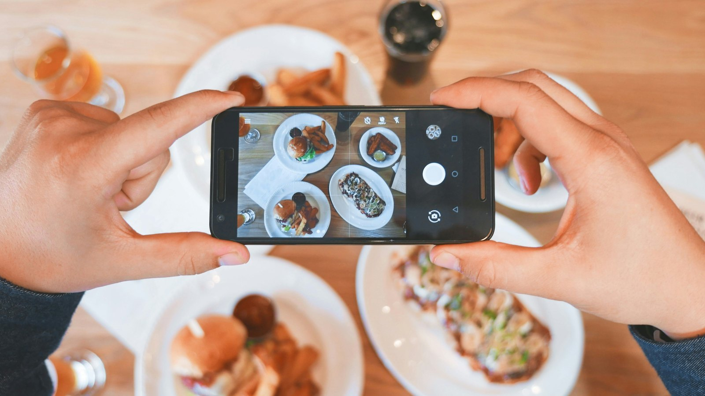

<!-- GENERATED from watch/issues/2026-05-25-firm-generated-user-content.yml by scripts/build_watch.py. Edit the data file. -->

```{=html}
<p class="mw-kicker">Marketing in 3 · Issue 20 · Week of 25 May 2026</p>
<figure class="mw-hero"><picture><source type="image/webp" sizes="(max-width: 900px) 100vw, 900px" srcset="../../images/web/issue-20-firm-generated-user-content-960.webp 960w, ../../images/web/issue-20-firm-generated-user-content-1600.webp 1600w"></picture><figcaption>The moment a brand would like to write for you. Photo: Eaters Collective on Unsplash.</figcaption></figure>
<section class="mw-answer" aria-label="Short answer"><h2>The short answer</h2><p>On the evidence here, yes, and more carefully than most do. Giving customers a finished post to send, instead of asking them to write one, raised sharing from 0.4% to 2.1% among real gym members and from 1.4% to 3.4% in a second field test. The wording decides who answers: warm, enthusiastic text pulled satisfied customers up to roughly half, while the flat factual wording most brands use did almost nothing. Unhappy customers handed the same warm text mostly went quiet instead of hitting back.</p></section>
<section class="mw-takeaways"><h2>Key takeaways</h2><ul><li>In a real gym campaign, a ready-made post was clicked through by 2.1% of members against 0.4% asked to write their own.</li><li>Among satisfied customers, enthusiastic wording lifted sharing to 50.7%, against 20.7% for a blank box.</li><li>Flat, factual wording — the kind most brands supply — reached 30.7% and was no better than asking people to write their own.</li><li>Among dissatisfied customers, the most glowing version cut sharing to 8.6%, below the 23.5% who would have written something themselves.</li></ul></section>
<section id="what-the-researchers-did"><h2>What the researchers did</h2><p>A personal note before the research. My birthday fell on the Sunday just gone, and birthdays make you sentimental
about where you started. Most of my own work has circled one question: what happens to a brand when the people
talking about it are not the brand. So this week&#x27;s paper landed well.</p><p>Jonathan Beck (University of Mississippi), Clay Voorhees (University of Alabama), Paul Fombelle (Northeastern
University) and Katherine Lemon (Boston College) have put a name to something that has crept into practice
without much scrutiny: firm-generated user content. Not an ad, and not a customer&#x27;s own words either. It is the
post the brand writes and the customer sends from their own account.</p><p>They ran six studies. Two were live campaigns that tracked whether people actually clicked through to post. One
measured what a thousand people really published on X after being handed a suggested line. The rest worked out
why, by varying how enthusiastic the supplied wording was and how happy the customer had been.</p>
<dl class="mw-facts"><div><dt>Field tests</dt><dd>A gym emailing 966 active members, and 999 people shown a film trailer</dd></div><div><dt>Experiments</dt><dd>Scenarios covering a wine aerator, a food delivery order and a suitcase, with 1,300 participants in total</dd></div><div><dt>Live posting study</dt><dd>1,003 people watched a deliberately poor short film, then had their real posts tracked</dd></div><div><dt>What was varied</dt><dd>Blank box or ready-made text, how warm that text was, and whether the experience had gone well</dd></div><div><dt>What was measured</dt><dd>Whether they shared, what they edited, and the tone of what finally went up</dd></div></dl>
</section>
<section id="a-blank-box-is-the-obstacle"><h2>A blank box is the obstacle</h2><p>The first test was a real campaign. A city gym emailed its members asking them to say something supportive on
social media. Half got a link to an empty posting box. Half got the same email with a finished sentence
recommending the gym, ready to send. Click-throughs went from 0.4% to 2.1%.</p><p>Those numbers look tiny until you remember what they are: click rates on a marketing email, where anything above
3% is unusual. Five times as many people took the step. The second field test, built around a film trailer,
moved the same way, from 1.4% to 3.4%.</p><p>Nothing here is about persuasion. The customers who shared already liked the gym. What changed was the cost of
doing something about it, and most goodwill never converts because writing a sentence in public is more effort
than it looks.</p>
</section>
<section id="enthusiasm-is-the-dial"><h2>Enthusiasm is the dial</h2><p>So what should the supplied sentence say? The second study put four versions in front of people who had just had
a good experience: an empty box, a flat statement of fact, a warm line, and an outright gushing one.</p><p>The flat version is roughly what brands write today, and it barely beat the blank box. Both of the warmer
versions nearly doubled sharing. The difference between warm and gushing was small, which matters, because the
gushing one carries a cost that shows up in the next section.</p><p>A second effect runs alongside. People overwhelmingly send the supplied text as written, so whatever tone the
brand chooses is the tone that ends up in public. Where customers wrote their own words, the posts came out
noticeably cooler.</p>
<figure class="mw-chart" id="chart-sharing"><figcaption class="mw-chart-title">Satisfied customers: share of them posting, by what the brand supplied</figcaption><div class="mw-chart-svg"><svg viewBox="0 0 680 194" role="img" aria-labelledby="chart-sharing-t" font-family="Hanken Grotesk, Arial, sans-serif"><title id="chart-sharing-t">Satisfied customers: share of them posting, by what the brand supplied</title><line x1="250.0" y1="4" x2="250.0" y2="168" stroke="#dde1e8" stroke-width="1"/><text x="250.0" y="186" font-size="12" text-anchor="middle" fill="#5b6476">0</text><line x1="310.0" y1="4" x2="310.0" y2="168" stroke="#dde1e8" stroke-width="1"/><text x="310.0" y="186" font-size="12" text-anchor="middle" fill="#5b6476">10</text><line x1="370.0" y1="4" x2="370.0" y2="168" stroke="#dde1e8" stroke-width="1"/><text x="370.0" y="186" font-size="12" text-anchor="middle" fill="#5b6476">20</text><line x1="430.0" y1="4" x2="430.0" y2="168" stroke="#dde1e8" stroke-width="1"/><text x="430.0" y="186" font-size="12" text-anchor="middle" fill="#5b6476">30</text><line x1="490.0" y1="4" x2="490.0" y2="168" stroke="#dde1e8" stroke-width="1"/><text x="490.0" y="186" font-size="12" text-anchor="middle" fill="#5b6476">40</text><line x1="550.0" y1="4" x2="550.0" y2="168" stroke="#dde1e8" stroke-width="1"/><text x="550.0" y="186" font-size="12" text-anchor="middle" fill="#5b6476">50</text><line x1="610.0" y1="4" x2="610.0" y2="168" stroke="#dde1e8" stroke-width="1"/><text x="610.0" y="186" font-size="12" text-anchor="middle" fill="#5b6476">60</text><g><title>Gushing wording: 52.7%</title><text x="238" y="27" font-size="13.5" text-anchor="end" fill="#15203b">Gushing wording</text><rect x="250" y="12" width="316.2" height="22" rx="4" fill="#aab3c5"/><text x="574.2" y="28" font-size="13.5" fill="#15203b">52.7%</text></g><g><title>Warm wording: 50.7%</title><text x="238" y="67" font-size="13.5" text-anchor="end" fill="#15203b" font-weight="600">Warm wording</text><rect x="250" y="52" width="304.2" height="22" rx="4" fill="#e0a12a"/><text x="562.2" y="68" font-size="13.5" fill="#15203b" font-weight="600">50.7%</text></g><g><title>Flat, factual wording: 30.7%</title><text x="238" y="107" font-size="13.5" text-anchor="end" fill="#15203b">Flat, factual wording</text><rect x="250" y="92" width="184.2" height="22" rx="4" fill="#aab3c5"/><text x="442.2" y="108" font-size="13.5" fill="#15203b">30.7%</text></g><g><title>Blank box: 20.7%</title><text x="238" y="147" font-size="13.5" text-anchor="end" fill="#15203b">Blank box</text><rect x="250" y="132" width="124.2" height="22" rx="4" fill="#aab3c5"/><text x="382.2" y="148" font-size="13.5" fill="#15203b">20.7%</text></g></svg></div><div class="mw-sr"><table><caption>Satisfied customers: share of them posting, by what the brand supplied</caption><tr><th>Group</th><th>Value (%)</th></tr><tr><th scope="row">Gushing wording</th><td>52.7</td></tr><tr><th scope="row">Warm wording</th><td>50.7</td></tr><tr><th scope="row">Flat, factual wording</th><td>30.7</td></tr><tr><th scope="row">Blank box</th><td>20.7</td></tr></table></div><p class="mw-chart-src">Study 2: 561 participants who had just had a good experience with the product.</p></figure>
</section>
<section id="the-unhappy-customer-quietly-declines"><h2>The unhappy customer quietly declines</h2><p>Now the same four versions, sent to people whose experience had gone badly. The pattern inverts. The glowing
line, which worked best on happy customers, cut sharing to roughly a third of what a blank box produced.</p><p>The reason is simple enough to recognise from your own inbox. For a satisfied customer, a ready-made line is a
favour: it says what they already think. For a dissatisfied one, it is a sentence that does not fit, and the
mismatch is uncomfortable enough that most people drop it rather than rewrite it.</p><p>The live study is the reassuring part. Of the unhappy viewers who did go ahead and post, four in five sent the
supplied line untouched, and the fifth softened it rather than sharpening it. Nobody turned it into an attack.
So the fear that this hands angry customers a megaphone did not materialise; what it does instead is thin out
their presence in the feed.</p>
<figure class="mw-chart" id="chart-dissatisfied"><figcaption class="mw-chart-title">Dissatisfied customers: the same four options, reversed</figcaption><div class="mw-chart-svg"><svg viewBox="0 0 680 194" role="img" aria-labelledby="chart-dissatisfied-t" font-family="Hanken Grotesk, Arial, sans-serif"><title id="chart-dissatisfied-t">Dissatisfied customers: the same four options, reversed</title><line x1="250.0" y1="4" x2="250.0" y2="168" stroke="#dde1e8" stroke-width="1"/><text x="250.0" y="186" font-size="12" text-anchor="middle" fill="#5b6476">0</text><line x1="310.0" y1="4" x2="310.0" y2="168" stroke="#dde1e8" stroke-width="1"/><text x="310.0" y="186" font-size="12" text-anchor="middle" fill="#5b6476">10</text><line x1="370.0" y1="4" x2="370.0" y2="168" stroke="#dde1e8" stroke-width="1"/><text x="370.0" y="186" font-size="12" text-anchor="middle" fill="#5b6476">20</text><line x1="430.0" y1="4" x2="430.0" y2="168" stroke="#dde1e8" stroke-width="1"/><text x="430.0" y="186" font-size="12" text-anchor="middle" fill="#5b6476">30</text><line x1="490.0" y1="4" x2="490.0" y2="168" stroke="#dde1e8" stroke-width="1"/><text x="490.0" y="186" font-size="12" text-anchor="middle" fill="#5b6476">40</text><line x1="550.0" y1="4" x2="550.0" y2="168" stroke="#dde1e8" stroke-width="1"/><text x="550.0" y="186" font-size="12" text-anchor="middle" fill="#5b6476">50</text><line x1="610.0" y1="4" x2="610.0" y2="168" stroke="#dde1e8" stroke-width="1"/><text x="610.0" y="186" font-size="12" text-anchor="middle" fill="#5b6476">60</text><g><title>Blank box: 23.5%</title><text x="238" y="27" font-size="13.5" text-anchor="end" fill="#15203b">Blank box</text><rect x="250" y="12" width="141.0" height="22" rx="4" fill="#aab3c5"/><text x="399.0" y="28" font-size="13.5" fill="#15203b">23.5%</text></g><g><title>Warm wording: 21.7%</title><text x="238" y="67" font-size="13.5" text-anchor="end" fill="#15203b">Warm wording</text><rect x="250" y="52" width="130.2" height="22" rx="4" fill="#aab3c5"/><text x="388.2" y="68" font-size="13.5" fill="#15203b">21.7%</text></g><g><title>Flat, factual wording: 17.4%</title><text x="238" y="107" font-size="13.5" text-anchor="end" fill="#15203b">Flat, factual wording</text><rect x="250" y="92" width="104.4" height="22" rx="4" fill="#aab3c5"/><text x="362.4" y="108" font-size="13.5" fill="#15203b">17.4%</text></g><g><title>Gushing wording: 8.6%</title><text x="238" y="147" font-size="13.5" text-anchor="end" fill="#15203b" font-weight="600">Gushing wording</text><rect x="250" y="132" width="51.6" height="22" rx="4" fill="#e0a12a"/><text x="309.6" y="148" font-size="13.5" fill="#15203b" font-weight="600">8.6%</text></g></svg></div><div class="mw-sr"><table><caption>Dissatisfied customers: the same four options, reversed</caption><tr><th>Group</th><th>Value (%)</th></tr><tr><th scope="row">Blank box</th><td>23.5</td></tr><tr><th scope="row">Warm wording</th><td>21.7</td></tr><tr><th scope="row">Flat, factual wording</th><td>17.4</td></tr><tr><th scope="row">Gushing wording</th><td>8.6</td></tr></table></div><p class="mw-chart-src">Study 2: the same experiment, among participants whose experience had gone badly.</p></figure>
</section>
<section id="the-part-that-should-make-you-pause"><h2>The part that should make you pause</h2><p>Here is where I have to take my marketer&#x27;s hat off. The entire value of user-generated content rests on readers
believing it came from a user. It persuades precisely because it is not controlled by the brand, which is why my
own work has always treated firm-created and user-generated communication as two different animals that do
different things to brand equity.</p><p>A tactic that works this well erases that line. Scale it across a customer base and the brand&#x27;s mentions stop
being evidence and start being distribution. The authors raise the same worry, and note that it may eventually
call for the kind of labelling that sponsored posts already carry.</p><p>Going beyond what their studies tested: the practical limit is probably self-correcting. If every mention of
your brand reads like the same sentence, readers will notice, and the channel will lose the credibility you were
borrowing. Which argues for using this where the enthusiasm is genuine, varying the words, and treating the
number of supplied posts against spontaneous ones as a metric worth watching rather than maximising.</p>
</section>
<section id="how-to-apply-it" class="mw-howto"><p class="mw-rsg-kicker">Marketing in 3 steps</p><h2>Ready. Set. Market.</h2><div class="mw-rsg"><div class="mw-phase"><div class="mw-phase-dot" aria-hidden="true">1</div><div class="mw-phase-tag"><span class="mw-phase-name">Ready</span><span class="mw-phase-sub">Decide and prepare</span></div><ul class="mw-rsg-steps"><li><strong>Fire the ask off a completed, successful moment.</strong> Trigger the request from an event in your data, not a calendar slot: order delivered, course finished, stay checked out, warranty registered. Send it within 48 hours, while the experience is still fresh.</li><li><strong>Put a satisfaction gate in front of it.</strong> Send the ready-made post only to customers whose last rating or survey sits in your top band. Route everyone else to a private feedback form, and suppress anyone with an open complaint.</li></ul></div><div class="mw-phase"><div class="mw-phase-dot" aria-hidden="true">2</div><div class="mw-phase-tag"><span class="mw-phase-name">Set</span><span class="mw-phase-sub">Build it</span></div><ul class="mw-rsg-steps"><li><strong>Write it as the customer would, warmly.</strong> First person, under 25 words, naming the product and one specific detail they would have noticed, with a clear note of enthusiasm. Skip the neutral, factual sentence; it performs like no suggestion at all.</li><li><strong>Make posting one tap, and leave it editable.</strong> Pre-fill the text and any link so the share sheet opens ready to send, and keep the box editable. Never auto-post on someone&#x27;s behalf.</li></ul></div><div class="mw-phase"><div class="mw-phase-dot" aria-hidden="true">3</div><div class="mw-phase-tag"><span class="mw-phase-name">Market</span><span class="mw-phase-sub">Launch and measure</span></div><ul class="mw-rsg-steps"><li><strong>Rotate at least ten versions.</strong> Generate a pool of variants, differing in the detail they mention and the phrasing, and assign a different one to each customer so your brand&#x27;s mentions do not read as one script.</li><li><strong>Watch the ratio, not just the rate.</strong> Report share rate alongside the proportion of your brand mentions that came from supplied text. When supplied posts start to crowd out spontaneous ones, cut the volume. Add a disclosure line wherever platform or advertising rules require it.</li></ul></div></div></section>
<section id="what-to-expect"><h2>What to expect</h2><ul class="mw-list"><li><strong>Small percentages, real volume.</strong> Share rates move by a point or two, which against a large customer base is a meaningful lift in mentions.</li><li><strong>A warmer public record.</strong> Supplied text travels mostly unedited, so the average tone of what gets posted rises.</li><li><strong>Fewer negative posts, not more.</strong> Unhappy customers tend to opt out rather than rewrite, and those who do post soften rather than attack.</li><li><strong>A credibility budget you are spending.</strong> Every supplied post trades a little of the independence that makes this channel work.</li></ul></section>
<section id="where-it-does-not-work"><h2>Where it does not work</h2><ul class="mw-list"><li><strong>Short posts only.</strong> This was tested on single-sentence social posts, not reviews, ratings or anything long enough to need a personal voice.</li><li><strong>One suggestion at a time.</strong> Every test offered a single ready-made line; offering a menu to choose from was not tried.</li><li><strong>No long-run evidence.</strong> Nothing here shows what repeated asks do to trust in the brand or in the channel over months.</li><li><strong>Mostly US scenario-based samples.</strong> Four of the six studies asked people to imagine an experience rather than live one, with the two field tests run in a single country.</li></ul></section>
<section id="questions"><h2>Questions marketers ask</h2><div class="mw-faq"><h3>Does giving customers a pre-written post actually increase sharing?</h3><p>Yes, by a multiple rather than a margin. A live gym campaign got five times the click-through when members were handed a finished message instead of an empty posting box, and a separate field test more than doubled (Beck et al., 2026, Journal of Marketing).</p></div><div class="mw-faq"><h3>What should the pre-written post say?</h3><p>Something warm and specific, written in the customer&#x27;s voice. Neutral factual wording, which is what most brands currently supply, performed no better than leaving the box empty.</p></div><div class="mw-faq"><h3>Will unhappy customers use a pre-written post against the brand?</h3><p>It did not happen here. Dissatisfied customers shared less often than they would have written on their own, four in five who shared sent the supplied line unchanged, and the minority who edited it made it milder rather than hostile.</p></div><div class="mw-faq"><h3>Why does a ready-made post work?</h3><p>Two different reasons depending on the customer. For satisfied ones it removes the effort of composing something; for dissatisfied ones it creates a mismatch with their experience, which is why they step away instead.</p></div><div class="mw-faq"><h3>Is this ethical?</h3><p>It sits in grey territory. Readers treat posts from customers as independent evidence, and supplying the words quietly removes that independence. The authors themselves flag the risk to consumer trust and suggest that disclosure rules may eventually be needed.</p></div></section>
<section id="also-new"><h2>Also new this week</h2><div class="mw-also"><article><p class="mw-also-src"><em>Journal of Marketing Research</em> · 2026</p><h3><a href="https://doi.org/10.1177/00222437261423540">Welfare implications of democratization in content creation: Generative AI and beyond</a></h3><p class="mw-also-au">Zou, T., Shi, Z., &amp; Wu, Y.</p><p>A modelling paper on what happens when tools let anyone produce content that passes for professional. A small narrowing of the quality gap can leave everybody worse off, flooding the market and crowding out the good material; a large one lifts both audiences and creators. Platforms that filter well raise welfare, yet are also where democratisation is most likely to hurt.</p></article><article><p class="mw-also-src"><em>Journal of Interactive Marketing</em> · 2026</p><h3><a href="https://doi.org/10.1177/10949968261457050">Sociopolitical activism, brand personality, and social media engagement</a></h3><p class="mw-also-au">Mahmood, A., &amp; Morales, J.</p><p>Ten years and 1.7 million posts from 269 corporate accounts, split into social and political causes. Social causes earned more engagement on average; political ones paid off only for brands already seen as competent at what they do. Activism is not one thing, and the right to speak on the harder subjects appears to be earned elsewhere.</p></article></div></section>
<section id="source" class="mw-source"><h2>Source</h2><p class="mw-cite">Beck, J. M., Voorhees, C. M., Fombelle, P. W., &amp; Lemon, K. N. (2026). Putting words in their mouths: Firm-generated user content and consumer sharing behavior. <em>Journal of Marketing</em>, <em>90</em>(2), 135-156. <a href="https://doi.org/10.1177/00222429251331483">https://doi.org/10.1177/00222429251331483</a></p><p class="mw-note">This brief is written for practitioners from the published article. Numbers are as reported by the authors; read the article for full methods.</p></section>
<section id="related-research" class="mw-related"><h2>Related research on this site</h2><ul><li><a href="../../../papers/social-media-communication-brand-perceptions.html">The effect of social media communication on consumer perceptions of brands</a><span>Journal of Marketing Communications</span></li><li><a href="../../../papers/measuring-consumer-engagement-social-media-content.html">Measuring consumers’ engagement with brand-related social-media content: Development and validation of a scale that identifies levels of social-media engagement with brands</a><span>Journal of Advertising Research</span></li><li><a href="../../../papers/brand-communication-brand-equity-facebook.html">The impact of brand communication on brand equity through Facebook</a><span>Journal of Research in Interactive Marketing</span></li></ul></section>
<section id="keep-reading" class="mw-more"><h2>Keep reading</h2><p class="mw-more-topics">More issues on <a href="../../topics/ugc.html">UGC</a> · <a href="../../topics/social-media.html">Social media</a> · <a href="../../topics/advertising.html">Advertising</a></p><div class="watch-list"><article class="watch-item"><a class="watch-thumb" href="../../posts/meme-marketing/index.html" tabindex="-1" aria-hidden="true"></a><div><p class="watch-meta">Issue 3 · Week of <time datetime="2026-01-26">26 January 2026</time></p><h3><a href="../../posts/meme-marketing/index.html">When brand memes sell, and when they flop</a></h3><p>In a field test, a meme ad doubled click-through (1.40% against 0.65%) and raised ROAS from 1.14 to 1.52. Memes work only when mature and for mainstream products.</p></div></article><article class="watch-item"><a class="watch-thumb" href="../../posts/synthetic-person-disclosure/index.html" tabindex="-1" aria-hidden="true"></a><div><p class="watch-meta">Issue 36 · Week of <time datetime="2026-09-14">14 September 2026</time></p><h3><a href="../../posts/synthetic-person-disclosure/index.html">The label that buys honesty, then spends it on artificiality</a></h3><p>A detailed &quot;this person does not exist&quot; label cut the sense of being manipulated and raised the sense of artificiality. The two effects cancelled out, except among younger viewers.</p></div></article><article class="watch-item"><a class="watch-thumb" href="../../posts/influencer-transgressions/index.html" tabindex="-1" aria-hidden="true"></a><div><p class="watch-meta">Issue 26 · Week of <time datetime="2026-07-06">6 July 2026</time></p><h3><a href="../../posts/influencer-transgressions/index.html">The brand walks. The influencer burns.</a></h3><p>In the Ferragni and Balocco case, 96% of journalists&#x27; tweets were about the influencer. Consumers followed the press, and the brand barely got mentioned.</p></div></article></div></section>
<div class="mw-author"><div><p><strong>Bruno Schivinski</strong> is Associate Professor of Marketing at Gdańsk University of Technology. He studies how consumers engage with brands in digital and social media.</p><p><a href="../../../index.html">About Bruno</a> · <a href="../../index.html">All Marketing in 3 issues</a> · <a href="../../subscribe.html">Subscribe</a></p></div></div>
<div class="mw-support" role="complementary" aria-label="Support Marketing in 3"><div class="mw-support-icon"><svg aria-hidden="true" focusable="false"
  class="lucide lucide-beer"
  xmlns="http://www.w3.org/2000/svg"
  width="24"
  height="24"
  viewBox="0 0 24 24"
  fill="none"
  stroke="currentColor"
  stroke-width="2"
  stroke-linecap="round"
  stroke-linejoin="round"
>
  <path d="M17 11h1a3 3 0 0 1 0 6h-1" />
  <path d="M9 12v6" />
  <path d="M13 12v6" />
  <path d="M14 7.5c-1 0-1.44.5-3 .5s-2-.5-3-.5-1.72.5-2.5.5a2.5 2.5 0 0 1 0-5c.78 0 1.57.5 2.5.5S9.44 2 11 2s2 1.5 3 1.5 1.72-.5 2.5-.5a2.5 2.5 0 0 1 0 5c-.78 0-1.5-.5-2.5-.5Z" />
  <path d="M5 8v12a2 2 0 0 0 2 2h8a2 2 0 0 0 2-2V8" />
</svg></div><p>If this issue saved you a meeting or sharpened a campaign, buy me a coffee. It keeps Marketing in 3 free, weekly and ad-free.</p><div class="mw-support-btns"><a class="mw-support-btn mw-support-btn-main" href="https://ko-fi.com/marketingin3" target="_blank" rel="noopener"><svg aria-hidden="true" focusable="false"
  class="lucide lucide-coffee"
  xmlns="http://www.w3.org/2000/svg"
  width="24"
  height="24"
  viewBox="0 0 24 24"
  fill="none"
  stroke="currentColor"
  stroke-width="2"
  stroke-linecap="round"
  stroke-linejoin="round"
>
  <path d="M10 2v2" />
  <path d="M14 2v2" />
  <path d="M16 8a1 1 0 0 1 1 1v8a4 4 0 0 1-4 4H7a4 4 0 0 1-4-4V9a1 1 0 0 1 1-1h14a4 4 0 1 1 0 8h-1" />
  <path d="M6 2v2" />
</svg><span class="mw-support-label">Buy me a coffee</span><span class="mw-support-price">€3</span></a></div></div>
<nav class="mw-pn" aria-label="More issues"><a class="mw-prev" href="../downvotes-content/index.html"><span>Previous issue</span>The dislike button that made people post more, and shout less</a><a class="mw-next" href="../deepfake-ugc-recognition/index.html"><span>Next issue</span>Caught, not told: the worst way for an AI actor to be found out</a></nav>
```
