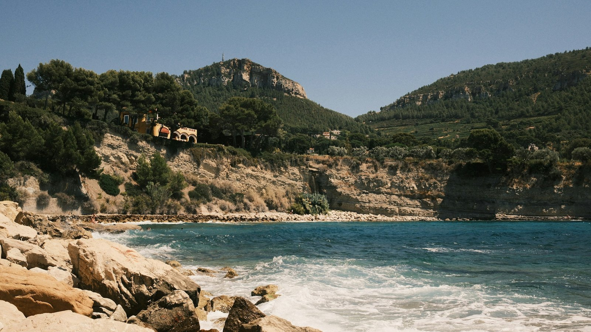
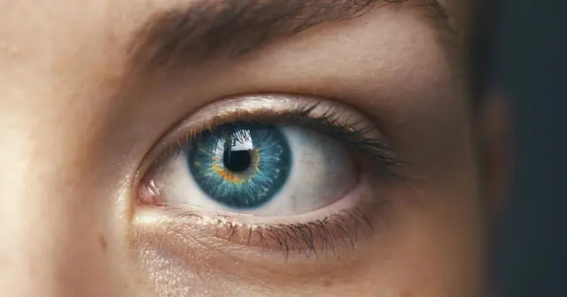

<!-- GENERATED from watch/issues/2026-11-05-genai-ad-visuals.yml by scripts/build_watch.py. Edit the data file. -->

```{=html}
<p class="mw-kicker">Marketing in 3 · 2026 · No. 45 · Thursday 5 November 2026</p>
<figure class="mw-hero"><picture><source type="image/webp" sizes="(max-width: 900px) 100vw, 900px" srcset="../../images/web/issue-45-genai-ad-visuals-960.webp 960w, ../../images/web/issue-45-genai-ad-visuals-1600.webp 1600w"></picture><figcaption>Seashore, hills or a waterfall? Choosing the scene behind an ad is turning into a search problem, not a photo shoot. Photo: Antoine LE on Unsplash.</figcaption></figure>
<section class="mw-answer" aria-label="Short answer"><h2>The short answer</h2><div class="mw-ans-grid"><p>For background images, in one real campaign, yes. Two researchers paired an image generator with two learning models, one predicting clicks and one predicting brand approval, and trained them over nine weekly rounds of Instagram ads. In the final test, the AI&#x27;s ten images averaged a 0.98% link click-through rate, against 0.78% for images chosen by a beauty score and 0.65% for a professional designer&#x27;s, and they varied least.</p><div class="mw-ev" role="note" aria-label="Evidence level: 2 of 3 stars, several studies"><span class="ev-k">Evidence level</span><ol><li><span class="ev-s" aria-hidden="true"><b>★</b><i>★</i><i>★</i></span>One study</li><li class="on"><span class="ev-s" aria-hidden="true"><b>★</b><b>★</b><i>★</i></span>Several studies</li><li><span class="ev-s" aria-hidden="true"><b>★</b><b>★</b><b>★</b></span>Meta-analysis</li></ol></div></div></section>
<section class="mw-takeaways"><h2>Key takeaways</h2><ul><li>Teaching the system what the brand accepts took the company&#x27;s representative under two hours of rating, spread over 60 small rounds.</li><li>In 99.6% of 10,000 resamples of the final test, the AI set&#x27;s average beat the designer&#x27;s. Against the beauty-score set it led in 90.8%, too close to call.</li><li>Just 0.6% of the training images ranked in the top tenth on both scores, predicted clicks and brand approval.</li><li>In the firm&#x27;s busy spring season, with no retraining, the company&#x27;s single standout ad came first, but the next five best ads were all made by the AI.</li></ul></section>
<section id="what-the-researchers-did"><h2>What the researchers did</h2><p><a class="mw-orcid-link" href="https://orcid.org/0000-0003-0838-3619" title="Remi Daviet on ORCID">Remi Daviet</a> and Yohei Nishimura, marketing researchers at the University of Wisconsin-Madison&#x27;s Wisconsin School of Business, started
from a practical worry. An image generator can produce more scenery than any team could ever test. The hard part becomes
finding the few pictures that people click and that the brand would happily put its name to.</p><p>Their system has three parts. A custom image generator builds each picture from a compact code with two halves: layout,
meaning where sky, trees and water sit, and style, meaning weather, light and the kind of trees. A standard open model then
polishes the rough image to ad quality. One learning model predicts whether the brand would accept an image, and a second
predicts its click-through rate. Both keep track of how unsure they are, and the system uses that doubt to choose each next
small batch to test: the images expected to teach it most about where the best on-brand pictures sit.</p><p>Keeping layout and style apart has a practical payoff. When an image has a flaw, such as a tree floating in the sky, a person
can fix the layout instead of throwing the picture away. Each fixed image and its rejected twin also show the brand model
exactly where the line falls.</p>
<dl class="mw-facts"><div><dt>Partner</dt><dd>An outdoor activities company advertising nature trips on Instagram</dd></div><div><dt>Audience</dt><dd>Local residents aged 18 to 55 with children aged 3 to 12; feed, Explore and search placements only</dd></div><div><dt>What changed</dt><dd>Only the background picture. Logo and text sat in a fixed template made by the firm&#x27;s own designer</dd></div><div><dt>Measure</dt><dd>Link click-through rate</dd></div><div><dt>Training</dt><dd>Late 2023, the firm&#x27;s off-peak winter season: brand ratings first, then nine weeks of live testing</dd></div><div><dt>Final test</dt><dd>Three sets of ten images run in the same week, with the same budget and targeting</dd></div></dl>
</section>
<section id="testing-it-first-in-a-simulation"><h2>Testing it first in a simulation</h2><p>Before spending real money, the authors built a simulated market in which they knew which images were best, while the system
did not. Two separate islands of the image space counted as on brand. Clicks peaked in a few rare spots, and the two
highest of them were off brand. Averaged over five runs, the system found the best on-brand peak within
five to seven rounds.</p><p>Two common alternatives did far worse. Testing random on-brand images, and Thompson sampling, a method many ad tools use to
shift budget toward early winners, often got stuck on lesser peaks with half the click rate. Thompson sampling is built to
harvest clicks from what already works, not to go looking for something better, so it barely explored.</p><p>Two other results matter in practice. Training the brand model in 60 rounds of 12 images did roughly as well as 20 rounds of
100, on roughly a third of the labels, because every round redirected the next. And with the brand model switched off, about
80% of the images sent for testing fell outside what the brand would accept.</p>
</section>
<section id="nine-weeks-of-live-ads"><h2>Nine weeks of live ads</h2><p>The partner wanted stronger background pictures for its Instagram ads. On brand meant three things: photorealistic, showing
the kind of landscape the firm really operates in, and free of tell-tale AI glitches.</p><p>A company representative first rated batches of 12 images on a four-step scale from unacceptable to great. Then came nine
weekly rounds of live ads. Each round ran a dozen images picked to be informative, plus the model&#x27;s current favourite and, from the second
round, the previous round&#x27;s best performer, which served as a yardstick for swings from one week to the next. Vetting those rounds turned
up 39 more batches with rejects, and each went back into the brand model. By the end it had learned from 1,417 rated images
and the click model from just 125 tested ones, tiny numbers for models of this kind.</p><p>Instagram adds noise of its own. When the same batches ran in two different periods, their rankings agreed only moderately
(a rank correlation of 0.43), and a round that fell on a long holiday weekend drew unusually high clicks. The early rounds
jumped around, as you would expect when the aim is to learn. From the eighth round, the model&#x27;s favourite images did better
and more steadily.</p>
</section>
<section id="the-final-test-ai-against-a-designer-and-a-beauty-score"><h2>The final test: AI against a designer and a beauty score</h2><p>For the final test the trained system picked ten images, drawn so the set spread across several promising scenes instead of
repeating one winner. Seashores, hills and waterfalls all made the cut. Two other sets of ten ran against them in the same
week, after the company had approved every image. One came from the designer who made the template. The other came from the
same image generator steered by a published aesthetics model, standing in for the shortcut of letting a general beauty score
do the choosing.</p><p>The AI set had the highest average and the narrowest spread. Its weakest image still drew 0.67%, while one picture in the
beauty-score set drew no link clicks at all. Counting clicks on the post as well as the link, the order held: 1.63% for the
AI set, 1.50% for the beauty-score set and 1.42% for the designer, in line with typical rates in that market. The authors
read it cautiously, given one designer, ten images per set and one week.</p>
<figure class="mw-chart" id="chart-ctr"><figcaption class="mw-chart-title">Average link click-through rate in the final test, ten images per set (%)</figcaption><div class="mw-chart-svg"><svg viewBox="0 0 680 154" role="img" aria-labelledby="chart-ctr-t" font-family="Hanken Grotesk, Arial, sans-serif"><title id="chart-ctr-t">Average link click-through rate in the final test, ten images per set (%)</title><line x1="250.0" y1="4" x2="250.0" y2="128" stroke="#dde1e8" stroke-width="1"/><text x="250.0" y="146" font-size="12" text-anchor="middle" fill="#5b6476">0</text><line x1="310.0" y1="4" x2="310.0" y2="128" stroke="#dde1e8" stroke-width="1"/><text x="310.0" y="146" font-size="12" text-anchor="middle" fill="#5b6476">0.2</text><line x1="370.0" y1="4" x2="370.0" y2="128" stroke="#dde1e8" stroke-width="1"/><text x="370.0" y="146" font-size="12" text-anchor="middle" fill="#5b6476">0.4</text><line x1="430.0" y1="4" x2="430.0" y2="128" stroke="#dde1e8" stroke-width="1"/><text x="430.0" y="146" font-size="12" text-anchor="middle" fill="#5b6476">0.6</text><line x1="490.0" y1="4" x2="490.0" y2="128" stroke="#dde1e8" stroke-width="1"/><text x="490.0" y="146" font-size="12" text-anchor="middle" fill="#5b6476">0.8</text><line x1="550.0" y1="4" x2="550.0" y2="128" stroke="#dde1e8" stroke-width="1"/><text x="550.0" y="146" font-size="12" text-anchor="middle" fill="#5b6476">1</text><line x1="610.0" y1="4" x2="610.0" y2="128" stroke="#dde1e8" stroke-width="1"/><text x="610.0" y="146" font-size="12" text-anchor="middle" fill="#5b6476">1.2</text><g><title>AI set (clicks and brand fit): 0.98%</title><text x="238" y="27" font-size="13.5" text-anchor="end" fill="#15203b" font-weight="600">AI set (clicks and brand fit)</text><rect x="250" y="12" width="294.0" height="22" rx="4" fill="#e0a12a"/><text x="552.0" y="28" font-size="13.5" fill="#15203b" font-weight="600">0.98%</text></g><g><title>Beauty-score set: 0.78%</title><text x="238" y="67" font-size="13.5" text-anchor="end" fill="#15203b">Beauty-score set</text><rect x="250" y="52" width="234.0" height="22" rx="4" fill="#aab3c5"/><text x="492.0" y="68" font-size="13.5" fill="#15203b">0.78%</text></g><g><title>Designer&#x27;s set: 0.65%</title><text x="238" y="107" font-size="13.5" text-anchor="end" fill="#15203b">Designer&#x27;s set</text><rect x="250" y="92" width="195.0" height="22" rx="4" fill="#aab3c5"/><text x="453.0" y="108" font-size="13.5" fill="#15203b">0.65%</text></g></svg></div><div class="mw-sr"><table><caption>Average link click-through rate in the final test, ten images per set (%)</caption><tr><th>Group</th><th>Value (%)</th></tr><tr><th scope="row">AI set (clicks and brand fit)</th><td>0.98</td></tr><tr><th scope="row">Beauty-score set</th><td>0.78</td></tr><tr><th scope="row">Designer&#x27;s set</th><td>0.65</td></tr></table></div><p class="mw-chart-src">Field experiment, final validation week; all images approved by the company, same budget and targeting. Standard deviations 0.26, 0.41 and 0.31.</p></figure>
</section>
<section id="back-in-spring-with-more-at-stake"><h2>Back in spring, with more at stake</h2><p>The real test for any creative tool is the busy season. In April 2024, during the firm&#x27;s peak booking weeks for spring holidays,
the authors ran the ten images picked from the winter training, with no retraining, against the best set the company&#x27;s own
team had prepared for that campaign. Targeting and budgets matched.</p><p>Click rates were far higher for everyone in spring. The AI set averaged 3.38% against the company&#x27;s 3.24%, with a slightly
narrower spread, but that edge could easily be chance: it held in about two of every three resamples. The company had the
single best ad by a distance, at 5.39%. The single worst ad was one of the AI&#x27;s, at 1.86%. In between, the AI images crowded the
upper part of the table.</p><p>In the authors&#x27; view this is a conservative floor, since a firm would normally retrain on fresh clicks before its busiest weeks.
Still, the scenery learned in winter kept working months later.</p>
<figure class="mw-chart" id="chart-april"><figcaption class="mw-chart-title">Spring retest in peak booking season, no retraining: link click-through rate (%)</figcaption><div class="mw-chart-svg"><svg viewBox="0 0 680 274" role="img" aria-labelledby="chart-april-t" font-family="Hanken Grotesk, Arial, sans-serif"><title id="chart-april-t">Spring retest in peak booking season, no retraining: link click-through rate (%)</title><line x1="250.0" y1="4" x2="250.0" y2="248" stroke="#dde1e8" stroke-width="1"/><text x="250.0" y="266" font-size="12" text-anchor="middle" fill="#5b6476">0</text><line x1="310.0" y1="4" x2="310.0" y2="248" stroke="#dde1e8" stroke-width="1"/><text x="310.0" y="266" font-size="12" text-anchor="middle" fill="#5b6476">1</text><line x1="370.0" y1="4" x2="370.0" y2="248" stroke="#dde1e8" stroke-width="1"/><text x="370.0" y="266" font-size="12" text-anchor="middle" fill="#5b6476">2</text><line x1="430.0" y1="4" x2="430.0" y2="248" stroke="#dde1e8" stroke-width="1"/><text x="430.0" y="266" font-size="12" text-anchor="middle" fill="#5b6476">3</text><line x1="490.0" y1="4" x2="490.0" y2="248" stroke="#dde1e8" stroke-width="1"/><text x="490.0" y="266" font-size="12" text-anchor="middle" fill="#5b6476">4</text><line x1="550.0" y1="4" x2="550.0" y2="248" stroke="#dde1e8" stroke-width="1"/><text x="550.0" y="266" font-size="12" text-anchor="middle" fill="#5b6476">5</text><line x1="610.0" y1="4" x2="610.0" y2="248" stroke="#dde1e8" stroke-width="1"/><text x="610.0" y="266" font-size="12" text-anchor="middle" fill="#5b6476">6</text><g><title>AI set, average: 3.38%</title><text x="238" y="27" font-size="13.5" text-anchor="end" fill="#15203b" font-weight="600">AI set, average</text><rect x="250" y="12" width="202.8" height="22" rx="4" fill="#e0a12a"/><text x="460.8" y="28" font-size="13.5" fill="#15203b" font-weight="600">3.38%</text></g><g><title>Company set, average: 3.24%</title><text x="238" y="67" font-size="13.5" text-anchor="end" fill="#15203b">Company set, average</text><rect x="250" y="52" width="194.4" height="22" rx="4" fill="#aab3c5"/><text x="452.4" y="68" font-size="13.5" fill="#15203b">3.24%</text></g><g><title>AI set, best ad: 4.32%</title><text x="238" y="107" font-size="13.5" text-anchor="end" fill="#15203b">AI set, best ad</text><rect x="250" y="92" width="259.2" height="22" rx="4" fill="#aab3c5"/><text x="517.2" y="108" font-size="13.5" fill="#15203b">4.32%</text></g><g><title>Company set, best ad: 5.39%</title><text x="238" y="147" font-size="13.5" text-anchor="end" fill="#15203b">Company set, best ad</text><rect x="250" y="132" width="323.4" height="22" rx="4" fill="#aab3c5"/><text x="581.4" y="148" font-size="13.5" fill="#15203b">5.39%</text></g><g><title>AI set, weakest ad: 1.86%</title><text x="238" y="187" font-size="13.5" text-anchor="end" fill="#15203b">AI set, weakest ad</text><rect x="250" y="172" width="111.6" height="22" rx="4" fill="#aab3c5"/><text x="369.6" y="188" font-size="13.5" fill="#15203b">1.86%</text></g><g><title>Company set, weakest ad: 2.51%</title><text x="238" y="227" font-size="13.5" text-anchor="end" fill="#15203b">Company set, weakest ad</text><rect x="250" y="212" width="150.6" height="22" rx="4" fill="#aab3c5"/><text x="408.6" y="228" font-size="13.5" fill="#15203b">2.51%</text></g></svg></div><div class="mw-sr"><table><caption>Spring retest in peak booking season, no retraining: link click-through rate (%)</caption><tr><th>Group</th><th>Value (%)</th></tr><tr><th scope="row">AI set, average</th><td>3.38</td></tr><tr><th scope="row">Company set, average</th><td>3.24</td></tr><tr><th scope="row">AI set, best ad</th><td>4.32</td></tr><tr><th scope="row">Company set, best ad</th><td>5.39</td></tr><tr><th scope="row">AI set, weakest ad</th><td>1.86</td></tr><tr><th scope="row">Company set, weakest ad</th><td>2.51</td></tr></table></div><p class="mw-chart-src">April 2024, ten images per set, same targeting and budget. The AI set&#x27;s higher average held in 67.7% of 10,000 resamples.</p></figure>
</section>
<section id="what-clicks-and-what-fits-the-brand-rarely-overlap"><h2>What clicks and what fits the brand rarely overlap</h2><p>Across the images the system rated during training, only 5.3% sat in the top quarter on both counts.
That is the case for running two models at once. Chase clicks alone and most of what you find is unusable. Judge on brand fit
alone and you miss what people respond to.</p><p>Could an off-the-shelf vision model stand in for the human rater? The authors tried. On a factual task, telling apart no
water, a river, a lake and the sea, a small open model agreed well with the right answers (a weighted kappa of 0.73, where 1
is perfect). On the brand manager&#x27;s sense of what was acceptable it scored below 0.05, close to guessing, despite dozens of
prompt versions. A larger commercial model did no better.</p><p>Money goes mainly on buying views. Media cost about $7 per thousand impressions in this campaign, and the authors set a full
testing cycle against what an agency might charge for similar work, noting that agency fees vary widely.</p>
<figure class="mw-chart" id="chart-cost"><figcaption class="mw-chart-title">Estimated cost of one nine-round testing cycle (US$ thousands)</figcaption><div class="mw-chart-svg"><svg viewBox="0 0 680 154" role="img" aria-labelledby="chart-cost-t" font-family="Hanken Grotesk, Arial, sans-serif"><title id="chart-cost-t">Estimated cost of one nine-round testing cycle (US$ thousands)</title><line x1="250.0" y1="4" x2="250.0" y2="128" stroke="#dde1e8" stroke-width="1"/><text x="250.0" y="146" font-size="12" text-anchor="middle" fill="#5b6476">0</text><line x1="322.0" y1="4" x2="322.0" y2="128" stroke="#dde1e8" stroke-width="1"/><text x="322.0" y="146" font-size="12" text-anchor="middle" fill="#5b6476">2</text><line x1="394.0" y1="4" x2="394.0" y2="128" stroke="#dde1e8" stroke-width="1"/><text x="394.0" y="146" font-size="12" text-anchor="middle" fill="#5b6476">4</text><line x1="466.0" y1="4" x2="466.0" y2="128" stroke="#dde1e8" stroke-width="1"/><text x="466.0" y="146" font-size="12" text-anchor="middle" fill="#5b6476">6</text><line x1="538.0" y1="4" x2="538.0" y2="128" stroke="#dde1e8" stroke-width="1"/><text x="538.0" y="146" font-size="12" text-anchor="middle" fill="#5b6476">8</text><line x1="610.0" y1="4" x2="610.0" y2="128" stroke="#dde1e8" stroke-width="1"/><text x="610.0" y="146" font-size="12" text-anchor="middle" fill="#5b6476">10</text><g><title>AI system: media for nine rounds: 3.0 </title><text x="238" y="27" font-size="13.5" text-anchor="end" fill="#15203b" font-weight="600">AI system: media for nine rounds</text><rect x="250" y="12" width="108.0" height="22" rx="4" fill="#e0a12a"/><text x="366.0" y="28" font-size="13.5" fill="#15203b" font-weight="600">3.0</text></g><g><title>Agency: creative production: 9.0 </title><text x="238" y="67" font-size="13.5" text-anchor="end" fill="#15203b">Agency: creative production</text><rect x="250" y="52" width="324.0" height="22" rx="4" fill="#aab3c5"/><text x="582.0" y="68" font-size="13.5" fill="#15203b">9.0</text></g><g><title>Agency: management fees: 4.0 </title><text x="238" y="107" font-size="13.5" text-anchor="end" fill="#15203b">Agency: management fees</text><rect x="250" y="92" width="144.0" height="22" rx="4" fill="#aab3c5"/><text x="402.0" y="108" font-size="13.5" fill="#15203b">4.0</text></g></svg></div><div class="mw-sr"><table><caption>Estimated cost of one nine-round testing cycle (US$ thousands)</caption><tr><th>Group</th><th>Value ()</th></tr><tr><th scope="row">AI system: media for nine rounds</th><td>3.0</td></tr><tr><th scope="row">Agency: creative production</th><td>9.0</td></tr><tr><th scope="row">Agency: management fees</th><td>4.0</td></tr></table></div><p class="mw-chart-src">The authors&#x27; estimates. The agency total is about $13,000; management fees assume 15% of managed media spend.</p></figure>
</section>
<section id="how-to-apply-it" class="mw-howto"><p class="mw-rsg-kicker">Marketing in 3 steps</p><h2>Ready. Set. Market.</h2><div class="mw-rsg"><div class="mw-phase"><div class="mw-phase-dot" aria-hidden="true">1</div><div class="mw-phase-tag"><span class="mw-phase-name">Ready</span><span class="mw-phase-sub">Decide and prepare</span></div><ul class="mw-rsg-steps"><li><strong>Fix everything except the picture.</strong> Build one ad template with your logo, headline and button locked in place, and leave a single slot for the background. Every image you try goes into that same slot, so any change in clicks comes from the picture.</li><li><strong>Write your brand&#x27;s red lines.</strong> List what an acceptable image must show and must never show, such as places you really serve, no warped objects and nothing that looks fake. Then ask the person who owns the brand to rate a first set of AI images as reject, borderline, good or great.</li></ul></div><div class="mw-phase"><div class="mw-phase-dot" aria-hidden="true">2</div><div class="mw-phase-tag"><span class="mw-phase-name">Set</span><span class="mw-phase-sub">Build it</span></div><ul class="mw-rsg-steps"><li><strong>Make small rounds of images.</strong> Generate about a dozen backgrounds per round. Drop any that cross a red line, and repair small flaws by hand instead of starting over, keeping the rejected and repaired versions side by side as examples.</li><li><strong>Hold the delivery settings still.</strong> Give every image in a round the same audience, budget, bid and placements. Add last round&#x27;s best image to each new round so a good picture can be told apart from a good week.</li></ul></div><div class="mw-phase"><div class="mw-phase-dot" aria-hidden="true">3</div><div class="mw-phase-tag"><span class="mw-phase-name">Market</span><span class="mw-phase-sub">Launch and measure</span></div><ul class="mw-rsg-steps"><li><strong>Run short rounds and feed back.</strong> Run each round for a week, send the click results back into what you generate next, and repeat for eight to ten rounds. Expect the early rounds to look messy.</li><li><strong>Launch a varied set, not one winner.</strong> Pick around ten images that cover different scenes. Compare their average and their weakest ad with your current creative, and refresh the set before your busiest season.</li></ul></div></div></section>
<div class="mw-coffee" role="complementary" aria-label="Support Marketing in 3"><div class="mw-coffee-text"><p class="mw-coffee-title">Found this useful?</p><p>Marketing in 3 is free and ad-free, with new issues every Monday and Thursday. A coffee keeps it that way.</p></div><a class="mw-coffee-btn" href="https://ko-fi.com/marketingin3" target="_blank" rel="noopener"><svg aria-hidden="true" focusable="false"
  class="lucide lucide-coffee"
  xmlns="http://www.w3.org/2000/svg"
  width="24"
  height="24"
  viewBox="0 0 24 24"
  fill="none"
  stroke="currentColor"
  stroke-width="2"
  stroke-linecap="round"
  stroke-linejoin="round"
>
  <path d="M10 2v2" />
  <path d="M14 2v2" />
  <path d="M16 8a1 1 0 0 1 1 1v8a4 4 0 0 1-4 4H7a4 4 0 0 1-4-4V9a1 1 0 0 1 1-1h14a4 4 0 1 1 0 8h-1" />
  <path d="M6 2v2" />
</svg><span>Buy me a coffee</span><span class="mw-coffee-price">€3</span></a></div>
<form class="mw-email mw-email-inline" action="https://qewbdm3gpjxh42mawu5n6ac37m0hlcgm.lambda-url.ap-southeast-2.on.aws/subscribe" method="post"><div class="mw-email-text"><p class="mw-email-title">Get it by email</p><p>New issues every Monday and Thursday, in your inbox. Free, no ads, unsubscribe anytime.</p></div><div class="mw-email-row"><label class="visually-hidden" for="m3-email-inline">Email address</label><input id="m3-email-inline" type="email" name="email" required autocomplete="email" inputmode="email" placeholder="you@example.com" maxlength="254"><input class="mw-hp" type="text" name="website" tabindex="-1" autocomplete="off" aria-hidden="true"><input type="hidden" name="source" value=""><button type="submit">Subscribe</button></div><p class="mw-email-status" role="status" aria-live="polite"></p><p class="mw-email-note">Your address is used only to send Marketing in 3. You will get one email to confirm.</p></form><script>(function(){if(window.m3Email)return;window.m3Email=1;
var M={"check": "Almost done. Check your inbox for an email from issues@marketingin3.com and tap the link to confirm.", "invalid": "That email address does not look right. Please check it and try again.", "slow": "Too many tries in a short time. Please wait a few minutes and try again.", "busy": "Too many tries in a short time. Please wait a few minutes and try again.", "error": "Something went wrong. Please try again in a moment.", "undeliverable": "That address cannot receive email from us. Please try another one.", "confirming": "Confirming your subscription…", "ok": "You are subscribed. The next issue arrives in your inbox on Monday or Thursday, whichever comes first.", "expired": "This confirmation link has expired or was already used. Enter your address again for a fresh one."};
function ep(f){return f.getAttribute('action').replace(/\/subscribe$/,'');}
function say(f,k){var s=f.querySelector('.mw-email-status');if(!s)return;s.textContent=M[k]||M.error;
s.className='mw-email-status is-'+(k==='ok'||k==='check'?'ok':(k==='confirming'?'wait':'bad'));}
function gc(e){try{if(window.mwTrack)window.mwTrack(e);}catch(x){}try{if(window.goatcounter&&goatcounter.count)goatcounter.count({path:e,title:e,event:true});}catch(x){}}
document.querySelectorAll('form.mw-email').forEach(function(f){
var src=f.querySelector('input[name=source]');if(src)src.value=location.pathname;
f.addEventListener('submit',function(e){if(!window.fetch)return;e.preventDefault();
var b=f.querySelector('button');b.disabled=true;
var data={email:f.email.value,website:f.website.value,source:location.pathname};
fetch(f.getAttribute('action'),{method:'POST',headers:{'content-type':'application/json'},body:JSON.stringify(data)})
.then(function(r){return r.json().catch(function(){return {status:'error'};});})
.then(function(j){say(f,j.status);if(j.status==='check'){f.classList.add('is-done');gc('email-subscribe');}})
.catch(function(){say(f,'error');}).then(function(){b.disabled=false;});});});
var q=new URLSearchParams(location.search),f=document.querySelector('form.mw-email');if(!f)return;
['check','invalid','slow','error'].forEach(function(k){if(q.get(k))say(f,k);});
var t=q.get('t');if(t){say(f,'confirming');
fetch(ep(f)+'/confirm',{method:'POST',headers:{'content-type':'application/json'},body:JSON.stringify({t:t})})
.then(function(r){return r.json().catch(function(){return {status:'error'};});})
.then(function(j){say(f,j.status);if(j.status==='ok'){f.classList.add('is-done');gc('email-confirmed');}
if(history.replaceState)history.replaceState(null,'',location.pathname+'#email');})
.catch(function(){say(f,'error');});}
})();</script>
<section id="what-to-expect"><h2>What to expect</h2><ul class="mw-list"><li><strong>Steadier results, not a jackpot.</strong> The AI set&#x27;s strength was a smaller gap between its best and worst ads. A person&#x27;s pick can still produce the single biggest hit.</li><li><strong>Messy learning rounds.</strong> Rounds chosen to teach the system will look erratic, because they are not trying to win yet.</li><li><strong>A brand person in the loop.</strong> Someone who knows the brand has to rate images and fix small flaws. In this study that was quick work, but it could not be handed to an AI vision model.</li><li><strong>Technical work up front.</strong> The system was custom-built. The authors suggest ad platforms or specialist firms could offer it as a service.</li></ul></section>
<section id="where-it-does-not-work"><h2>Where it does not work</h2><ul class="mw-list"><li><strong>One campaign.</strong> One company, one audience, one platform and one kind of picture: nature scenery behind a fixed template.</li><li><strong>A small final test.</strong> Ten images per set, one week and a single designer as the human benchmark. The lead over the beauty-score set was not conclusive.</li><li><strong>Backgrounds only.</strong> Products, people and exact wording inside the image are beyond the current generator.</li><li><strong>Platform variation.</strong> The ad platform&#x27;s own delivery choices are part of every result, which is why settings have to stay identical across a round.</li></ul></section>
<section id="questions"><h2>Questions marketers ask</h2><div class="mw-faq"><h3>Can AI-generated images outperform a human designer&#x27;s ads?</h3><p>In this test, on average, yes. The AI&#x27;s ten backgrounds drew about 50% more link clicks per view than a professional designer&#x27;s ten (Daviet &amp; Nishimura, 2026). With one designer, one campaign and one week of testing, it shows AI images can compete, not that they always win.</p></div><div class="mw-faq"><h3>Is a general beauty score a good guide for choosing ad images?</h3><p>Not on its own. Images generated to please a standard aesthetics model beat the designer&#x27;s set on average but trailed the set trained on real clicks, and one of them drew a blank on link clicks. What drove the gain was learning from the campaign&#x27;s own results.</p></div><div class="mw-faq"><h3>How do you keep AI ad images on brand?</h3><p>Train a separate model on a brand owner&#x27;s ratings and only test the images it passes. In the authors&#x27; simulation, dropping that filter sent most of the test budget to pictures the brand would have refused.</p></div><div class="mw-faq"><h3>Can a vision AI judge brand fit instead of a person?</h3><p>Not yet, on this evidence. A vision-language model could tell a river from the sea, but after dozens of prompts it still could not predict which images the brand manager would accept, and a bigger model did no better.</p></div><div class="mw-faq"><h3>What does it cost to test AI ad images this way?</h3><p>Mostly media. A round of 12 images at a few thousand impressions each cost about $340, and each model update took around 15 minutes on a laptop graphics card. Building the system needs specialist skills.</p></div></section>
<section id="also-new"><h2>Also new this week</h2><div class="mw-also"><article><p class="mw-also-src"><em>Journal of Advertising</em> · 2026</p><h3><a href="https://doi.org/10.1080/00913367.2026.2731565">Generative AI Disclosure in Advertising: From Intent- to Production-Based Disclosure</a></h3><p class="mw-also-au">Dineva &amp; Acar</p><p>A conceptual paper arguing that an &quot;AI-generated&quot; label tells people how an ad was made, not why it was made, which is what older disclosure research assumed. It separates labels a brand adds itself, labels the rules require and labels built into the platforms themselves, and sets out two routes to judgement: who people think made the ad, and what they infer from how it was produced. How closely they think it through depends on their motivation and ability. The label is now part of the message.</p></article><article><p class="mw-also-src"><em>International Journal of Advertising</em> · 2026</p><h3><a href="https://doi.org/10.1080/02650487.2026.2737583">Disclosing AI-generated advertising: effects on attitudes, purchase intent, and social media engagement</a></h3><p class="mw-also-au">Wilson, Roux, &amp; Bright</p><p>This study looks at synthetic outdoor ads: AI-altered versions of billboards and street displays, made for brands to post on social media. The more creative the fake, the more persuasive it was, but the more likely people were to notice it was not real. Once people noticed, they warmed less to both the ad and its brand, though their purchase intent and social media engagement did not change. A clever illusion invites a second look.</p></article></div></section>
<section id="source" class="mw-source"><h2>Source</h2><p class="mw-cite">Daviet, R., &amp; Nishimura, Y. (2026). Leveraging Generative Artificial Intelligence to Create Visual Content in Digital Advertising. <em>Marketing Science</em>, <em>45</em>(5), 893-912. <a href="https://doi.org/10.1287/mksc.2024.1130">https://doi.org/10.1287/mksc.2024.1130</a></p><p class="mw-note">This brief is written for practitioners from the published article. Numbers are as reported by the authors; read the article for full methods.</p></section>

<section id="keep-reading" class="mw-more"><h2>Keep reading</h2><p class="mw-more-topics">More issues on <a href="../../topics/ai.html">AI</a> · <a href="../../topics/creative.html">Creative</a> · <a href="../../topics/advertising.html">Advertising</a></p><div class="watch-list"><article class="watch-item"><a class="watch-thumb" href="../../posts/genai-creative-ideation/index.html" tabindex="-1" aria-hidden="true"></a><div><p class="watch-meta">2026 · No. 42 · <time datetime="2026-10-26">Week of 26 October 2026</time></p><h3><a href="../../posts/genai-creative-ideation/index.html">Prompt training doubled the ideas, not the quality</a></h3><p>Milano et al. tested 98 advertising professionals: generative AI doubled the number of tagline ideas, but only after prompt training, and quality stayed flat.</p></div></article><article class="watch-item"><a class="watch-thumb" href="../../posts/contextual-advertising-attention/index.html" tabindex="-1" aria-hidden="true"></a><div><p class="watch-meta">2026 · No. 13 · <time datetime="2026-04-06">Week of 6 April 2026</time></p><h3><a href="../../posts/contextual-advertising-attention/index.html">Match ads to pages by look, not just by topic</a></h3><p>Placing ads by both look and topic of the page lifted predicted attention by up to 10%; matching by category or text alone did not. Evidence from 3,531 ads.</p></div></article><article class="watch-item"><a class="watch-thumb" href="../../posts/generative-ai-ad-images/index.html" tabindex="-1" aria-hidden="true"></a><div><p class="watch-meta">2026 · No. 1 · <time datetime="2026-01-12">Week of 12 January 2026</time></p><h3><a href="../../posts/generative-ai-ad-images/index.html">Generative AI images that actually engage</a></h3><p>Fine-tuned on top-rated ads, generative AI made ad images that beat conventional ads in pretests and lifted Meta click-through by 49%. How to apply it, and when it fails.</p></div></article></div></section>
<div class="mw-author"><div><p><strong>Bruno Schivinski</strong> is Associate Professor of Marketing at Gdańsk University of Technology. He studies how consumers engage with brands in digital and social media.</p><p><a href="../../../index.html">About Bruno</a> · <a href="../../index.html">All Marketing in 3 issues</a> · <a href="../../subscribe.html">Subscribe</a></p></div></div>
<nav class="mw-pn" aria-label="More issues"><a class="mw-prev" href="../returnless-partial-refunds/index.html"><span>Previous issue</span>Keep it, get part back: returns that pay off later</a></nav>
```
