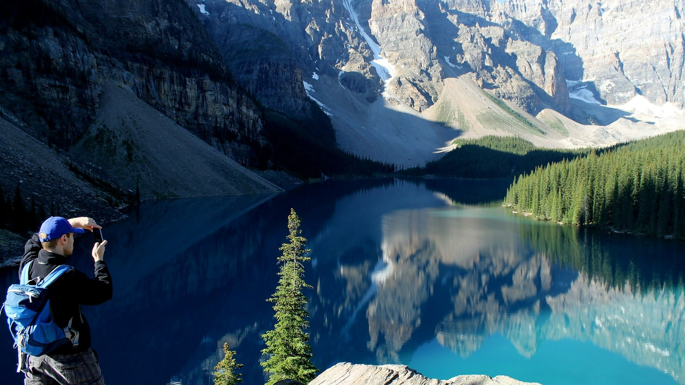
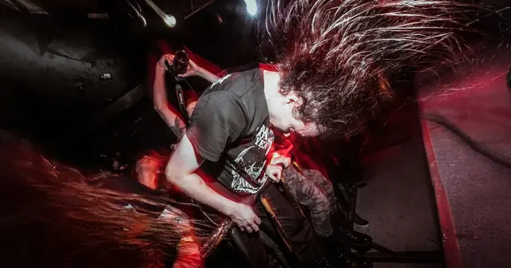

<!-- GENERATED from watch/issues/2025-01-06-greenfluencer-nature-posts.yml by scripts/build_watch.py. Edit the data file. -->

```{=html}
<p class="mw-kicker">Marketing in 3 · <a href="../../2025/index.html">2025 in research</a> · No. 1 · Paper published 6 January 2025</p>
<figure class="mw-hero"><picture><source type="image/webp" sizes="(max-width: 900px) 100vw, 900px" srcset="../../images/web/2025-01-greenfluencer-nature-posts-960.webp 960w, ../../images/web/2025-01-greenfluencer-nature-posts-1600.webp 1600w"></picture><figcaption>One picture of a lake can do more for the climate than a lecture about carbon. Photo: Darin Wicentowich on Unsplash.</figcaption></figure>
<section class="mw-answer" aria-label="Short answer"><h2>The short answer</h2><div class="mw-ans-grid"><p>Yes, they nudge followers towards it. In a US experiment with 600 adults, people saw three Instagram posts from a green influencer. The captions never changed; only the pictures did, either unspoilt landscapes or scenes with no nature in them. The landscape versions left people feeling they had spent time outdoors, more worried about the climate and readier to act. A survey of 550 Australian Instagram users found the same chain, strongest where followers trusted the creator.</p><div class="mw-ev" role="note" aria-label="Evidence level: 2 of 3 stars, several studies"><span class="ev-k">Evidence level</span><ol><li><span class="ev-s" aria-hidden="true"><b>★</b><i>★</i><i>★</i></span>One study</li><li class="on"><span class="ev-s" aria-hidden="true"><b>★</b><b>★</b><i>★</i></span>Several studies</li><li><span class="ev-s" aria-hidden="true"><b>★</b><b>★</b><b>★</b></span>Meta-analysis</li></ol></div></div></section>
<section class="mw-takeaways"><h2>Key takeaways</h2><ul><li>Swapping in landscape photos, with every caption word for word the same, almost doubled how much viewers felt they were out in nature: 3.36 against 1.84 on a five-point scale.</li><li>Planned climate action, such as cutting one&#x27;s carbon footprint or choosing green power, came out about 12% higher after the nature posts.</li><li>Reputation counted for more than the pictures: across both picture sets, planned action averaged 3.16 when the influencer was well regarded and 2.59 when she had been accused of greenwashing.</li><li>Among Australian followers, how close to nature and how worried about climate they felt explained close to half (49%) of the differences in their plans to act.</li></ul></section>
<section id="what-the-researchers-did"><h2>What the researchers did</h2><p><a class="mw-orcid-link" href="https://orcid.org/0000-0001-5922-3098" title="Patrick Hartmann on ORCID">Patrick Hartmann</a> and <a class="mw-orcid-link" href="https://orcid.org/0000-0003-3252-3036" title="Vanessa Apaolaza on ORCID">Vanessa Apaolaza</a> of the University of the Basque Country in Bilbao, <a class="mw-orcid-link" href="https://orcid.org/0000-0001-7803-0830" title="Mario R. Paredes on ORCID">Mario R. Paredes</a> of IPADE Business
School in Mexico City and <a class="mw-orcid-link" href="https://orcid.org/0000-0002-6591-5725" title="Clare D’Souza on ORCID">Clare D’Souza</a> of La Trobe University in Melbourne looked at the posts green creators make most
often and talk about least. Much of a sustainability feed is not advice or product tips but plain landscapes: a lake at dawn,
a forest path, the creator standing on a ridge. The team wanted to know whether those pictures change anything.</p><p>They ran two studies. The first surveyed Australian Instagram users who follow influencers, half of them following a creator
who mainly promotes green living. Each person described how often that creator posts nature, how browsing the feed makes them
feel, and what they plan to do about climate change in the coming months.</p><p>The second was a controlled test in the United States. Participants read a short profile of an invented green influencer called
Lyra Heely, written to make her sound either respected and well researched or tainted by greenwashing claims. They then saw
three of her posts. Half saw pristine scenery; the other half saw pictures that fitted the same captions but showed no nature.</p>
<dl class="mw-facts"><div><dt>Study 1</dt><dd>550 Australian Instagram users from an online panel, 275 of them greenfluencer followers; 5,405 panel members invited to fill that quota</dd></div><div><dt>Study 2</dt><dd>600 US adults recruited to match the population on sex, age, ethnicity and political leaning</dd></div><div><dt>Design</dt><dd>Nature pictures or none, crossed with a trusted or doubtful influencer; four groups</dd></div><div><dt>Captions</dt><dd>General calls for a greener lifestyle, identical in every version and never mentioning nature</dd></div><div><dt>Measured</dt><dd>Sense of being in nature, bond with nature, climate concern, and intended climate-friendly steps</dd></div><div><dt>Checks</dt><dd>Both studies registered in advance; in Study 2, 28 people who failed attention checks were replaced</dd></div></dl>
</section>
<section id="what-the-nature-posts-changed"><h2>What the nature posts changed</h2><p>The pictures worked first on how people felt while scrolling. Viewers of the landscape posts reported far more of the calm,
outdoors sensation that researchers call a virtual nature experience, and that feeling carried on into concern about the
climate and stated plans to act.</p><p>One outcome did not budge. Three posts were not enough to change how strongly people felt they belonged to the natural
world. That kind of identity is slow to shift, and the authors&#x27; Australian survey, where followers had watched a creator for
months, is where it showed up. Climate worry, by contrast, moved within a single sitting.</p>
<figure class="mw-chart" id="chart-moved"><figcaption class="mw-chart-title">Average scores after three posts, with or without nature pictures (1 to 5 scale)</figcaption><div class="mw-chart-svg"><svg viewBox="0 0 706 194" role="img" aria-labelledby="chart-moved-t" font-family="Hanken Grotesk, Arial, sans-serif"><title id="chart-moved-t">Average scores after three posts, with or without nature pictures (1 to 5 scale)</title><line x1="276.0" y1="4" x2="276.0" y2="168" stroke="#dde1e8" stroke-width="1"/><text x="276.0" y="186" font-size="12" text-anchor="middle" fill="#5b6476">1</text><line x1="366.0" y1="4" x2="366.0" y2="168" stroke="#dde1e8" stroke-width="1"/><text x="366.0" y="186" font-size="12" text-anchor="middle" fill="#5b6476">2</text><line x1="456.0" y1="4" x2="456.0" y2="168" stroke="#dde1e8" stroke-width="1"/><text x="456.0" y="186" font-size="12" text-anchor="middle" fill="#5b6476">3</text><line x1="546.0" y1="4" x2="546.0" y2="168" stroke="#dde1e8" stroke-width="1"/><text x="546.0" y="186" font-size="12" text-anchor="middle" fill="#5b6476">4</text><line x1="636.0" y1="4" x2="636.0" y2="168" stroke="#dde1e8" stroke-width="1"/><text x="636.0" y="186" font-size="12" text-anchor="middle" fill="#5b6476">5</text><g><title>Climate worry, no nature: 2.68 </title><text x="264" y="27" font-size="13.5" text-anchor="end" fill="#15203b">Climate worry, no nature</text><rect x="276" y="12" width="151.2" height="22" rx="4" fill="#aab3c5"/><text x="435.2" y="28" font-size="13.5" fill="#15203b">2.68</text></g><g><title>Climate worry, nature posts: 3.11 </title><text x="264" y="67" font-size="13.5" text-anchor="end" fill="#15203b" font-weight="600">Climate worry, nature posts</text><rect x="276" y="52" width="189.9" height="22" rx="4" fill="#e0a12a"/><text x="473.9" y="68" font-size="13.5" fill="#15203b" font-weight="600">3.11</text></g><g><title>Feeling part of nature, no nature: 3.74 </title><text x="264" y="107" font-size="13.5" text-anchor="end" fill="#15203b">Feeling part of nature, no nature</text><rect x="276" y="92" width="246.6" height="22" rx="4" fill="#aab3c5"/><text x="530.6" y="108" font-size="13.5" fill="#15203b">3.74</text></g><g><title>Feeling part of nature, nature posts: 3.84 </title><text x="264" y="147" font-size="13.5" text-anchor="end" fill="#15203b">Feeling part of nature, nature posts</text><rect x="276" y="132" width="255.6" height="22" rx="4" fill="#aab3c5"/><text x="539.6" y="148" font-size="13.5" fill="#15203b">3.84</text></g></svg></div><div class="mw-sr"><table><caption>Average scores after three posts, with or without nature pictures (1 to 5 scale)</caption><tr><th>Group</th><th>Value ()</th></tr><tr><th scope="row">Climate worry, no nature</th><td>2.68</td></tr><tr><th scope="row">Climate worry, nature posts</th><td>3.11</td></tr><tr><th scope="row">Feeling part of nature, no nature</th><td>3.74</td></tr><tr><th scope="row">Feeling part of nature, nature posts</th><td>3.84</td></tr></table></div><p class="mw-chart-src">Study 2, US experiment, 600 adults. Climate worry rose significantly; the change in feeling part of nature did not.</p></figure>
</section>
<section id="how-a-landscape-turns-into-a-climate-plan"><h2>How a landscape turns into a climate plan</h2><p>In the survey, followers whose creator posted nature more often also reported stronger nature experiences, felt closer to the
natural world, worried more about climate change and planned more climate-friendly steps. Once those feelings were taken into
account, posting frequency had no pull of its own on plans to act. In other words, the pictures did not persuade directly; they
worked through what they made people feel.</p><p>Two routes stood out. One ran from the nature experience to a stronger bond with nature and on to action. The other ran from the
experience to climate worry and on to action. In the US test the worry route carried roughly nine times as much of the effect as
the bond route, which fits the finding that a single viewing moved worry but not identity.</p>
</section>
<section id="trust-amplifies-the-effect-but-only-if-it-is-earned"><h2>Trust amplifies the effect, but only if it is earned</h2><p>Among Australian followers, the link between nature posts and nature feelings was strongest for those who rated their creator
most sincere, honest and trustworthy. Credible creators got more out of each landscape.</p><p>The US test told a slightly different story. A trusted profile lifted every outcome except the sense of belonging to nature, but
the pictures were no stronger for it. The authors put this down to the setting: participants met Lyra once,
through a paragraph of description. Trust that grows from months of following, with its sense of knowing someone, could not be
recreated in a few minutes. For marketers, the practical reading is that the two levers add up even when they do not multiply.</p>
<figure class="mw-chart" id="chart-trust"><figcaption class="mw-chart-title">Planned climate action by picture type and influencer reputation (1 to 5 scale)</figcaption><div class="mw-chart-svg"><svg viewBox="0 0 685 194" role="img" aria-labelledby="chart-trust-t" font-family="Hanken Grotesk, Arial, sans-serif"><title id="chart-trust-t">Planned climate action by picture type and influencer reputation (1 to 5 scale)</title><line x1="255.0" y1="4" x2="255.0" y2="168" stroke="#dde1e8" stroke-width="1"/><text x="255.0" y="186" font-size="12" text-anchor="middle" fill="#5b6476">1</text><line x1="345.0" y1="4" x2="345.0" y2="168" stroke="#dde1e8" stroke-width="1"/><text x="345.0" y="186" font-size="12" text-anchor="middle" fill="#5b6476">2</text><line x1="435.0" y1="4" x2="435.0" y2="168" stroke="#dde1e8" stroke-width="1"/><text x="435.0" y="186" font-size="12" text-anchor="middle" fill="#5b6476">3</text><line x1="525.0" y1="4" x2="525.0" y2="168" stroke="#dde1e8" stroke-width="1"/><text x="525.0" y="186" font-size="12" text-anchor="middle" fill="#5b6476">4</text><line x1="615.0" y1="4" x2="615.0" y2="168" stroke="#dde1e8" stroke-width="1"/><text x="615.0" y="186" font-size="12" text-anchor="middle" fill="#5b6476">5</text><g><title>No nature, doubtful influencer: 2.36 </title><text x="243" y="27" font-size="13.5" text-anchor="end" fill="#15203b">No nature, doubtful influencer</text><rect x="255" y="12" width="122.4" height="22" rx="4" fill="#aab3c5"/><text x="385.4" y="28" font-size="13.5" fill="#15203b">2.36</text></g><g><title>Nature posts, doubtful influencer: 2.82 </title><text x="243" y="67" font-size="13.5" text-anchor="end" fill="#15203b">Nature posts, doubtful influencer</text><rect x="255" y="52" width="163.8" height="22" rx="4" fill="#aab3c5"/><text x="426.8" y="68" font-size="13.5" fill="#15203b">2.82</text></g><g><title>No nature, trusted influencer: 3.06 </title><text x="243" y="107" font-size="13.5" text-anchor="end" fill="#15203b">No nature, trusted influencer</text><rect x="255" y="92" width="185.4" height="22" rx="4" fill="#aab3c5"/><text x="448.4" y="108" font-size="13.5" fill="#15203b">3.06</text></g><g><title>Nature posts, trusted influencer: 3.25 </title><text x="243" y="147" font-size="13.5" text-anchor="end" fill="#15203b" font-weight="600">Nature posts, trusted influencer</text><rect x="255" y="132" width="202.5" height="22" rx="4" fill="#e0a12a"/><text x="465.5" y="148" font-size="13.5" fill="#15203b" font-weight="600">3.25</text></g></svg></div><div class="mw-sr"><table><caption>Planned climate action by picture type and influencer reputation (1 to 5 scale)</caption><tr><th>Group</th><th>Value ()</th></tr><tr><th scope="row">No nature, doubtful influencer</th><td>2.36</td></tr><tr><th scope="row">Nature posts, doubtful influencer</th><td>2.82</td></tr><tr><th scope="row">No nature, trusted influencer</th><td>3.06</td></tr><tr><th scope="row">Nature posts, trusted influencer</th><td>3.25</td></tr></table></div><p class="mw-chart-src">Study 2, US experiment, about 150 adults per group. Both factors raised plans to act; their combination did not add an extra boost.</p></figure>
</section>
<section id="which-kind-of-nature-to-post"><h2>Which kind of nature to post</h2><p>The studies compared nature against no nature, not one landscape against another. On what to show, the authors lean on earlier
research into which scenes people find restorative. Their advice is to post idyllic, unthreatening places: open green land,
meadows and trees, clear water inland or on the coast, and settings that look familiar to the audience.</p><p>They warn against closed, dark scenery, which people can read as a threat. Disaster imagery, such as floods or melting ice, is a
separate debate in climate communication; this paper&#x27;s point is that the gentle, attractive shot is doing persuasive work that
creators and brands tend to overlook.</p>
</section>
<section id="how-to-apply-it" class="mw-howto"><p class="mw-rsg-kicker">Marketing in 3 steps</p><h2>Ready. Set. Market.</h2><div class="mw-rsg"><div class="mw-phase"><div class="mw-phase-dot" aria-hidden="true">1</div><div class="mw-phase-tag"><span class="mw-phase-name">Ready</span><span class="mw-phase-sub">Decide and prepare</span></div><ul class="mw-rsg-steps"><li><strong>Count what is already there.</strong> Scroll back through the last 30 posts on your account, or on the accounts of the creators you sponsor. Count how many show open landscapes, water, trees or the person outdoors, and write the number down.</li><li><strong>Choose creators people already trust.</strong> Shortlist green creators whose followers have stayed with them for a year or more and whose comments sound like trust, not suspicion. Drop anyone facing greenwashing complaints, however big the audience.</li></ul></div><div class="mw-phase"><div class="mw-phase-dot" aria-hidden="true">2</div><div class="mw-phase-tag"><span class="mw-phase-name">Set</span><span class="mw-phase-sub">Build it</span></div><ul class="mw-rsg-steps"><li><strong>Plan a nature post in every three.</strong> Build the content calendar so about one post in three is a calm outdoor scene. Keep the green message in the caption exactly as you would write it anyway.</li><li><strong>Pick open, bright, welcoming places.</strong> Choose wide shots of meadows, trees and clear blue or green water, ideally places your audience knows. Leave out dark forests, storms and scenes of damage.</li></ul></div><div class="mw-phase"><div class="mw-phase-dot" aria-hidden="true">3</div><div class="mw-phase-tag"><span class="mw-phase-name">Market</span><span class="mw-phase-sub">Launch and measure</span></div><ul class="mw-rsg-steps"><li><strong>Add one small action to each post.</strong> End the caption of every nature post with one concrete step, such as switching to a green power plan or walking short trips, and a link to do it now.</li><li><strong>Track actions, not likes.</strong> For eight weeks, compare clicks on those links and sign-ups between nature posts and other posts. Keep the mix that moves people to act and cut the one that only collects likes.</li></ul></div></div></section>
<div class="mw-coffee" role="complementary" aria-label="Support Marketing in 3"><div class="mw-coffee-text"><p class="mw-coffee-title">Found this useful?</p><p>Marketing in 3 is free and ad-free, with new issues every Monday and Thursday. A coffee keeps it that way.</p></div><a class="mw-coffee-btn" href="https://ko-fi.com/marketingin3" target="_blank" rel="noopener"><svg aria-hidden="true" focusable="false"
  class="lucide lucide-coffee"
  xmlns="http://www.w3.org/2000/svg"
  width="24"
  height="24"
  viewBox="0 0 24 24"
  fill="none"
  stroke="currentColor"
  stroke-width="2"
  stroke-linecap="round"
  stroke-linejoin="round"
>
  <path d="M10 2v2" />
  <path d="M14 2v2" />
  <path d="M16 8a1 1 0 0 1 1 1v8a4 4 0 0 1-4 4H7a4 4 0 0 1-4-4V9a1 1 0 0 1 1-1h14a4 4 0 1 1 0 8h-1" />
  <path d="M6 2v2" />
</svg><span>Buy me a coffee</span><span class="mw-coffee-price">€3</span></a></div>
<form class="mw-email mw-email-inline" action="https://qewbdm3gpjxh42mawu5n6ac37m0hlcgm.lambda-url.ap-southeast-2.on.aws/subscribe" method="post"><div class="mw-email-text"><p class="mw-email-title">Get it by email</p><p>New issues every Monday and Thursday, in your inbox. Free, no ads, unsubscribe anytime.</p></div><div class="mw-email-row"><label class="visually-hidden" for="m3-email-inline">Email address</label><input id="m3-email-inline" type="email" name="email" required autocomplete="email" inputmode="email" placeholder="you@example.com" maxlength="254"><input class="mw-hp" type="text" name="website" tabindex="-1" autocomplete="off" aria-hidden="true"><input type="hidden" name="source" value=""><button type="submit">Subscribe</button></div><p class="mw-email-status" role="status" aria-live="polite"></p><p class="mw-email-note">Your address is used only to send Marketing in 3. You will get one email to confirm.</p></form><script>(function(){if(window.m3Email)return;window.m3Email=1;
var M={"check": "Almost done. Check your inbox for an email from issues@marketingin3.com and tap the link to confirm.", "invalid": "That email address does not look right. Please check it and try again.", "slow": "Too many tries in a short time. Please wait a few minutes and try again.", "busy": "Too many tries in a short time. Please wait a few minutes and try again.", "error": "Something went wrong. Please try again in a moment.", "undeliverable": "That address cannot receive email from us. Please try another one.", "confirming": "Confirming your subscription…", "ok": "You are subscribed. The next issue arrives in your inbox on Monday or Thursday, whichever comes first.", "expired": "This confirmation link has expired or was already used. Enter your address again for a fresh one."};
function ep(f){return f.getAttribute('action').replace(/\/subscribe$/,'');}
function say(f,k){var s=f.querySelector('.mw-email-status');if(!s)return;s.textContent=M[k]||M.error;
s.className='mw-email-status is-'+(k==='ok'||k==='check'?'ok':(k==='confirming'?'wait':'bad'));}
function gc(e){try{if(window.mwTrack)window.mwTrack(e);}catch(x){}try{if(window.goatcounter&&goatcounter.count)goatcounter.count({path:e,title:e,event:true});}catch(x){}}
document.querySelectorAll('form.mw-email').forEach(function(f){
var src=f.querySelector('input[name=source]');if(src)src.value=location.pathname;
f.addEventListener('submit',function(e){if(!window.fetch)return;e.preventDefault();
var b=f.querySelector('button');b.disabled=true;
var data={email:f.email.value,website:f.website.value,source:location.pathname};
fetch(f.getAttribute('action'),{method:'POST',headers:{'content-type':'application/json'},body:JSON.stringify(data)})
.then(function(r){return r.json().catch(function(){return {status:'error'};});})
.then(function(j){say(f,j.status);if(j.status==='check'){f.classList.add('is-done');gc('email-subscribe');}})
.catch(function(){say(f,'error');}).then(function(){b.disabled=false;});});});
var q=new URLSearchParams(location.search),f=document.querySelector('form.mw-email');if(!f)return;
['check','invalid','slow','error'].forEach(function(k){if(q.get(k))say(f,k);});
var t=q.get('t');if(t){say(f,'confirming');
fetch(ep(f)+'/confirm',{method:'POST',headers:{'content-type':'application/json'},body:JSON.stringify({t:t})})
.then(function(r){return r.json().catch(function(){return {status:'error'};});})
.then(function(j){say(f,j.status);if(j.status==='ok'){f.classList.add('is-done');gc('email-confirmed');}
if(history.replaceState)history.replaceState(null,'',location.pathname+'#email');})
.catch(function(){say(f,'error');});}
})();</script>
<section id="what-to-expect"><h2>What to expect</h2><ul class="mw-list"><li><strong>Small shifts, not conversions.</strong> Expect stated plans to shift by tenths on a one-to-five scale: a nudge, not a change of heart.</li><li><strong>Feelings move first.</strong> The quickest change is in how people feel while they scroll. Worry about the climate follows, and stated plans move least.</li><li><strong>Trust takes time to build.</strong> The authors think credibility grows through months of consistent posting, so a new creator partnership may not show its full effect at first.</li><li><strong>A possible wellbeing bonus.</strong> The authors suggest nature posts may lift mood the way time outdoors does, especially for people who rarely get there. They did not measure it.</li></ul></section>
<section id="where-it-does-not-work"><h2>Where it does not work</h2><ul class="mw-list"><li><strong>Plans, not behaviour.</strong> No one&#x27;s energy bills, travel or purchases were tracked. Every outcome is what people said they intended to do.</li><li><strong>A snapshot and a single exposure.</strong> The Australian data come from one survey at one moment, so they show links rather than causes. The US test showed an invented influencer once.</li><li><strong>Belonging to nature needs time.</strong> A few posts lifted worry but not people&#x27;s sense of being part of nature, so the slower route may depend on long-term following.</li><li><strong>One platform, two Western countries.</strong> Short-video apps, or cultures where people define themselves mainly through their group, could give other results.</li></ul></section>
<section id="questions"><h2>Questions marketers ask</h2><div class="mw-faq"><h3>Do influencers&#x27; nature photos change what followers do about climate change?</h3><p>They change what followers plan to do. In a controlled test, the same green captions paired with landscapes rather than nature-free pictures produced higher worry about climate change and stronger intentions to act, although actual behaviour was not tracked (Hartmann et al., 2025).</p></div><div class="mw-faq"><h3>What is a greenfluencer?</h3><p>A creator on Instagram, TikTok, YouTube or similar platforms who promotes sustainable living, green products or environmental causes. They are common: in one Australian panel, roughly one member in five followed at least one.</p></div><div class="mw-faq"><h3>Why would a landscape picture make someone care about the climate?</h3><p>Looking at attractive nature produces a milder version of the restful feeling people get outdoors. That feeling brings nature closer and makes threats to it feel more personal, which in turn raises willingness to protect it.</p></div><div class="mw-faq"><h3>Does the influencer&#x27;s reputation matter?</h3><p>A great deal. A well-regarded creator lifted climate plans more than the choice of pictures did. Among real followers, trust also made each nature post more effective, though a one-off test with an unknown creator could not reproduce that boost.</p></div><div class="mw-faq"><h3>What kind of nature pictures work best?</h3><p>The authors recommend open, unthreatening scenes with greenery and clear water, preferably landscapes the audience recognises. They suggest avoiding dark, enclosed settings. This advice comes from earlier landscape research rather than from comparisons in their own studies.</p></div></section>
<section id="also-new"><h2>Also new at the time</h2><div class="mw-also"><article><p class="mw-also-src"><em>Journal of Marketing</em> · 2025</p><h3><a href="https://doi.org/10.1177/00222429241307608">Do More Likes Lead to More Clicks? Evidence from a Field Experiment on Social Advertising</a></h3><p class="mw-also-au">Huang &amp; Lin</p><p>A large field experiment on WeChat ads, backed by three online studies, varied how many friends&#x27; likes an ad displayed. Showing the first like raised both liking and clicking, but further likes only brought more likes, not more clicks. Extra likes did help clicks for lesser-known brands. Visible approval seems to pull people towards public gestures more than private interest, so measure clicks rather than counting likes.</p></article><article><p class="mw-also-src"><em>Psychology &amp; Marketing</em> · 2025</p><h3><a href="https://doi.org/10.1002/mar.22163">When Did They Post It? How Temporal Markers Influence the Persuasiveness of Online Reviews</a></h3><p class="mw-also-au">Hagen &amp; O&#x27;Brien</p><p>Across a field study and a series of experiments, the same review persuaded less when tagged as written a day after purchase than a year after. Readers assumed a recent buyer lacked experience, which weakened praise and softened criticism alike. The effect faded when other cues restored the reviewer&#x27;s expertise. Platforms that stamp reviews with purchase dates may want to add those cues too.</p></article></div></section>
<section id="source" class="mw-source"><h2>Source</h2><p class="mw-cite">Hartmann, P., Apaolaza, V., Paredes, M. R., &amp; D’Souza, C. (2025). Virtual nature experiences on Instagram: how greenfluencers’ nature posts drive climate action. <em>International Journal of Advertising</em>, <em>44</em>(4), 620-650. <a href="https://doi.org/10.1080/02650487.2024.2447218">https://doi.org/10.1080/02650487.2024.2447218</a></p><p class="mw-note">This brief is written for practitioners from the published article. Open access (CC BY-NC-ND 4.0): free to read at the publisher. Numbers are as reported by the authors; read the article for full methods.</p></section>

<section id="keep-reading" class="mw-more"><h2>Keep reading</h2><p class="mw-more-topics">More issues on <a href="../../topics/influencers.html">Influencers</a> · <a href="../../topics/social-media.html">Social media</a> · <a href="../../topics/creative.html">Creative</a></p><div class="watch-list"><article class="watch-item"><a class="watch-thumb" href="../../posts/visual-consistency-influencers/index.html" tabindex="-1" aria-hidden="true"></a><div><p class="watch-meta">Issue 41 · <time datetime="2026-10-19">Week of 19 October 2026</time></p><h3><a href="../../posts/visual-consistency-influencers/index.html">Matching looks suit posts, a mix suits stories</a></h3><p>Boluki et al. studied 1,812 Instagram posts and stories from 182 influencer campaigns: matching looks suit posts, while stories do better with a mix.</p></div></article><article class="watch-item"><a class="watch-thumb" href="../../posts/live-streaming-liveness-lift/index.html" tabindex="-1" aria-hidden="true"></a><div><p class="watch-meta">Issue 5 · <time datetime="2026-02-09">Week of 9 February 2026</time></p><h3><a href="../../posts/live-streaming-liveness-lift/index.html">The liveness lift: why people stay for live video</a></h3><p>Telling viewers a video was live made them more likely to keep watching (5.19 vs 3.59 out of 7) and to follow the creator. When going live pays off.</p></div></article><article class="watch-item"><a class="watch-thumb" href="../../posts/trend-atypicality/index.html" tabindex="-1" aria-hidden="true"></a><div><p class="watch-meta">Issue 40 · <time datetime="2026-10-12">Week of 12 October 2026</time></p><h3><a href="../../posts/trend-atypicality/index.html">Trend videos with a twist beat close copies</a></h3><p>An analysis of 85,000 TikTok dance videos plus three experiments finds that putting your own spin on a trend earns more likes than copying it closely.</p></div></article></div></section>
<div class="mw-author"><div><p><strong>Bruno Schivinski</strong> is Associate Professor of Marketing at Gdańsk University of Technology. He studies how consumers engage with brands in digital and social media.</p><p><a href="../../../index.html">About Bruno</a> · <a href="../../index.html">All Marketing in 3 issues</a> · <a href="../../subscribe.html">Subscribe</a></p></div></div>
<nav class="mw-pn" aria-label="More issues"><a class="mw-next" href="../emoji-emotion-detection/index.html"><span>Next issue</span>Reading customer emotions through emojis</a></nav>
```
