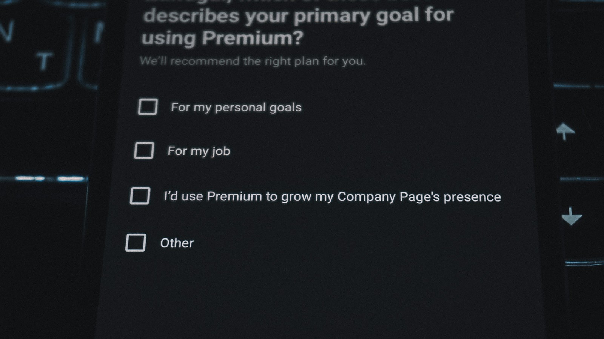

<!-- GENERATED from watch/issues/2026-09-07-llm-market-research.yml by scripts/build_watch.py. Edit the data file. -->

```{=html}
<p class="mw-kicker">Marketing in 3 · Issue 35 · Week of 7 September 2026</p>
<figure class="mw-hero"><picture><source type="image/webp" sizes="(max-width: 900px) 100vw, 900px" srcset="../../images/web/issue-35-llm-market-research-960.webp 960w, ../../images/web/issue-35-llm-market-research-1600.webp 1600w"></picture><figcaption>Each tick box is a preference. The question here is whether a machine can tick them for a customer. Photo: Zulfugar Karimov on Unsplash.</figcaption></figure>
<section class="mw-answer" aria-label="Short answer"><h2>The short answer</h2><p>Not on its own. In a study of vaccine choices, answers generated by ChatGPT models did not match what real people chose, and simply pooling them with real answers pushed estimates further from the truth. A statistical correction learned from a small real sample fixed this and saved between 25% and 80% of the real data needed, depending on how many real answers were available. AI answers are a supplement to real respondents and not a stand-in for them.</p></section>
<section class="mw-takeaways"><h2>Key takeaways</h2><ul><li>AI-generated and human answers differ in systematic ways. In this study, newer models and cleverer prompts did not close the gap, and step-by-step reasoning prompts often widened it.</li><li>Adding AI answers the obvious way, by pooling them with human ones, usually made estimates worse for the stronger models.</li><li>The authors&#x27; correction compares AI and human answers on a small real sample, then adjusts a much larger batch of AI answers. It reduced error in every setting tested.</li><li>On vaccine choices it saved 24.9% to 79.8% of the real data needed. On sports car choices the savings were 5.1% to 60.3%.</li></ul></section>
<section id="what-the-researchers-did"><h2>What the researchers did</h2><p>Market researchers want to know how much customers value each feature of a product. The standard tool is conjoint
analysis. People choose between made-up products that differ in price, features and so on, and a model works out which
features drive their choices. It works, and it is slow and costly, because every answer comes from a recruited person.</p><p>Large language models offer a shortcut. Ask one to act like a random shopper and it will answer thousands of choice
questions for almost nothing. Earlier studies found these answers look plausible, and also differ from real human answers in
ways that can mislead.</p><p>Mengxin Wang (UT Dallas), Dennis Zhang (Washington University in St. Louis) and Heng Zhang (Arizona State) asked a practical
question. Is there a way to use AI answers without being misled by them? They built a statistical method, which they call
an AI-augmented estimator, and tested it on two real conjoint studies.</p>
<dl class="mw-facts"><div><dt>Main test</dt><dd>A national survey on COVID-19 vaccine preferences, 1,971 U.S. adults, each choosing between two hypothetical vaccines five times</dd></div><div><dt>Second test</dt><dd>A sports car study with 200 people, each choosing between three cars ten times</dd></div><div><dt>AI used</dt><dd>Several ChatGPT models, with plain prompts, step-by-step reasoning prompts, example-based prompts and a model fine-tuned on real answers</dd></div><div><dt>Method</dt><dd>50 repeated experiments per setting, mixing a small set of real choices with 1,000 AI-generated ones</dd></div><div><dt>Funding</dt><dd>OpenAI Research funding supported the work</dd></div></dl>
</section>
<section id="why-simply-pooling-the-answers-goes-wrong"><h2>Why simply pooling the answers goes wrong</h2><p>The tempting move is to put real and AI answers into one pile and analyse them together. The authors show why that fails.</p><p>Take the vaccine data. Using the full human survey as the truth, they built small real samples and added 1,000 AI answers. When
they pooled the AI answers in directly, the estimates did not settle toward the truth as more AI data arrived. In most
cases they drifted further away. Adding more real data did the opposite and shrank the error toward zero.</p><p>The pattern held across model versions. Stronger models and fancier prompts did not fix it, and sometimes made things
worse. The authors suspect that when a model reasons step by step, it becomes too rational. It weighs efficacy and side effects the way a
textbook would, and real people are messier. Fine-tuning on real answers helped, without closing the gap.</p><p>The authors&#x27; summary is that AI-generated data is informative but not a direct substitute for people.</p>
</section>
<section id="the-fix-learn-the-gap-then-correct-it"><h2>The fix: learn the gap, then correct it</h2><p>The method works in plain steps. First, collect a small number of real answers. Then ask the AI the same questions, so
each real answer has an AI answer beside it. A statistical model learns how the AI&#x27;s answer relates to the real one for
each type of choice. Next, that model corrects a much larger batch of AI answers, so they look more like human answers.
Finally, everything is analysed together.</p><p>The idea is to use the small human sample twice. It supplies real data, and it teaches the system how far the AI strays.
The authors prove the estimates stay sound as the sample grows, which the naive pooling approach cannot offer.</p><p>The correction also improves when the AI answers are better. With a fine-tuned model it did best. The plain pooling
approach shows no such pattern.</p><p>They compared it with another known technique for mixing AI predictions with real data. The two performed about the same
with few product features, and the new method did better when there were many.</p>
</section>
<section id="how-much-real-data-it-saved"><h2>How much real data it saved</h2><p>The test was how many real answers a researcher can skip. The authors found the amount of real data you would need
to reach the same accuracy without AI help, and compared.</p><p>With only 50 real choices, which is about ten people at five choices each, the correction saved 72% to 80% of the data,
depending on the model. With 100 or 150 real choices the saving was 28% to 58%. With a fine-tuned model it ranged from
25% to 80% across sizes. The saving shrinks as the real sample grows, because there is less left to add.</p><p>The sports car study gave a similar picture with smaller numbers. Savings ran from 5% to 60%, and were 47% to 60% with
a very small real sample. The authors note that sports car preferences are highly subjective, which they say is why
newer models and cleverer prompts helped less here.</p>
<figure class="mw-chart" id="chart-savings"><figcaption class="mw-chart-title">Share of real survey answers saved, by size of real sample</figcaption><div class="mw-chart-svg"><svg viewBox="0 0 680 194" role="img" aria-labelledby="chart-savings-t" font-family="Hanken Grotesk, Arial, sans-serif"><title id="chart-savings-t">Share of real survey answers saved, by size of real sample</title><line x1="250.0" y1="4" x2="250.0" y2="168" stroke="#dde1e8" stroke-width="1"/><text x="250.0" y="186" font-size="12" text-anchor="middle" fill="#5b6476">0</text><line x1="322.0" y1="4" x2="322.0" y2="168" stroke="#dde1e8" stroke-width="1"/><text x="322.0" y="186" font-size="12" text-anchor="middle" fill="#5b6476">20</text><line x1="394.0" y1="4" x2="394.0" y2="168" stroke="#dde1e8" stroke-width="1"/><text x="394.0" y="186" font-size="12" text-anchor="middle" fill="#5b6476">40</text><line x1="466.0" y1="4" x2="466.0" y2="168" stroke="#dde1e8" stroke-width="1"/><text x="466.0" y="186" font-size="12" text-anchor="middle" fill="#5b6476">60</text><line x1="538.0" y1="4" x2="538.0" y2="168" stroke="#dde1e8" stroke-width="1"/><text x="538.0" y="186" font-size="12" text-anchor="middle" fill="#5b6476">80</text><line x1="610.0" y1="4" x2="610.0" y2="168" stroke="#dde1e8" stroke-width="1"/><text x="610.0" y="186" font-size="12" text-anchor="middle" fill="#5b6476">100</text><g><title>50 real choices: 80%</title><text x="238" y="27" font-size="13.5" text-anchor="end" fill="#15203b" font-weight="600">50 real choices</text><rect x="250" y="12" width="288.0" height="22" rx="4" fill="#e0a12a"/><text x="546.0" y="28" font-size="13.5" fill="#15203b" font-weight="600">80%</text></g><g><title>100 real choices: 58%</title><text x="238" y="67" font-size="13.5" text-anchor="end" fill="#15203b">100 real choices</text><rect x="250" y="52" width="208.8" height="22" rx="4" fill="#aab3c5"/><text x="466.8" y="68" font-size="13.5" fill="#15203b">58%</text></g><g><title>150 real choices: 50%</title><text x="238" y="107" font-size="13.5" text-anchor="end" fill="#15203b">150 real choices</text><rect x="250" y="92" width="180.0" height="22" rx="4" fill="#aab3c5"/><text x="438.0" y="108" font-size="13.5" fill="#15203b">50%</text></g><g><title>200 real choices: 25%</title><text x="238" y="147" font-size="13.5" text-anchor="end" fill="#15203b">200 real choices</text><rect x="250" y="132" width="90.0" height="22" rx="4" fill="#aab3c5"/><text x="348.0" y="148" font-size="13.5" fill="#15203b">25%</text></g></svg></div><div class="mw-sr"><table><caption>Share of real survey answers saved, by size of real sample</caption><tr><th>Group</th><th>Value (%)</th></tr><tr><th scope="row">50 real choices</th><td>80</td></tr><tr><th scope="row">100 real choices</th><td>58</td></tr><tr><th scope="row">150 real choices</th><td>50</td></tr><tr><th scope="row">200 real choices</th><td>25</td></tr></table></div><p class="mw-chart-src">Table 8, COVID-19 vaccine study, fine-tuned GPT-4o with the correction method, averaged over 50 runs. Each respondent made five choices, so 50 choices is about ten people.</p></figure>
</section>
<section id="what-it-means-for-your-research"><h2>What it means for your research</h2><p>Read this as a method for stretching a real sample, not a way to avoid one. The correction needs real answers to learn
from, and the more varied they are, the better it works.</p><p>For a small firm, the practical gain is the early stage. When budgets allow ten or twenty real respondents, a correction
step can make that small sample go much further. It is also cheap to repeat. Preferences shift, so conjoint studies need
repeating, and AI answers cost almost nothing to regenerate.</p><p>There is a risk in the other direction. Anyone can run an AI survey and get tidy-looking numbers. The study shows
those numbers can be confidently wrong, and the error can get worse as you ask the AI more questions.</p>
</section>
<section id="how-to-apply-it" class="mw-howto"><p class="mw-rsg-kicker">Marketing in 3 steps</p><h2>Ready. Set. Market.</h2><div class="mw-rsg"><div class="mw-phase"><div class="mw-phase-dot" aria-hidden="true">1</div><div class="mw-phase-tag"><span class="mw-phase-name">Ready</span><span class="mw-phase-sub">Decide and prepare</span></div><ul class="mw-rsg-steps"><li><strong>Collect a small real sample first.</strong> Survey at least 20 real customers, each making five product choices. Keep the exact product descriptions and the answer each person gave.</li><li><strong>Ask an AI tool the same questions.</strong> Paste each choice into a chat tool with: &quot;Act like a random shopper. Which option would you choose? Reply with one letter.&quot; Run the same 100 choices and record each answer beside the human one.</li></ul></div><div class="mw-phase"><div class="mw-phase-dot" aria-hidden="true">2</div><div class="mw-phase-tag"><span class="mw-phase-name">Set</span><span class="mw-phase-sub">Build it</span></div><ul class="mw-rsg-steps"><li><strong>Count where they disagree.</strong> Work out the share of choices where the AI picked a different option from the human. Then look at which feature, such as price or a brand, the AI seems to over-weight.</li><li><strong>Keep the AI out of your headline results.</strong> Report the human results as your main finding. Use AI answers only to plan, for example to shortlist features or draft questions, unless an analyst applies a statistical correction.</li></ul></div><div class="mw-phase"><div class="mw-phase-dot" aria-hidden="true">3</div><div class="mw-phase-tag"><span class="mw-phase-name">Market</span><span class="mw-phase-sub">Launch and measure</span></div><ul class="mw-rsg-steps"><li><strong>Ask for a correction, not an average.</strong> If you need a bigger sample than you can afford, ask your analyst to use a method that learns the gap between AI and human answers and adjusts for it. Do not average the two sets.</li><li><strong>Test it before you trust it.</strong> Split your real sample in half. Run the corrected method using only one half, and compare its estimates with those from the full human sample. Use it only if it lands closer than the half-sample alone.</li></ul></div></div></section>
<section id="what-to-expect"><h2>What to expect</h2><ul class="mw-list"><li><strong>A cheaper first pass.</strong> Corrected AI answers can stretch a few dozen real respondents a long way when budgets are tight.</li><li><strong>Savings that shrink.</strong> The more real data you have, the less AI adds. Expect a big saving on small samples and a small one on large samples.</li><li><strong>Plausible but wrong.</strong> A pure AI survey can look clean and be off. Always keep a real sample to check it against.</li><li><strong>Repeat studies get easier.</strong> Re-running a preference study each year gets cheaper, because the AI answers cost almost nothing.</li></ul></section>
<section id="where-it-does-not-work"><h2>Where it does not work</h2><ul class="mw-list"><li><strong>Two products only.</strong> Vaccines and sports cars are two of many categories. Results may differ for everyday goods, services or luxury.</li><li><strong>One model family.</strong> All the AI answers came from OpenAI models, and the work was funded by OpenAI Research. Other models may behave differently.</li><li><strong>Models were not the newest.</strong> The newest model available at the time was left out, and the authors expect the pattern to hold, but they did not test it.</li><li><strong>Possible overlap with training data.</strong> The authors cannot be sure the AI had not seen the survey data. They argue this would have helped pooling, which still failed.</li></ul></section>
<section id="questions"><h2>Questions marketers ask</h2><div class="mw-faq"><h3>Can AI replace survey respondents in a conjoint study?</h3><p>Not safely. In this study AI-generated choices differed from real ones in consistent ways, and pooling them with real answers often made estimates worse (Wang, Zhang &amp; Zhang, 2026, Marketing Science).</p></div><div class="mw-faq"><h3>Do better prompts fix AI survey answers?</h3><p>Not reliably. Step-by-step reasoning prompts often widened the gap, perhaps because the model became too rational. Examples and fine-tuning helped somewhat, though neither closed the gap.</p></div><div class="mw-faq"><h3>How does the correction method work?</h3><p>It uses a small set of real answers that have an AI answer beside them to learn how the AI differs from people. It then adjusts a large batch of AI answers using that pattern before analysing all the data together.</p></div><div class="mw-faq"><h3>How much real data can it save?</h3><p>In the vaccine study, between about a quarter and four fifths, with the most saved when the real sample was smallest. In the sports car study, between about 5% and 60%.</p></div><div class="mw-faq"><h3>Is it worth it for a small business?</h3><p>It can be, if you have at least a few dozen real respondents to learn from and an analyst who can apply the method. Without a real sample, there is nothing to correct against.</p></div></section>
<section id="also-new"><h2>Also new this week</h2><div class="mw-also"><article><p class="mw-also-src"><em>Journal of Consumer Research</em> · 2026</p><h3><a href="https://doi.org/10.1093/jcr/ucag006">Brief Commentary: A Framework for Detecting AI Agents in Online Research</a></h3><p class="mw-also-au">Affonso</p><p>AI agents can now complete online surveys by reading the screen, and old attention checks miss them. The author builds questions that are easy for people and hard for vision models. Tested on 1,007 people and 526 AI agents, they caught 97.1% of agents and flagged 4.1% of people, against 2.3% of agents caught by traditional checks. If you pay survey respondents, add checks like these.</p></article><article><p class="mw-also-src"><em>International Journal of Research in Marketing</em> · 2026</p><h3><a href="https://doi.org/10.1016/j.ijresmar.2025.12.003">Integrating GenAI interactions in marketing studies: A methodological guide</a></h3><p class="mw-also-au">Jörling</p><p>A step-by-step guide for putting a generative AI chat inside a survey platform, with four worked examples: a search assistant, an automated interviewer, a co-creation tool and personalised messages. It also offers a decision framework for when AI adds something over standard methods, and shows how AI coding tools can write the connecting code. Start with one of the templates.</p></article></div></section>
<section id="source" class="mw-source"><h2>Source</h2><p class="mw-cite">Wang, M., Zhang, D. J., &amp; Zhang, H. (2026). Large Language Models for Market Research: A Data-Augmentation Approach. <em>Marketing Science</em>, <em>45</em>(4), 728-751. <a href="https://doi.org/10.1287/mksc.2025.0009">https://doi.org/10.1287/mksc.2025.0009</a></p><p class="mw-note">This brief is written for practitioners from the published article. Numbers are as reported by the authors; read the article for full methods.</p></section>

<section id="keep-reading" class="mw-more"><h2>Keep reading</h2><p class="mw-more-topics">More issues on <a href="../../topics/ai.html">AI</a> · <a href="../../topics/research-methods.html">Research methods</a></p><div class="watch-list"><article class="watch-item"><a class="watch-thumb" href="../../posts/llm-review-sentiment/index.html" tabindex="-1" aria-hidden="true"></a><div><p class="watch-meta">Issue 30 · Week of <time datetime="2026-08-03">3 August 2026</time></p><h3><a href="../../posts/llm-review-sentiment/index.html">When an AI misreads a review, readers do too</a></h3><p>A language model guessed the star rating of 28,900 reviews from the text alone. When it missed, human readers missed too, and found the review less helpful.</p></div></article><article class="watch-item"><a class="watch-thumb" href="../../posts/chatbot-expectation-violation/index.html" tabindex="-1" aria-hidden="true"></a><div><p class="watch-meta">Issue 39 · Week of <time datetime="2026-10-05">5 October 2026</time></p><h3><a href="../../posts/chatbot-expectation-violation/index.html">When the chatbot fails, the brand takes the blame</a></h3><p>A survey of 238 people and 36 interviews show a failed brand chatbot hurts feelings and trust through the brand, and behaviour through the bot.</p></div></article><article class="watch-item"><a class="watch-thumb" href="../../posts/ar-previews-product-returns/index.html" tabindex="-1" aria-hidden="true"></a><div><p class="watch-meta">Issue 38 · Week of <time datetime="2026-09-28">28 September 2026</time></p><h3><a href="../../posts/ar-previews-product-returns/index.html">AR try-ons can raise returns when the product disappoints</a></h3><p>In four experiments, AR try-on previews raised return intentions after a flawed product arrived. Positive reviews and realistic rendering reduced the effect.</p></div></article></div></section>
<div class="mw-author"><div><p><strong>Bruno Schivinski</strong> is Associate Professor of Marketing at Gdańsk University of Technology. He studies how consumers engage with brands in digital and social media.</p><p><a href="../../../index.html">About Bruno</a> · <a href="../../index.html">All Marketing in 3 issues</a> · <a href="../../subscribe.html">Subscribe</a></p></div></div>
<div class="mw-support" role="complementary" aria-label="Support Marketing in 3"><div class="mw-support-icon"><svg aria-hidden="true" focusable="false"
  class="lucide lucide-beer"
  xmlns="http://www.w3.org/2000/svg"
  width="24"
  height="24"
  viewBox="0 0 24 24"
  fill="none"
  stroke="currentColor"
  stroke-width="2"
  stroke-linecap="round"
  stroke-linejoin="round"
>
  <path d="M17 11h1a3 3 0 0 1 0 6h-1" />
  <path d="M9 12v6" />
  <path d="M13 12v6" />
  <path d="M14 7.5c-1 0-1.44.5-3 .5s-2-.5-3-.5-1.72.5-2.5.5a2.5 2.5 0 0 1 0-5c.78 0 1.57.5 2.5.5S9.44 2 11 2s2 1.5 3 1.5 1.72-.5 2.5-.5a2.5 2.5 0 0 1 0 5c-.78 0-1.5-.5-2.5-.5Z" />
  <path d="M5 8v12a2 2 0 0 0 2 2h8a2 2 0 0 0 2-2V8" />
</svg></div><p>If this issue saved you a meeting or sharpened a campaign, buy me a coffee. It keeps Marketing in 3 free, weekly and ad-free.</p><div class="mw-support-btns"><a class="mw-support-btn mw-support-btn-main" href="https://ko-fi.com/marketingin3" target="_blank" rel="noopener"><svg aria-hidden="true" focusable="false"
  class="lucide lucide-coffee"
  xmlns="http://www.w3.org/2000/svg"
  width="24"
  height="24"
  viewBox="0 0 24 24"
  fill="none"
  stroke="currentColor"
  stroke-width="2"
  stroke-linecap="round"
  stroke-linejoin="round"
>
  <path d="M10 2v2" />
  <path d="M14 2v2" />
  <path d="M16 8a1 1 0 0 1 1 1v8a4 4 0 0 1-4 4H7a4 4 0 0 1-4-4V9a1 1 0 0 1 1-1h14a4 4 0 1 1 0 8h-1" />
  <path d="M6 2v2" />
</svg><span class="mw-support-label">Buy me a coffee</span><span class="mw-support-price">€3</span></a></div></div>
<nav class="mw-pn" aria-label="More issues"><a class="mw-prev" href="../agentic-marketing-relationships/index.html"><span>Previous issue</span>When your customer&#x27;s AI agent does the shopping</a><a class="mw-next" href="../synthetic-person-disclosure/index.html"><span>Next issue</span>The label that buys honesty, then spends it on artificiality</a></nav>
```
