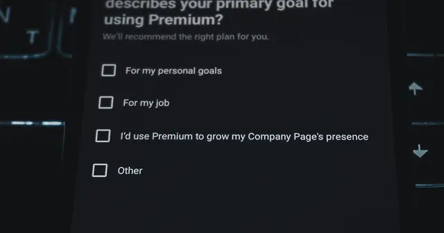

<!-- GENERATED from watch/issues/2026-08-03-llm-review-sentiment.yml by scripts/build_watch.py. Edit the data file. -->

```{=html}
<p class="mw-kicker">Marketing in 3 · Issue 30 · Week of 3 August 2026</p>
<figure class="mw-hero"><picture><source type="image/webp" sizes="(max-width: 900px) 100vw, 900px" srcset="../../images/web/issue-30-llm-review-sentiment-960.webp 960w, ../../images/web/issue-30-llm-review-sentiment-1600.webp 1600w"></picture><figcaption>A star rating is a one-number summary of a paragraph of text. This study asks how well a machine can run that summary backwards. Photo: Towfiqu barbhuiya on Unsplash.</figcaption></figure>
<section class="mw-answer" aria-label="Short answer"><h2>The short answer</h2><div class="mw-ans-grid"><p>Quite well, but not perfectly, and the misses are useful. A general-purpose language model, with no special training, guessed the author&#x27;s star rating from review text alone. It matched the author closely overall. Where it missed, ordinary readers also misjudged the rating, and they rated the review as less helpful. So a model&#x27;s confusion can work as an early warning for reviews that are hard to read.</p><div class="mw-ev" role="note" aria-label="Evidence level: 2 of 3 stars, several studies"><span class="ev-k">Evidence level</span><ol><li><span class="ev-s" aria-hidden="true"><b>★</b><i>★</i><i>★</i></span>One study</li><li class="on"><span class="ev-s" aria-hidden="true"><b>★</b><b>★</b><i>★</i></span>Several studies</li><li><span class="ev-s" aria-hidden="true"><b>★</b><b>★</b><b>★</b></span>Meta-analysis</li></ol></div></div></section>
<section class="mw-takeaways"><h2>Key takeaways</h2><ul><li>Without any training, the model&#x27;s star guesses tracked the authors&#x27; real ratings closely (a correlation of .76), and only about 1 in 20 was two or more stars away.</li><li>The model found pleasure purchases easier than practical ones, because their writers use plainly opinionated words.</li><li>In an experiment with 1,063 people, the model&#x27;s miss predicted the readers&#x27; miss, and the readers&#x27; miss predicted lower helpfulness ratings.</li><li>On the platform data the helpfulness link was strongest for goods you must try to judge. In the experiment it was strongest for goods you can judge before buying.</li></ul></section>
<section id="what-the-researchers-did"><h2>What the researchers did</h2><p>Most online stores show two things for a review: a star rating and some text. Usually they agree. When they do not,
something has gone wrong, and either the writer or the reader may be to blame.</p><p>Christian Winter, Nicolas Zacharias and Mattis Hartwig, at Friedrich Schiller University Jena and the German
Research Center for Artificial Intelligence, turned that idea into a test. They gave a general-purpose language model
(GPT-4) the text of each review, hid the stars, and asked it to guess the rating. The gap between the guess and the
stars the author really gave became their measure of how hard a review is to read.</p><p>Three studies followed. The first asked how well the model reads reviews and for which products it struggles.
The second asked whether the gap predicts how many helpful votes a review gets. The third was an experiment that
asked real readers to guess the stars themselves, to see why.</p>
<dl class="mw-facts"><div><dt>Reviews</dt><dd>28,900 reviews with text, from the first page of results for 12 product searches on a global shopping platform</dd></div><div><dt>Products</dt><dd>Sorted as pleasure or practical, and as easy or hard to judge before buying, using an earlier classification</dd></div><div><dt>The model</dt><dd>GPT-4, used as it comes, with no training or tuning and a low creativity setting</dd></div><div><dt>Experiment</dt><dd>1,063 U.S. adults on Prolific, each shown one of 400 reviews with the stars hidden</dd></div><div><dt>Helpfulness</dt><dd>Helpful votes on the platform; a five-point helpfulness rating in the experiment</dd></div></dl>
</section>
<section id="the-model-reads-most-reviews-well"><h2>The model reads most reviews well</h2><p>Start with the plain result. The model&#x27;s guesses and the authors&#x27; real ratings moved together closely. Across all
reviews, the guess tracked the real rating with a correlation of .76.</p><p>It was not perfect, and that is what makes the next step possible. Roughly 37% of reviews were given a different
number of stars than the author chose, and about 5% were off by two stars or more. Most misses were by one star, the
kind of difference between a 4 and a 5 that people themselves disagree about.</p><p>The team also checked whether a simpler setup does the job. Using the model as it comes did about as well as, or better than, four common
approaches that need to be trained on labelled reviews first. That matters for a small firm without a data
science team, because there is nothing to train.</p>
<figure class="mw-chart" id="chart-match"><figcaption class="mw-chart-title">How the model&#x27;s star guess compared with the author&#x27;s rating</figcaption><div class="mw-chart-svg"><svg viewBox="0 0 680 154" role="img" aria-labelledby="chart-match-t" font-family="Hanken Grotesk, Arial, sans-serif"><title id="chart-match-t">How the model&#x27;s star guess compared with the author&#x27;s rating</title><line x1="250.0" y1="4" x2="250.0" y2="128" stroke="#dde1e8" stroke-width="1"/><text x="250.0" y="146" font-size="12" text-anchor="middle" fill="#5b6476">0</text><line x1="340.0" y1="4" x2="340.0" y2="128" stroke="#dde1e8" stroke-width="1"/><text x="340.0" y="146" font-size="12" text-anchor="middle" fill="#5b6476">20</text><line x1="430.0" y1="4" x2="430.0" y2="128" stroke="#dde1e8" stroke-width="1"/><text x="430.0" y="146" font-size="12" text-anchor="middle" fill="#5b6476">40</text><line x1="520.0" y1="4" x2="520.0" y2="128" stroke="#dde1e8" stroke-width="1"/><text x="520.0" y="146" font-size="12" text-anchor="middle" fill="#5b6476">60</text><line x1="610.0" y1="4" x2="610.0" y2="128" stroke="#dde1e8" stroke-width="1"/><text x="610.0" y="146" font-size="12" text-anchor="middle" fill="#5b6476">80</text><g><title>Same stars: 63%</title><text x="238" y="27" font-size="13.5" text-anchor="end" fill="#15203b" font-weight="600">Same stars</text><rect x="250" y="12" width="283.5" height="22" rx="4" fill="#e0a12a"/><text x="541.5" y="28" font-size="13.5" fill="#15203b" font-weight="600">63%</text></g><g><title>One star off: 32%</title><text x="238" y="67" font-size="13.5" text-anchor="end" fill="#15203b">One star off</text><rect x="250" y="52" width="144.0" height="22" rx="4" fill="#aab3c5"/><text x="402.0" y="68" font-size="13.5" fill="#15203b">32%</text></g><g><title>Two or more stars off: 5%</title><text x="238" y="107" font-size="13.5" text-anchor="end" fill="#15203b">Two or more stars off</text><rect x="250" y="92" width="22.5" height="22" rx="4" fill="#aab3c5"/><text x="280.5" y="108" font-size="13.5" fill="#15203b">5%</text></g></svg></div><div class="mw-sr"><table><caption>How the model&#x27;s star guess compared with the author&#x27;s rating</caption><tr><th>Group</th><th>Value (%)</th></tr><tr><th scope="row">Same stars</th><td>63</td></tr><tr><th scope="row">One star off</th><td>32</td></tr><tr><th scope="row">Two or more stars off</th><td>5</td></tr></table></div><p class="mw-chart-src">Study 1, 28,900 reviews. 37% misclassified and about 5% two or more points apart; the one-star group is the remainder.</p></figure>
</section>
<section id="pleasure-purchases-were-easier-not-harder"><h2>Pleasure purchases were easier, not harder</h2><p>The authors expected the opposite. Machines are often said to struggle with feelings, and pleasure purchases such as makeup
or a phone are bought on feelings. They predicted more misses for those.</p><p>They found fewer. Reviews of pleasure products were read more accurately than reviews of practical products such as
a printer or a vacuum cleaner. The likely reason is the style of the text. People writing about pleasure products
lean on openly personal, evaluative words like &quot;great&quot; and &quot;love it&quot;. A follow-up check found those reviews were
indeed more subjective. Reading difficulty was no different between the two groups.</p><p>Misses were also more common for one-star reviews, for longer reviews and for more recent ones. A long angry
review can mix praise, complaint and sarcasm in one paragraph, which is hard for anyone to score. The authors
suggest the meaning of a star may also drift over time.</p>
</section>
<section id="a-miss-can-flag-a-hard-to-read-review"><h2>A miss can flag a hard-to-read review</h2><p>Now the main question. If the model struggles with a review, do people?</p><p>On the platform data, the gap did not predict helpful votes on its own. Once the authors separated goods you can judge
before you buy from goods you only know by using them, a pattern appeared. For goods you must try, a bigger gap
went with fewer helpful votes. That fits the idea that when you cannot check the product yourself, you lean harder on
reviews that are clear.</p><p>The experiment tested the reason. Readers who saw a review the model had misjudged were more likely to misjudge
it themselves. Misjudging, in turn, led them to rate the review as less helpful. The whole effect ran through
the readers&#x27; own confusion. Once their misreading was counted, the model&#x27;s miss added nothing.</p><p>In other words, the model is not detecting quality directly. It is picking up on text whose message is muddled,
and muddled text is what readers dislike.</p>
</section>
<section id="two-studies-two-answers-on-which-goods"><h2>Two studies, two answers on which goods</h2><p>The two studies disagree on one detail, and the authors say so openly.</p><p>In the platform data, the link between the model&#x27;s miss and helpfulness was stronger for goods you must try to judge.
In the experiment, the effect of the model&#x27;s miss on helpfulness, through readers&#x27; confusion, showed up for goods
you can judge before buying and not for the other group.</p><p>The authors do not settle it. A reasonable reading is that the clean answer is the shared one: when the model
misses, readers tend to miss, and that costs helpfulness. Treat any claim about which kind of product is hit harder
as open.</p><p>The platform data also carries a built-in limit. More than half of the reviews, 15,529 of 28,900, had no helpful votes at
all, so a missing vote can mean unhelpful or simply unread. The team used a statistical model built for that, and the
experiment avoids the problem.</p>
</section>
<section id="how-to-apply-it" class="mw-howto"><p class="mw-rsg-kicker">Marketing in 3 steps</p><h2>Ready. Set. Market.</h2><div class="mw-rsg"><div class="mw-phase"><div class="mw-phase-dot" aria-hidden="true">1</div><div class="mw-phase-tag"><span class="mw-phase-name">Ready</span><span class="mw-phase-sub">Decide and prepare</span></div><ul class="mw-rsg-steps"><li><strong>Pull a sample of 200 reviews.</strong> Export your most recent 200 reviews with the star rating and the text. Put the text in one column and the stars in another. Cover the star column when you start step 2.</li><li><strong>Ask an AI tool to guess the stars.</strong> Paste each review into a chat tool with this instruction: &quot;Read this review and reply with one number from 1 to 5, the star rating the writer most likely gave.&quot; Do not show it the real stars. Write each guess next to the real rating.</li></ul></div><div class="mw-phase"><div class="mw-phase-dot" aria-hidden="true">2</div><div class="mw-phase-tag"><span class="mw-phase-name">Set</span><span class="mw-phase-sub">Build it</span></div><ul class="mw-rsg-steps"><li><strong>Mark the misses.</strong> Count how many guesses match exactly. Then mark every review where the guess is two or more stars away from the real rating. Those marked reviews are your hard-to-read ones.</li><li><strong>Read the marked reviews yourself.</strong> Read ten of them. Sort each into one cause: mixed praise and complaint, sarcasm, a rating that looks like a mistake, or a long ramble. Write down which cause is most common.</li></ul></div><div class="mw-phase"><div class="mw-phase-dot" aria-hidden="true">3</div><div class="mw-phase-tag"><span class="mw-phase-name">Market</span><span class="mw-phase-sub">Launch and measure</span></div><ul class="mw-rsg-steps"><li><strong>Fix what you can control.</strong> If wrong-star reviews are common, add one line to your review request: &quot;In one sentence, tell us why you chose that many stars.&quot; If sarcasm or mixed reviews dominate, reply to those first with a question that clears it up.</li><li><strong>Check whether it pays.</strong> After four weeks, repeat the guess test on the new reviews. Compare the share of marked reviews that get a helpful vote with the share of unmarked ones. If marked reviews do worse, show unmarked ones first on your page.</li></ul></div></div></section>
<div class="mw-coffee" role="complementary" aria-label="Support Marketing in 3"><div class="mw-coffee-text"><p class="mw-coffee-title">Found this useful?</p><p>Marketing in 3 is free and ad-free, with new issues every Monday and Thursday. A coffee keeps it that way.</p></div><a class="mw-coffee-btn" href="https://ko-fi.com/marketingin3" target="_blank" rel="noopener"><svg aria-hidden="true" focusable="false"
  class="lucide lucide-coffee"
  xmlns="http://www.w3.org/2000/svg"
  width="24"
  height="24"
  viewBox="0 0 24 24"
  fill="none"
  stroke="currentColor"
  stroke-width="2"
  stroke-linecap="round"
  stroke-linejoin="round"
>
  <path d="M10 2v2" />
  <path d="M14 2v2" />
  <path d="M16 8a1 1 0 0 1 1 1v8a4 4 0 0 1-4 4H7a4 4 0 0 1-4-4V9a1 1 0 0 1 1-1h14a4 4 0 1 1 0 8h-1" />
  <path d="M6 2v2" />
</svg><span>Buy me a coffee</span><span class="mw-coffee-price">€3</span></a></div>
<form class="mw-email mw-email-inline" action="https://qewbdm3gpjxh42mawu5n6ac37m0hlcgm.lambda-url.ap-southeast-2.on.aws/subscribe" method="post"><div class="mw-email-text"><p class="mw-email-title">Get it by email</p><p>New issues every Monday and Thursday, in your inbox. Free, no ads, unsubscribe anytime.</p></div><div class="mw-email-row"><label class="visually-hidden" for="m3-email-inline">Email address</label><input id="m3-email-inline" type="email" name="email" required autocomplete="email" inputmode="email" placeholder="you@example.com" maxlength="254"><input class="mw-hp" type="text" name="website" tabindex="-1" autocomplete="off" aria-hidden="true"><input type="hidden" name="source" value=""><button type="submit">Subscribe</button></div><p class="mw-email-status" role="status" aria-live="polite"></p><p class="mw-email-note">Your address is used only to send Marketing in 3. You will get one email to confirm.</p></form><script>(function(){if(window.m3Email)return;window.m3Email=1;
var M={"check": "Almost done. Check your inbox for an email from issues@marketingin3.com and tap the link to confirm.", "invalid": "That email address does not look right. Please check it and try again.", "slow": "Too many tries in a short time. Please wait a few minutes and try again.", "busy": "Too many tries in a short time. Please wait a few minutes and try again.", "error": "Something went wrong. Please try again in a moment.", "undeliverable": "That address cannot receive email from us. Please try another one.", "confirming": "Confirming your subscription…", "ok": "You are subscribed. The next issue arrives in your inbox on Monday or Thursday, whichever comes first.", "expired": "This confirmation link has expired or was already used. Enter your address again for a fresh one."};
function ep(f){return f.getAttribute('action').replace(/\/subscribe$/,'');}
function say(f,k){var s=f.querySelector('.mw-email-status');if(!s)return;s.textContent=M[k]||M.error;
s.className='mw-email-status is-'+(k==='ok'||k==='check'?'ok':(k==='confirming'?'wait':'bad'));}
function gc(e){try{if(window.mwTrack)window.mwTrack(e);}catch(x){}try{if(window.goatcounter&&goatcounter.count)goatcounter.count({path:e,title:e,event:true});}catch(x){}}
document.querySelectorAll('form.mw-email').forEach(function(f){
var src=f.querySelector('input[name=source]');if(src)src.value=location.pathname;
f.addEventListener('submit',function(e){if(!window.fetch)return;e.preventDefault();
var b=f.querySelector('button');b.disabled=true;
var data={email:f.email.value,website:f.website.value,source:location.pathname};
fetch(f.getAttribute('action'),{method:'POST',headers:{'content-type':'application/json'},body:JSON.stringify(data)})
.then(function(r){return r.json().catch(function(){return {status:'error'};});})
.then(function(j){say(f,j.status);if(j.status==='check'){f.classList.add('is-done');gc('email-subscribe');}})
.catch(function(){say(f,'error');}).then(function(){b.disabled=false;});});});
var q=new URLSearchParams(location.search),f=document.querySelector('form.mw-email');if(!f)return;
['check','invalid','slow','error'].forEach(function(k){if(q.get(k))say(f,k);});
var t=q.get('t');if(t){say(f,'confirming');
fetch(ep(f)+'/confirm',{method:'POST',headers:{'content-type':'application/json'},body:JSON.stringify({t:t})})
.then(function(r){return r.json().catch(function(){return {status:'error'};});})
.then(function(j){say(f,j.status);if(j.status==='ok'){f.classList.add('is-done');gc('email-confirmed');}
if(history.replaceState)history.replaceState(null,'',location.pathname+'#email');})
.catch(function(){say(f,'error');});}
})();</script>
<section id="what-to-expect"><h2>What to expect</h2><ul class="mw-list"><li><strong>A cheap first screen.</strong> An off-the-shelf AI tool can sort reviews into clear and muddled without any setup, so a small team can try it in an afternoon.</li><li><strong>Clear reviews get more votes.</strong> The study links muddled text to lower helpfulness, so clear reviews are the ones worth showing first.</li><li><strong>Most misses are small.</strong> Expect many one-star differences. The signal is in the two-star gaps.</li><li><strong>Different results by product.</strong> Practical products produced more misses than pleasure products, so set your bar by category.</li></ul></section>
<section id="where-it-does-not-work"><h2>Where it does not work</h2><ul class="mw-list"><li><strong>One model, one platform, one moment.</strong> The team used GPT-4 on reviews from one shopping platform. Newer models may behave differently, though a later, smaller model gave the same results.</li><li><strong>The reason is inferred.</strong> The authors argue that muddled text raises the effort of reading, but they did not test effort directly.</li><li><strong>The experiment is artificial.</strong> Guessing a hidden star rating is a device to isolate the mechanism, not something readers do while shopping.</li><li><strong>Votes are a thin signal.</strong> More than half the reviews had no helpful votes, and the two studies disagree on which kind of product the effect is stronger for.</li></ul></section>
<section id="questions"><h2>Questions marketers ask</h2><div class="mw-faq"><h3>Can a large language model tell the star rating from a review&#x27;s text?</h3><p>Mostly. Used with no training, GPT-4&#x27;s guesses tracked authors&#x27; real ratings closely, with only about 1 in 20 guesses two or more stars away (Winter, Zacharias &amp; Hartwig, 2026).</p></div><div class="mw-faq"><h3>Is an AI sentiment tool less accurate on emotional reviews?</h3><p>Not here. The tool did better on pleasure products than on practical ones, probably because their writers use openly evaluative words. Do not assume emotional text is harder for the tool.</p></div><div class="mw-faq"><h3>Why would an AI&#x27;s mistake predict a less helpful review?</h3><p>The mistakes seem to track muddled writing. When the model misread a review, human readers were more likely to misread it too, and that confusion is what lowered helpfulness ratings.</p></div><div class="mw-faq"><h3>Do I need to train a model to score my reviews?</h3><p>No. The approach used an existing model as it comes, with a one-line instruction. In the benchmark it scored on par with four common methods that need labelled training data.</p></div><div class="mw-faq"><h3>Can I use this to remove reviews from my page?</h3><p>It is not built for that. A model&#x27;s miss shows that a review is hard to read, not that it is false or low in value. Use it to decide which reviews to reply to or show first, not which ones to hide.</p></div></section>
<section id="also-new"><h2>Also new this week</h2><div class="mw-also"><article><p class="mw-also-src"><em>Journal of Interactive Marketing</em> · 2026</p><h3><a href="https://doi.org/10.1177/10949968261447298">The Impact of Follower-Based Status Change on Influencer Content Creation: Evidence from a Regression Discontinuity Approach</a></h3><p class="mw-also-au">Zhong, Wu, Sun, &amp; Chen</p><p>A Chinese platform gives influencers &quot;mid-tier&quot; status once they pass 50,000 followers. Comparing creators just above and below that line, gaining the status led to more sponsored posts but not more organic ones, and neither kind got more engagement. The extra sponsorship came through the agencies that manage creators and hand out deals by status. Where status is a gate to brand deals, a follower count can matter more than the content.</p></article><article><p class="mw-also-src"><em>Journal of Marketing</em> · 2026</p><h3><a href="https://doi.org/10.1177/00222429261466254">Preference Filtering: When Customers Share Narrow Preferences with Algorithms</a></h3><p class="mw-also-au">Gai, Leung, &amp; Klesse</p><p>Asked to pick interests for recommendations, customers share a narrower set with an algorithm than with a human curator, because they expect the algorithm to weigh everything equally. Across 12 studies with 8,824 people, this looks sensible at the time but leads to poorer recommendations later. Two studies on video-streaming sites show that easing the filtering increased engagement. If you ask for preferences, show what the choices will be used for.</p></article></div></section>
<section id="source" class="mw-source"><h2>Source</h2><p class="mw-cite">Winter, C. G. H., Zacharias, N. A., &amp; Hartwig, M. (2026). Using LLMs as sentiment analyzers to predict review helpfulness: first insights to open the black box. <em>Marketing Letters</em>, <em>37</em>, Article 30. <a href="https://doi.org/10.1007/s11002-026-09824-7">https://doi.org/10.1007/s11002-026-09824-7</a></p><p class="mw-note">This brief is written for practitioners from the published article. Open access (CC BY 4.0): free to read at the publisher. Numbers are as reported by the authors; read the article for full methods.</p></section>

<section id="keep-reading" class="mw-more"><h2>Keep reading</h2><p class="mw-more-topics">More issues on <a href="../../topics/ai.html">AI</a> · <a href="../../topics/ugc.html">UGC</a> · <a href="../../topics/research-methods.html">Research methods</a></p><div class="watch-list"><article class="watch-item"><a class="watch-thumb" href="../../posts/brand-followers-ai/index.html" tabindex="-1" aria-hidden="true"></a><div><p class="watch-meta">Issue 43 · <time datetime="2026-10-29">Thursday 29 October 2026</time></p><h3><a href="../../posts/brand-followers-ai/index.html">Five kinds of brand follower, and why AI hasn&#x27;t changed them</a></h3><p>Schivinski&#x27;s machine learning study of 1,356 brand followers found five engagement patterns driven by commitment, and they still matter in the age of AI.</p></div></article><article class="watch-item"><a class="watch-thumb" href="../../posts/llm-market-research/index.html" tabindex="-1" aria-hidden="true"></a><div><p class="watch-meta">Issue 35 · <time datetime="2026-09-07">Week of 7 September 2026</time></p><h3><a href="../../posts/llm-market-research/index.html">AI survey answers help, if you correct them</a></h3><p>Pooling AI-generated answers with real customer answers can bias a preference study. A correction method kept the AI&#x27;s help and saved up to 80% of real data.</p></div></article><article class="watch-item"><a class="watch-thumb" href="../../posts/generative-ai-consumer-reviews/index.html" tabindex="-1" aria-hidden="true"></a><div><p class="watch-meta">Issue 32 · <time datetime="2026-08-17">Week of 17 August 2026</time></p><h3><a href="../../posts/generative-ai-consumer-reviews/index.html">When ChatGPT went dark, reviews got shorter</a></h3><p>When Italy blocked ChatGPT for four weeks, hotel reviews written on desktop fell 2% in number and 9% in length. AI help is quietly reshaping reviews.</p></div></article></div></section>
<div class="mw-author"><div><p><strong>Bruno Schivinski</strong> is Associate Professor of Marketing at Gdańsk University of Technology. He studies how consumers engage with brands in digital and social media.</p><p><a href="../../../index.html">About Bruno</a> · <a href="../../index.html">All Marketing in 3 issues</a> · <a href="../../subscribe.html">Subscribe</a></p></div></div>
<nav class="mw-pn" aria-label="More issues"><a class="mw-prev" href="../livestream-emotional-swings/index.html"><span>Previous issue</span>Mood swings win likes and lose sales</a><a class="mw-next" href="../chatbot-goal-formation/index.html"><span>Next issue</span>When a smart chatbot is too smart</a></nav>
```
