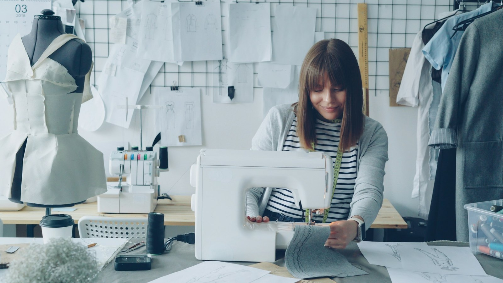
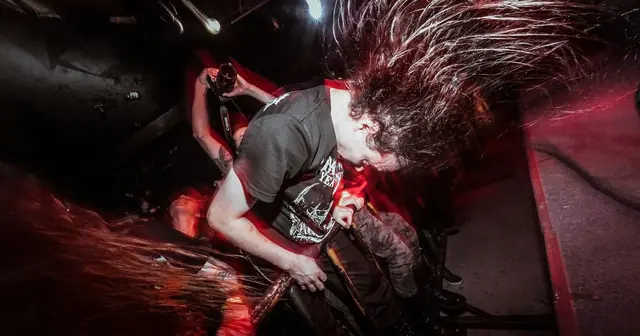

<!-- GENERATED from watch/issues/2026-11-09-luxury-tiktok-transparency.yml by scripts/build_watch.py. Edit the data file. -->

```{=html}
<p class="mw-kicker">Marketing in 3 · 2026 · No. 46 · Monday 9 November 2026</p>
<figure class="mw-hero"><picture><source type="image/webp" sizes="(max-width: 900px) 100vw, 900px" srcset="../../images/web/issue-46-luxury-tiktok-transparency-960.webp 960w, ../../images/web/issue-46-luxury-tiktok-transparency-1600.webp 1600w"></picture><figcaption>The making of a garment is the kind of openness that luxury audiences responded to. Photo: Vitaly Gariev on Unsplash.</figcaption></figure>
<section class="mw-answer" aria-label="Short answer"><h2>The short answer</h2><div class="mw-ans-grid"><p>Yes, if they choose what to reveal. Across 5,565 TikTok posts from eleven luxury fashion accounts, behind-the-scenes production content drew the strongest engagement of any transparency theme. In an experiment with 230 British luxury shoppers, a production video raised perceived openness and left exclusivity intact. A video about the brand&#x27;s social impact raised openness too, but at a cost to exclusivity.</p><div class="mw-ev" role="note" aria-label="Evidence level: 2 of 3 stars, several studies"><span class="ev-k">Evidence level</span><ol><li><span class="ev-s" aria-hidden="true"><b>★</b><i>★</i><i>★</i></span>One study</li><li class="on"><span class="ev-s" aria-hidden="true"><b>★</b><b>★</b><i>★</i></span>Several studies</li><li><span class="ev-s" aria-hidden="true"><b>★</b><b>★</b><b>★</b></span>Meta-analysis</li></ol></div></div></section>
<section class="mw-takeaways"><h2>Key takeaways</h2><ul><li>83% of the posts carried no transparency claim of any kind.</li><li>A playful tone appeared in few posts but drew a median of 22,700 likes; the formal tone used in 57% of posts did worse.</li><li>Kering&#x27;s group account made explicit transparency claims in just 4% of its posts, against 10% explicit and 36% implied at LVMH.</li><li>In the experiment, perceived transparency was linked to engagement more than three times as strongly as perceived exclusivity.</li></ul></section>
<section id="what-the-researchers-did"><h2>What the researchers did</h2><p><a class="mw-orcid-link" href="https://orcid.org/0009-0003-0923-9392" title="Nayla Khan on ORCID">Nayla Khan</a> of Kingston University, <a class="mw-orcid-link" href="https://orcid.org/0000-0002-8344-0356" title="Valentina Mazzoli on ORCID">Valentina Mazzoli</a> of the University of Verona, <a class="mw-orcid-link" href="https://orcid.org/0000-0001-8521-4988" title="Giampaolo Viglia on ORCID">Giampaolo Viglia</a> of the University of
Portsmouth and the Prague University of Economics and Business, and Michaela Merk of Audencia Business School examined a
tension every luxury marketer will recognise. Openness about production and values is now expected online, yet a luxury
label sells partly on mystery, and TikTok favours informal, unpolished content.</p><p>They worked in three steps. First, they coded by hand every TikTok post from eleven accounts belonging to LVMH, Kering and
Prada Group, the luxury fashion groups that met the authors&#x27; criteria: revenue above €5 billion, an active TikTok
presence and a traditional luxury position. Second, they showed
British luxury shoppers one of three short videos for an invented label. Third, they interviewed three senior luxury
managers about how they decide what to disclose.</p>
<dl class="mw-facts"><div><dt>Accounts</dt><dd>LVMH, Louis Vuitton, Dior, Loewe, Fendi, Kering, Gucci, Balenciaga, Saint Laurent, Prada and Miu Miu</dd></div><div><dt>Posts</dt><dd>5,565, from each account&#x27;s first post to 31 March 2025</dd></div><div><dt>Experiment</dt><dd>230 British luxury fashion shoppers aged 18 to 45 with TikTok accounts</dd></div><div><dt>Videos</dt><dd>25 seconds, TikTok style, for a fictional label called VADE</dd></div><div><dt>Interviews</dt><dd>Three senior luxury managers, about 90 minutes each, June 2025</dd></div></dl>
</section>
<section id="what-luxury-brands-actually-post-on-tiktok"><h2>What luxury brands actually post on TikTok</h2><p>Most of what these accounts post builds image rather than explaining anything. Depending on the account, branding and
lifestyle content made up between 52% and 95% of the posts. When posts did reveal something, it
was usually about production or social impact. LVMH&#x27;s group account led on production, with 31% of its posts, and
Kering&#x27;s on social impact, with 19%. Heritage, materials, environmental impact and quality each appeared in fewer than 3%.</p><p>Engagement followed a clear order. Branding posts drew the most likes. Posts about materials and about production came
next, and people saved them often, with medians of around 200 saves, a sign that viewers wanted to come back to them.
Posts on social and environmental themes trailed well behind, despite their ethical weight.</p>
<figure class="mw-chart" id="chart-likes"><figcaption class="mw-chart-title">Median likes per post by content theme, eleven luxury TikTok accounts (thousands)</figcaption><div class="mw-chart-svg"><svg viewBox="0 0 680 234" role="img" aria-labelledby="chart-likes-t" font-family="Hanken Grotesk, Arial, sans-serif"><title id="chart-likes-t">Median likes per post by content theme, eleven luxury TikTok accounts (thousands)</title><line x1="250.0" y1="4" x2="250.0" y2="208" stroke="#dde1e8" stroke-width="1"/><text x="250.0" y="226" font-size="12" text-anchor="middle" fill="#5b6476">0</text><line x1="340.0" y1="4" x2="340.0" y2="208" stroke="#dde1e8" stroke-width="1"/><text x="340.0" y="226" font-size="12" text-anchor="middle" fill="#5b6476">2</text><line x1="430.0" y1="4" x2="430.0" y2="208" stroke="#dde1e8" stroke-width="1"/><text x="430.0" y="226" font-size="12" text-anchor="middle" fill="#5b6476">4</text><line x1="520.0" y1="4" x2="520.0" y2="208" stroke="#dde1e8" stroke-width="1"/><text x="520.0" y="226" font-size="12" text-anchor="middle" fill="#5b6476">6</text><line x1="610.0" y1="4" x2="610.0" y2="208" stroke="#dde1e8" stroke-width="1"/><text x="610.0" y="226" font-size="12" text-anchor="middle" fill="#5b6476">8</text><g><title>Branding and lifestyle: 7.05 </title><text x="238" y="27" font-size="13.5" text-anchor="end" fill="#15203b">Branding and lifestyle</text><rect x="250" y="12" width="317.2" height="22" rx="4" fill="#aab3c5"/><text x="575.2" y="28" font-size="13.5" fill="#15203b">7.05</text></g><g><title>Materials and sustainability: 4.43 </title><text x="238" y="67" font-size="13.5" text-anchor="end" fill="#15203b">Materials and sustainability</text><rect x="250" y="52" width="199.4" height="22" rx="4" fill="#aab3c5"/><text x="457.4" y="68" font-size="13.5" fill="#15203b">4.43</text></g><g><title>Production process: 4.28 </title><text x="238" y="107" font-size="13.5" text-anchor="end" fill="#15203b" font-weight="600">Production process</text><rect x="250" y="92" width="192.6" height="22" rx="4" fill="#e0a12a"/><text x="450.6" y="108" font-size="13.5" fill="#15203b" font-weight="600">4.28</text></g><g><title>Environmental impact: 0.93 </title><text x="238" y="147" font-size="13.5" text-anchor="end" fill="#15203b">Environmental impact</text><rect x="250" y="132" width="41.9" height="22" rx="4" fill="#aab3c5"/><text x="299.9" y="148" font-size="13.5" fill="#15203b">0.93</text></g><g><title>Social impact: 0.13 </title><text x="238" y="187" font-size="13.5" text-anchor="end" fill="#15203b">Social impact</text><rect x="250" y="172" width="5.8" height="22" rx="4" fill="#aab3c5"/><text x="263.9" y="188" font-size="13.5" fill="#15203b">0.13</text></g></svg></div><div class="mw-sr"><table><caption>Median likes per post by content theme, eleven luxury TikTok accounts (thousands)</caption><tr><th>Group</th><th>Value ()</th></tr><tr><th scope="row">Branding and lifestyle</th><td>7.05</td></tr><tr><th scope="row">Materials and sustainability</th><td>4.43</td></tr><tr><th scope="row">Production process</th><td>4.28</td></tr><tr><th scope="row">Environmental impact</th><td>0.93</td></tr><tr><th scope="row">Social impact</th><td>0.13</td></tr></table></div><p class="mw-chart-src">Study 1, 5,565 posts. Medians are shown because engagement figures were heavily skewed.</p></figure>
</section>
<section id="tone-and-faces-mattered-as-much-as-topic"><h2>Tone and faces mattered as much as topic</h2><p>How a post spoke mattered too. Posts with an ethical tone drew the least engagement of all. Conversational posts did well,
and LVMH and Loewe used that tone more than most.</p><p>Endorsers appeared in 41% of posts, mostly celebrities. Celebrities brought the lowest engagement of any endorser. Posts with brand
ambassadors, people formally tied to the brand, drew the strongest: a median of 22,800 likes and 190 comments. Influencers
were the ones who brought views, notably for Loewe and Gucci.</p><p>Claims followed a similar pattern. Posts that made no transparency claim outperformed those with implied or explicit
claims, and the implied and explicit ones performed alike. Explicit claims still became more common year by year, so
brands are moving towards a kind of post that has so far drawn less engagement.</p>
</section>
<section id="the-experiment-one-invented-label-three-videos"><h2>The experiment: one invented label, three videos</h2><p>For a controlled test, the authors created VADE, a fictional luxury label, so that nobody&#x27;s feelings about a real brand
could colour the results. Each shopper saw one of three videos. One showed how the products were made, including the
materials. One showed the brand&#x27;s social impact, such as support for local communities. One told the brand&#x27;s heritage,
with traditional methods and history. Tone and the amount disclosed did not vary between them.</p><p>The heritage video served as the benchmark. Against it, the social impact version lowered perceived exclusivity
clearly. The production video made no meaningful difference to exclusivity.</p>
<figure class="mw-chart" id="chart-exclusivity"><figcaption class="mw-chart-title">Perceived exclusivity of the fictional brand after each video (scale 1 to 7)</figcaption><div class="mw-chart-svg"><svg viewBox="0 0 680 154" role="img" aria-labelledby="chart-exclusivity-t" font-family="Hanken Grotesk, Arial, sans-serif"><title id="chart-exclusivity-t">Perceived exclusivity of the fictional brand after each video (scale 1 to 7)</title><line x1="250.0" y1="4" x2="250.0" y2="128" stroke="#dde1e8" stroke-width="1"/><text x="250.0" y="146" font-size="12" text-anchor="middle" fill="#5b6476">0</text><line x1="301.4" y1="4" x2="301.4" y2="128" stroke="#dde1e8" stroke-width="1"/><text x="301.4" y="146" font-size="12" text-anchor="middle" fill="#5b6476">1</text><line x1="352.9" y1="4" x2="352.9" y2="128" stroke="#dde1e8" stroke-width="1"/><text x="352.9" y="146" font-size="12" text-anchor="middle" fill="#5b6476">2</text><line x1="404.3" y1="4" x2="404.3" y2="128" stroke="#dde1e8" stroke-width="1"/><text x="404.3" y="146" font-size="12" text-anchor="middle" fill="#5b6476">3</text><line x1="455.7" y1="4" x2="455.7" y2="128" stroke="#dde1e8" stroke-width="1"/><text x="455.7" y="146" font-size="12" text-anchor="middle" fill="#5b6476">4</text><line x1="507.1" y1="4" x2="507.1" y2="128" stroke="#dde1e8" stroke-width="1"/><text x="507.1" y="146" font-size="12" text-anchor="middle" fill="#5b6476">5</text><line x1="558.6" y1="4" x2="558.6" y2="128" stroke="#dde1e8" stroke-width="1"/><text x="558.6" y="146" font-size="12" text-anchor="middle" fill="#5b6476">6</text><line x1="610.0" y1="4" x2="610.0" y2="128" stroke="#dde1e8" stroke-width="1"/><text x="610.0" y="146" font-size="12" text-anchor="middle" fill="#5b6476">7</text><g><title>Heritage video (benchmark): 5.30 </title><text x="238" y="27" font-size="13.5" text-anchor="end" fill="#15203b">Heritage video (benchmark)</text><rect x="250" y="12" width="272.6" height="22" rx="4" fill="#aab3c5"/><text x="530.6" y="28" font-size="13.5" fill="#15203b">5.30</text></g><g><title>Production video: 5.12 </title><text x="238" y="67" font-size="13.5" text-anchor="end" fill="#15203b">Production video</text><rect x="250" y="52" width="263.3" height="22" rx="4" fill="#aab3c5"/><text x="521.3" y="68" font-size="13.5" fill="#15203b">5.12</text></g><g><title>Social impact video: 4.70 </title><text x="238" y="107" font-size="13.5" text-anchor="end" fill="#15203b" font-weight="600">Social impact video</text><rect x="250" y="92" width="241.7" height="22" rx="4" fill="#e0a12a"/><text x="499.7" y="108" font-size="13.5" fill="#15203b" font-weight="600">4.70</text></g></svg></div><div class="mw-sr"><table><caption>Perceived exclusivity of the fictional brand after each video (scale 1 to 7)</caption><tr><th>Group</th><th>Value ()</th></tr><tr><th scope="row">Heritage video (benchmark)</th><td>5.3</td></tr><tr><th scope="row">Production video</th><td>5.12</td></tr><tr><th scope="row">Social impact video</th><td>4.7</td></tr></table></div><p class="mw-chart-src">Study 2a, 230 British luxury shoppers. Only the social impact drop was statistically significant.</p></figure>
</section>
<section id="openness-was-what-moved-engagement"><h2>Openness was what moved engagement</h2><p>Viewers of the production and the social impact video rated the brand as more transparent than viewers of the heritage video, with
production ahead. That mattered, because perceived transparency was closely tied to how engaged people felt with the brand,
while exclusivity was more loosely tied to it.</p><p>Taken together, both videos lifted engagement compared with the heritage video, by roughly half a scale point, and the whole rise
came through those two perceptions. The difference lies in the cost. Production content gained its rise with no loss of
exclusivity. Social impact content gained a similar rise while giving up some exclusivity, a trade-off a luxury brand may
not want to make again and again.</p>
<figure class="mw-chart" id="chart-transparency"><figcaption class="mw-chart-title">Perceived transparency of the fictional brand after each video (scale 1 to 7)</figcaption><div class="mw-chart-svg"><svg viewBox="0 0 680 154" role="img" aria-labelledby="chart-transparency-t" font-family="Hanken Grotesk, Arial, sans-serif"><title id="chart-transparency-t">Perceived transparency of the fictional brand after each video (scale 1 to 7)</title><line x1="250.0" y1="4" x2="250.0" y2="128" stroke="#dde1e8" stroke-width="1"/><text x="250.0" y="146" font-size="12" text-anchor="middle" fill="#5b6476">0</text><line x1="301.4" y1="4" x2="301.4" y2="128" stroke="#dde1e8" stroke-width="1"/><text x="301.4" y="146" font-size="12" text-anchor="middle" fill="#5b6476">1</text><line x1="352.9" y1="4" x2="352.9" y2="128" stroke="#dde1e8" stroke-width="1"/><text x="352.9" y="146" font-size="12" text-anchor="middle" fill="#5b6476">2</text><line x1="404.3" y1="4" x2="404.3" y2="128" stroke="#dde1e8" stroke-width="1"/><text x="404.3" y="146" font-size="12" text-anchor="middle" fill="#5b6476">3</text><line x1="455.7" y1="4" x2="455.7" y2="128" stroke="#dde1e8" stroke-width="1"/><text x="455.7" y="146" font-size="12" text-anchor="middle" fill="#5b6476">4</text><line x1="507.1" y1="4" x2="507.1" y2="128" stroke="#dde1e8" stroke-width="1"/><text x="507.1" y="146" font-size="12" text-anchor="middle" fill="#5b6476">5</text><line x1="558.6" y1="4" x2="558.6" y2="128" stroke="#dde1e8" stroke-width="1"/><text x="558.6" y="146" font-size="12" text-anchor="middle" fill="#5b6476">6</text><line x1="610.0" y1="4" x2="610.0" y2="128" stroke="#dde1e8" stroke-width="1"/><text x="610.0" y="146" font-size="12" text-anchor="middle" fill="#5b6476">7</text><g><title>Heritage video (benchmark): 4.68 </title><text x="238" y="27" font-size="13.5" text-anchor="end" fill="#15203b">Heritage video (benchmark)</text><rect x="250" y="12" width="240.7" height="22" rx="4" fill="#aab3c5"/><text x="498.7" y="28" font-size="13.5" fill="#15203b">4.68</text></g><g><title>Production video: 5.43 </title><text x="238" y="67" font-size="13.5" text-anchor="end" fill="#15203b" font-weight="600">Production video</text><rect x="250" y="52" width="279.3" height="22" rx="4" fill="#e0a12a"/><text x="537.3" y="68" font-size="13.5" fill="#15203b" font-weight="600">5.43</text></g><g><title>Social impact video: 5.21 </title><text x="238" y="107" font-size="13.5" text-anchor="end" fill="#15203b">Social impact video</text><rect x="250" y="92" width="267.9" height="22" rx="4" fill="#aab3c5"/><text x="525.9" y="108" font-size="13.5" fill="#15203b">5.21</text></g></svg></div><div class="mw-sr"><table><caption>Perceived transparency of the fictional brand after each video (scale 1 to 7)</caption><tr><th>Group</th><th>Value ()</th></tr><tr><th scope="row">Heritage video (benchmark)</th><td>4.68</td></tr><tr><th scope="row">Production video</th><td>5.43</td></tr><tr><th scope="row">Social impact video</th><td>5.21</td></tr></table></div><p class="mw-chart-src">Study 2a. Both rises over the heritage video were statistically significant.</p></figure>
</section>
<section id="how-managers-handle-the-trade-off"><h2>How managers handle the trade-off</h2><p>The interviews describe transparency as something curated rather than complete. One manager said: &quot;We show the flaws we
want to show.&quot; Traditional heritage houses limit their TikTok activity or rely on high-status ambassadors, while newer
challenger brands use founders, humour and an open tone. Group accounts carry the environmental and social messages, which
tend to draw lower engagement.</p><p>They also described a split audience. Gen Z brings visibility, while millennials are the ones buying through TikTok Shop.
At one brand, the legal and CSR teams review every transparency campaign before it goes out. Standard metrics are treated with
caution, and one manager pointed to comment sentiment and how widely creators share the content as better guides.</p>
</section>
<section id="how-to-apply-it" class="mw-howto"><p class="mw-rsg-kicker">Marketing in 3 steps</p><h2>Ready. Set. Market.</h2><div class="mw-rsg"><div class="mw-phase"><div class="mw-phase-dot" aria-hidden="true">1</div><div class="mw-phase-tag"><span class="mw-phase-name">Ready</span><span class="mw-phase-sub">Decide and prepare</span></div><ul class="mw-rsg-steps"><li><strong>Sort your recent posts by what they reveal.</strong> Go through the last three months of posts and label each one: brand image, how it is made, heritage, social impact or environmental impact. Mark which posts state something a viewer could check and which only set a mood.</li><li><strong>Agree what you will show and what stays private.</strong> List what you are willing to show, such as workshops, materials, hands at work and fittings, and what stays private, such as suppliers, costs and clients. Have the legal, sustainability and creative leads sign off the list together.</li></ul></div><div class="mw-phase"><div class="mw-phase-dot" aria-hidden="true">2</div><div class="mw-phase-tag"><span class="mw-phase-name">Set</span><span class="mw-phase-sub">Build it</span></div><ul class="mw-rsg-steps"><li><strong>Film how things are made.</strong> Shoot short clips of one step at a time: cutting, stitching, finishing, checking. Keep captions brief and let the work carry the message instead of a written claim.</li><li><strong>Put ethics inside the craft story.</strong> Show the people who make the product, their training and their working conditions as part of how it is made, rather than as a separate campaign about doing good. Add independent certification where you have it.</li></ul></div><div class="mw-phase"><div class="mw-phase-dot" aria-hidden="true">3</div><div class="mw-phase-tag"><span class="mw-phase-name">Market</span><span class="mw-phase-sub">Launch and measure</span></div><ul class="mw-rsg-steps"><li><strong>Choose people who can explain the work.</strong> Give the story to ambassadors and creators who can talk about the craft, and use celebrities for reach rather than explanation. Run one playful format alongside your usual polished one for a month.</li><li><strong>Track how exclusive the brand still feels.</strong> Alongside likes and views, record saves, shares and comment sentiment for each type of post. Every quarter, run a short poll asking followers how exclusive and how open the brand feels, and adjust the mix.</li></ul></div></div></section>
<div class="mw-coffee" role="complementary" aria-label="Support Marketing in 3"><div class="mw-coffee-text"><p class="mw-coffee-title">Found this useful?</p><p>Marketing in 3 is free and ad-free, with new issues every Monday and Thursday. A coffee keeps it that way.</p></div><a class="mw-coffee-btn" href="https://ko-fi.com/marketingin3" target="_blank" rel="noopener"><svg aria-hidden="true" focusable="false"
  class="lucide lucide-coffee"
  xmlns="http://www.w3.org/2000/svg"
  width="24"
  height="24"
  viewBox="0 0 24 24"
  fill="none"
  stroke="currentColor"
  stroke-width="2"
  stroke-linecap="round"
  stroke-linejoin="round"
>
  <path d="M10 2v2" />
  <path d="M14 2v2" />
  <path d="M16 8a1 1 0 0 1 1 1v8a4 4 0 0 1-4 4H7a4 4 0 0 1-4-4V9a1 1 0 0 1 1-1h14a4 4 0 1 1 0 8h-1" />
  <path d="M6 2v2" />
</svg><span>Buy me a coffee</span><span class="mw-coffee-price">€3</span></a></div>
<form class="mw-email mw-email-inline" action="https://qewbdm3gpjxh42mawu5n6ac37m0hlcgm.lambda-url.ap-southeast-2.on.aws/subscribe" method="post"><div class="mw-email-text"><p class="mw-email-title">Get it by email</p><p>New issues every Monday and Thursday, in your inbox. Free, no ads, unsubscribe anytime.</p></div><div class="mw-email-row"><label class="visually-hidden" for="m3-email-inline">Email address</label><input id="m3-email-inline" type="email" name="email" required autocomplete="email" inputmode="email" placeholder="you@example.com" maxlength="254"><input class="mw-hp" type="text" name="website" tabindex="-1" autocomplete="off" aria-hidden="true"><input type="hidden" name="source" value=""><button type="submit">Subscribe</button></div><p class="mw-email-status" role="status" aria-live="polite"></p><p class="mw-email-note">Your address is used only to send Marketing in 3. You will get one email to confirm.</p></form><script>(function(){if(window.m3Email)return;window.m3Email=1;
var M={"check": "Almost done. Check your inbox for an email from issues@marketingin3.com and tap the link to confirm.", "invalid": "That email address does not look right. Please check it and try again.", "slow": "Too many tries in a short time. Please wait a few minutes and try again.", "busy": "Too many tries in a short time. Please wait a few minutes and try again.", "error": "Something went wrong. Please try again in a moment.", "undeliverable": "That address cannot receive email from us. Please try another one.", "confirming": "Confirming your subscription…", "ok": "You are subscribed. The next issue arrives in your inbox on Monday or Thursday, whichever comes first.", "expired": "This confirmation link has expired or was already used. Enter your address again for a fresh one."};
function ep(f){return f.getAttribute('action').replace(/\/subscribe$/,'');}
function say(f,k){var s=f.querySelector('.mw-email-status');if(!s)return;s.textContent=M[k]||M.error;
s.className='mw-email-status is-'+(k==='ok'||k==='check'?'ok':(k==='confirming'?'wait':'bad'));}
function gc(e){try{if(window.mwTrack)window.mwTrack(e);}catch(x){}try{if(window.goatcounter&&goatcounter.count)goatcounter.count({path:e,title:e,event:true});}catch(x){}}
document.querySelectorAll('form.mw-email').forEach(function(f){
var src=f.querySelector('input[name=source]');if(src)src.value=location.pathname;
f.addEventListener('submit',function(e){if(!window.fetch)return;e.preventDefault();
var b=f.querySelector('button');b.disabled=true;
var data={email:f.email.value,website:f.website.value,source:location.pathname};
fetch(f.getAttribute('action'),{method:'POST',headers:{'content-type':'application/json'},body:JSON.stringify(data)})
.then(function(r){return r.json().catch(function(){return {status:'error'};});})
.then(function(j){say(f,j.status);if(j.status==='check'){f.classList.add('is-done');gc('email-subscribe');}})
.catch(function(){say(f,'error');}).then(function(){b.disabled=false;});});});
var q=new URLSearchParams(location.search),f=document.querySelector('form.mw-email');if(!f)return;
['check','invalid','slow','error'].forEach(function(k){if(q.get(k))say(f,k);});
var t=q.get('t');if(t){say(f,'confirming');
fetch(ep(f)+'/confirm',{method:'POST',headers:{'content-type':'application/json'},body:JSON.stringify({t:t})})
.then(function(r){return r.json().catch(function(){return {status:'error'};});})
.then(function(j){say(f,j.status);if(j.status==='ok'){f.classList.add('is-done');gc('email-confirmed');}
if(history.replaceState)history.replaceState(null,'',location.pathname+'#email');})
.catch(function(){say(f,'error');});}
})();</script>
<section id="what-to-expect"><h2>What to expect</h2><ul class="mw-list"><li><strong>Steady interest in craft content.</strong> Workshop clips tend to be saved, so viewers come back to them.</li><li><strong>A cost to social impact messages.</strong> Stand-alone posts about good causes can make a luxury brand feel more ordinary, even when people find them open and credible.</li><li><strong>Better results from a lighter tone.</strong> Playful and conversational posts did better than formal ones, which may sit uneasily with a heritage house&#x27;s style guide.</li><li><strong>More internal coordination.</strong> Showing more means legal, sustainability and creative teams have to review content together before it goes out.</li></ul></section>
<section id="where-it-does-not-work"><h2>Where it does not work</h2><ul class="mw-list"><li><strong>One sector, three groups.</strong> Eleven accounts from three luxury fashion groups; other categories and smaller labels may respond in other ways.</li><li><strong>An invented brand and one country.</strong> The experiment used a fictional label and British shoppers aged 18 to 45. Real brands come with history and loyalty that may change the effects.</li><li><strong>Descriptive post data.</strong> The engagement figures for real posts are associations, not evidence of cause.</li><li><strong>Three interviews.</strong> A small number of senior managers, who may describe their own brand&#x27;s approach favourably.</li><li><strong>TikTok only.</strong> Instagram&#x27;s more polished feed may treat the same content differently.</li></ul></section>
<section id="questions"><h2>Questions marketers ask</h2><div class="mw-faq"><h3>Does transparency hurt luxury brands on social media?</h3><p>It depends on the topic. Production content raised how open a fictional luxury label seemed without costing it exclusivity, whereas social impact content lowered its exclusivity (Khan et al., 2026). Both still lifted engagement compared with a heritage video, because openness counted for more than exclusivity.</p></div><div class="mw-faq"><h3>What kind of TikTok content gets the most engagement for luxury fashion brands?</h3><p>Brand and lifestyle posts, which make up most of these feeds, drew the most likes. Among posts that revealed something, those about production and materials did best, and playful or conversational posts outperformed formal ones.</p></div><div class="mw-faq"><h3>Should luxury brands post about sustainability on TikTok?</h3><p>With care. Social and environmental posts drew far fewer likes than craft content in this sample, and the managers interviewed said such messages are often avoided on TikTok. The authors suggest folding ethical points into stories about how products are made and backing them with certification.</p></div><div class="mw-faq"><h3>Do celebrities work for luxury brands on TikTok?</h3><p>Less well than many brands assume. Celebrity posts drew the weakest engagement of any endorser type, brand ambassadors drew the strongest, and influencers brought the views.</p></div></section>
<section id="also-new"><h2>Also new this week</h2><div class="mw-also"><article><p class="mw-also-src"><em>Journal of Advertising Research</em> · 2026</p><h3><a href="https://doi.org/10.1080/00218499.2025.2602859">When Does Integrating Human Values in Brands’ Communications Lower Social Media Engagement?</a></h3><p class="mw-also-au">Siuki, Mirzaei, &amp; Lai</p><p>Using text mining on 27,900 posts from 47 brands in fashion, retail, sportswear and technology, this study measured how strongly each post expressed human values such as tradition, care for others, openness to change or achievement. More value-laden posts did not reliably earn more engagement. For fashion brands the relationship rose and then fell, so posts with a lighter expression of values did better than heavily value-laden ones. Beyond a certain point, stating values starts to cost attention.</p></article><article><p class="mw-also-src"><em>Psychology &amp; Marketing</em> · 2026</p><h3><a href="https://doi.org/10.1002/mar.70253">When Luxury Brands Meet Artificial Intelligence: How Brand Longevity Shapes Consumer Responses to AI‐Designed Products</a></h3><p class="mw-also-au">Nechaeva &amp; Mazzoli</p><p>Four online experiments, with real and fictitious brands, fashion and technology products and participants in different countries, tested AI-designed products from luxury brands. For brands with a long history, AI design looked like a poor fit: it lowered perceived authenticity, prestige and attitudes towards the product, and participants tended to pass such products by. Participants&#x27; own attitudes to AI moderated the effect. For heritage houses, how a product is made is part of what is being sold.</p></article></div></section>
<section id="source" class="mw-source"><h2>Source</h2><p class="mw-cite">Khan, N., Mazzoli, V., Viglia, G., &amp; Merk, M. (2026). Luxury Fashion’s Transparency Paradox on TikTok: Balancing Openness and Exclusivity. <em>Journal of Advertising Research</em>. <a href="https://doi.org/10.1080/00218499.2026.2645375">https://doi.org/10.1080/00218499.2026.2645375</a></p><p class="mw-note">This brief is written for practitioners from the published article. Open access (CC BY-NC-ND 4.0): free to read at the publisher. Numbers are as reported by the authors; read the article for full methods.</p></section>

<section id="keep-reading" class="mw-more"><h2>Keep reading</h2><p class="mw-more-topics">More issues on <a href="../../topics/social-media.html">Social media</a> · <a href="../../topics/creative.html">Creative</a> · <a href="../../topics/influencers.html">Influencers</a></p><div class="watch-list"><article class="watch-item"><a class="watch-thumb" href="../../posts/visual-consistency-influencers/index.html" tabindex="-1" aria-hidden="true"></a><div><p class="watch-meta">2026 · No. 41 · <time datetime="2026-10-19">Week of 19 October 2026</time></p><h3><a href="../../posts/visual-consistency-influencers/index.html">Matching looks suit posts, a mix suits stories</a></h3><p>Boluki et al. studied 1,812 Instagram posts and stories from 182 influencer campaigns: matching looks suit posts, while stories do better with a mix.</p></div></article><article class="watch-item"><a class="watch-thumb" href="../../posts/live-streaming-liveness-lift/index.html" tabindex="-1" aria-hidden="true"></a><div><p class="watch-meta">2026 · No. 5 · <time datetime="2026-02-09">Week of 9 February 2026</time></p><h3><a href="../../posts/live-streaming-liveness-lift/index.html">The liveness lift: why people stay for live video</a></h3><p>Telling viewers a video was live made them more likely to keep watching (5.19 vs 3.59 out of 7) and to follow the creator. When going live pays off.</p></div></article><article class="watch-item"><a class="watch-thumb" href="../../posts/greenfluencer-nature-posts/index.html" tabindex="-1" aria-hidden="true"></a><div><p class="watch-meta">2025 · No. 2 · <time datetime="2025-01-06">Paper published 6 January 2025</time></p><h3><a href="../../posts/greenfluencer-nature-posts/index.html">Why green influencers should post more nature</a></h3><p>Hartmann et al. show greenfluencers&#x27; landscape photos lift climate intentions: identical captions with nature pictures raised planned action by about 12%.</p></div></article></div></section>
<div class="mw-author"><div><p><strong>Bruno Schivinski</strong> is Associate Professor of Marketing at Gdańsk University of Technology. He studies how consumers engage with brands in digital and social media.</p><p><a href="../../../index.html">About Bruno</a> · <a href="../../index.html">All Marketing in 3 issues</a> · <a href="../../subscribe.html">Subscribe</a></p></div></div>
<nav class="mw-pn" aria-label="More issues"><a class="mw-prev" href="../genai-ad-visuals/index.html"><span>Previous issue</span>AI ad backgrounds that click and stay on brand</a></nav>
```
