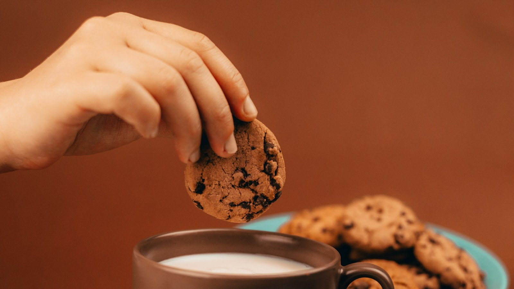
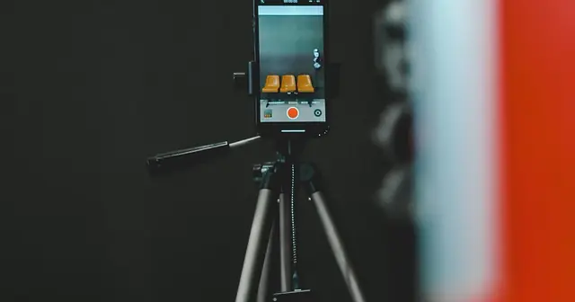

<!-- GENERATED from watch/issues/2024-01-09-meme-brand-placement.yml by scripts/build_watch.py. Edit the data file. -->

```{=html}
<p class="mw-kicker">Marketing in 3 · <a href="../../2024/index.html">2024 in research</a> · No. 2 · Paper published 9 January 2024</p>
<figure class="mw-hero"><picture><source type="image/webp" sizes="(max-width: 900px) 100vw, 900px" srcset="../../images/web/2024-meme-brand-placement-960.webp 960w, ../../images/web/2024-meme-brand-placement-1600.webp 1600w"></picture><figcaption>The first test meme ended with a cookie dunked in milk. Naming the cookie mattered most when the brand was unknown. Photo: Tamas Pap on Unsplash.</figcaption></figure>
<section class="mw-answer" aria-label="Short answer"><h2>The short answer</h2><div class="mw-ans-grid"><p>Yes, on this evidence. In three online experiments with 853 American adults, memes that spelled out the brand and showed its logo or pack were liked more, and people said they were readier to engage with them, than the same memes with the brand barely visible. The logo helped by pulling viewers into the meme&#x27;s little story. It mattered most for an unfamiliar brand, for viewers who understood the joke and for captions addressed to &quot;you&quot;.</p><div class="mw-ev" role="note" aria-label="Evidence level: 2 of 3 stars, several studies"><span class="ev-k">Evidence level</span><ol><li><span class="ev-s" aria-hidden="true"><b>★</b><i>★</i><i>★</i></span>One study</li><li class="on"><span class="ev-s" aria-hidden="true"><b>★</b><b>★</b><i>★</i></span>Several studies</li><li><span class="ev-s" aria-hidden="true"><b>★</b><b>★</b><b>★</b></span>Meta-analysis</li></ol></div></div></section>
<section class="mw-takeaways"><h2>Key takeaways</h2><ul><li>On a cookie meme, repeating the brand name and showing the pack lifted viewers&#x27; stated willingness to hit like, pass it on or tag a friend from 4.96 to 5.57 out of 7.</li><li>For Hydrox, a cookie few participants knew, the brand-heavy meme absorbed people far more than the light one (5.56 against 3.92 out of 7). For Oreo the two versions scored almost the same (5.75 against 5.42).</li><li>In a check with 92 viewers, a caption written with &quot;you&quot; instead of &quot;I&quot; made people feel the meme was about them far more: 5.16 against 2.80 on the self-reference measure.</li><li>The pattern held for a luxury watch too: naming the brand lifted intent to engage with the meme from 3.62 to 4.73 out of 7.</li></ul></section>
<section id="what-the-researchers-did"><h2>What the researchers did</h2><p><a class="mw-orcid-link" href="https://orcid.org/0000-0002-8184-8868" title="Ali Razzaq on ORCID">Ali Razzaq</a>, <a class="mw-orcid-link" href="https://orcid.org/0000-0002-9440-7543" title="Wei Shao on ORCID">Wei Shao</a> and <a class="mw-orcid-link" href="https://orcid.org/0000-0002-0976-5179" title="Sara Quach on ORCID">Sara Quach</a> of the Department of Marketing at Griffith University in Queensland, Australia,
looked at a choice every social media team faces when it borrows a meme: how loudly should the brand speak? Some
teams repeat the name and show the product. Others drop in one quiet mention so the post feels less like an ad.
Research on product placement in films and television often favours the quiet route, because a conspicuous brand
can make viewers feel sold to.</p><p>The team treated memes as tiny stories, with a set-up, a character, a sense of movement and a punchline, and asked
whether a visible brand helps or hinders people getting lost in them. They built pairs of memes with a free online
meme maker, using well-known templates, and changed only how often the brand appeared in words and pictures.</p><p>Each of the three experiments added a second twist. The first compared a household cookie brand with a rival few
shoppers know. The second recruited people who had never seen its meme and explained the joke to half of them. The
third rewrote the caption with &quot;I&quot; or &quot;you&quot;.</p>
<dl class="mw-facts"><div><dt>Participants</dt><dd>Three groups of US adults on Prolific, of 300, 300 and 253 people</dd></div><div><dt>Screening</dt><dd>Experienced platform workers with high approval ratings only; the second study turned away 20 people who already knew its meme</dd></div><div><dt>Memes</dt><dd>Galaxy Brain with Oreo or Hydrox cookies; Draw 25 with a KFC bucket; a watch bursting through a sleeve, with or without a Gucci label</dd></div><div><dt>What changed</dt><dd>How often the brand showed up, crossed with brand familiarity, an explanation of the meme, or the caption&#x27;s pronoun</dd></div><div><dt>Measured</dt><dd>Absorption in the meme, attitude towards it as an advert, and the chance of liking, sharing or tagging it, all on seven-step scales</dd></div><div><dt>Controls</dt><dd>Appetite for humour, the tendency to get lost in stories and, in the later studies, familiarity with the brand</dd></div></dl>
</section>
<section id="why-the-louder-brand-did-better"><h2>Why the louder brand did better</h2><p>In every experiment, the version with the brand clearly on show beat the quieter one on liking for the ad and on
willingness to engage. That held for a cheap snack, a fast-food meal and a designer accessory.</p><p>The authors trace the difference to absorption, which researchers call narrative transportation: the sense of being
pulled inside a story. A clear name or pack gives viewers something to hang the punchline on, so they tie the joke to
the brand with less effort and sink into it further. The statistics fit. Once absorption was taken into account, the
brand cues had no separate pull on liking or sharing; their whole effect ran through it.</p><p>That cuts against the cautious advice from screen placement, where a conspicuous brand tends to pull attention away
from the plot. In a meme, the authors argue, the brand is part of the plot.</p>
<figure class="mw-chart" id="chart-liking"><figcaption class="mw-chart-title">Liking for the meme as an ad, brand light against brand heavy, in each study (1 to 7 scale)</figcaption><div class="mw-chart-svg"><svg viewBox="0 0 680 274" role="img" aria-labelledby="chart-liking-t" font-family="Hanken Grotesk, Arial, sans-serif"><title id="chart-liking-t">Liking for the meme as an ad, brand light against brand heavy, in each study (1 to 7 scale)</title><line x1="250.0" y1="4" x2="250.0" y2="248" stroke="#dde1e8" stroke-width="1"/><text x="250.0" y="266" font-size="12" text-anchor="middle" fill="#5b6476">1</text><line x1="310.0" y1="4" x2="310.0" y2="248" stroke="#dde1e8" stroke-width="1"/><text x="310.0" y="266" font-size="12" text-anchor="middle" fill="#5b6476">2</text><line x1="370.0" y1="4" x2="370.0" y2="248" stroke="#dde1e8" stroke-width="1"/><text x="370.0" y="266" font-size="12" text-anchor="middle" fill="#5b6476">3</text><line x1="430.0" y1="4" x2="430.0" y2="248" stroke="#dde1e8" stroke-width="1"/><text x="430.0" y="266" font-size="12" text-anchor="middle" fill="#5b6476">4</text><line x1="490.0" y1="4" x2="490.0" y2="248" stroke="#dde1e8" stroke-width="1"/><text x="490.0" y="266" font-size="12" text-anchor="middle" fill="#5b6476">5</text><line x1="550.0" y1="4" x2="550.0" y2="248" stroke="#dde1e8" stroke-width="1"/><text x="550.0" y="266" font-size="12" text-anchor="middle" fill="#5b6476">6</text><line x1="610.0" y1="4" x2="610.0" y2="248" stroke="#dde1e8" stroke-width="1"/><text x="610.0" y="266" font-size="12" text-anchor="middle" fill="#5b6476">7</text><g><title>Cookies, brand light: 4.14 </title><text x="238" y="27" font-size="13.5" text-anchor="end" fill="#15203b">Cookies, brand light</text><rect x="250" y="12" width="188.4" height="22" rx="4" fill="#aab3c5"/><text x="446.4" y="28" font-size="13.5" fill="#15203b">4.14</text></g><g><title>Cookies, brand heavy: 5.39 </title><text x="238" y="67" font-size="13.5" text-anchor="end" fill="#15203b" font-weight="600">Cookies, brand heavy</text><rect x="250" y="52" width="263.4" height="22" rx="4" fill="#e0a12a"/><text x="521.4" y="68" font-size="13.5" fill="#15203b" font-weight="600">5.39</text></g><g><title>Fried chicken, brand light: 4.20 </title><text x="238" y="107" font-size="13.5" text-anchor="end" fill="#15203b">Fried chicken, brand light</text><rect x="250" y="92" width="192.0" height="22" rx="4" fill="#aab3c5"/><text x="450.0" y="108" font-size="13.5" fill="#15203b">4.20</text></g><g><title>Fried chicken, brand heavy: 4.78 </title><text x="238" y="147" font-size="13.5" text-anchor="end" fill="#15203b" font-weight="600">Fried chicken, brand heavy</text><rect x="250" y="132" width="226.8" height="22" rx="4" fill="#e0a12a"/><text x="484.8" y="148" font-size="13.5" fill="#15203b" font-weight="600">4.78</text></g><g><title>Luxury watch, brand light: 3.10 </title><text x="238" y="187" font-size="13.5" text-anchor="end" fill="#15203b">Luxury watch, brand light</text><rect x="250" y="172" width="126.0" height="22" rx="4" fill="#aab3c5"/><text x="384.0" y="188" font-size="13.5" fill="#15203b">3.10</text></g><g><title>Luxury watch, brand heavy: 4.46 </title><text x="238" y="227" font-size="13.5" text-anchor="end" fill="#15203b" font-weight="600">Luxury watch, brand heavy</text><rect x="250" y="212" width="207.6" height="22" rx="4" fill="#e0a12a"/><text x="465.6" y="228" font-size="13.5" fill="#15203b" font-weight="600">4.46</text></g></svg></div><div class="mw-sr"><table><caption>Liking for the meme as an ad, brand light against brand heavy, in each study (1 to 7 scale)</caption><tr><th>Group</th><th>Value ()</th></tr><tr><th scope="row">Cookies, brand light</th><td>4.14</td></tr><tr><th scope="row">Cookies, brand heavy</th><td>5.39</td></tr><tr><th scope="row">Fried chicken, brand light</th><td>4.2</td></tr><tr><th scope="row">Fried chicken, brand heavy</th><td>4.78</td></tr><tr><th scope="row">Luxury watch, brand light</th><td>3.1</td></tr><tr><th scope="row">Luxury watch, brand heavy</th><td>4.46</td></tr></table></div><p class="mw-chart-src">Studies 1, 2 and 3 with 300, 300 and 253 US adults; group averages as reported, from analyses that controlled for appetite for humour and other factors.</p></figure>
</section>
<section id="famous-brands-can-afford-to-whisper"><h2>Famous brands can afford to whisper</h2><p>How well people knew the brand changed the picture. With the unfamiliar cookie, the quiet meme left people far less
absorbed than the loud one. With the market leader, both versions landed about equally well.</p><p>The explanation comes from how memory works. People who know a brand well fill in the missing cues themselves, so a
light mention is enough. People who do not know it have only what the post shows them, and the extra mentions give
them something to build the link from. For a challenger brand, a meme is a chance to teach the name, not to hide it.</p>
</section>
<section id="nobody-is-drawn-in-by-a-joke-they-do-not-get"><h2>Nobody is drawn in by a joke they do not get</h2><p>The second experiment used the Draw 25 template, in which a man would rather pick up a whole pile of cards than do
what the card asks of him. Only people unfamiliar with the meme took part. Half read a short note on what it usually
means; the rest saw it cold.</p><p>Among those given the note, the version with the logo on the bucket drew people in much more than the plain one.
Among those who saw it cold, absorption stayed low whichever version they saw, and the logo made no reliable
difference. A brand cannot ride a joke its audience does not understand.</p><p>The authors suggest aiming memes at younger audiences, where memes are most popular, and keeping clear of heavily
symbolic templates for people less at home with them. Age itself was not tested.</p>
<figure class="mw-chart" id="chart-literacy"><figcaption class="mw-chart-title">Absorption in the fried-chicken meme, by logo and by whether the joke was explained (1 to 7 scale)</figcaption><div class="mw-chart-svg"><svg viewBox="0 0 680 194" role="img" aria-labelledby="chart-literacy-t" font-family="Hanken Grotesk, Arial, sans-serif"><title id="chart-literacy-t">Absorption in the fried-chicken meme, by logo and by whether the joke was explained (1 to 7 scale)</title><line x1="250.0" y1="4" x2="250.0" y2="168" stroke="#dde1e8" stroke-width="1"/><text x="250.0" y="186" font-size="12" text-anchor="middle" fill="#5b6476">1</text><line x1="310.0" y1="4" x2="310.0" y2="168" stroke="#dde1e8" stroke-width="1"/><text x="310.0" y="186" font-size="12" text-anchor="middle" fill="#5b6476">2</text><line x1="370.0" y1="4" x2="370.0" y2="168" stroke="#dde1e8" stroke-width="1"/><text x="370.0" y="186" font-size="12" text-anchor="middle" fill="#5b6476">3</text><line x1="430.0" y1="4" x2="430.0" y2="168" stroke="#dde1e8" stroke-width="1"/><text x="430.0" y="186" font-size="12" text-anchor="middle" fill="#5b6476">4</text><line x1="490.0" y1="4" x2="490.0" y2="168" stroke="#dde1e8" stroke-width="1"/><text x="490.0" y="186" font-size="12" text-anchor="middle" fill="#5b6476">5</text><line x1="550.0" y1="4" x2="550.0" y2="168" stroke="#dde1e8" stroke-width="1"/><text x="550.0" y="186" font-size="12" text-anchor="middle" fill="#5b6476">6</text><line x1="610.0" y1="4" x2="610.0" y2="168" stroke="#dde1e8" stroke-width="1"/><text x="610.0" y="186" font-size="12" text-anchor="middle" fill="#5b6476">7</text><g><title>Not explained, no logo: 2.81 </title><text x="238" y="27" font-size="13.5" text-anchor="end" fill="#15203b">Not explained, no logo</text><rect x="250" y="12" width="108.6" height="22" rx="4" fill="#aab3c5"/><text x="366.6" y="28" font-size="13.5" fill="#15203b">2.81</text></g><g><title>Not explained, logo shown: 3.21 </title><text x="238" y="67" font-size="13.5" text-anchor="end" fill="#15203b">Not explained, logo shown</text><rect x="250" y="52" width="132.6" height="22" rx="4" fill="#aab3c5"/><text x="390.6" y="68" font-size="13.5" fill="#15203b">3.21</text></g><g><title>Explained, no logo: 4.11 </title><text x="238" y="107" font-size="13.5" text-anchor="end" fill="#15203b">Explained, no logo</text><rect x="250" y="92" width="186.6" height="22" rx="4" fill="#aab3c5"/><text x="444.6" y="108" font-size="13.5" fill="#15203b">4.11</text></g><g><title>Explained, logo shown: 5.73 </title><text x="238" y="147" font-size="13.5" text-anchor="end" fill="#15203b" font-weight="600">Explained, logo shown</text><rect x="250" y="132" width="283.8" height="22" rx="4" fill="#e0a12a"/><text x="541.8" y="148" font-size="13.5" fill="#15203b" font-weight="600">5.73</text></g></svg></div><div class="mw-sr"><table><caption>Absorption in the fried-chicken meme, by logo and by whether the joke was explained (1 to 7 scale)</caption><tr><th>Group</th><th>Value ()</th></tr><tr><th scope="row">Not explained, no logo</th><td>2.81</td></tr><tr><th scope="row">Not explained, logo shown</th><td>3.21</td></tr><tr><th scope="row">Explained, no logo</th><td>4.11</td></tr><tr><th scope="row">Explained, logo shown</th><td>5.73</td></tr></table></div><p class="mw-chart-src">Study 2, 300 US adults new to the Draw 25 meme, about 75 per group. Without the explanation the gap was not statistically reliable.</p></figure>
</section>
<section id="talk-to-the-viewer-not-about-yourself"><h2>Talk to the viewer, not about yourself</h2><p>The third experiment moved to a luxury watch and changed one word in the caption: &quot;When I got the new watch and have
to show it off&quot; became &quot;When you got the new watch...&quot;.</p><p>That word decided whether naming the brand paid off. Written with &quot;you&quot;, the meme that named the watchmaker pulled
people in far more than the unnamed one. Written with &quot;I&quot;, naming the brand added little. As the authors see it,
second-person wording lets viewers cast themselves in the scene, while &quot;I&quot; leaves them watching someone else,
and the brand, from the outside.</p>
<figure class="mw-chart" id="chart-pronoun"><figcaption class="mw-chart-title">How absorbed people felt in the watch meme, by brand mention and caption pronoun (1 to 7 scale)</figcaption><div class="mw-chart-svg"><svg viewBox="0 0 680 194" role="img" aria-labelledby="chart-pronoun-t" font-family="Hanken Grotesk, Arial, sans-serif"><title id="chart-pronoun-t">How absorbed people felt in the watch meme, by brand mention and caption pronoun (1 to 7 scale)</title><line x1="250.0" y1="4" x2="250.0" y2="168" stroke="#dde1e8" stroke-width="1"/><text x="250.0" y="186" font-size="12" text-anchor="middle" fill="#5b6476">1</text><line x1="310.0" y1="4" x2="310.0" y2="168" stroke="#dde1e8" stroke-width="1"/><text x="310.0" y="186" font-size="12" text-anchor="middle" fill="#5b6476">2</text><line x1="370.0" y1="4" x2="370.0" y2="168" stroke="#dde1e8" stroke-width="1"/><text x="370.0" y="186" font-size="12" text-anchor="middle" fill="#5b6476">3</text><line x1="430.0" y1="4" x2="430.0" y2="168" stroke="#dde1e8" stroke-width="1"/><text x="430.0" y="186" font-size="12" text-anchor="middle" fill="#5b6476">4</text><line x1="490.0" y1="4" x2="490.0" y2="168" stroke="#dde1e8" stroke-width="1"/><text x="490.0" y="186" font-size="12" text-anchor="middle" fill="#5b6476">5</text><line x1="550.0" y1="4" x2="550.0" y2="168" stroke="#dde1e8" stroke-width="1"/><text x="550.0" y="186" font-size="12" text-anchor="middle" fill="#5b6476">6</text><line x1="610.0" y1="4" x2="610.0" y2="168" stroke="#dde1e8" stroke-width="1"/><text x="610.0" y="186" font-size="12" text-anchor="middle" fill="#5b6476">7</text><g><title>&quot;I&quot; caption, brand not named: 3.01 </title><text x="238" y="27" font-size="13.5" text-anchor="end" fill="#15203b">&quot;I&quot; caption, brand not named</text><rect x="250" y="12" width="120.6" height="22" rx="4" fill="#aab3c5"/><text x="378.6" y="28" font-size="13.5" fill="#15203b">3.01</text></g><g><title>&quot;I&quot; caption, brand named: 3.25 </title><text x="238" y="67" font-size="13.5" text-anchor="end" fill="#15203b">&quot;I&quot; caption, brand named</text><rect x="250" y="52" width="135.0" height="22" rx="4" fill="#aab3c5"/><text x="393.0" y="68" font-size="13.5" fill="#15203b">3.25</text></g><g><title>&quot;You&quot; caption, brand not named: 3.85 </title><text x="238" y="107" font-size="13.5" text-anchor="end" fill="#15203b">&quot;You&quot; caption, brand not named</text><rect x="250" y="92" width="171.0" height="22" rx="4" fill="#aab3c5"/><text x="429.0" y="108" font-size="13.5" fill="#15203b">3.85</text></g><g><title>&quot;You&quot; caption, brand named: 5.11 </title><text x="238" y="147" font-size="13.5" text-anchor="end" fill="#15203b" font-weight="600">&quot;You&quot; caption, brand named</text><rect x="250" y="132" width="246.6" height="22" rx="4" fill="#e0a12a"/><text x="504.6" y="148" font-size="13.5" fill="#15203b" font-weight="600">5.11</text></g></svg></div><div class="mw-sr"><table><caption>How absorbed people felt in the watch meme, by brand mention and caption pronoun (1 to 7 scale)</caption><tr><th>Group</th><th>Value ()</th></tr><tr><th scope="row">&quot;I&quot; caption, brand not named</th><td>3.01</td></tr><tr><th scope="row">&quot;I&quot; caption, brand named</th><td>3.25</td></tr><tr><th scope="row">&quot;You&quot; caption, brand not named</th><td>3.85</td></tr><tr><th scope="row">&quot;You&quot; caption, brand named</th><td>5.11</td></tr></table></div><p class="mw-chart-src">Study 3, 253 US adults. With the &quot;I&quot; caption, naming the brand made no reliable difference in the authors&#x27; model.</p></figure>
</section>
<section id="how-to-apply-it" class="mw-howto"><p class="mw-rsg-kicker">Marketing in 3 steps</p><h2>Ready. Set. Market.</h2><div class="mw-rsg"><div class="mw-phase"><div class="mw-phase-dot" aria-hidden="true">1</div><div class="mw-phase-tag"><span class="mw-phase-name">Ready</span><span class="mw-phase-sub">Decide and prepare</span></div><ul class="mw-rsg-steps"><li><strong>Find out how well people know you.</strong> Show a plain photo of your product, with no logo, to 50 people in your target audience and ask who makes it. If fewer than half can say, plan every meme to show your name and product clearly.</li><li><strong>Check the meme before you use it.</strong> Show the bare meme template, without your brand, to 10 people from your audience and ask what it means. Use it only if at least seven explain it correctly. Otherwise pick another one.</li></ul></div><div class="mw-phase"><div class="mw-phase-dot" aria-hidden="true">2</div><div class="mw-phase-tag"><span class="mw-phase-name">Set</span><span class="mw-phase-sub">Build it</span></div><ul class="mw-rsg-steps"><li><strong>Name the brand more than once.</strong> Put the brand name in the caption at least twice and show the product or logo in the picture. Shrink the finished post to thumbnail size on your phone. If you cannot read the name, make it bigger.</li><li><strong>Write the caption to the reader.</strong> Write the line with &quot;you&quot;, as in &quot;When you finally...&quot;, not &quot;I&quot; or &quot;we&quot;. Read it aloud. If it sounds like the brand talking about itself, rewrite it so the reader is the one in the scene.</li></ul></div><div class="mw-phase"><div class="mw-phase-dot" aria-hidden="true">3</div><div class="mw-phase-tag"><span class="mw-phase-name">Market</span><span class="mw-phase-sub">Launch and measure</span></div><ul class="mw-rsg-steps"><li><strong>Post two versions for one week.</strong> Run a brand-heavy and a brand-light version of the same meme to two similar audiences for seven days. Compare shares, saves and friend tags, not just likes.</li><li><strong>Read the comments on day one.</strong> Check the replies in the first 24 hours. If people ask what the post means or who it is from, pause it and swap in a clearer meme. Keep a list of the templates that land and reuse them.</li></ul></div></div></section>
<div class="mw-coffee" role="complementary" aria-label="Support Marketing in 3"><div class="mw-coffee-text"><p class="mw-coffee-title">Found this useful?</p><p>Marketing in 3 is free and ad-free, with new issues every Monday and Thursday. A coffee keeps it that way.</p></div><a class="mw-coffee-btn" href="https://ko-fi.com/marketingin3" target="_blank" rel="noopener"><svg aria-hidden="true" focusable="false"
  class="lucide lucide-coffee"
  xmlns="http://www.w3.org/2000/svg"
  width="24"
  height="24"
  viewBox="0 0 24 24"
  fill="none"
  stroke="currentColor"
  stroke-width="2"
  stroke-linecap="round"
  stroke-linejoin="round"
>
  <path d="M10 2v2" />
  <path d="M14 2v2" />
  <path d="M16 8a1 1 0 0 1 1 1v8a4 4 0 0 1-4 4H7a4 4 0 0 1-4-4V9a1 1 0 0 1 1-1h14a4 4 0 1 1 0 8h-1" />
  <path d="M6 2v2" />
</svg><span>Buy me a coffee</span><span class="mw-coffee-price">€3</span></a></div>
<form class="mw-email mw-email-inline" action="https://qewbdm3gpjxh42mawu5n6ac37m0hlcgm.lambda-url.ap-southeast-2.on.aws/subscribe" method="post"><div class="mw-email-text"><p class="mw-email-title">Get it by email</p><p>New issues every Monday and Thursday, in your inbox. Free, no ads, unsubscribe anytime.</p></div><div class="mw-email-row"><label class="visually-hidden" for="m3-email-inline">Email address</label><input id="m3-email-inline" type="email" name="email" required autocomplete="email" inputmode="email" placeholder="you@example.com" maxlength="254"><input class="mw-hp" type="text" name="website" tabindex="-1" autocomplete="off" aria-hidden="true"><input type="hidden" name="source" value=""><button type="submit">Subscribe</button></div><p class="mw-email-status" role="status" aria-live="polite"></p><p class="mw-email-note">Your address is used only to send Marketing in 3. You will get one email to confirm.</p></form><script>(function(){if(window.m3Email)return;window.m3Email=1;
var M={"check": "Almost done. Check your inbox for an email from issues@marketingin3.com and tap the link to confirm.", "invalid": "That email address does not look right. Please check it and try again.", "slow": "Too many tries in a short time. Please wait a few minutes and try again.", "busy": "Too many tries in a short time. Please wait a few minutes and try again.", "error": "Something went wrong. Please try again in a moment.", "undeliverable": "That address cannot receive email from us. Please try another one.", "confirming": "Confirming your subscription…", "ok": "You are subscribed. The next issue arrives in your inbox on Monday or Thursday, whichever comes first.", "expired": "This confirmation link has expired or was already used. Enter your address again for a fresh one."};
function ep(f){return f.getAttribute('action').replace(/\/subscribe$/,'');}
function say(f,k){var s=f.querySelector('.mw-email-status');if(!s)return;s.textContent=M[k]||M.error;
s.className='mw-email-status is-'+(k==='ok'||k==='check'?'ok':(k==='confirming'?'wait':'bad'));}
function gc(e){try{if(window.mwTrack)window.mwTrack(e);}catch(x){}try{if(window.goatcounter&&goatcounter.count)goatcounter.count({path:e,title:e,event:true});}catch(x){}}
document.querySelectorAll('form.mw-email').forEach(function(f){
var src=f.querySelector('input[name=source]');if(src)src.value=location.pathname;
f.addEventListener('submit',function(e){if(!window.fetch)return;e.preventDefault();
var b=f.querySelector('button');b.disabled=true;
var data={email:f.email.value,website:f.website.value,source:location.pathname};
fetch(f.getAttribute('action'),{method:'POST',headers:{'content-type':'application/json'},body:JSON.stringify(data)})
.then(function(r){return r.json().catch(function(){return {status:'error'};});})
.then(function(j){say(f,j.status);if(j.status==='check'){f.classList.add('is-done');gc('email-subscribe');}})
.catch(function(){say(f,'error');}).then(function(){b.disabled=false;});});});
var q=new URLSearchParams(location.search),f=document.querySelector('form.mw-email');if(!f)return;
['check','invalid','slow','error'].forEach(function(k){if(q.get(k))say(f,k);});
var t=q.get('t');if(t){say(f,'confirming');
fetch(ep(f)+'/confirm',{method:'POST',headers:{'content-type':'application/json'},body:JSON.stringify({t:t})})
.then(function(r){return r.json().catch(function(){return {status:'error'};});})
.then(function(j){say(f,j.status);if(j.status==='ok'){f.classList.add('is-done');gc('email-confirmed');}
if(history.replaceState)history.replaceState(null,'',location.pathname+'#email');})
.catch(function(){say(f,'error');});}
})();</script>
<section id="what-to-expect"><h2>What to expect</h2><ul class="mw-list"><li><strong>A steady edge, not a jackpot.</strong> The brand-heavy meme won for all three products, but the size of its lead changed a lot from one product and audience to the next.</li><li><strong>Sharing can lag behind liking.</strong> In the fast-food test, the logo version was liked clearly more, while the gain in willingness to share or tag it was small: 4.12 against 3.95.</li><li><strong>Cheap to test.</strong> Each test meme was assembled from a public template with a free tool, so testing a loud and a quiet take on one joke costs little beyond time.</li><li><strong>Context can widen the circle.</strong> A short explanation turned a puzzling meme into one that worked. We think a caption or pinned comment that sets up the joke could do the same, though only the explanation itself was tested.</li></ul></section>
<section id="where-it-does-not-work"><h2>Where it does not work</h2><ul class="mw-list"><li><strong>One viewing, stated reactions.</strong> People saw a single meme once and said how they felt and what they might do. No real likes, shares or sales were counted, and everyone was a US adult on one research platform.</li><li><strong>Real brands, one meme each.</strong> Oreo, Hydrox, KFC and Gucci carry existing feelings, and each study tested one template. GIFs, video memes and other formats were left out.</li><li><strong>Meme know-how was taught, not measured.</strong> Understanding came from a short note given to newcomers. Fluency built over years online may behave differently.</li><li><strong>Feeling sold to was not checked.</strong> The authors believe a clearly branded meme does not set off people&#x27;s ad radar. That belief went unmeasured.</li><li><strong>Some averages appear twice.</strong> For the first study, the text and the summary table give different averages for the same groups. This page uses the summary table and the main analyses; every version points the same way.</li></ul></section>
<section id="questions"><h2>Questions marketers ask</h2><div class="mw-faq"><h3>Should brands put their logo in memes?</h3><p>On this evidence, yes. Across cookies, fried chicken and a designer watch, memes that showed the brand clearly were rated more favourably and drew stronger intentions to engage than versions where the brand was easy to miss (Razzaq et al., 2024).</p></div><div class="mw-faq"><h3>What is brand-prominent meme marketing?</h3><p>A meme in which the brand&#x27;s name, logo or product appears often and is easy to see. Its opposite is a brand-subtle meme, which mentions the brand once or only hints at it.</p></div><div class="mw-faq"><h3>Do well-known brands need to show their logo in memes?</h3><p>Less so. People who already know a brand supply the missing cues from memory, so for the best-known cookie tested a light touch matched a heavy one. Lesser-known brands gained much more from being visible.</p></div><div class="mw-faq"><h3>What is meme literacy?</h3><p>The ability to read the hidden meaning of a meme template, which usually depends on knowing where it came from and how people use it. Viewers without it miss the joke, and the brand message goes with it.</p></div><div class="mw-faq"><h3>Why write a meme caption with &quot;you&quot;?</h3><p>Second-person wording invites viewers to picture themselves in the scene. With the brand on show, that deepened how absorbed they became; written in the first person, the caption kept them at a distance.</p></div></section>
<section id="also-new"><h2>Also new at the time</h2><div class="mw-also"><article><p class="mw-also-src"><em>Journal of Marketing</em> · 2024</p><h3><a href="https://doi.org/10.1177/00222429241227145">More Likely to Pay but Less Engaged: The Effects of Switching Online Courses from Scheduled to On-Demand Release on User Behavior</a></h3><p class="mw-also-au">Lu et al.</p><p>When an online learning platform stopped releasing a marketing course week by week and put every lesson up at once, the authors tracked more than 67,000 learners either side of the change. More of them paid for a certificate, so revenue rose quickly. Yet they finished fewer lectures, scored lower on quizzes and enrolled in fewer of the platform&#x27;s other business courses. Open access to everything sells the course; a release schedule keeps people coming back.</p></article><article><p class="mw-also-src"><em>Journal of Consumer Psychology</em> · 2025</p><h3><a href="https://doi.org/10.1002/jcpy.1405">Man up! The mental health-feminine stereotype and its effect on the adoption of mental health apps</a></h3><p class="mw-also-au">Lee &amp; Trudel</p><p>Across five studies, men were more reluctant than women to take up apps built to support their mental health, because using one felt like a feminine thing to do. Offering privacy and do-it-yourself features did not make that hesitation go away. Describing the same app in more masculine terms did lift men&#x27;s interest, especially among those with traditional views of manhood. Who downloads an app can hinge on its framing long before its features get a look.</p></article></div></section>
<section id="source" class="mw-source"><h2>Source</h2><p class="mw-cite">Razzaq, A., Shao, W., &amp; Quach, S. (2024). Meme marketing effectiveness: A moderated-mediation model. <em>Journal of Retailing and Consumer Services</em>, <em>78</em>, 103702. <a href="https://doi.org/10.1016/j.jretconser.2023.103702">https://doi.org/10.1016/j.jretconser.2023.103702</a></p><p class="mw-note">This brief is written for practitioners from the published article. Open access (CC BY 4.0): free to read at the publisher. Numbers are as reported by the authors; read the article for full methods.</p></section>

<section id="keep-reading" class="mw-more"><h2>Keep reading</h2><p class="mw-more-topics">More issues on <a href="../../topics/social-media.html">Social media</a> · <a href="../../topics/creative.html">Creative</a> · <a href="../../topics/advertising.html">Advertising</a></p><div class="watch-list"><article class="watch-item"><a class="watch-thumb" href="../../posts/genai-creative-ideation/index.html" tabindex="-1" aria-hidden="true"></a><div><p class="watch-meta">Issue 42 · <time datetime="2026-10-26">Week of 26 October 2026</time></p><h3><a href="../../posts/genai-creative-ideation/index.html">Prompt training doubled the ideas, not the quality</a></h3><p>Milano et al. tested 98 advertising professionals: generative AI doubled the number of tagline ideas, but only after prompt training, and quality stayed flat.</p></div></article><article class="watch-item"><a class="watch-thumb" href="../../posts/visual-consistency-influencers/index.html" tabindex="-1" aria-hidden="true"></a><div><p class="watch-meta">Issue 41 · <time datetime="2026-10-19">Week of 19 October 2026</time></p><h3><a href="../../posts/visual-consistency-influencers/index.html">Matching looks suit posts, a mix suits stories</a></h3><p>Boluki et al. studied 1,812 Instagram posts and stories from 182 influencer campaigns: matching looks suit posts, while stories do better with a mix.</p></div></article><article class="watch-item"><a class="watch-thumb" href="../../posts/trend-atypicality/index.html" tabindex="-1" aria-hidden="true"></a><div><p class="watch-meta">Issue 40 · <time datetime="2026-10-12">Week of 12 October 2026</time></p><h3><a href="../../posts/trend-atypicality/index.html">Trend videos with a twist beat close copies</a></h3><p>An analysis of 85,000 TikTok dance videos plus three experiments finds that putting your own spin on a trend earns more likes than copying it closely.</p></div></article></div></section>
<div class="mw-author"><div><p><strong>Bruno Schivinski</strong> is Associate Professor of Marketing at Gdańsk University of Technology. He studies how consumers engage with brands in digital and social media.</p><p><a href="../../../index.html">About Bruno</a> · <a href="../../index.html">All Marketing in 3 issues</a> · <a href="../../subscribe.html">Subscribe</a></p></div></div>
<nav class="mw-pn" aria-label="More issues"><a class="mw-prev" href="../dataveillance-chilling-effects/index.html"><span>Previous issue</span>When ad tracking makes viewers switch off</a><a class="mw-next" href="../ar-brand-closeness/index.html"><span>Next issue</span>How AR brings a brand closer, and why that breeds love</a></nav>
```
