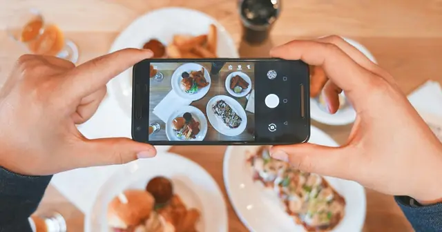

<!-- GENERATED from watch/issues/2026-01-26-meme-marketing.yml by scripts/build_watch.py. Edit the data file. -->

```{=html}
<p class="mw-kicker">Marketing in 3 · Issue 3 · Week of 26 January 2026</p>
<figure class="mw-hero"><picture><source type="image/webp" sizes="(max-width: 900px) 100vw, 900px" srcset="../../images/web/issue-03-meme-marketing-960.webp 960w, ../../images/web/issue-03-meme-marketing-1600.webp 1600w"></picture><figcaption>Memes work because people feel they own them together. Photo: Vitaly Gariev on Unsplash.</figcaption></figure>
<section class="mw-answer" aria-label="Short answer"><h2>The short answer</h2><p>Yes, under two conditions. Across six studies, posts and ads built on an internet meme earned more likes, more clicks, more orders and higher purchase intentions than the same message without the meme. In a real WeChat campaign, the meme ad&#x27;s click-through rate was 1.40% against 0.65%, and its return on ad spend 1.52 against 1.14. Memes work because consumers feel the meme belongs to them and other internet users, and that feeling transfers to the brand. The effect appeared only for memes at their peak (mature, widely recognised) and for mainstream products, not niche ones.</p></section>
<section class="mw-takeaways"><h2>Key takeaways</h2><ul><li>In a real A/B test on WeChat Moments, a grocery ad using the meme &quot;Laomo, I want to eat fish tonight&quot; got 115% more clicks per impression and a 44% higher conversion rate than a standard ad for the same fish.</li><li>Across 900,139 posts from 2,981 brands on Weibo, posts with a meme earned at least 10% more likes, and more comments and reposts.</li><li>Timing decides it. Using a meme at its peak raised purchase intention (6.42 against 5.69 out of 9); using it while it was new, still growing or fading did nothing.</li><li>Memes sell mainstream products, not niche ones. A meme campaign raised intention to watch a mainstream action film (5.10 against 4.09) but not an art-house film (3.90 against 4.16).</li></ul></section>
<section id="what-the-researchers-did"><h2>What the researchers did</h2><p>Brands from Delta Air Lines to DreamWorks join meme trends, and industry reports suggest firms now put 5% to 10%
of their marketing budgets into meme marketing, some startups as much as 30% to 40%. Yet there was little evidence
on whether it works. In a survey of 100 US digital marketers by the authors, the main difficulties were choosing
the right meme and pairing it with the right product.</p><p><a class="mw-orcid-link" href="https://orcid.org/0000-0002-1460-2593" title="Lu Wang on ORCID">Lu Wang</a> (Zhongnan University of Economics and Law), <a class="mw-orcid-link" href="https://orcid.org/0000-0002-0040-2208" title="Xueni (Shirley) Li on ORCID">Xueni (Shirley) Li</a> (Hong Kong Baptist University), Qiyuan
Wang (Hong Kong Polytechnic University) and <a class="mw-orcid-link" href="https://orcid.org/0000-0002-7743-3520" title="Lei Su on ORCID">Lei Su</a> (City University of Hong Kong) define meme marketing by four
features: it is created together by brands and internet users, it follows a template, it draws on shared culture,
and it spreads by imitation and remixing. They tested it with brand posts on Weibo, a paid field experiment on
WeChat, and five online experiments with nearly 4,000 people in China and the US, using text, image and video
memes.</p>
<dl class="mw-facts"><div><dt>Field data</dt><dd>900,139 Weibo posts from 2,981 brands (October 2021 to October 2022), 879 of them using one of 13 memes</dd></div><div><dt>Field experiment</dt><dd>A/B test of two paid ads for a Chinese grocery platform on WeChat Moments, RMB 5,000 each</dd></div><div><dt>Experiments</dt><dd>5 online experiments, 600 to 1,561 people each, two of them preregistered</dd></div><div><dt>Measures</dt><dd>Likes, comments and reposts; clicks, orders and return on ad spend; purchase intention, shared ownership of the message, self–brand connection</dd></div><div><dt>Open data</dt><dd>Data and materials posted on ResearchBox (#3608)</dd></div></dl>
</section>
<section id="what-they-found-in-a-real-campaign"><h2>What they found in a real campaign</h2><p>Working with Dingdong, a large online grocery retailer in China, the authors ran two WeChat ads for freshwater
fish with identical images and budgets. One used the tagline of a popular meme, &quot;Laomo, I want to eat fish
tonight&quot;; the other read &quot;High-quality fresh freshwater fish&quot;. Ads were paid per click, so the more attractive ad
needed fewer impressions to use up its budget.</p><p>The meme ad needed half the impressions (140,152 against 283,413) to get slightly more clicks (1,958 against
1,845). Its click-through rate was 1.40% against 0.65%, close to the 0.60% industry average. More of those clicks
became orders (8.27% against 5.75%), so the meme ad brought in more revenue (RMB 7,624 against 5,698) for the
same spend: a return on ad spend of 1.52 against 1.14.</p><p>The Weibo data point the same way. With each brand compared with itself, posts with a meme got at least 10% more
likes, plus more comments and reposts, and the result held with matched posts, an instrumental variable and posts
matched on meaning.</p>
<figure class="mw-chart" id="chart-ctr"><figcaption class="mw-chart-title">Click-through rate of two WeChat ads for the same fish</figcaption><div class="mw-chart-svg"><svg viewBox="0 0 727 154" role="img" aria-labelledby="chart-ctr-t" font-family="Hanken Grotesk, Arial, sans-serif"><title id="chart-ctr-t">Click-through rate of two WeChat ads for the same fish</title><line x1="297.0" y1="4" x2="297.0" y2="128" stroke="#dde1e8" stroke-width="1"/><text x="297.0" y="146" font-size="12" text-anchor="middle" fill="#5b6476">0</text><line x1="409.5" y1="4" x2="409.5" y2="128" stroke="#dde1e8" stroke-width="1"/><text x="409.5" y="146" font-size="12" text-anchor="middle" fill="#5b6476">0.5</text><line x1="522.0" y1="4" x2="522.0" y2="128" stroke="#dde1e8" stroke-width="1"/><text x="522.0" y="146" font-size="12" text-anchor="middle" fill="#5b6476">1</text><line x1="634.5" y1="4" x2="634.5" y2="128" stroke="#dde1e8" stroke-width="1"/><text x="634.5" y="146" font-size="12" text-anchor="middle" fill="#5b6476">1.5</text><g><title>Industry average: 0.60%</title><text x="285" y="27" font-size="13.5" text-anchor="end" fill="#15203b">Industry average</text><rect x="297" y="12" width="135.0" height="22" rx="4" fill="#aab3c5"/><text x="440.0" y="28" font-size="13.5" fill="#15203b">0.60%</text></g><g><title>Standard ad (&quot;High-quality fresh fish&quot;): 0.65%</title><text x="285" y="67" font-size="13.5" text-anchor="end" fill="#15203b">Standard ad (&quot;High-quality fresh fish&quot;)</text><rect x="297" y="52" width="146.2" height="22" rx="4" fill="#aab3c5"/><text x="451.2" y="68" font-size="13.5" fill="#15203b">0.65%</text></g><g><title>Meme ad (&quot;Laomo, I want to eat fish&quot;): 1.40%</title><text x="285" y="107" font-size="13.5" text-anchor="end" fill="#15203b" font-weight="600">Meme ad (&quot;Laomo, I want to eat fish&quot;)</text><rect x="297" y="92" width="315.0" height="22" rx="4" fill="#e0a12a"/><text x="620.0" y="108" font-size="13.5" fill="#15203b" font-weight="600">1.40%</text></g></svg></div><div class="mw-sr"><table><caption>Click-through rate of two WeChat ads for the same fish</caption><tr><th>Group</th><th>Value (%)</th></tr><tr><th scope="row">Industry average</th><td>0.6</td></tr><tr><th scope="row">Standard ad (&quot;High-quality fresh fish&quot;)</th><td>0.65</td></tr><tr><th scope="row">Meme ad (&quot;Laomo, I want to eat fish&quot;)</th><td>1.4</td></tr></table></div><p class="mw-chart-src">Study 2a, field A/B test on WeChat Moments, RMB 5,000 per ad; industry average as cited by the authors.</p></figure>
</section>
<section id="why-memes-work"><h2>Why memes work</h2><p>A meme belongs to everybody who has used it. The authors call this shared psychological ownership: the sense that
&quot;we&quot;, the internet users, made this. When a brand speaks in a meme, people feel they own the message with others,
and that feeling turns into a closer connection between themselves and the brand.</p><p>Two experiments showed this. On a simulated social media feed in China (1,000 people), a back-support brand&#x27;s
post was more likely to be liked (5.40 against 4.60 out of 9) and its product more wanted (6.08 against 5.60) when
a third of the feed used the meme the post borrowed. With 600 US adults, a fictitious sportswear brand using the
line &quot;There are five types of fitness enthusiasts…&quot; was felt to be more shared property (4.98 against 3.97), felt
closer to the self (3.45 against 2.52) and was more wanted (4.79 against 4.20). Ownership and connection, in that
order, explained the effect. Mood, the quality of the post and how familiar the brand was did not.</p>
</section>
<section id="catch-the-meme-at-its-peak"><h2>Catch the meme at its peak</h2><p>Memes have a life cycle: introduction, growth, maturity and decline. With 1,561 US adults, a bedding brand used a
line from a TV series (&quot;I come to our beddings for only three things: cozy, cozy, and cozy&quot;) at each of the four
stages. Only when the meme was mature, widely recognised and used by many people, did the meme post beat a
standard post (6.42 against 5.69 out of 9). A new meme has not yet been shared enough for anyone to feel they own
it; a fading one no longer gives that feeling. Ownership and self–brand connection rose only at maturity too.</p>
<figure class="mw-chart" id="chart-lifecycle"><figcaption class="mw-chart-title">Purchase intention when the brand used the meme at each stage</figcaption><div class="mw-chart-svg"><svg viewBox="0 0 680 234" role="img" aria-labelledby="chart-lifecycle-t" font-family="Hanken Grotesk, Arial, sans-serif"><title id="chart-lifecycle-t">Purchase intention when the brand used the meme at each stage</title><line x1="250.0" y1="4" x2="250.0" y2="208" stroke="#dde1e8" stroke-width="1"/><text x="250.0" y="226" font-size="12" text-anchor="middle" fill="#5b6476">1</text><line x1="295.0" y1="4" x2="295.0" y2="208" stroke="#dde1e8" stroke-width="1"/><text x="295.0" y="226" font-size="12" text-anchor="middle" fill="#5b6476">2</text><line x1="340.0" y1="4" x2="340.0" y2="208" stroke="#dde1e8" stroke-width="1"/><text x="340.0" y="226" font-size="12" text-anchor="middle" fill="#5b6476">3</text><line x1="385.0" y1="4" x2="385.0" y2="208" stroke="#dde1e8" stroke-width="1"/><text x="385.0" y="226" font-size="12" text-anchor="middle" fill="#5b6476">4</text><line x1="430.0" y1="4" x2="430.0" y2="208" stroke="#dde1e8" stroke-width="1"/><text x="430.0" y="226" font-size="12" text-anchor="middle" fill="#5b6476">5</text><line x1="475.0" y1="4" x2="475.0" y2="208" stroke="#dde1e8" stroke-width="1"/><text x="475.0" y="226" font-size="12" text-anchor="middle" fill="#5b6476">6</text><line x1="520.0" y1="4" x2="520.0" y2="208" stroke="#dde1e8" stroke-width="1"/><text x="520.0" y="226" font-size="12" text-anchor="middle" fill="#5b6476">7</text><line x1="565.0" y1="4" x2="565.0" y2="208" stroke="#dde1e8" stroke-width="1"/><text x="565.0" y="226" font-size="12" text-anchor="middle" fill="#5b6476">8</text><line x1="610.0" y1="4" x2="610.0" y2="208" stroke="#dde1e8" stroke-width="1"/><text x="610.0" y="226" font-size="12" text-anchor="middle" fill="#5b6476">9</text><g><title>Standard post (no meme): 5.69 out of 9</title><text x="238" y="27" font-size="13.5" text-anchor="end" fill="#15203b">Standard post (no meme)</text><rect x="250" y="12" width="211.1" height="22" rx="4" fill="#aab3c5"/><text x="469.1" y="28" font-size="13.5" fill="#15203b">5.69</text></g><g><title>Meme just introduced: 5.38 out of 9</title><text x="238" y="67" font-size="13.5" text-anchor="end" fill="#15203b">Meme just introduced</text><rect x="250" y="52" width="197.1" height="22" rx="4" fill="#aab3c5"/><text x="455.1" y="68" font-size="13.5" fill="#15203b">5.38</text></g><g><title>Meme growing: 5.74 out of 9</title><text x="238" y="107" font-size="13.5" text-anchor="end" fill="#15203b">Meme growing</text><rect x="250" y="92" width="213.3" height="22" rx="4" fill="#aab3c5"/><text x="471.3" y="108" font-size="13.5" fill="#15203b">5.74</text></g><g><title>Meme at maturity: 6.42 out of 9</title><text x="238" y="147" font-size="13.5" text-anchor="end" fill="#15203b" font-weight="600">Meme at maturity</text><rect x="250" y="132" width="243.9" height="22" rx="4" fill="#e0a12a"/><text x="501.9" y="148" font-size="13.5" fill="#15203b" font-weight="600">6.42</text></g><g><title>Meme in decline: 5.45 out of 9</title><text x="238" y="187" font-size="13.5" text-anchor="end" fill="#15203b">Meme in decline</text><rect x="250" y="172" width="200.2" height="22" rx="4" fill="#aab3c5"/><text x="458.2" y="188" font-size="13.5" fill="#15203b">5.45</text></g></svg></div><div class="mw-sr"><table><caption>Purchase intention when the brand used the meme at each stage</caption><tr><th>Group</th><th>Value (out of 9)</th></tr><tr><th scope="row">Standard post (no meme)</th><td>5.69</td></tr><tr><th scope="row">Meme just introduced</th><td>5.38</td></tr><tr><th scope="row">Meme growing</th><td>5.74</td></tr><tr><th scope="row">Meme at maturity</th><td>6.42</td></tr><tr><th scope="row">Meme in decline</th><td>5.45</td></tr></table></div><p class="mw-chart-src">Study 3, 1,561 US adults, 1–9 scale. The standard post is the maturity-stage comparison; standard posts did not differ across stages.</p></figure>
</section>
<section id="mainstream-products-only"><h2>Mainstream products only</h2><p>With 797 US adults, a video meme (two cats chatting) was used to promote either a mainstream action film or a
niche art-house film with the same title. The meme raised intention to watch the mainstream film (5.10 against
4.09 out of 9) but not the niche one (3.90 against 4.16). Memes draw their power from mass culture, which suits
mass-market products; niche products appeal to people who want to stand apart, and borrowed mass culture works
against that.</p><p>One in four participants (23.6%) had seen the cat meme before. Prior exposure did not change the result, but the
authors stress that people must recognise a meme as a meme for any of this to work: in the feed experiment, 98% of
people spotted it.</p>
<figure class="mw-chart" id="chart-product"><figcaption class="mw-chart-title">Intention to watch a film promoted with or without a meme</figcaption><div class="mw-chart-svg"><svg viewBox="0 0 680 194" role="img" aria-labelledby="chart-product-t" font-family="Hanken Grotesk, Arial, sans-serif"><title id="chart-product-t">Intention to watch a film promoted with or without a meme</title><line x1="250.0" y1="4" x2="250.0" y2="168" stroke="#dde1e8" stroke-width="1"/><text x="250.0" y="186" font-size="12" text-anchor="middle" fill="#5b6476">1</text><line x1="295.0" y1="4" x2="295.0" y2="168" stroke="#dde1e8" stroke-width="1"/><text x="295.0" y="186" font-size="12" text-anchor="middle" fill="#5b6476">2</text><line x1="340.0" y1="4" x2="340.0" y2="168" stroke="#dde1e8" stroke-width="1"/><text x="340.0" y="186" font-size="12" text-anchor="middle" fill="#5b6476">3</text><line x1="385.0" y1="4" x2="385.0" y2="168" stroke="#dde1e8" stroke-width="1"/><text x="385.0" y="186" font-size="12" text-anchor="middle" fill="#5b6476">4</text><line x1="430.0" y1="4" x2="430.0" y2="168" stroke="#dde1e8" stroke-width="1"/><text x="430.0" y="186" font-size="12" text-anchor="middle" fill="#5b6476">5</text><line x1="475.0" y1="4" x2="475.0" y2="168" stroke="#dde1e8" stroke-width="1"/><text x="475.0" y="186" font-size="12" text-anchor="middle" fill="#5b6476">6</text><line x1="520.0" y1="4" x2="520.0" y2="168" stroke="#dde1e8" stroke-width="1"/><text x="520.0" y="186" font-size="12" text-anchor="middle" fill="#5b6476">7</text><line x1="565.0" y1="4" x2="565.0" y2="168" stroke="#dde1e8" stroke-width="1"/><text x="565.0" y="186" font-size="12" text-anchor="middle" fill="#5b6476">8</text><line x1="610.0" y1="4" x2="610.0" y2="168" stroke="#dde1e8" stroke-width="1"/><text x="610.0" y="186" font-size="12" text-anchor="middle" fill="#5b6476">9</text><g><title>Mainstream film, no meme: 4.09 out of 9</title><text x="238" y="27" font-size="13.5" text-anchor="end" fill="#15203b">Mainstream film, no meme</text><rect x="250" y="12" width="139.0" height="22" rx="4" fill="#aab3c5"/><text x="397.0" y="28" font-size="13.5" fill="#15203b">4.09</text></g><g><title>Mainstream film, meme: 5.10 out of 9</title><text x="238" y="67" font-size="13.5" text-anchor="end" fill="#15203b" font-weight="600">Mainstream film, meme</text><rect x="250" y="52" width="184.5" height="22" rx="4" fill="#e0a12a"/><text x="442.5" y="68" font-size="13.5" fill="#15203b" font-weight="600">5.10</text></g><g><title>Niche film, no meme: 4.16 out of 9</title><text x="238" y="107" font-size="13.5" text-anchor="end" fill="#15203b">Niche film, no meme</text><rect x="250" y="92" width="142.2" height="22" rx="4" fill="#aab3c5"/><text x="400.2" y="108" font-size="13.5" fill="#15203b">4.16</text></g><g><title>Niche film, meme: 3.90 out of 9</title><text x="238" y="147" font-size="13.5" text-anchor="end" fill="#15203b">Niche film, meme</text><rect x="250" y="132" width="130.5" height="22" rx="4" fill="#aab3c5"/><text x="388.5" y="148" font-size="13.5" fill="#15203b">3.90</text></g></svg></div><div class="mw-sr"><table><caption>Intention to watch a film promoted with or without a meme</caption><tr><th>Group</th><th>Value (out of 9)</th></tr><tr><th scope="row">Mainstream film, no meme</th><td>4.09</td></tr><tr><th scope="row">Mainstream film, meme</th><td>5.1</td></tr><tr><th scope="row">Niche film, no meme</th><td>4.16</td></tr><tr><th scope="row">Niche film, meme</th><td>3.9</td></tr></table></div><p class="mw-chart-src">Study 4, 797 US adults, video meme &quot;Two cats conversation&quot;, 1–9 scale; the niche difference was not significant.</p></figure>
</section>
<section id="how-to-apply-it" class="mw-howto"><p class="mw-rsg-kicker">Marketing in 3 steps</p><h2>Ready. Set. Market.</h2><div class="mw-rsg"><div class="mw-phase"><div class="mw-phase-dot" aria-hidden="true">1</div><div class="mw-phase-tag"><span class="mw-phase-name">Ready</span><span class="mw-phase-sub">Decide and prepare</span></div><ul class="mw-rsg-steps"><li><strong>Keep it for mainstream products.</strong> Memes worked for a grocery staple, a back-support product, sportswear, bedding and a blockbuster film, but not for a niche art film. For premium, artistic or subcultural brands, use other tactics.</li><li><strong>Pick a mature meme.</strong> Use memes that many people already recognise and remix, not ones that are just emerging or already fading. Judge maturity by how many people create their own versions, how consistent the template is and how recognisable it is to your audience, not by views alone.</li></ul></div><div class="mw-phase"><div class="mw-phase-dot" aria-hidden="true">2</div><div class="mw-phase-tag"><span class="mw-phase-name">Set</span><span class="mw-phase-sub">Build it</span></div><ul class="mw-rsg-steps"><li><strong>Borrow the template, add your product.</strong> Keep the meme&#x27;s structure intact and slot the product in (&quot;There are five types of fitness enthusiasts…&quot;). The winning ads changed one line of copy and nothing else.</li><li><strong>Keep the tone soft.</strong> Meme posts work as conversation rather than promotion. Post them on owned channels and let people share and remix them, which brings earned reach on top.</li></ul></div><div class="mw-phase"><div class="mw-phase-dot" aria-hidden="true">3</div><div class="mw-phase-tag"><span class="mw-phase-name">Market</span><span class="mw-phase-sub">Launch and measure</span></div><ul class="mw-rsg-steps"><li><strong>Check recognition before launch.</strong> The effect depends on people seeing the post as a meme. If a quick check shows your target audience would not recognise the template, choose another.</li><li><strong>Measure it like any ad.</strong> A/B test a meme version against your standard copy and track click-through, conversion and return on ad spend, as in the field experiment.</li></ul></div></div></section>
<div class="mw-coffee" role="complementary" aria-label="Support Marketing in 3"><div class="mw-coffee-text"><p class="mw-coffee-title">Found this useful?</p><p>Marketing in 3 is free and ad-free, with new issues every Monday and Thursday. A coffee keeps it that way.</p></div><a class="mw-coffee-btn" href="https://ko-fi.com/marketingin3" target="_blank" rel="noopener"><svg aria-hidden="true" focusable="false"
  class="lucide lucide-coffee"
  xmlns="http://www.w3.org/2000/svg"
  width="24"
  height="24"
  viewBox="0 0 24 24"
  fill="none"
  stroke="currentColor"
  stroke-width="2"
  stroke-linecap="round"
  stroke-linejoin="round"
>
  <path d="M10 2v2" />
  <path d="M14 2v2" />
  <path d="M16 8a1 1 0 0 1 1 1v8a4 4 0 0 1-4 4H7a4 4 0 0 1-4-4V9a1 1 0 0 1 1-1h14a4 4 0 1 1 0 8h-1" />
  <path d="M6 2v2" />
</svg><span>Buy me a coffee</span><span class="mw-coffee-price">€3</span></a></div>
<section id="what-to-expect"><h2>What to expect</h2><ul class="mw-list"><li><strong>More clicks for the same budget.</strong> In the field test, click-through more than doubled (1.40% against 0.65%) and the meme ad needed half the impressions to spend its budget.</li><li><strong>Better return, not just engagement.</strong> Conversion rose from 5.75% to 8.27% and return on ad spend from 1.14 to 1.52.</li><li><strong>Modest lifts in surveys.</strong> In the experiments, purchase intention rose by about half a point to one point on a 9-point scale (effect sizes d = .23 to .44).</li><li><strong>Engagement on organic posts.</strong> On Weibo, meme posts earned at least 10% more likes than the same brand&#x27;s other posts, and more comments and reposts.</li></ul></section>
<section id="where-it-does-not-work"><h2>Where it does not work</h2><ul class="mw-list"><li><strong>One field test.</strong> The click and revenue evidence comes from a single A/B test of two ads in China. The authors&#x27; estimate that meme marketing could add US$212 billion in revenue is a rough extrapolation, not a finding.</li><li><strong>Simulated life cycles.</strong> The meme&#x27;s stage was described to participants rather than observed over time, and the memes and brands in most experiments were made up.</li><li><strong>Risky memes untested.</strong> Political or sensitive memes, memes that clash with a brand&#x27;s persona, and platform rules on meme use were not studied.</li><li><strong>Platform-specific formats.</strong> TikTok challenges and similar formats follow platform logic that may change the effect; combining memes with influencers is also untested.</li></ul></section>
<section id="questions"><h2>Questions marketers ask</h2><div class="mw-faq"><h3>Does meme marketing work?</h3><p>Yes, under two conditions. In a Journal of Marketing study, a meme ad on WeChat more than doubled click-through (1.40% against 0.65%) and raised return on ad spend from 1.14 to 1.52, and meme posts on Weibo got at least 10% more likes. The effect appeared only for mature, widely recognised memes and for mainstream products.</p></div><div class="mw-faq"><h3>Why are memes effective in marketing?</h3><p>Because people feel memes belong to everyone who uses them. When a brand speaks in a meme, consumers feel they share ownership of the message, and this strengthens their connection with the brand, which raises purchase intention (Wang et al., 2026).</p></div><div class="mw-faq"><h3>When should brands use a meme?</h3><p>At its peak. In an experiment with 1,561 people, a brand post using a meme raised purchase intention only when the meme was mature (6.42 against 5.69 out of 9), not when it was new, still growing or in decline.</p></div><div class="mw-faq"><h3>Does meme marketing work for niche or luxury brands?</h3><p>Not in this research. A meme campaign raised intention to watch a mainstream action film (5.10 against 4.09 out of 9) but had no effect for a niche art-house film (3.90 against 4.16). Memes rely on mass culture, which suits mainstream products.</p></div><div class="mw-faq"><h3>What is meme marketing?</h3><p>A digital marketing practice in which brands use internet memes to promote products. It is co-created by brands and internet users, follows a recognisable template, draws on shared culture and spreads through imitation and remixing.</p></div></section>
<section id="also-new"><h2>Also new this week</h2><div class="mw-also"><article><p class="mw-also-src"><em>European Journal of Marketing</em> · 2026</p><h3><a href="https://doi.org/10.1108/ejm-02-2025-0103">Holiday marketing of retailers on social media: Impact of post appeals and humor on advertising communication effectiveness</a></h3><p class="mw-also-au">Kuo, Y.-F., Lin, W.-C., Liao, J.-Z., &amp; Liu, H.-H.</p><p>Analysing holiday Facebook posts from seven Taiwanese retailers (2021 to 2023) and running follow-up experiments, the authors find that image-building posts beat sales-driven ones, and that humour helps, most of all in sales-driven posts, where clever, cognitive humour works better than purely feel-good humour. If a holiday post has to push a promotion, make it witty.</p></article><article><p class="mw-also-src"><em>Psychology &amp; Marketing</em> · 2026</p><h3><a href="https://doi.org/10.1002/mar.70108">Humor heals: Examining meme tone and victim framing in donation-driven content</a></h3><p class="mw-also-au">Kim, M., &amp; Koksal, A.</p><p>Donations usually fall as the number of victims rises, a pattern known as compassion fade. Across three experiments, humorous meme-style posts kept donation intentions up for appeals about many victims, where serious posts lost ground. For charities, a light meme tone can soften compassion fade rather than trivialise the cause.</p></article></div></section>
<section id="source" class="mw-source"><h2>Source</h2><p class="mw-cite">Wang, L., Li, X., Wang, Q., &amp; Su, L. (2026). From owning to connecting: Understanding and leveraging the effect of internet meme marketing. <em>Journal of Marketing</em>. <a href="https://doi.org/10.1177/00222429261417674">https://doi.org/10.1177/00222429261417674</a></p><p class="mw-note">This brief is written for practitioners from the published article. Open access (CC BY-NC 4.0): free to read at the publisher. Numbers are as reported by the authors; read the article for full methods.</p></section>
<section id="related-research" class="mw-related"><h2>Related research on this site</h2><ul><li><a href="../../../papers/measuring-consumer-engagement-social-media-content.html">Measuring consumers’ engagement with brand-related social-media content: Development and validation of a scale that identifies levels of social-media engagement with brands</a><span>Journal of Advertising Research</span></li></ul></section>
<section id="keep-reading" class="mw-more"><h2>Keep reading</h2><p class="mw-more-topics">More issues on <a href="../../topics/social-media.html">Social media</a> · <a href="../../topics/advertising.html">Advertising</a> · <a href="../../topics/ugc.html">UGC</a></p><div class="watch-list"><article class="watch-item"><a class="watch-thumb" href="../../posts/firm-generated-user-content/index.html" tabindex="-1" aria-hidden="true"></a><div><p class="watch-meta">Issue 20 · <time datetime="2026-05-25">Week of 25 May 2026</time></p><h3><a href="../../posts/firm-generated-user-content/index.html">Write the post for them and they will send it</a></h3><p>Handing customers a ready-made post lifted sharing from 0.4% to 2.1% in a real gym campaign, and quietly stopped unhappy customers posting at all. How to use it, and where it gets uncomfortable.</p></div></article><article class="watch-item"><a class="watch-thumb" href="../../posts/brand-followers-ai/index.html" tabindex="-1" aria-hidden="true"></a><div><p class="watch-meta">Issue 43 · <time datetime="2026-10-29">Thursday 29 October 2026</time></p><h3><a href="../../posts/brand-followers-ai/index.html">Five kinds of brand follower, and why AI hasn&#x27;t changed them</a></h3><p>Schivinski&#x27;s machine learning study of 1,356 brand followers found five engagement patterns driven by commitment, and they still matter in the age of AI.</p></div></article><article class="watch-item"><a class="watch-thumb" href="../../posts/synthetic-person-disclosure/index.html" tabindex="-1" aria-hidden="true"></a><div><p class="watch-meta">Issue 36 · <time datetime="2026-09-14">Week of 14 September 2026</time></p><h3><a href="../../posts/synthetic-person-disclosure/index.html">The label that buys honesty, then spends it on artificiality</a></h3><p>A detailed &quot;this person does not exist&quot; label cut the sense of being manipulated and raised the sense of artificiality. The two effects cancelled out, except among younger viewers.</p></div></article></div></section>
<div class="mw-author"><div><p><strong>Bruno Schivinski</strong> is Associate Professor of Marketing at Gdańsk University of Technology. He studies how consumers engage with brands in digital and social media.</p><p><a href="../../../index.html">About Bruno</a> · <a href="../../index.html">All Marketing in 3 issues</a> · <a href="../../subscribe.html">Subscribe</a></p></div></div>
<nav class="mw-pn" aria-label="More issues"><a class="mw-prev" href="../responding-to-positive-reviews/index.html"><span>Previous issue</span>How to answer customers who praise you online</a><a class="mw-next" href="../influencer-endorsement-rate/index.html"><span>Next issue</span>Why half-sponsored influencers get the least engagement</a></nav>
```
