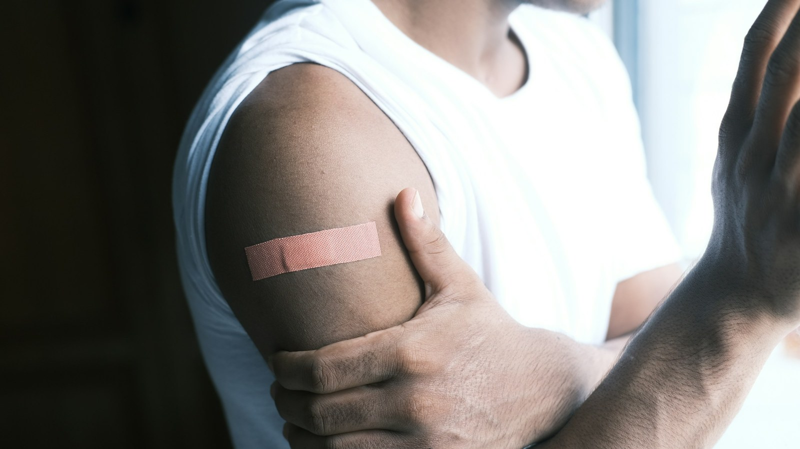

<!-- GENERATED from watch/issues/2025-01-02-official-posts-vaccine-intention.yml by scripts/build_watch.py. Edit the data file. -->

```{=html}
<p class="mw-kicker">Marketing in 3 · <a href="../../2025/index.html">2025 in research</a> · No. 1 · Journal issue published 2 January 2025</p>
<figure class="mw-hero"><picture><source type="image/webp" sizes="(max-width: 900px) 100vw, 900px" srcset="../../images/web/2025-official-posts-vaccine-intention-960.webp 960w, ../../images/web/2025-official-posts-vaccine-intention-1600.webp 1600w"></picture><figcaption>A small plaster, and behind it a chain of posts, feeds and conversations. Photo: Towfiqu barbhuiya on Unsplash.</figcaption></figure>
<section class="mw-answer" aria-label="Short answer"><h2>The short answer</h2><div class="mw-ans-grid"><p>Official accounts, and mostly through belief. In our survey of 428 adults in Australia during the 2021 vaccine rollout, people who rated official social media information more positively were more willing to be vaccinated, largely because they were more convinced the vaccine works and is safe. Posts from friends and other users had no direct link with intentions at all; they helped only by shifting those same two beliefs. Fear of the virus made no difference.</p><div class="mw-ev" role="note" aria-label="Evidence level: 1 of 3 stars, one study"><span class="ev-k">Evidence level</span><ol><li class="on"><span class="ev-s" aria-hidden="true"><b>★</b><i>★</i><i>★</i></span>One study</li><li><span class="ev-s" aria-hidden="true"><b>★</b><b>★</b><i>★</i></span>Several studies</li><li><span class="ev-s" aria-hidden="true"><b>★</b><b>★</b><b>★</b></span>Meta-analysis</li></ol></div></div></section>
<section class="mw-takeaways"><h2>Key takeaways</h2><ul><li>Posts and beliefs together accounted for 73% of the differences in people&#x27;s intention to be vaccinated.</li><li>Believing the vaccine works was the strongest driver, almost four times as strong as believing it is safe.</li><li>Official-source posts had about three times the overall link with intentions that user posts had, and the user-post link fell short of statistical significance.</li><li>On average, respondents had talked about vaccines with about 17 people on social media in the previous month.</li></ul></section>
<section id="what-we-did"><h2>What we did</h2><p>Dooyeon Park, Hilary Duns-McKay, Bartholomew Heeren, Elizabeth McLachlan and I, all at the School of Media and
Communication at RMIT University in Melbourne, wanted to settle a question that kept coming up during the pandemic. Is
social media good or bad for vaccine uptake? Earlier studies pointed both ways. Our hunch was that they treated social
media as one thing, when in fact it carries two very different voices: official accounts, such as news organisations and
government pages, and ordinary users, such as friends and family.</p><p>The project grew out of a research course in RMIT&#x27;s Master of Advertising. We ran an online survey in late August and early
September 2021, while Australia&#x27;s rollout was under way and fewer than six in ten people had their first dose. The link
went out through local Facebook groups and personal pages that had nothing to do with COVID-19, and respondents passed it
on. People rated how they felt about vaccine information on social media from each type of source, and how convinced they
were that the vaccine works, that it is safe, and that the virus is a real risk to them. Finally, they told us how ready
they were to be vaccinated, boosters included.</p>
<dl class="mw-facts"><div><dt>Sample</dt><dd>428 adults living in Australia, aged 16 to 79, average age 46; 53% women</dd></div><div><dt>Recruited</dt><dd>Through Facebook groups and pages unrelated to COVID-19, then shared on by respondents; 554 surveys collected, 428 usable</dd></div><div><dt>Vaccination status</dt><dd>27% had one dose, 47% two, 18% none at the time</dd></div><div><dt>Two voices</dt><dd>Official sources (news organisations, government accounts) and user-generated posts (friends, family, other users)</dd></div><div><dt>Beliefs</dt><dd>Confidence in the vaccine&#x27;s protection and safety, and the perceived threat of COVID-19</dd></div><div><dt>Analysis</dt><dd>Structural equation model with age, gender and time on social media held constant</dd></div></dl>
</section>
<section id="official-posts-work-through-belief"><h2>Official posts work through belief</h2><p>The more favourably someone judged official accounts&#x27; vaccine information, the more convinced they were on both counts
that mattered: that the vaccine protects, and that it carries little danger. Those two beliefs then carried most of the link through to intentions.
Once they were taken into account, only a small and statistically uncertain direct link was left.</p><p>In marketing terms, the official account did not persuade by repeating &quot;get vaccinated&quot;. It persuaded by making people
more sure of what the product does and that it will not hurt them. The credibility that news organisations and public
bodies already had did not stay behind on their websites; it came with them onto social media.</p>
<figure class="mw-chart" id="chart-beliefs"><figcaption class="mw-chart-title">How strongly positive ratings of each source went with each belief (standardised effect)</figcaption><div class="mw-chart-svg"><svg viewBox="0 0 699 274" role="img" aria-labelledby="chart-beliefs-t" font-family="Hanken Grotesk, Arial, sans-serif"><title id="chart-beliefs-t">How strongly positive ratings of each source went with each belief (standardised effect)</title><line x1="269.0" y1="4" x2="269.0" y2="248" stroke="#dde1e8" stroke-width="1"/><text x="269.0" y="266" font-size="12" text-anchor="middle" fill="#5b6476">0</text><line x1="389.0" y1="4" x2="389.0" y2="248" stroke="#dde1e8" stroke-width="1"/><text x="389.0" y="266" font-size="12" text-anchor="middle" fill="#5b6476">0.1</text><line x1="509.0" y1="4" x2="509.0" y2="248" stroke="#dde1e8" stroke-width="1"/><text x="509.0" y="266" font-size="12" text-anchor="middle" fill="#5b6476">0.2</text><line x1="629.0" y1="4" x2="629.0" y2="248" stroke="#dde1e8" stroke-width="1"/><text x="629.0" y="266" font-size="12" text-anchor="middle" fill="#5b6476">0.3</text><g><title>Official posts: the vaccine works: 0.29 </title><text x="257" y="27" font-size="13.5" text-anchor="end" fill="#15203b" font-weight="600">Official posts: the vaccine works</text><rect x="269" y="12" width="348.0" height="22" rx="4" fill="#e0a12a"/><text x="625.0" y="28" font-size="13.5" fill="#15203b" font-weight="600">0.29</text></g><g><title>Official posts: the vaccine is safe: 0.28 </title><text x="257" y="67" font-size="13.5" text-anchor="end" fill="#15203b" font-weight="600">Official posts: the vaccine is safe</text><rect x="269" y="52" width="336.0" height="22" rx="4" fill="#e0a12a"/><text x="613.0" y="68" font-size="13.5" fill="#15203b" font-weight="600">0.28</text></g><g><title>Official posts: COVID-19 is a risk: 0.20 </title><text x="257" y="107" font-size="13.5" text-anchor="end" fill="#15203b">Official posts: COVID-19 is a risk</text><rect x="269" y="92" width="240.0" height="22" rx="4" fill="#aab3c5"/><text x="517.0" y="108" font-size="13.5" fill="#15203b">0.20</text></g><g><title>User posts: the vaccine works: 0.14 </title><text x="257" y="147" font-size="13.5" text-anchor="end" fill="#15203b">User posts: the vaccine works</text><rect x="269" y="132" width="168.0" height="22" rx="4" fill="#aab3c5"/><text x="445.0" y="148" font-size="13.5" fill="#15203b">0.14</text></g><g><title>User posts: the vaccine is safe: 0.15 </title><text x="257" y="187" font-size="13.5" text-anchor="end" fill="#15203b">User posts: the vaccine is safe</text><rect x="269" y="172" width="180.0" height="22" rx="4" fill="#aab3c5"/><text x="457.0" y="188" font-size="13.5" fill="#15203b">0.15</text></g><g><title>User posts: COVID-19 is a risk: 0.04 </title><text x="257" y="227" font-size="13.5" text-anchor="end" fill="#15203b">User posts: COVID-19 is a risk</text><rect x="269" y="212" width="48.0" height="22" rx="4" fill="#aab3c5"/><text x="325.0" y="228" font-size="13.5" fill="#15203b">0.04</text></g></svg></div><div class="mw-sr"><table><caption>How strongly positive ratings of each source went with each belief (standardised effect)</caption><tr><th>Group</th><th>Value ()</th></tr><tr><th scope="row">Official posts: the vaccine works</th><td>0.29</td></tr><tr><th scope="row">Official posts: the vaccine is safe</th><td>0.28</td></tr><tr><th scope="row">Official posts: COVID-19 is a risk</th><td>0.2</td></tr><tr><th scope="row">User posts: the vaccine works</th><td>0.14</td></tr><tr><th scope="row">User posts: the vaccine is safe</th><td>0.15</td></tr><tr><th scope="row">User posts: COVID-19 is a risk</th><td>0.04</td></tr></table></div><p class="mw-chart-src">Structural model, 428 adults. All links significant except user posts and risk.</p></figure>
</section>
<section id="user-posts-matter-only-when-they-change-minds"><h2>User posts matter only when they change minds</h2><p>We expected posts from ordinary users to pull intentions down, given how much misleading material circulated at the
time. That is not what we found. How people rated user posts was unrelated to their intentions in any direct way.</p><p>They did have an indirect one. People who rated user posts more positively also trusted the jab&#x27;s effect and its safety a
little more, and through those beliefs, were more willing to take it. So user-generated content was neither a villain nor a
driver in its own right. It was a channel, and what counted was whether it carried belief in the product&#x27;s efficacy and
safety. An earlier influenza study had found the opposite for material shared by friends and relatives, which may reflect the different disease and the broader
question that study asked.</p>
<figure class="mw-chart" id="chart-routes"><figcaption class="mw-chart-title">How each source&#x27;s link to vaccine intention travelled (indirect effect)</figcaption><div class="mw-chart-svg"><svg viewBox="0 0 680 274" role="img" aria-labelledby="chart-routes-t" font-family="Hanken Grotesk, Arial, sans-serif"><title id="chart-routes-t">How each source&#x27;s link to vaccine intention travelled (indirect effect)</title><line x1="250.0" y1="4" x2="250.0" y2="248" stroke="#dde1e8" stroke-width="1"/><text x="250.0" y="266" font-size="12" text-anchor="middle" fill="#5b6476">0</text><line x1="340.0" y1="4" x2="340.0" y2="248" stroke="#dde1e8" stroke-width="1"/><text x="340.0" y="266" font-size="12" text-anchor="middle" fill="#5b6476">0.05</text><line x1="430.0" y1="4" x2="430.0" y2="248" stroke="#dde1e8" stroke-width="1"/><text x="430.0" y="266" font-size="12" text-anchor="middle" fill="#5b6476">0.1</text><line x1="520.0" y1="4" x2="520.0" y2="248" stroke="#dde1e8" stroke-width="1"/><text x="520.0" y="266" font-size="12" text-anchor="middle" fill="#5b6476">0.15</text><line x1="610.0" y1="4" x2="610.0" y2="248" stroke="#dde1e8" stroke-width="1"/><text x="610.0" y="266" font-size="12" text-anchor="middle" fill="#5b6476">0.2</text><g><title>Official, via belief it works: 0.16 </title><text x="238" y="27" font-size="13.5" text-anchor="end" fill="#15203b" font-weight="600">Official, via belief it works</text><rect x="250" y="12" width="288.0" height="22" rx="4" fill="#e0a12a"/><text x="546.0" y="28" font-size="13.5" fill="#15203b" font-weight="600">0.16</text></g><g><title>Official, via belief it is safe: 0.04 </title><text x="238" y="67" font-size="13.5" text-anchor="end" fill="#15203b">Official, via belief it is safe</text><rect x="250" y="52" width="72.0" height="22" rx="4" fill="#aab3c5"/><text x="330.0" y="68" font-size="13.5" fill="#15203b">0.04</text></g><g><title>Official, via sense of risk: 0.01 </title><text x="238" y="107" font-size="13.5" text-anchor="end" fill="#15203b">Official, via sense of risk</text><rect x="250" y="92" width="18.0" height="22" rx="4" fill="#aab3c5"/><text x="276.0" y="108" font-size="13.5" fill="#15203b">0.01</text></g><g><title>User, via belief it works: 0.08 </title><text x="238" y="147" font-size="13.5" text-anchor="end" fill="#15203b" font-weight="600">User, via belief it works</text><rect x="250" y="132" width="144.0" height="22" rx="4" fill="#e0a12a"/><text x="402.0" y="148" font-size="13.5" fill="#15203b" font-weight="600">0.08</text></g><g><title>User, via belief it is safe: 0.02 </title><text x="238" y="187" font-size="13.5" text-anchor="end" fill="#15203b">User, via belief it is safe</text><rect x="250" y="172" width="36.0" height="22" rx="4" fill="#aab3c5"/><text x="294.0" y="188" font-size="13.5" fill="#15203b">0.02</text></g><g><title>User, via sense of risk: 0.01 </title><text x="238" y="227" font-size="13.5" text-anchor="end" fill="#15203b">User, via sense of risk</text><rect x="250" y="212" width="18.0" height="22" rx="4" fill="#aab3c5"/><text x="276.0" y="228" font-size="13.5" fill="#15203b">0.01</text></g></svg></div><div class="mw-sr"><table><caption>How each source&#x27;s link to vaccine intention travelled (indirect effect)</caption><tr><th>Group</th><th>Value ()</th></tr><tr><th scope="row">Official, via belief it works</th><td>0.16</td></tr><tr><th scope="row">Official, via belief it is safe</th><td>0.04</td></tr><tr><th scope="row">Official, via sense of risk</th><td>0.01</td></tr><tr><th scope="row">User, via belief it works</th><td>0.08</td></tr><tr><th scope="row">User, via belief it is safe</th><td>0.02</td></tr><tr><th scope="row">User, via sense of risk</th><td>0.01</td></tr></table></div><p class="mw-chart-src">5,000 bootstrap samples. Both routes through belief were significant for each source; neither route through risk was.</p></figure>
</section>
<section id="fear-did-not-move-people"><h2>Fear did not move people</h2><p>Official posts did raise people&#x27;s sense that COVID-19 was a risk to them and those around them. But that sense of risk
did not translate into a stronger intention to be vaccinated, from either source.</p><p>For anyone tempted to sell through fear, this is a useful caution. In our data, confidence in the solution did the
persuading, not alarm about the problem.</p>
</section>
<section id="what-this-means-in-a-feed-full-of-ai"><h2>What this means in a feed full of AI</h2><p>We collected these answers in 2021, when the worry was misinformation passed between friends. My sense is that the
question has only become sharper. A convincing post can now be written and illustrated by AI in seconds, and many
people meet health, finance and technology advice in a feed rather than from an expert. When anyone can sound
official, the real official account becomes more valuable, not less.</p><p>The lesson I take for brands goes well beyond vaccines. Wherever buyers hesitate over effectiveness and safety, the
brand&#x27;s own channels have to answer both plainly and with evidence: a new medicine or supplement, an
investment app, a child&#x27;s car seat, an AI tool handling personal data. Customers&#x27; own posts will not rescue a weak
case, but they can spread a strong one. That is my reading of the findings, not something the survey tested
directly.</p>
</section>
<section id="how-to-apply-it" class="mw-howto"><p class="mw-rsg-kicker">Marketing in 3 steps</p><h2>Ready. Set. Market.</h2><div class="mw-rsg"><div class="mw-phase"><div class="mw-phase-dot" aria-hidden="true">1</div><div class="mw-phase-tag"><span class="mw-phase-name">Ready</span><span class="mw-phase-sub">Decide and prepare</span></div><ul class="mw-rsg-steps"><li><strong>Write down the two doubts.</strong> List the questions people ask before they commit, sorted into two piles: does it work, and is it safe. Pull the ten most common versions of each from your comments, reviews and support inbox.</li><li><strong>Make one account the source of answers.</strong> Pick the official account that will answer those questions and put a named expert or spokesperson behind it. Post from it at least once a week so people know where checked answers live.</li></ul></div><div class="mw-phase"><div class="mw-phase-dot" aria-hidden="true">2</div><div class="mw-phase-tag"><span class="mw-phase-name">Set</span><span class="mw-phase-sub">Build it</span></div><ul class="mw-rsg-steps"><li><strong>Lead with proof that it works.</strong> Build each post around one plain piece of evidence that the product does its job, such as a test result, a demonstration or an independent review. Do not lean on warnings about what happens if people do nothing.</li><li><strong>Answer each safety worry in its own post.</strong> Write a short post for every common safety concern: what is known, what is not yet known, and where to check. Use your customers&#x27; words, not technical terms.</li></ul></div><div class="mw-phase"><div class="mw-phase-dot" aria-hidden="true">3</div><div class="mw-phase-tag"><span class="mw-phase-name">Market</span><span class="mw-phase-sub">Launch and measure</span></div><ul class="mw-rsg-steps"><li><strong>Make it easy to pass on.</strong> Shape official posts so followers can forward them to friends and family in one tap: one clear image, one claim, one link. Ask your most engaged customers to share them.</li><li><strong>Track belief, not just reach.</strong> Each month, ask a sample of followers two questions: how well do you think it works, and how safe is it? Check whether those two scores rise among people who saw your posts.</li></ul></div></div></section>
<div class="mw-coffee" role="complementary" aria-label="Support Marketing in 3"><div class="mw-coffee-text"><p class="mw-coffee-title">Found this useful?</p><p>Marketing in 3 is free and ad-free, with new issues every Monday and Thursday. A coffee keeps it that way.</p></div><a class="mw-coffee-btn" href="https://ko-fi.com/marketingin3" target="_blank" rel="noopener"><svg aria-hidden="true" focusable="false"
  class="lucide lucide-coffee"
  xmlns="http://www.w3.org/2000/svg"
  width="24"
  height="24"
  viewBox="0 0 24 24"
  fill="none"
  stroke="currentColor"
  stroke-width="2"
  stroke-linecap="round"
  stroke-linejoin="round"
>
  <path d="M10 2v2" />
  <path d="M14 2v2" />
  <path d="M16 8a1 1 0 0 1 1 1v8a4 4 0 0 1-4 4H7a4 4 0 0 1-4-4V9a1 1 0 0 1 1-1h14a4 4 0 1 1 0 8h-1" />
  <path d="M6 2v2" />
</svg><span>Buy me a coffee</span><span class="mw-coffee-price">€3</span></a></div>
<form class="mw-email mw-email-inline" action="https://qewbdm3gpjxh42mawu5n6ac37m0hlcgm.lambda-url.ap-southeast-2.on.aws/subscribe" method="post"><div class="mw-email-text"><p class="mw-email-title">Get it by email</p><p>New issues every Monday and Thursday, in your inbox. Free, no ads, unsubscribe anytime.</p></div><div class="mw-email-row"><label class="visually-hidden" for="m3-email-inline">Email address</label><input id="m3-email-inline" type="email" name="email" required autocomplete="email" inputmode="email" placeholder="you@example.com" maxlength="254"><input class="mw-hp" type="text" name="website" tabindex="-1" autocomplete="off" aria-hidden="true"><input type="hidden" name="source" value=""><button type="submit">Subscribe</button></div><p class="mw-email-status" role="status" aria-live="polite"></p><p class="mw-email-note">Your address is used only to send Marketing in 3. You will get one email to confirm.</p></form><script>(function(){if(window.m3Email)return;window.m3Email=1;
var M={"check": "Almost done. Check your inbox for an email from issues@marketingin3.com and tap the link to confirm.", "invalid": "That email address does not look right. Please check it and try again.", "slow": "Too many tries in a short time. Please wait a few minutes and try again.", "busy": "Too many tries in a short time. Please wait a few minutes and try again.", "error": "Something went wrong. Please try again in a moment.", "undeliverable": "That address cannot receive email from us. Please try another one.", "confirming": "Confirming your subscription…", "ok": "You are subscribed. The next issue arrives in your inbox on Monday or Thursday, whichever comes first.", "expired": "This confirmation link has expired or was already used. Enter your address again for a fresh one."};
function ep(f){return f.getAttribute('action').replace(/\/subscribe$/,'');}
function say(f,k){var s=f.querySelector('.mw-email-status');if(!s)return;s.textContent=M[k]||M.error;
s.className='mw-email-status is-'+(k==='ok'||k==='check'?'ok':(k==='confirming'?'wait':'bad'));}
function gc(e){try{if(window.mwTrack)window.mwTrack(e);}catch(x){}try{if(window.goatcounter&&goatcounter.count)goatcounter.count({path:e,title:e,event:true});}catch(x){}}
document.querySelectorAll('form.mw-email').forEach(function(f){
var src=f.querySelector('input[name=source]');if(src)src.value=location.pathname;
f.addEventListener('submit',function(e){if(!window.fetch)return;e.preventDefault();
var b=f.querySelector('button');b.disabled=true;
var data={email:f.email.value,website:f.website.value,source:location.pathname};
fetch(f.getAttribute('action'),{method:'POST',headers:{'content-type':'application/json'},body:JSON.stringify(data)})
.then(function(r){return r.json().catch(function(){return {status:'error'};});})
.then(function(j){say(f,j.status);if(j.status==='check'){f.classList.add('is-done');gc('email-subscribe');}})
.catch(function(){say(f,'error');}).then(function(){b.disabled=false;});});});
var q=new URLSearchParams(location.search),f=document.querySelector('form.mw-email');if(!f)return;
['check','invalid','slow','error'].forEach(function(k){if(q.get(k))say(f,k);});
var t=q.get('t');if(t){say(f,'confirming');
fetch(ep(f)+'/confirm',{method:'POST',headers:{'content-type':'application/json'},body:JSON.stringify({t:t})})
.then(function(r){return r.json().catch(function(){return {status:'error'};});})
.then(function(j){say(f,j.status);if(j.status==='ok'){f.classList.add('is-done');gc('email-confirmed');}
if(history.replaceState)history.replaceState(null,'',location.pathname+'#email');})
.catch(function(){say(f,'error');});}
})();</script>
<section id="what-to-expect"><h2>What to expect</h2><ul class="mw-list"><li><strong>Watch belief first.</strong> Progress shows up as growing confidence in the product&#x27;s benefits and its safety; in this study that is the route intentions moved along.</li><li><strong>Credibility travels with you.</strong> An organisation already trusted offline can carry that trust onto social platforms, provided the account is clearly its own.</li><li><strong>Fans multiply, they do not originate.</strong> Customer posts help most when they carry your evidence onwards rather than replacing it.</li><li><strong>Fear has a ceiling.</strong> Raising alarm can make people feel the risk without making them act.</li></ul></section>
<section id="where-it-does-not-work"><h2>Where it does not work</h2><ul class="mw-list"><li><strong>A single snapshot.</strong> The data show links, not cause and effect, and they were collected in the urgent middle of the pandemic.</li><li><strong>Not a representative sample.</strong> People came through Facebook and passed the survey on, so the sample leans towards active social media users in Australia.</li><li><strong>Ratings, not exposure.</strong> We measured how positively people rated each source&#x27;s information, not how many posts they actually saw.</li><li><strong>Two broad voices.</strong> News outlets, government pages and doctors were grouped as official sources; user posts that shared official content were not separated from users&#x27; own opinions.</li><li><strong>Moods change.</strong> Attitudes to vaccines, and to boosters in particular, have shifted since, so the strength of each link may differ today.</li></ul></section>
<section id="questions"><h2>Questions marketers ask</h2><div class="mw-faq"><h3>Does social media help or hurt vaccine uptake?</h3><p>It depends on whose voice people are hearing. In our 2021 survey, positive ratings of official accounts went with stronger intentions to be vaccinated, while user posts showed no direct connection (Park et al., 2025).</p></div><div class="mw-faq"><h3>Do posts from friends and family change health decisions?</h3><p>Only through what they make people believe. Their whole influence passed through people&#x27;s belief in the jab&#x27;s effectiveness and safety, which means accurate posts from ordinary users can help.</p></div><div class="mw-faq"><h3>Do fear-based messages work on social media?</h3><p>Not in this study. Official posts heightened the sense that the virus was a threat, yet that feeling did nothing for willingness to be vaccinated. Confidence in the remedy mattered instead.</p></div><div class="mw-faq"><h3>What can brands learn from vaccine communication?</h3><p>When buyers worry whether something works and whether it is safe, the brand&#x27;s official channels should carry the evidence on both points, and customers should be given something solid to pass on.</p></div><div class="mw-faq"><h3>How was social media communication measured?</h3><p>With an adapted version of an earlier scale of mine with Dariusz Dabrowski, which asks how satisfied people are with information from a source, how well it meets their expectations, and how they feel about it overall. It was asked separately for official and user-generated content.</p></div></section>
<section id="also-new"><h2>Also new at the time</h2><div class="mw-also"><article><p class="mw-also-src"><em>Journal of Research in Interactive Marketing</em> · 2025</p><h3><a href="https://doi.org/10.1108/jrim-05-2024-0268">Examining CSR communication on social media during a victim crisis: a machine learning based text analytics approach</a></h3><p class="mw-also-au">Yang, Basile, &amp; Zhao</p><p>Machine learning applied to 18,502 Facebook posts by top global brands, from before and during the pandemic, showed firms stepping up their social responsibility messages and matching different strategies to different topics. Proactive, accommodating and interactive approaches lifted the positivity and strength of customer comments, more so for some industries than others. A crisis rewards brands that talk with people rather than at them.</p></article><article><p class="mw-also-src"><em>Psychology &amp; Marketing</em> · 2025</p><h3><a href="https://doi.org/10.1002/mar.22165">AI Chatbot, Human, and In‐Between: Examining the Broader Spectrum of Technology‐Human Interactions in Driving Customer‐Brand Relationships Across Experience and Credence Services</a></h3><p class="mw-also-au">Sheng, Natalia, &amp; Rusfian</p><p>Two experiments with real chat sessions compared a chatbot replacing staff, a chatbot assisting staff, and a human agent. Full replacement pushed customers away from the brand in every case. For services judged on the experience, the assisted chatbot beat the human; for expert services that customers cannot easily evaluate, it simply matched one. Keep a person in the loop where trust is at stake.</p></article></div></section>
<section id="source" class="mw-source"><h2>Source</h2><p class="mw-cite">Park, D., Schivinski, B., Duns-McKay, H., Heeren, B., &amp; McLachlan, E. (2025). The effect of social media communication on intention to vaccinate against COVID-19: A relationship mediated by perceptions of vaccine efficacy and safety. <em>Journal of Marketing Communications</em>, <em>31</em>(1), 1-20. <a href="https://doi.org/10.1080/13527266.2023.2191618">https://doi.org/10.1080/13527266.2023.2191618</a></p><p class="mw-note">This brief is written for practitioners from the published article. Open access (CC BY-NC-ND 4.0): free to read at the publisher. Numbers are as reported by the authors; read the article for full methods.</p></section>
<section id="on-this-site" class="mw-related"><h2>The paper, in full, on this site</h2><ul><li><a href="../../../papers/social-media-covid-vaccination-intention.html">The effect of social media communication on intention to vaccinate against COVID-19: A relationship mediated by perceptions of vaccine efficacy and safety</a><span>Journal of Marketing Communications</span></li></ul></section>
<section id="keep-reading" class="mw-more"><h2>Keep reading</h2><p class="mw-more-topics">More issues on <a href="../../topics/social-media.html">Social media</a> · <a href="../../topics/ugc.html">UGC</a></p><div class="watch-list"><article class="watch-item"><a class="watch-thumb" href="../../posts/brand-followers-ai/index.html" tabindex="-1" aria-hidden="true"></a><div><p class="watch-meta">Issue 43 · <time datetime="2026-10-29">Thursday 29 October 2026</time></p><h3><a href="../../posts/brand-followers-ai/index.html">Five kinds of brand follower, and why AI hasn&#x27;t changed them</a></h3><p>Schivinski&#x27;s machine learning study of 1,356 brand followers found five engagement patterns driven by commitment, and they still matter in the age of AI.</p></div></article><article class="watch-item"><a class="watch-thumb" href="../../posts/ai-disclosure-labels/index.html" tabindex="-1" aria-hidden="true"></a><div><p class="watch-meta">Issue 25 · <time datetime="2026-06-29">Week of 29 June 2026</time></p><h3><a href="../../posts/ai-disclosure-labels/index.html">The label does not read as artificial. It reads as lazy.</a></h3><p>Posts carrying TikTok&#x27;s AI label collected 7% to 8% fewer likes at the same reach. Not because people distrust AI. Because the label says the creator did not try.</p></div></article><article class="watch-item"><a class="watch-thumb" href="../../posts/video-thumbnails/index.html" tabindex="-1" aria-hidden="true"></a><div><p class="watch-meta">Issue 22 · <time datetime="2026-06-08">Week of 8 June 2026</time></p><h3><a href="../../posts/video-thumbnails/index.html">Busy enough to be interesting, tidy enough to be read</a></h3><p>Thumbnails with a middling amount going on won the clicks at 5.48 out of 7. Middling colour harmony lost them at 3.41. Two dials, pulling opposite ways.</p></div></article></div></section>
<div class="mw-author"><div><p><strong>Bruno Schivinski</strong> is Associate Professor of Marketing at Gdańsk University of Technology. He studies how consumers engage with brands in digital and social media.</p><p><a href="../../../index.html">About Bruno</a> · <a href="../../index.html">All Marketing in 3 issues</a> · <a href="../../subscribe.html">Subscribe</a></p></div></div>
<nav class="mw-pn" aria-label="More issues"><a class="mw-next" href="../greenfluencer-nature-posts/index.html"><span>Next issue</span>Why green influencers should post more nature</a></nav>
```
