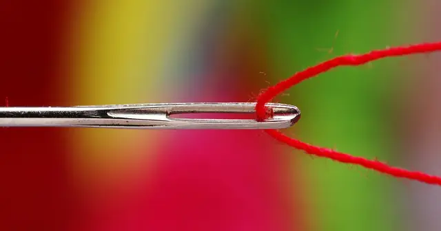

<!-- GENERATED from watch/issues/2026-04-13-personalization-embarrassment.yml by scripts/build_watch.py. Edit the data file. -->

```{=html}
<p class="mw-kicker">Marketing in 3 · Issue 14 · Week of 13 April 2026</p>
<figure class="mw-hero"><picture><source type="image/webp" sizes="(max-width: 900px) 100vw, 900px" srcset="../../images/web/issue-14-personalization-embarrassment-960.webp 960w, ../../images/web/issue-14-personalization-embarrassment-1600.webp 1600w"></picture><figcaption>Some recommendations people would rather not be seen getting. Photo: Ivan Aleksic on Unsplash.</figcaption></figure>
<section class="mw-answer" aria-label="Short answer"><h2>The short answer</h2><p>Yes, when the product is one people would rather not be linked to. Shoppers buying weight-loss medicine rated an online pharmacy 3.02 out of 7 when it greeted them with a personalized refill reminder, against 3.79 without it; for headache pills, personalization made no difference. Students liked a music service less when its &quot;personalized&quot; playlists were called &quot;Tween Party&quot;. The cause was embarrassment, not privacy worries. The fix is to tailor quietly in sensitive categories rather than announce it.</p></section>
<section class="mw-takeaways"><h2>Key takeaways</h2><ul><li>Buying weight-loss medicine, people rated a pharmacy 3.02 out of 7 when it announced a personalized refill, against 3.79 when they found the product themselves.</li><li>For headache medicine, personalization made no difference (4.89 against 4.98).</li><li>Students liked a music service less when it labelled the same songs as a personalized &quot;Tween Party&quot; playlist (4.47 against 5.13), but not as &quot;College Party&quot;.</li><li>Embarrassment, not privacy concern or fear of being identified, explained the drop.</li></ul></section>
<section id="what-the-researchers-did"><h2>What the researchers did</h2><p>Most marketers treat personalization as a safe bet: it saves customers effort and makes offers more relevant. But
every personalized message is also a mirror. It tells customers what the brand knows about them, and sometimes
that is something they would rather not see. Seven in ten Spotify users, the authors note, say they are
embarrassed by their annual &quot;Wrapped&quot; summary.</p><p>John Yi (Le Moyne College) and Caleb Warren (University of Arizona) tested when that mirror backfires, using
three studies with different kinds of personalization: an online pharmacy, a music streaming service and a real
Google display ad campaign. In each, they varied whether the marketing was presented as personalized and whether
it pointed to something people would rather not be associated with.</p>
<dl class="mw-facts"><div><dt>Study 1</dt><dd>398 US adults with a BMI over 30 shopping at a mock online pharmacy for weight-loss or headache medicine</dd></div><div><dt>Study 2</dt><dd>291 US undergraduates using a test music service that recommended playlists</dd></div><div><dt>Study 3</dt><dd>A 12-day Google display ad campaign shown to people who had searched for acne terms: 324,014 impressions</dd></div><div><dt>Measured</dt><dd>Ratings of the business (1 to 7), embarrassment, privacy concern, and clicks in the field</dd></div></dl>
</section>
<section id="the-online-pharmacy"><h2>The online pharmacy</h2><p>Participants returned to an online pharmacy to buy either weight-loss medicine or headache medicine. Half were
greeted with a personalized page: &quot;Based on your last purchase, we think you will need this. It&#x27;s time for your
monthly refill! Personalized recommendations, just for you.&quot; The other half found the product by browsing the
menu.</p><p>For headache medicine, the greeting made no difference. For weight-loss medicine, it backfired: people rated the
pharmacy 3.02 out of 7 with personalization against 3.79 without, even though it saved them clicks. The reason was
embarrassment. Concern about privacy and about being identified did not explain the drop.</p>
<figure class="mw-chart" id="chart-pharmacy"><figcaption class="mw-chart-title">Rating of the online pharmacy, by product and personalization</figcaption><div class="mw-chart-svg"><svg viewBox="0 0 680 194" role="img" aria-labelledby="chart-pharmacy-t" font-family="Hanken Grotesk, Arial, sans-serif"><title id="chart-pharmacy-t">Rating of the online pharmacy, by product and personalization</title><line x1="250.0" y1="4" x2="250.0" y2="168" stroke="#dde1e8" stroke-width="1"/><text x="250.0" y="186" font-size="12" text-anchor="middle" fill="#5b6476">1</text><line x1="310.0" y1="4" x2="310.0" y2="168" stroke="#dde1e8" stroke-width="1"/><text x="310.0" y="186" font-size="12" text-anchor="middle" fill="#5b6476">2</text><line x1="370.0" y1="4" x2="370.0" y2="168" stroke="#dde1e8" stroke-width="1"/><text x="370.0" y="186" font-size="12" text-anchor="middle" fill="#5b6476">3</text><line x1="430.0" y1="4" x2="430.0" y2="168" stroke="#dde1e8" stroke-width="1"/><text x="430.0" y="186" font-size="12" text-anchor="middle" fill="#5b6476">4</text><line x1="490.0" y1="4" x2="490.0" y2="168" stroke="#dde1e8" stroke-width="1"/><text x="490.0" y="186" font-size="12" text-anchor="middle" fill="#5b6476">5</text><line x1="550.0" y1="4" x2="550.0" y2="168" stroke="#dde1e8" stroke-width="1"/><text x="550.0" y="186" font-size="12" text-anchor="middle" fill="#5b6476">6</text><line x1="610.0" y1="4" x2="610.0" y2="168" stroke="#dde1e8" stroke-width="1"/><text x="610.0" y="186" font-size="12" text-anchor="middle" fill="#5b6476">7</text><g><title>Headache pills, browsing: 4.98 out of 7</title><text x="238" y="27" font-size="13.5" text-anchor="end" fill="#15203b">Headache pills, browsing</text><rect x="250" y="12" width="238.8" height="22" rx="4" fill="#aab3c5"/><text x="496.8" y="28" font-size="13.5" fill="#15203b">4.98</text></g><g><title>Headache pills, personalized: 4.89 out of 7</title><text x="238" y="67" font-size="13.5" text-anchor="end" fill="#15203b">Headache pills, personalized</text><rect x="250" y="52" width="233.4" height="22" rx="4" fill="#aab3c5"/><text x="491.4" y="68" font-size="13.5" fill="#15203b">4.89</text></g><g><title>Weight-loss pills, browsing: 3.79 out of 7</title><text x="238" y="107" font-size="13.5" text-anchor="end" fill="#15203b">Weight-loss pills, browsing</text><rect x="250" y="92" width="167.4" height="22" rx="4" fill="#aab3c5"/><text x="425.4" y="108" font-size="13.5" fill="#15203b">3.79</text></g><g><title>Weight-loss pills, personalized: 3.02 out of 7</title><text x="238" y="147" font-size="13.5" text-anchor="end" fill="#15203b" font-weight="600">Weight-loss pills, personalized</text><rect x="250" y="132" width="121.2" height="22" rx="4" fill="#e0a12a"/><text x="379.2" y="148" font-size="13.5" fill="#15203b" font-weight="600">3.02</text></g></svg></div><div class="mw-sr"><table><caption>Rating of the online pharmacy, by product and personalization</caption><tr><th>Group</th><th>Value (out of 7)</th></tr><tr><th scope="row">Headache pills, browsing</th><td>4.98</td></tr><tr><th scope="row">Headache pills, personalized</th><td>4.89</td></tr><tr><th scope="row">Weight-loss pills, browsing</th><td>3.79</td></tr><tr><th scope="row">Weight-loss pills, personalized</th><td>3.02</td></tr></table></div><p class="mw-chart-src">Study 1: 398 US adults with a BMI over 30. Average of attitude, revisit intention and satisfaction.</p></figure>
</section>
<section id="the-playlist-and-the-ad"><h2>The playlist and the ad</h2><p>In the second study, students chose between artists, then saw two recommended playlists with exactly the same
songs. Only the names changed: &quot;Almost Sweet 16&quot; and &quot;Tween Party Music&quot;, or &quot;Almost 21&quot; and &quot;College Party&quot;. When
the service said the playlists were personalized, students liked it less if the names suggested tween taste (4.47
against 5.13 out of 7). With the college names, personalization did no harm.</p><p>The field test ran Google display ads to people who had searched for acne terms. One ad offered &quot;10 ways to fix
your acne&quot;; the other, &quot;10 ways to maintain your perfect skin&quot;. Each said it was either &quot;shown to you based on
your past Google searches&quot; or shown to a random selection of visitors. Saying the acne ad was personalized cut
clicks by 28.5%, while saying the clear-skin ad was personalized raised them by 31%. The difference between these
two patterns was statistically reliable, though each comparison on its own was not, as clicks were very rare.</p>
<figure class="mw-chart" id="chart-clicks"><figcaption class="mw-chart-title">Click-through rate on Google display ads for acne searchers</figcaption><div class="mw-chart-svg"><svg viewBox="0 0 680 194" role="img" aria-labelledby="chart-clicks-t" font-family="Hanken Grotesk, Arial, sans-serif"><title id="chart-clicks-t">Click-through rate on Google display ads for acne searchers</title><line x1="250.0" y1="4" x2="250.0" y2="168" stroke="#dde1e8" stroke-width="1"/><text x="250.0" y="186" font-size="12" text-anchor="middle" fill="#5b6476">0</text><line x1="322.0" y1="4" x2="322.0" y2="168" stroke="#dde1e8" stroke-width="1"/><text x="322.0" y="186" font-size="12" text-anchor="middle" fill="#5b6476">0.02</text><line x1="394.0" y1="4" x2="394.0" y2="168" stroke="#dde1e8" stroke-width="1"/><text x="394.0" y="186" font-size="12" text-anchor="middle" fill="#5b6476">0.04</text><line x1="466.0" y1="4" x2="466.0" y2="168" stroke="#dde1e8" stroke-width="1"/><text x="466.0" y="186" font-size="12" text-anchor="middle" fill="#5b6476">0.06</text><line x1="538.0" y1="4" x2="538.0" y2="168" stroke="#dde1e8" stroke-width="1"/><text x="538.0" y="186" font-size="12" text-anchor="middle" fill="#5b6476">0.08</text><line x1="610.0" y1="4" x2="610.0" y2="168" stroke="#dde1e8" stroke-width="1"/><text x="610.0" y="186" font-size="12" text-anchor="middle" fill="#5b6476">0.1</text><g><title>Clear-skin ad, random: 0.070%</title><text x="238" y="27" font-size="13.5" text-anchor="end" fill="#15203b">Clear-skin ad, random</text><rect x="250" y="12" width="252.0" height="22" rx="4" fill="#aab3c5"/><text x="510.0" y="28" font-size="13.5" fill="#15203b">0.070%</text></g><g><title>Clear-skin ad, personalized: 0.092%</title><text x="238" y="67" font-size="13.5" text-anchor="end" fill="#15203b">Clear-skin ad, personalized</text><rect x="250" y="52" width="331.2" height="22" rx="4" fill="#aab3c5"/><text x="589.2" y="68" font-size="13.5" fill="#15203b">0.092%</text></g><g><title>Acne ad, random: 0.084%</title><text x="238" y="107" font-size="13.5" text-anchor="end" fill="#15203b">Acne ad, random</text><rect x="250" y="92" width="302.4" height="22" rx="4" fill="#aab3c5"/><text x="560.4" y="108" font-size="13.5" fill="#15203b">0.084%</text></g><g><title>Acne ad, personalized: 0.060%</title><text x="238" y="147" font-size="13.5" text-anchor="end" fill="#15203b" font-weight="600">Acne ad, personalized</text><rect x="250" y="132" width="216.0" height="22" rx="4" fill="#e0a12a"/><text x="474.0" y="148" font-size="13.5" fill="#15203b" font-weight="600">0.060%</text></g></svg></div><div class="mw-sr"><table><caption>Click-through rate on Google display ads for acne searchers</caption><tr><th>Group</th><th>Value (%)</th></tr><tr><th scope="row">Clear-skin ad, random</th><td>0.07</td></tr><tr><th scope="row">Clear-skin ad, personalized</th><td>0.092</td></tr><tr><th scope="row">Acne ad, random</th><td>0.084</td></tr><tr><th scope="row">Acne ad, personalized</th><td>0.06</td></tr></table></div><p class="mw-chart-src">Study 3: 324,014 impressions and 249 clicks over 12 days in December 2020.</p></figure>
</section>
<section id="beyond-the-pharmacy-shelf"><h2>Beyond the pharmacy shelf</h2><p>The study tested medicine, music and skin care, but the risk applies to any category people do not want reflected
back at them. My reading, not tested in the paper, is that this includes debt and payday loans, hair loss, hearing
aids and incontinence, alcohol, gambling, dating, diet products and guilty-pleasure viewing, and also year-in-review
recaps, &quot;because you watched&quot; rows and named email subject lines that can be seen on a lock screen.</p><p>The flip side matters too. Personalization that points to an identity people are proud of, healthy, stylish or
green, can work in your favour, as the clear-skin ad suggests. The question is not whether to personalize, but
when to say so.</p>
</section>
<section id="how-to-apply-it" class="mw-howto"><p class="mw-rsg-kicker">Marketing in 3 steps</p><h2>Ready. Set. Market.</h2><div class="mw-rsg"><div class="mw-phase"><div class="mw-phase-dot" aria-hidden="true">1</div><div class="mw-phase-tag"><span class="mw-phase-name">Ready</span><span class="mw-phase-sub">Decide and prepare</span></div><ul class="mw-rsg-steps"><li><strong>List your sensitive categories.</strong> Go through your range and flag the products, content and services customers might not want reflected back: weight, skin, age-related needs, money trouble, alcohol, guilty pleasures.</li><li><strong>Separate tailoring from telling.</strong> In the studies, the harm came from telling people the offer was personalized. Decide, category by category, where you will personalize openly and where you will tailor quietly.</li></ul></div><div class="mw-phase"><div class="mw-phase-dot" aria-hidden="true">2</div><div class="mw-phase-tag"><span class="mw-phase-name">Set</span><span class="mw-phase-sub">Build it</span></div><ul class="mw-rsg-steps"><li><strong>Drop the &quot;just for you&quot; labels.</strong> In sensitive categories, show tailored items under neutral headings such as &quot;new&quot;, &quot;popular&quot; or &quot;trending&quot; instead of &quot;Top picks for you&quot; or &quot;Based on your last purchase&quot;.</li><li><strong>Keep names and history out of sight.</strong> Avoid first names and purchase references in sensitive messages, and think about where they appear, such as email subject lines and phone notifications others can see.</li></ul></div><div class="mw-phase"><div class="mw-phase-dot" aria-hidden="true">3</div><div class="mw-phase-tag"><span class="mw-phase-name">Market</span><span class="mw-phase-sub">Launch and measure</span></div><ul class="mw-rsg-steps"><li><strong>Watch for quiet exits.</strong> As the authors suggest, monitor sessions that end or customers who unsubscribe right after a personalized offer in a sensitive category, and A/B test labelled against unlabelled versions.</li><li><strong>Stay honest when asked.</strong> Not shouting &quot;just for you&quot; is different from hiding personalization. Keep &quot;why am I seeing this&quot; explanations truthful, and never claim an offer is not personalized when it is.</li></ul></div></div></section>
<div class="mw-coffee" role="complementary" aria-label="Support Marketing in 3"><div class="mw-coffee-text"><p class="mw-coffee-title">Found this useful?</p><p>Marketing in 3 is free, weekly and ad-free. A coffee keeps it that way.</p></div><a class="mw-coffee-btn" href="https://ko-fi.com/marketingin3" target="_blank" rel="noopener"><svg aria-hidden="true" focusable="false"
  class="lucide lucide-coffee"
  xmlns="http://www.w3.org/2000/svg"
  width="24"
  height="24"
  viewBox="0 0 24 24"
  fill="none"
  stroke="currentColor"
  stroke-width="2"
  stroke-linecap="round"
  stroke-linejoin="round"
>
  <path d="M10 2v2" />
  <path d="M14 2v2" />
  <path d="M16 8a1 1 0 0 1 1 1v8a4 4 0 0 1-4 4H7a4 4 0 0 1-4-4V9a1 1 0 0 1 1-1h14a4 4 0 1 1 0 8h-1" />
  <path d="M6 2v2" />
</svg><span>Buy me a coffee</span><span class="mw-coffee-price">€3</span></a></div>
<section id="what-to-expect"><h2>What to expect</h2><ul class="mw-list"><li><strong>No penalty in neutral categories.</strong> Personalized service for headache medicine, and &quot;College Party&quot; playlists, did no harm.</li><li><strong>A clear drop in sensitive ones.</strong> Ratings of the pharmacy fell by about three-quarters of a point on a 7-point scale for weight-loss medicine.</li><li><strong>A possible boost for flattering identities.</strong> The personalized clear-skin ad drew 31% more clicks, though that result was only marginally reliable.</li><li><strong>Privacy fixes will not solve it.</strong> In Study 1 the drop came from embarrassment, not privacy concern, so better data policies alone will not help.</li></ul></section>
<section id="where-it-does-not-work"><h2>Where it does not work</h2><ul class="mw-list"><li><strong>Mostly imagined or lab settings.</strong> Two of the three studies used simulated shopping or a test service, with US adults and students.</li><li><strong>Little real benefit from personalization.</strong> The personalized versions saved at most a click or two, so the studies do not show what happens when personalization offers real value.</li><li><strong>A weak field signal.</strong> The ads drew only 249 clicks from 324,014 impressions, and the individual comparisons were not statistically reliable.</li><li><strong>Some effects were marginal.</strong> In Study 1 the overall interaction just missed the usual significance threshold, though the weight-loss comparison itself was clear.</li></ul></section>
<section id="questions"><h2>Questions marketers ask</h2><div class="mw-faq"><h3>Can personalized marketing backfire?</h3><p>Yes. In a 2026 Journal of Interactive Marketing study, people buying weight-loss medicine rated an online pharmacy lower when it showed a personalized refill reminder (3.02 against 3.79 out of 7), because it embarrassed them. For headache medicine, personalization made no difference (<a class="mw-orcid-link" href="https://orcid.org/0000-0002-0473-0129" title="John J. Yi on ORCID">Yi</a> and Warren, 2026).</p></div><div class="mw-faq"><h3>Why does personalization sometimes feel uncomfortable?</h3><p>Besides privacy worries, personalized marketing can remind people of something about themselves they would rather not see, such as a health condition or a taste they are embarrassed by. That embarrassment makes them like the brand less.</p></div><div class="mw-faq"><h3>Should brands stop personalizing for sensitive products?</h3><p>Not necessarily. The authors suggest still tailoring offers but not announcing it, for example showing items under &quot;trending&quot; rather than &quot;picked for you&quot;, while never claiming that an offer is not personalized.</p></div><div class="mw-faq"><h3>Does saying an ad is personalized change click-through rates?</h3><p>In a field test with acne searchers, saying an acne ad was personalized cut clicks by 28.5%, while saying a clear-skin ad was personalized raised them by 31%. Clicks were rare, so these figures are indicative.</p></div><div class="mw-faq"><h3>Is the problem with personalization just privacy?</h3><p>No. In the pharmacy study, embarrassment explained the drop in evaluations, while privacy concern and perceived anonymity did not.</p></div></section>
<section id="also-new"><h2>Also new this week</h2><div class="mw-also"><article><p class="mw-also-src"><em>International Journal of Research in Marketing</em> · 2026</p><h3><a href="https://doi.org/10.1016/j.ijresmar.2025.03.002">The impact of the General Data Protection Regulation (GDPR) on online tracking</a></h3><p class="mw-also-au">Miller, K. M., Lukic, K., &amp; Skiera, B.</p><p>Tracking 294 publishers over 32 months, the authors find that online tracking grew everywhere after 2018, but less for EU publishers covered by the GDPR: about four fewer trackers per publisher, a 14.8% reduction. The cut came mostly from privacy-invasive trackers that collect and share personal data, while advertising trackers were barely affected. Regulation has trimmed the riskiest data flows, not ad tracking as a whole.</p></article></div></section>
<section id="source" class="mw-source"><h2>Source</h2><p class="mw-cite"><a class="mw-orcid-link" href="https://orcid.org/0000-0002-0473-0129" title="John J. Yi on ORCID">Yi, J. J.</a>, &amp; Warren, C. (2026). Uncomfortably yours: When personalization repels customers. <em>Journal of Interactive Marketing</em>, <em>61</em>(3), 275–290. <a href="https://doi.org/10.1177/10949968251397987">https://doi.org/10.1177/10949968251397987</a></p><p class="mw-note">This brief is written for practitioners from the published article. Numbers are as reported by the authors; read the article for full methods.</p></section>

<section id="keep-reading" class="mw-more"><h2>Keep reading</h2><p class="mw-more-topics">More issues on <a href="../../topics/personalization.html">Personalization</a> · <a href="../../topics/privacy.html">Privacy</a> · <a href="../../topics/retail.html">Retail</a></p><div class="watch-list"><article class="watch-item"><a class="watch-thumb" href="../../posts/personalization-meta-analysis/index.html" tabindex="-1" aria-hidden="true"></a><div><p class="watch-meta">Issue 28 · Week of <time datetime="2026-07-20">20 July 2026</time></p><h3><a href="../../posts/personalization-meta-analysis/index.html">Personalization works. Half-hearted does not.</a></h3><p>A meta-analysis of 1,536 results from 290 studies finds personalization lifts responses with almost no backlash. Moderate levels do worst.</p></div></article><article class="watch-item"><a class="watch-thumb" href="../../posts/cart-abandonment/index.html" tabindex="-1" aria-hidden="true"></a><div><p class="watch-meta">Issue 6 · Week of <time datetime="2026-02-16">16 February 2026</time></p><h3><a href="../../posts/cart-abandonment/index.html">Treats in the cart, guilt at checkout</a></h3><p>Carts with more indulgent items are abandoned more often. Recommending a practical add-on cut abandonment from 4.61 to 3.64 out of 7. Here is how to use it.</p></div></article><article class="watch-item"><a class="watch-thumb" href="../../posts/ar-previews-product-returns/index.html" tabindex="-1" aria-hidden="true"></a><div><p class="watch-meta">Issue 38 · Week of <time datetime="2026-09-28">28 September 2026</time></p><h3><a href="../../posts/ar-previews-product-returns/index.html">AR try-ons can raise returns when the product disappoints</a></h3><p>In four experiments, AR try-on previews raised return intentions after a flawed product arrived. Positive reviews and realistic rendering reduced the effect.</p></div></article></div></section>
<div class="mw-author"><div><p><strong>Bruno Schivinski</strong> is Associate Professor of Marketing at Gdańsk University of Technology. He studies how consumers engage with brands in digital and social media.</p><p><a href="../../../index.html">About Bruno</a> · <a href="../../index.html">All Marketing in 3 issues</a> · <a href="../../subscribe.html">Subscribe</a></p></div></div>
<nav class="mw-pn" aria-label="More issues"><a class="mw-prev" href="../contextual-advertising-attention/index.html"><span>Previous issue</span>Match ads to pages by look, not just by topic</a><a class="mw-next" href="../human-or-ai-service/index.html"><span>Next issue</span>When the front line all looks alike, some customers choose the bot</a></nav>
```
