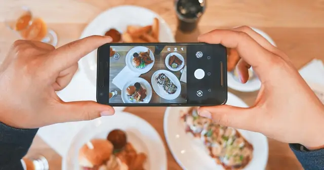

<!-- GENERATED from watch/issues/2024-01-23-religion-city-branding.yml by scripts/build_watch.py. Edit the data file. -->

```{=html}
<p class="mw-kicker">Marketing in 3 · <a href="../../2024/index.html">2024 in research</a> · No. 4 · Paper published 23 January 2024</p>
<figure class="mw-hero"><picture><source type="image/webp" sizes="(max-width: 900px) 100vw, 900px" srcset="../../images/web/2024-religion-city-branding-960.webp 960w, ../../images/web/2024-religion-city-branding-1600.webp 1600w"></picture><figcaption>Makkah by night: faith is built into the skyline, and into the posts that promote a city. Photo: Rushdi Fatani on Unsplash.</figcaption></figure>
<section class="mw-answer" aria-label="Short answer"><h2>The short answer</h2><div class="mw-ans-grid"><p>It helps people approve, more than it gets them talking. We analysed 1,253 posts from Saudi government accounts promoting the 2019 Jeddah and Riyadh festival seasons on Twitter, Facebook and Instagram. Religion ran through them, in buildings, events and beliefs. Residents answered with likes and shares, above all for posts about what the cities offer and what they stand for. Comments, the deeper kind of engagement, stayed rare on every platform.</p><div class="mw-ev" role="note" aria-label="Evidence level: 1 of 3 stars, one study"><span class="ev-k">Evidence level</span><ol><li class="on"><span class="ev-s" aria-hidden="true"><b>★</b><i>★</i><i>★</i></span>One study</li><li><span class="ev-s" aria-hidden="true"><b>★</b><b>★</b><i>★</i></span>Several studies</li><li><span class="ev-s" aria-hidden="true"><b>★</b><b>★</b><b>★</b></span>Meta-analysis</li></ol></div></div></section>
<section class="mw-takeaways"><h2>Key takeaways</h2><ul><li>Of all the government posts, 53% sold the cities on what they offer, such as events, transport and clean streets, and 32% on their character; just 15% were about how the cities look.</li><li>Every kind of post scored at least 2.0 on the engagement index on Twitter, while on Facebook nothing went above 0.9.</li><li>Comments barely registered: the comment index never passed 0.4 on any platform, and on Twitter it sat at 0.1 or 0.2.</li><li>Religion travelled inside events: one government competition, built on the Prophet&#x27;s call to teach children swimming, archery and horse riding, offered more than US$300,000 in prizes.</li></ul></section>
<section id="what-we-did"><h2>What we did</h2><p>Xiufang (Leah) Li, <a class="mw-orcid-link" href="https://orcid.org/0000-0003-4287-9810" title="Abdullah Alahmari on ORCID">Abdullah Alahmari</a> and I were colleagues at Melbourne&#x27;s RMIT University, in its media and
communication school. Abdullah, also affiliated with the Islamic University of Madinah, curated and analysed the data. Our
starting point was simple. In Saudi Arabia, faith shapes daily life and public policy, so any attempt to brand a Saudi
city has to reckon with it. Yet research on religion and place branding had mostly looked at mosques and other
buildings, not at how faith might get residents involved in promoting the place they live in.</p><p>We took the Saudi Seasons, a state-run programme of city festivals launched in 2019, as our case. Two cities stood out.
Jeddah, on the Red Sea, is the city many pilgrims pass through on their way to Makkah and Medina. Riyadh is the
capital, home to more than six million people. For each city&#x27;s season we gathered the government&#x27;s festival posts on
three platforms, together with the likes, shares and comments that residents left on them.</p><p>We asked three things. How did the government use religion in those posts? How did residents respond? And what does
that mean for giving residents a real voice in their city&#x27;s brand?</p>
<dl class="mw-facts"><div><dt>Festivals</dt><dd>Jeddah Season, 8 June to 18 July 2019; Riyadh Season, 11 October to 30 December 2019</dd></div><div><dt>Data</dt><dd>1,253 Arabic text posts from government accounts on the three platforms, with residents&#x27; reactions, bought from a social media data provider</dd></div><div><dt>Coding</dt><dd>Three sides of a city brand: physical (how it looks), functional (what it offers) and personality (its character, values and beliefs), each split into five or six categories</dd></div><div><dt>Reliability</dt><dd>Two trained coders, both native Arabic speakers; agreement of 0.86 on Holsti&#x27;s measure in a 313-post check, above the usual 0.80 bar</dd></div><div><dt>Engagement</dt><dd>Likes (popularity), shares (virality) and comments (commitment) per post for every 1,000 followers, added together into one engagement index</dd></div><div><dt>Ethics</dt><dd>Approved by RMIT University&#x27;s College Human Ethics Advisory Network</dd></div></dl>
</section>
<section id="faith-inside-the-event-calendar"><h2>Faith inside the event calendar</h2><p>Faith was not a separate strand of the campaign. It ran through all three sides of the city brand. Posts about
the cities&#x27; looks showed off historic Islamic buildings and the Arabic calligraphy that decorates mosques, an art form
tied to the teachings of the Qur&#x27;an. On the practical side, posts promoted Qur&#x27;an memorisation activities and a
contest for the most beautiful recitation, next to outdoor entertainment, community centres and new roads built to
ease the traffic that kept people away from events.</p><p>Posts about the cities&#x27; character went further. When a solar eclipse fell during the festivals, the government
postponed events and asked residents to pray in mosques until it ended, as Islam requires. It then apologised and
offered accommodation to people whose plans had been disrupted. Other posts urged residents to thank God for what
the cities&#x27; growth had brought them.</p><p>As the chart shows, one category towered over the rest. Cultural activities were the backbone of the festival
story, and the Qur&#x27;an activities described above were among them.</p>
<figure class="mw-chart" id="chart-topics"><figcaption class="mw-chart-title">What the government posted about: the seven biggest categories (number of posts)</figcaption><div class="mw-chart-svg"><svg viewBox="0 0 680 314" role="img" aria-labelledby="chart-topics-t" font-family="Hanken Grotesk, Arial, sans-serif"><title id="chart-topics-t">What the government posted about: the seven biggest categories (number of posts)</title><line x1="250.0" y1="4" x2="250.0" y2="288" stroke="#dde1e8" stroke-width="1"/><text x="250.0" y="306" font-size="12" text-anchor="middle" fill="#5b6476">0</text><line x1="370.0" y1="4" x2="370.0" y2="288" stroke="#dde1e8" stroke-width="1"/><text x="370.0" y="306" font-size="12" text-anchor="middle" fill="#5b6476">200</text><line x1="490.0" y1="4" x2="490.0" y2="288" stroke="#dde1e8" stroke-width="1"/><text x="490.0" y="306" font-size="12" text-anchor="middle" fill="#5b6476">400</text><line x1="610.0" y1="4" x2="610.0" y2="288" stroke="#dde1e8" stroke-width="1"/><text x="610.0" y="306" font-size="12" text-anchor="middle" fill="#5b6476">600</text><g><title>Cultural activities: 535 </title><text x="238" y="27" font-size="13.5" text-anchor="end" fill="#15203b" font-weight="600">Cultural activities</text><rect x="250" y="12" width="321.0" height="22" rx="4" fill="#e0a12a"/><text x="579.0" y="28" font-size="13.5" fill="#15203b" font-weight="600">535</text></g><g><title>City brand attitudes: 193 </title><text x="238" y="67" font-size="13.5" text-anchor="end" fill="#15203b">City brand attitudes</text><rect x="250" y="52" width="115.8" height="22" rx="4" fill="#aab3c5"/><text x="373.8" y="68" font-size="13.5" fill="#15203b">193</text></g><g><title>Social bonding and community: 132 </title><text x="238" y="107" font-size="13.5" text-anchor="end" fill="#15203b">Social bonding and community</text><rect x="250" y="92" width="79.2" height="22" rx="4" fill="#aab3c5"/><text x="337.2" y="108" font-size="13.5" fill="#15203b">132</text></g><g><title>Café design: 88 </title><text x="238" y="147" font-size="13.5" text-anchor="end" fill="#15203b">Café design</text><rect x="250" y="132" width="52.8" height="22" rx="4" fill="#aab3c5"/><text x="310.8" y="148" font-size="13.5" fill="#15203b">88</text></g><g><title>Clean environment: 67 </title><text x="238" y="187" font-size="13.5" text-anchor="end" fill="#15203b">Clean environment</text><rect x="250" y="172" width="40.2" height="22" rx="4" fill="#aab3c5"/><text x="298.2" y="188" font-size="13.5" fill="#15203b">67</text></g><g><title>Religious architecture: 54 </title><text x="238" y="227" font-size="13.5" text-anchor="end" fill="#15203b">Religious architecture</text><rect x="250" y="212" width="32.4" height="22" rx="4" fill="#aab3c5"/><text x="290.4" y="228" font-size="13.5" fill="#15203b">54</text></g><g><title>Religious beliefs: 45 </title><text x="238" y="267" font-size="13.5" text-anchor="end" fill="#15203b">Religious beliefs</text><rect x="250" y="252" width="27.0" height="22" rx="4" fill="#aab3c5"/><text x="285.0" y="268" font-size="13.5" fill="#15203b">45</text></g></svg></div><div class="mw-sr"><table><caption>What the government posted about: the seven biggest categories (number of posts)</caption><tr><th>Group</th><th>Value ()</th></tr><tr><th scope="row">Cultural activities</th><td>535</td></tr><tr><th scope="row">City brand attitudes</th><td>193</td></tr><tr><th scope="row">Social bonding and community</th><td>132</td></tr><tr><th scope="row">Café design</th><td>88</td></tr><tr><th scope="row">Clean environment</th><td>67</td></tr><tr><th scope="row">Religious architecture</th><td>54</td></tr><tr><th scope="row">Religious beliefs</th><td>45</td></tr></table></div><p class="mw-chart-src">Content analysis of 1,253 government posts across all three platforms, both 2019 festival seasons; counts summed from Table 2 of the article.</p></figure>
</section>
<section id="likes-and-shares-but-little-talk"><h2>Likes and shares, but little talk</h2><p>Residents did respond. They engaged most with posts about entertainment and cultural events, and with posts about
social bonds, religious values and beliefs. But they responded in a particular way. The bulk of the engagement came
from liking and sharing. Commenting, which asks a person to put their own words in public under a government post,
hardly happened.</p><p>That matters, because not all engagement is equal. Engagement researchers treat a comment as a deeper step than a
like: it is how a follower turns into a participant. A like says yes. A comment opens a conversation.</p><p>We think the silence has a context. Saudi Arabia has rules on speech that restrict material seen as breaching Islamic
law or harming national security, and there have been government efforts to monitor what is said online. Where
speaking up carries risk, people may choose the quieter signals. Our data cannot prove that link, but it fits what
earlier research says about how unequal power between government and citizens holds back resident involvement.</p>
<figure class="mw-chart" id="chart-modes"><figcaption class="mw-chart-title">Likes, shares and comments on Twitter posts about what each city offers (index scaled to followers)</figcaption><div class="mw-chart-svg"><svg viewBox="0 0 680 274" role="img" aria-labelledby="chart-modes-t" font-family="Hanken Grotesk, Arial, sans-serif"><title id="chart-modes-t">Likes, shares and comments on Twitter posts about what each city offers (index scaled to followers)</title><line x1="250.0" y1="4" x2="250.0" y2="248" stroke="#dde1e8" stroke-width="1"/><text x="250.0" y="266" font-size="12" text-anchor="middle" fill="#5b6476">0</text><line x1="322.0" y1="4" x2="322.0" y2="248" stroke="#dde1e8" stroke-width="1"/><text x="322.0" y="266" font-size="12" text-anchor="middle" fill="#5b6476">0.5</text><line x1="394.0" y1="4" x2="394.0" y2="248" stroke="#dde1e8" stroke-width="1"/><text x="394.0" y="266" font-size="12" text-anchor="middle" fill="#5b6476">1</text><line x1="466.0" y1="4" x2="466.0" y2="248" stroke="#dde1e8" stroke-width="1"/><text x="466.0" y="266" font-size="12" text-anchor="middle" fill="#5b6476">1.5</text><line x1="538.0" y1="4" x2="538.0" y2="248" stroke="#dde1e8" stroke-width="1"/><text x="538.0" y="266" font-size="12" text-anchor="middle" fill="#5b6476">2</text><line x1="610.0" y1="4" x2="610.0" y2="248" stroke="#dde1e8" stroke-width="1"/><text x="610.0" y="266" font-size="12" text-anchor="middle" fill="#5b6476">2.5</text><g><title>Jeddah: likes: 2.0 </title><text x="238" y="27" font-size="13.5" text-anchor="end" fill="#15203b" font-weight="600">Jeddah: likes</text><rect x="250" y="12" width="288.0" height="22" rx="4" fill="#e0a12a"/><text x="546.0" y="28" font-size="13.5" fill="#15203b" font-weight="600">2.0</text></g><g><title>Jeddah: shares: 0.6 </title><text x="238" y="67" font-size="13.5" text-anchor="end" fill="#15203b">Jeddah: shares</text><rect x="250" y="52" width="86.4" height="22" rx="4" fill="#aab3c5"/><text x="344.4" y="68" font-size="13.5" fill="#15203b">0.6</text></g><g><title>Jeddah: comments: 0.1 </title><text x="238" y="107" font-size="13.5" text-anchor="end" fill="#15203b">Jeddah: comments</text><rect x="250" y="92" width="14.4" height="22" rx="4" fill="#aab3c5"/><text x="272.4" y="108" font-size="13.5" fill="#15203b">0.1</text></g><g><title>Riyadh: likes: 1.7 </title><text x="238" y="147" font-size="13.5" text-anchor="end" fill="#15203b" font-weight="600">Riyadh: likes</text><rect x="250" y="132" width="244.8" height="22" rx="4" fill="#e0a12a"/><text x="502.8" y="148" font-size="13.5" fill="#15203b" font-weight="600">1.7</text></g><g><title>Riyadh: shares: 0.8 </title><text x="238" y="187" font-size="13.5" text-anchor="end" fill="#15203b">Riyadh: shares</text><rect x="250" y="172" width="115.2" height="22" rx="4" fill="#aab3c5"/><text x="373.2" y="188" font-size="13.5" fill="#15203b">0.8</text></g><g><title>Riyadh: comments: 0.1 </title><text x="238" y="227" font-size="13.5" text-anchor="end" fill="#15203b">Riyadh: comments</text><rect x="250" y="212" width="14.4" height="22" rx="4" fill="#aab3c5"/><text x="272.4" y="228" font-size="13.5" fill="#15203b">0.1</text></g></svg></div><div class="mw-sr"><table><caption>Likes, shares and comments on Twitter posts about what each city offers (index scaled to followers)</caption><tr><th>Group</th><th>Value ()</th></tr><tr><th scope="row">Jeddah: likes</th><td>2.0</td></tr><tr><th scope="row">Jeddah: shares</th><td>0.6</td></tr><tr><th scope="row">Jeddah: comments</th><td>0.1</td></tr><tr><th scope="row">Riyadh: likes</th><td>1.7</td></tr><tr><th scope="row">Riyadh: shares</th><td>0.8</td></tr><tr><th scope="row">Riyadh: comments</th><td>0.1</td></tr></table></div><p class="mw-chart-src">Government Twitter accounts for Jeddah (139,000 followers) and Riyadh (320,000) during their festival seasons; Table 3.</p></figure>
</section>
<section id="twitter-was-the-main-stage"><h2>Twitter was the main stage</h2><p>Most of the interaction between government and residents took place on Twitter, with Instagram second and Facebook a
distant third. That ordering held for both cities and for every side of the brand.</p><p>The index is already scaled to followers, so the gap is not simply a matter of bigger audiences. Jeddah&#x27;s Twitter and
Instagram accounts had similar followings, about 139,000 and 129,000, yet Twitter drew more engagement on every type of
post. The simpler explanation is where people were. At the time, over 90% of people in Saudi Arabia used social media,
and Twitter was the country&#x27;s most popular network.</p>
<figure class="mw-chart" id="chart-platforms"><figcaption class="mw-chart-title">Engagement with posts about each city&#x27;s character, values and beliefs, by platform (engagement index)</figcaption><div class="mw-chart-svg"><svg viewBox="0 0 680 274" role="img" aria-labelledby="chart-platforms-t" font-family="Hanken Grotesk, Arial, sans-serif"><title id="chart-platforms-t">Engagement with posts about each city&#x27;s character, values and beliefs, by platform (engagement index)</title><line x1="250.0" y1="4" x2="250.0" y2="248" stroke="#dde1e8" stroke-width="1"/><text x="250.0" y="266" font-size="12" text-anchor="middle" fill="#5b6476">0</text><line x1="370.0" y1="4" x2="370.0" y2="248" stroke="#dde1e8" stroke-width="1"/><text x="370.0" y="266" font-size="12" text-anchor="middle" fill="#5b6476">1</text><line x1="490.0" y1="4" x2="490.0" y2="248" stroke="#dde1e8" stroke-width="1"/><text x="490.0" y="266" font-size="12" text-anchor="middle" fill="#5b6476">2</text><line x1="610.0" y1="4" x2="610.0" y2="248" stroke="#dde1e8" stroke-width="1"/><text x="610.0" y="266" font-size="12" text-anchor="middle" fill="#5b6476">3</text><g><title>Twitter, Riyadh: 2.2 </title><text x="238" y="27" font-size="13.5" text-anchor="end" fill="#15203b" font-weight="600">Twitter, Riyadh</text><rect x="250" y="12" width="264.0" height="22" rx="4" fill="#e0a12a"/><text x="522.0" y="28" font-size="13.5" fill="#15203b" font-weight="600">2.2</text></g><g><title>Twitter, Jeddah: 2.1 </title><text x="238" y="67" font-size="13.5" text-anchor="end" fill="#15203b" font-weight="600">Twitter, Jeddah</text><rect x="250" y="52" width="252.0" height="22" rx="4" fill="#e0a12a"/><text x="510.0" y="68" font-size="13.5" fill="#15203b" font-weight="600">2.1</text></g><g><title>Instagram, Jeddah: 2.0 </title><text x="238" y="107" font-size="13.5" text-anchor="end" fill="#15203b">Instagram, Jeddah</text><rect x="250" y="92" width="240.0" height="22" rx="4" fill="#aab3c5"/><text x="498.0" y="108" font-size="13.5" fill="#15203b">2.0</text></g><g><title>Instagram, Riyadh: 1.5 </title><text x="238" y="147" font-size="13.5" text-anchor="end" fill="#15203b">Instagram, Riyadh</text><rect x="250" y="132" width="180.0" height="22" rx="4" fill="#aab3c5"/><text x="438.0" y="148" font-size="13.5" fill="#15203b">1.5</text></g><g><title>Facebook, Riyadh: 0.7 </title><text x="238" y="187" font-size="13.5" text-anchor="end" fill="#15203b">Facebook, Riyadh</text><rect x="250" y="172" width="84.0" height="22" rx="4" fill="#aab3c5"/><text x="342.0" y="188" font-size="13.5" fill="#15203b">0.7</text></g><g><title>Facebook, Jeddah: 0.6 </title><text x="238" y="227" font-size="13.5" text-anchor="end" fill="#15203b">Facebook, Jeddah</text><rect x="250" y="212" width="72.0" height="22" rx="4" fill="#aab3c5"/><text x="330.0" y="228" font-size="13.5" fill="#15203b">0.6</text></g></svg></div><div class="mw-sr"><table><caption>Engagement with posts about each city&#x27;s character, values and beliefs, by platform (engagement index)</caption><tr><th>Group</th><th>Value ()</th></tr><tr><th scope="row">Twitter, Riyadh</th><td>2.2</td></tr><tr><th scope="row">Twitter, Jeddah</th><td>2.1</td></tr><tr><th scope="row">Instagram, Jeddah</th><td>2.0</td></tr><tr><th scope="row">Instagram, Riyadh</th><td>1.5</td></tr><tr><th scope="row">Facebook, Riyadh</th><td>0.7</td></tr><tr><th scope="row">Facebook, Jeddah</th><td>0.6</td></tr></table></div><p class="mw-chart-src">Index = likes + shares + comments per post, per 1,000 followers. Government accounts in both cities, 2019; Table 3.</p></figure>
</section>
<section id="the-missing-comments-are-the-real-story-in-my-view"><h2>The missing comments are the real story, in my view</h2><p>This is my reading, not something the study measured. In digital marketing we still treat likes and shares as proof
that content works. Our data show how much that can hide. The government reached residents through faith and
festivals, and residents clearly approved. Yet almost nobody used the one tool that turns an audience into partners:
the reply.</p><p>I see the same pattern far beyond city branding. Brands lean on values, from sustainability to national pride, and
collect quick approval for it. A post built on shared values is easy to like and awkward to question in public,
especially where speaking up feels risky. So a thin comment section is a poor gauge of what people really think, and
a weak basis for any claim that a brand is being built together with its audience.</p><p>What would I tell a city or a brand today? Keep the values, but wrap them in something people can use, and make
answering feel safe: polls, private messages, smaller groups, and a team that actually replies. Platforms change too.
Twitter, where our residents were busiest, has since become X, so the lesson is to go where your people already talk,
not to bet on one network.</p>
</section>
<section id="how-to-apply-it" class="mw-howto"><p class="mw-rsg-kicker">Marketing in 3 steps</p><h2>Ready. Set. Market.</h2><div class="mw-rsg"><div class="mw-phase"><div class="mw-phase-dot" aria-hidden="true">1</div><div class="mw-phase-tag"><span class="mw-phase-name">Ready</span><span class="mw-phase-sub">Decide and prepare</span></div><ul class="mw-rsg-steps"><li><strong>Name the values your audience shares.</strong> Write down three to five beliefs, traditions or local values that most of your audience holds in common. Check each one with ten people from that community before you build anything on it.</li><li><strong>Choose the network where they already talk.</strong> Look at the last 30 days on each of your accounts. Divide the average reactions per post by the number of followers, and put most of your effort where that figure is highest.</li></ul></div><div class="mw-phase"><div class="mw-phase-dot" aria-hidden="true">2</div><div class="mw-phase-tag"><span class="mw-phase-name">Set</span><span class="mw-phase-sub">Build it</span></div><ul class="mw-rsg-steps"><li><strong>Put the values inside useful posts.</strong> Tie each value to something people can use: an event, a service, a new route, a cleaner park. Make about half your posts about what you offer. Keep posts that carry only a message, with nothing to do or attend, to about one in ten.</li><li><strong>Make every post easy to answer.</strong> End each post with one simple question or a two-option poll. Offer a private route as well, such as direct messages or a short form, for people who would rather not speak in public.</li></ul></div><div class="mw-phase"><div class="mw-phase-dot" aria-hidden="true">3</div><div class="mw-phase-tag"><span class="mw-phase-name">Market</span><span class="mw-phase-sub">Launch and measure</span></div><ul class="mw-rsg-steps"><li><strong>Reply within a day.</strong> Answer every comment and question within 24 hours, in the language it was written in. Thank people by name and say what you will do with their idea.</li><li><strong>Count comments apart from likes.</strong> Each month, log likes, shares and comments per post as three separate numbers. If likes climb but comments stay flat, change how you ask, not what you stand for.</li></ul></div></div></section>
<div class="mw-coffee" role="complementary" aria-label="Support Marketing in 3"><div class="mw-coffee-text"><p class="mw-coffee-title">Found this useful?</p><p>Marketing in 3 is free and ad-free, with new issues every Monday and Thursday. A coffee keeps it that way.</p></div><a class="mw-coffee-btn" href="https://ko-fi.com/marketingin3" target="_blank" rel="noopener"><svg aria-hidden="true" focusable="false"
  class="lucide lucide-coffee"
  xmlns="http://www.w3.org/2000/svg"
  width="24"
  height="24"
  viewBox="0 0 24 24"
  fill="none"
  stroke="currentColor"
  stroke-width="2"
  stroke-linecap="round"
  stroke-linejoin="round"
>
  <path d="M10 2v2" />
  <path d="M14 2v2" />
  <path d="M16 8a1 1 0 0 1 1 1v8a4 4 0 0 1-4 4H7a4 4 0 0 1-4-4V9a1 1 0 0 1 1-1h14a4 4 0 1 1 0 8h-1" />
  <path d="M6 2v2" />
</svg><span>Buy me a coffee</span><span class="mw-coffee-price">€3</span></a></div>
<form class="mw-email mw-email-inline" action="https://qewbdm3gpjxh42mawu5n6ac37m0hlcgm.lambda-url.ap-southeast-2.on.aws/subscribe" method="post"><div class="mw-email-text"><p class="mw-email-title">Get it by email</p><p>New issues every Monday and Thursday, in your inbox. Free, no ads, unsubscribe anytime.</p></div><div class="mw-email-row"><label class="visually-hidden" for="m3-email-inline">Email address</label><input id="m3-email-inline" type="email" name="email" required autocomplete="email" inputmode="email" placeholder="you@example.com" maxlength="254"><input class="mw-hp" type="text" name="website" tabindex="-1" autocomplete="off" aria-hidden="true"><input type="hidden" name="source" value=""><button type="submit">Subscribe</button></div><p class="mw-email-status" role="status" aria-live="polite"></p><p class="mw-email-note">Your address is used only to send Marketing in 3. You will get one email to confirm.</p></form><script>(function(){if(window.m3Email)return;window.m3Email=1;
var M={"check": "Almost done. Check your inbox for an email from issues@marketingin3.com and tap the link to confirm.", "invalid": "That email address does not look right. Please check it and try again.", "slow": "Too many tries in a short time. Please wait a few minutes and try again.", "busy": "Too many tries in a short time. Please wait a few minutes and try again.", "error": "Something went wrong. Please try again in a moment.", "undeliverable": "That address cannot receive email from us. Please try another one.", "confirming": "Confirming your subscription…", "ok": "You are subscribed. The next issue arrives in your inbox on Monday or Thursday, whichever comes first.", "expired": "This confirmation link has expired or was already used. Enter your address again for a fresh one."};
function ep(f){return f.getAttribute('action').replace(/\/subscribe$/,'');}
function say(f,k){var s=f.querySelector('.mw-email-status');if(!s)return;s.textContent=M[k]||M.error;
s.className='mw-email-status is-'+(k==='ok'||k==='check'?'ok':(k==='confirming'?'wait':'bad'));}
function gc(e){try{if(window.mwTrack)window.mwTrack(e);}catch(x){}try{if(window.goatcounter&&goatcounter.count)goatcounter.count({path:e,title:e,event:true});}catch(x){}}
document.querySelectorAll('form.mw-email').forEach(function(f){
var src=f.querySelector('input[name=source]');if(src)src.value=location.pathname;
f.addEventListener('submit',function(e){if(!window.fetch)return;e.preventDefault();
var b=f.querySelector('button');b.disabled=true;
var data={email:f.email.value,website:f.website.value,source:location.pathname};
fetch(f.getAttribute('action'),{method:'POST',headers:{'content-type':'application/json'},body:JSON.stringify(data)})
.then(function(r){return r.json().catch(function(){return {status:'error'};});})
.then(function(j){say(f,j.status);if(j.status==='check'){f.classList.add('is-done');gc('email-subscribe');}})
.catch(function(){say(f,'error');}).then(function(){b.disabled=false;});});});
var q=new URLSearchParams(location.search),f=document.querySelector('form.mw-email');if(!f)return;
['check','invalid','slow','error'].forEach(function(k){if(q.get(k))say(f,k);});
var t=q.get('t');if(t){say(f,'confirming');
fetch(ep(f)+'/confirm',{method:'POST',headers:{'content-type':'application/json'},body:JSON.stringify({t:t})})
.then(function(r){return r.json().catch(function(){return {status:'error'};});})
.then(function(j){say(f,j.status);if(j.status==='ok'){f.classList.add('is-done');gc('email-confirmed');}
if(history.replaceState)history.replaceState(null,'',location.pathname+'#email');})
.catch(function(){say(f,'error');});}
})();</script>
<section id="what-to-expect"><h2>What to expect</h2><ul class="mw-list"><li><strong>Replying should pay back, at a cost.</strong> We recommend, though we did not test it, answering people&#x27;s reactions, comments and questions, since responsive accounts tend to draw more of all three kinds of engagement. That needs staff time every day, not just a content budget.</li><li><strong>Looks are the weakest pull.</strong> In every city and platform pairing we looked at, posts about how a place looks came last, so let appearance support the story rather than lead it.</li><li><strong>Values are local.</strong> For Saudi cities we pointed to the Islamic values of tolerance and justice as shared ground to build on. Another place has to find its own, which means listening before posting.</li><li><strong>Judge per follower, not by totals.</strong> Riyadh&#x27;s Twitter account had more than twice Jeddah&#x27;s followers, yet engagement per follower came out much the same, so a bigger account will not by itself earn a warmer response.</li></ul></section>
<section id="where-it-does-not-work"><h2>Where it does not work</h2><ul class="mw-list"><li><strong>One country, two festivals.</strong> A case study of two Saudi festival seasons in 2019, so the results may not hold for other places, faiths or times of year.</li><li><strong>Religion was not isolated.</strong> Engagement was reported for each side of the brand, not for religious posts against other posts, so we cannot say how much faith itself added.</li><li><strong>Words only.</strong> We coded the text of each post, not its pictures or video.</li><li><strong>Actions, not reasons.</strong> Likes, shares and comments show what residents did, not why. Nobody was surveyed or interviewed.</li><li><strong>Two voices.</strong> We studied government accounts and residents; businesses, influencers and charities that also shape a city&#x27;s image were left out.</li></ul></section>
<section id="questions"><h2>Questions marketers ask</h2><div class="mw-faq"><h3>Does religion help engage residents with a city brand?</h3><p>It can draw them in. Saudi government posts that wove Islamic values, events and architecture into festival promotion earned plenty of approval from residents, though little discussion (Li et al., 2024).</p></div><div class="mw-faq"><h3>What are the three dimensions of a place brand?</h3><p>Physical attributes are what a place looks like, such as architecture, colours and logos. Functional attributes are what it provides, from transport and services to cultural events. Personality traits are the character people link with it: its values, community spirit and beliefs.</p></div><div class="mw-faq"><h3>Why did residents rarely comment on government posts?</h3><p>We cannot say for certain, because nobody was asked. Our explanation is caution: commenting is public, and Saudi Arabia restricts some kinds of speech and has tried to monitor online content, so a like or a share is the safer response.</p></div><div class="mw-faq"><h3>Should brands use faith or shared values in social media content?</h3><p>With care. Values an audience already holds make content feel familiar and easy to endorse, but here they bought approval rather than dialogue. Handled clumsily, faith can also backfire: the earlier work we reviewed notes boycotts of products seen as offending Islam.</p></div><div class="mw-faq"><h3>Would a faith-based city brand work in other countries?</h3><p>That is untested. The case covers one country. The broader idea, that a place brand can draw its character from values residents already hold, may well travel to other strong shared identities, but it needs checking elsewhere.</p></div></section>
<section id="also-new"><h2>Also new at the time</h2><div class="mw-also"><article><p class="mw-also-src"><em>Psychology &amp; Marketing</em> · 2024</p><h3><a href="https://doi.org/10.1002/mar.21968">The conceptualization of enablers and constraints of in‐store buying as part of the affordances flow funnel process through scan and go apps</a></h3><p class="mw-also-au">Naeem et al.</p><p>Supermarket apps that let shoppers scan items on their phone and skip the till are studied here through ethnographic fieldwork with the people using them. The authors trace a funnel from what shoppers believe the app lets them do, to what they actually manage, to a third stage they call affordance dichotomy, where experiences split in opposite directions. Reactions ranged widely, from shoppers who abandoned the app to others who became thoroughly absorbed in it. Self-service feels like a perk only when help is close by for the moments it breaks down.</p></article><article><p class="mw-also-src"><em>Psychology &amp; Marketing</em> · 2024</p><h3><a href="https://doi.org/10.1002/mar.21967">To buy or not to buy? The impulse buying dilemma in livestream shopping</a></h3><p class="mw-also-au">Miranda et al.</p><p>Live selling, where a host shows products on stream and viewers can buy on the spot, is built for unplanned purchases. This paper asks what tips viewers over. Across 671 survey responses, how useful a stream felt did more to trigger spur-of-the-moment buying than how entertaining it was, and the gap widened among seasoned live shoppers. A second, qualitative study of a leading Chinese streamer&#x27;s record sale pointed to the host&#x27;s manner, limited stock and price offers. Fun may hold an audience, but practical value is what gets the basket filled.</p></article></div></section>
<section id="source" class="mw-source"><h2>Source</h2><p class="mw-cite">Li, X. (L.), Alahmari, A., &amp; Schivinski, B. (2024). Place branding: Religion in shaping the three-dimensional essence of a city brand through stakeholder engagement. <em>PLOS ONE</em>, <em>19</em>(1), e0296162. <a href="https://doi.org/10.1371/journal.pone.0296162">https://doi.org/10.1371/journal.pone.0296162</a></p><p class="mw-note">This brief is written for practitioners from the published article. Open access (CC BY 4.0): free to read at the publisher. Numbers are as reported by the authors; read the article for full methods.</p></section>
<section id="on-this-site" class="mw-related"><h2>The paper, in full, on this site</h2><ul><li><a href="../../../papers/religion-city-branding-saudi-arabia.html">Place branding: Religion in shaping the three-dimensional essence of a city brand through stakeholder engagement</a><span>PLOS ONE</span></li></ul></section>
<section id="keep-reading" class="mw-more"><h2>Keep reading</h2><p class="mw-more-topics">More issues on <a href="../../topics/social-media.html">Social media</a> · <a href="../../topics/advertising.html">Advertising</a></p><div class="watch-list"><article class="watch-item"><a class="watch-thumb" href="../../posts/synthetic-person-disclosure/index.html" tabindex="-1" aria-hidden="true"></a><div><p class="watch-meta">Issue 36 · <time datetime="2026-09-14">Week of 14 September 2026</time></p><h3><a href="../../posts/synthetic-person-disclosure/index.html">The label that buys honesty, then spends it on artificiality</a></h3><p>A detailed &quot;this person does not exist&quot; label cut the sense of being manipulated and raised the sense of artificiality. The two effects cancelled out, except among younger viewers.</p></div></article><article class="watch-item"><a class="watch-thumb" href="../../posts/influencer-transgressions/index.html" tabindex="-1" aria-hidden="true"></a><div><p class="watch-meta">Issue 26 · <time datetime="2026-07-06">Week of 6 July 2026</time></p><h3><a href="../../posts/influencer-transgressions/index.html">The brand walks. The influencer burns.</a></h3><p>In the Ferragni and Balocco case, 96% of journalists&#x27; tweets were about the influencer. Consumers followed the press, and the brand barely got mentioned.</p></div></article><article class="watch-item"><a class="watch-thumb" href="../../posts/firm-generated-user-content/index.html" tabindex="-1" aria-hidden="true"></a><div><p class="watch-meta">Issue 20 · <time datetime="2026-05-25">Week of 25 May 2026</time></p><h3><a href="../../posts/firm-generated-user-content/index.html">Write the post for them and they will send it</a></h3><p>Handing customers a ready-made post lifted sharing from 0.4% to 2.1% in a real gym campaign, and quietly stopped unhappy customers posting at all. How to use it, and where it gets uncomfortable.</p></div></article></div></section>
<div class="mw-author"><div><p><strong>Bruno Schivinski</strong> is Associate Professor of Marketing at Gdańsk University of Technology. He studies how consumers engage with brands in digital and social media.</p><p><a href="../../../index.html">About Bruno</a> · <a href="../../index.html">All Marketing in 3 issues</a> · <a href="../../subscribe.html">Subscribe</a></p></div></div>
<nav class="mw-pn" aria-label="More issues"><a class="mw-prev" href="../ar-brand-closeness/index.html"><span>Previous issue</span>How AR brings a brand closer, and why that breeds love</a><a class="mw-next" href="../diverse-virtual-influencers/index.html"><span>Next issue</span>Why diverse virtual influencers win followers</a></nav>
```
