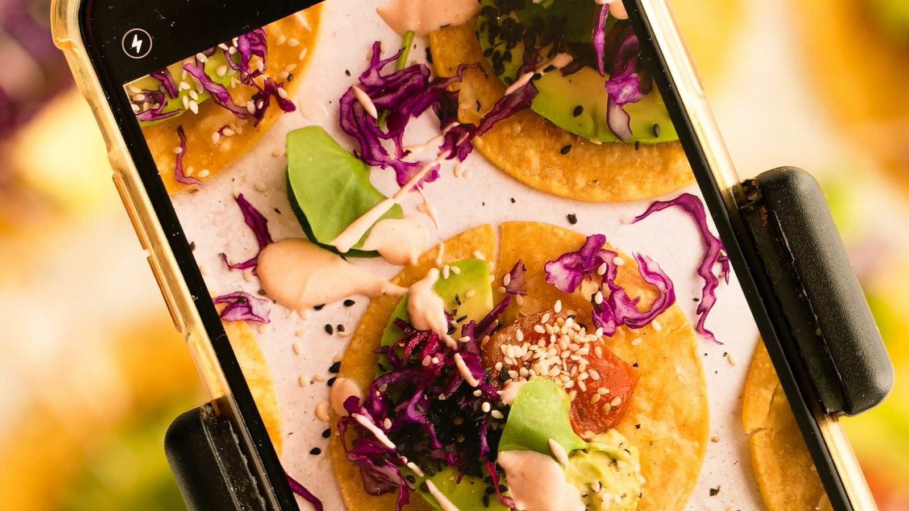

<!-- GENERATED from watch/issues/2026-06-15-review-photo-quality.yml by scripts/build_watch.py. Edit the data file. -->

```{=html}
<p class="mw-kicker">Marketing in 3 · Issue 23 · Week of 15 June 2026</p>
<figure class="mw-hero"><figcaption>The part of a review nobody studies: the thirty seconds before the shutter. Photo: Karolin Baitinger (Bakd&amp;Raw) on Unsplash.</figcaption></figure>
<section class="mw-answer" aria-label="Short answer"><h2>The short answer</h2><p>Because people put real effort into photographing something they are pleased with, and almost none into photographing something that annoyed them. Six studies tracked that effort directly, including hidden cameras in a lab and nearly 670,000 real reviews. On Amazon, independent judges called 72.3% of the pictures in positive reviews well composed, against 39.7% of the pictures in negative ones. Better pictures then read as more helpful, which quietly lifts the reviews that need the help least.</p></section>
<section class="mw-takeaways"><h2>Key takeaways</h2><ul><li>Ten props sat on each desk for staging the shot. People worked 4.64 of them into the picture of the cookie they liked, and 2.97 into the shot of the one they disliked.</li><li>On Yelp, 83.8% of photos in positive restaurant reviews were judged well composed, against 55.3% in negative ones.</li><li>Negative reviewers crop tighter: 66% of their photos showed a whole shoe, against 75% for positive reviewers.</li><li>Amazon reviews carrying a photo averaged 5.27 helpful votes. Reviews without one averaged 0.57.</li></ul></section>
<section id="what-the-researchers-did"><h2>What the researchers did</h2><p>Plenty of research asks what a photo does to a review once it is posted. Almost none asks where the photo came
from. Jiani Xue, writing as an independent researcher, and Shiri Melumad of the Wharton School went after the
thirty seconds before the shutter.</p><p>Their argument is simple enough to state in a line. Taking a decent picture is work, you have to frame it,
clear the clutter, find the light, and people are willing to do that work for something they like and not for
something they resent. So the pictures attached to praise come out better than the pictures attached to
complaints, and because better pictures read as more useful, the whole review inherits the difference.</p><p>They tested it six ways: a large online experiment where people photographed their own clothes, a lab study
where the product was held visually identical and the participants were filmed without knowing it, two studies
where strangers rated the resulting pictures, and finally two very large piles of real reviews from Amazon and
Yelp. Picture quality was never judged by the authors. It came from independent human raters, from MUSIQ, a
deep learning scorer trained on smartphone photography, and from GPT-4o prompted to react like an ordinary
shopper.</p>
<dl class="mw-facts"><div><dt>Studies</dt><dd>Six: two on effort, two on how observers react, two on real review data</dd></div><div><dt>People in the lab and online</dt><dd>4,218 across the controlled studies, from Prolific, CloudResearch and a university lab</dd></div><div><dt>Real reviews analysed</dt><dd>348,108 Amazon reviews of 500 products, plus 321,829 Yelp reviews of 186 Los Angeles restaurants</dd></div><div><dt>Photos rated</dt><dd>Over 100,000 by algorithm, thousands more by recruited human judges</dd></div><div><dt>Three ways to score a picture</dt><dd>Human judges, the MUSIQ deep learning model, and GPT-4o acting as a shopper</dd></div></dl>
</section>
<section id="one-thing-you-love-one-thing-you-regret-buying"><h2>One thing you love, one thing you regret buying</h2><p>The first study asked 1,313 people to do the same task twice. Find a piece of clothing or an accessory you are
really happy with, write a review of it, photograph it. Then do it again for something you are really unhappy
with. Same person, same phone, same room, so the only thing that moved was how they felt about the object in
front of them.</p><p>Effort moved with the feeling. Asked how much care they had taken, whether they staged the shot, whether they
minded about quality, they came out at 4.65 out of seven for the garment they were pleased with and 4.18 for
the garment they regretted. They also took more frames before settling on one, 2.12 against 1.95.</p><p>Then the pictures went out to independent judges who had no idea which review each came from. They rated the
photos of liked items higher, 3.56 against 3.29. Small numbers, and the same direction turned up in both
machine scores. A real gap, running quietly through everyone&#x27;s camera roll.</p>
</section>
<section id="the-cookie-test"><h2>The cookie test</h2><p>This is the study worth retelling at dinner. 144 students were sat at desks with two cookies in front
of them, labelled A and B. The cookies looked the same. One had been baked to taste good, the other baked to
taste bad. On each desk was a box of props from a fictional bakery: pinecones, dried leaves, dried flowers,
decorative paper.</p><p>Participants tasted, wrote a review, then photographed each cookie for the review. What they were not told
until afterwards was that three cameras were filming the desk. A research assistant later sat with a stopwatch
and timed, for each cookie, how long each person had their phone camera open.</p><p>The gap was not subtle. Self reported effort came in at 4.10 for the good cookie and 2.88 for the bad one, and
the stopwatch backed it up. Judges then called 58.9% of the good cookie photos well composed against 30.1% of
the bad cookie photos, which is the part that matters most. The two cookies were visually identical. Nobody can
argue the better pictures came out better because the subject was prettier.</p>
<figure class="mw-chart" id="chart-time"><figcaption class="mw-chart-title">Seconds spent with the camera open, by how the cookie tasted</figcaption><div class="mw-chart-svg"><svg viewBox="0 0 680 114" role="img" aria-labelledby="chart-time-t" font-family="Hanken Grotesk, Arial, sans-serif"><title id="chart-time-t">Seconds spent with the camera open, by how the cookie tasted</title><line x1="250.0" y1="4" x2="250.0" y2="88" stroke="#dde1e8" stroke-width="1"/><text x="250.0" y="106" font-size="12" text-anchor="middle" fill="#5b6476">0</text><line x1="322.0" y1="4" x2="322.0" y2="88" stroke="#dde1e8" stroke-width="1"/><text x="322.0" y="106" font-size="12" text-anchor="middle" fill="#5b6476">5</text><line x1="394.0" y1="4" x2="394.0" y2="88" stroke="#dde1e8" stroke-width="1"/><text x="394.0" y="106" font-size="12" text-anchor="middle" fill="#5b6476">10</text><line x1="466.0" y1="4" x2="466.0" y2="88" stroke="#dde1e8" stroke-width="1"/><text x="466.0" y="106" font-size="12" text-anchor="middle" fill="#5b6476">15</text><line x1="538.0" y1="4" x2="538.0" y2="88" stroke="#dde1e8" stroke-width="1"/><text x="538.0" y="106" font-size="12" text-anchor="middle" fill="#5b6476">20</text><line x1="610.0" y1="4" x2="610.0" y2="88" stroke="#dde1e8" stroke-width="1"/><text x="610.0" y="106" font-size="12" text-anchor="middle" fill="#5b6476">25</text><g><title>The cookie that tasted bad: 13.70  seconds</title><text x="238" y="27" font-size="13.5" text-anchor="end" fill="#15203b">The cookie that tasted bad</text><rect x="250" y="12" width="197.3" height="22" rx="4" fill="#aab3c5"/><text x="455.3" y="28" font-size="13.5" fill="#15203b">13.70</text></g><g><title>The cookie that tasted good: 19.88  seconds</title><text x="238" y="67" font-size="13.5" text-anchor="end" fill="#15203b" font-weight="600">The cookie that tasted good</text><rect x="250" y="52" width="286.3" height="22" rx="4" fill="#e0a12a"/><text x="544.3" y="68" font-size="13.5" fill="#15203b" font-weight="600">19.88</text></g></svg></div><div class="mw-sr"><table><caption>Seconds spent with the camera open, by how the cookie tasted</caption><tr><th>Group</th><th>Value ( seconds)</th></tr><tr><th scope="row">The cookie that tasted bad</th><td>13.7</td></tr><tr><th scope="row">The cookie that tasted good</th><td>19.88</td></tr></table></div><p class="mw-chart-src">Study 2: 118 usable recordings, timed by a research assistant from three camera angles.</p></figure>
</section>
<section id="why-a-better-picture-is-a-more-useful-picture"><h2>Why a better picture is a more useful picture</h2><p>So far this is a story about photographers. The next two studies turn it around and look at the person
scrolling.</p><p>347 observers were shown photos of shoes taken for real positive and negative reviews, with the review text
above each one. They rated the positive-review photos higher on overall quality, 4.25 against 3.73, and, more
interestingly, reported more trust in the person who took them, 4.92 against 4.72. Helpfulness followed the
same line, 5.40 against 5.14. Two things are happening at once: a well made picture is easier to take in, and
visible effort makes the reviewer look like someone worth listening to.</p><p>The obvious objection is that nice shoes photograph nicely. So the authors took twenty photos that judges had
already agreed were good, half showing attractive shoes and half unattractive ones, and ran each through
PowerPoint to make a degraded twin: blurred, off centre, exposure pushed around. Fresh observers rated one
image each for helpfulness.</p><p>Degrading the picture cost it a lot of helpfulness. How appealing the shoes were made no difference at all,
and it did not interact with image quality either. The craft of the photograph was doing the work, not the
product in it.</p>
<figure class="mw-chart" id="chart-degraded"><figcaption class="mw-chart-title">How helpful observers found a photo, before and after it was degraded</figcaption><div class="mw-chart-svg"><svg viewBox="0 0 734 114" role="img" aria-labelledby="chart-degraded-t" font-family="Hanken Grotesk, Arial, sans-serif"><title id="chart-degraded-t">How helpful observers found a photo, before and after it was degraded</title><line x1="304.0" y1="4" x2="304.0" y2="88" stroke="#dde1e8" stroke-width="1"/><text x="304.0" y="106" font-size="12" text-anchor="middle" fill="#5b6476">0</text><line x1="355.4" y1="4" x2="355.4" y2="88" stroke="#dde1e8" stroke-width="1"/><text x="355.4" y="106" font-size="12" text-anchor="middle" fill="#5b6476">1</text><line x1="406.9" y1="4" x2="406.9" y2="88" stroke="#dde1e8" stroke-width="1"/><text x="406.9" y="106" font-size="12" text-anchor="middle" fill="#5b6476">2</text><line x1="458.3" y1="4" x2="458.3" y2="88" stroke="#dde1e8" stroke-width="1"/><text x="458.3" y="106" font-size="12" text-anchor="middle" fill="#5b6476">3</text><line x1="509.7" y1="4" x2="509.7" y2="88" stroke="#dde1e8" stroke-width="1"/><text x="509.7" y="106" font-size="12" text-anchor="middle" fill="#5b6476">4</text><line x1="561.1" y1="4" x2="561.1" y2="88" stroke="#dde1e8" stroke-width="1"/><text x="561.1" y="106" font-size="12" text-anchor="middle" fill="#5b6476">5</text><line x1="612.6" y1="4" x2="612.6" y2="88" stroke="#dde1e8" stroke-width="1"/><text x="612.6" y="106" font-size="12" text-anchor="middle" fill="#5b6476">6</text><line x1="664.0" y1="4" x2="664.0" y2="88" stroke="#dde1e8" stroke-width="1"/><text x="664.0" y="106" font-size="12" text-anchor="middle" fill="#5b6476">7</text><g><title>The same picture, blurred and off centre: 3.52 out of 7</title><text x="292" y="27" font-size="13.5" text-anchor="end" fill="#15203b">The same picture, blurred and off centre</text><rect x="304" y="12" width="181.0" height="22" rx="4" fill="#aab3c5"/><text x="493.0" y="28" font-size="13.5" fill="#15203b">3.52</text></g><g><title>The picture as taken: 4.89 out of 7</title><text x="292" y="67" font-size="13.5" text-anchor="end" fill="#15203b" font-weight="600">The picture as taken</text><rect x="304" y="52" width="251.5" height="22" rx="4" fill="#e0a12a"/><text x="563.5" y="68" font-size="13.5" fill="#15203b" font-weight="600">4.89</text></g></svg></div><div class="mw-sr"><table><caption>How helpful observers found a photo, before and after it was degraded</caption><tr><th>Group</th><th>Value (out of 7)</th></tr><tr><th scope="row">The same picture, blurred and off centre</th><td>3.52</td></tr><tr><th scope="row">The picture as taken</th><td>4.89</td></tr></table></div><p class="mw-chart-src">Study 3b: 401 observers, one image each, 20 original photos and 20 degraded twins.</p></figure>
</section>
<section id="nearly-670-000-reviews-say-the-same-thing"><h2>Nearly 670,000 reviews say the same thing</h2><p>Then the field data, and here the scale changes completely. Eight years of Amazon reviews covering shoes, bags
and hats, of which 24,996 came with at least one product photo. Nineteen years of Yelp reviews covering
restaurants across greater Los Angeles, of which 82,472 came with photos.</p><p>Both datasets replicated the pattern on every measure. Star ratings and GPT-scored picture quality moved
together on Amazon, a correlation of .34, and on Yelp, .21. The MUSIQ scores leaned the same way, 63.23 for
positive Amazon reviews against 61.26 for negative ones. Human judges, shown a sample with no idea where each
picture came from, agreed.</p><p>The last study asks what this does to a ranking. Reviews with photos collect more helpful votes, that much was
already known. And negative reviews have always collected more helpful votes than positive ones, which is also
old news. The new finding is what happens when you put those two facts together. On Amazon, adding photos to
the picture did not just weaken the old negative relationship between star rating and helpfulness. It flipped
it. Among reviews with images, the more positive the review, the more helpful votes it got. On Yelp the same
interaction appeared but was not strong enough to reverse anything, only to soften it.</p>
<figure class="mw-chart" id="chart-pleasing"><figcaption class="mw-chart-title">Share of review photos judges called pleasing to look at</figcaption><div class="mw-chart-svg"><svg viewBox="0 0 680 194" role="img" aria-labelledby="chart-pleasing-t" font-family="Hanken Grotesk, Arial, sans-serif"><title id="chart-pleasing-t">Share of review photos judges called pleasing to look at</title><line x1="250.0" y1="4" x2="250.0" y2="168" stroke="#dde1e8" stroke-width="1"/><text x="250.0" y="186" font-size="12" text-anchor="middle" fill="#5b6476">0</text><line x1="322.0" y1="4" x2="322.0" y2="168" stroke="#dde1e8" stroke-width="1"/><text x="322.0" y="186" font-size="12" text-anchor="middle" fill="#5b6476">20</text><line x1="394.0" y1="4" x2="394.0" y2="168" stroke="#dde1e8" stroke-width="1"/><text x="394.0" y="186" font-size="12" text-anchor="middle" fill="#5b6476">40</text><line x1="466.0" y1="4" x2="466.0" y2="168" stroke="#dde1e8" stroke-width="1"/><text x="466.0" y="186" font-size="12" text-anchor="middle" fill="#5b6476">60</text><line x1="538.0" y1="4" x2="538.0" y2="168" stroke="#dde1e8" stroke-width="1"/><text x="538.0" y="186" font-size="12" text-anchor="middle" fill="#5b6476">80</text><line x1="610.0" y1="4" x2="610.0" y2="168" stroke="#dde1e8" stroke-width="1"/><text x="610.0" y="186" font-size="12" text-anchor="middle" fill="#5b6476">100</text><g><title>Amazon, negative review: 24.0%</title><text x="238" y="27" font-size="13.5" text-anchor="end" fill="#15203b" font-weight="600">Amazon, negative review</text><rect x="250" y="12" width="86.4" height="22" rx="4" fill="#e0a12a"/><text x="344.4" y="28" font-size="13.5" fill="#15203b" font-weight="600">24.0%</text></g><g><title>Amazon, positive review: 67.0%</title><text x="238" y="67" font-size="13.5" text-anchor="end" fill="#15203b">Amazon, positive review</text><rect x="250" y="52" width="241.2" height="22" rx="4" fill="#aab3c5"/><text x="499.2" y="68" font-size="13.5" fill="#15203b">67.0%</text></g><g><title>Yelp, negative review: 38.8%</title><text x="238" y="107" font-size="13.5" text-anchor="end" fill="#15203b">Yelp, negative review</text><rect x="250" y="92" width="139.7" height="22" rx="4" fill="#aab3c5"/><text x="397.7" y="108" font-size="13.5" fill="#15203b">38.8%</text></g><g><title>Yelp, positive review: 73.5%</title><text x="238" y="147" font-size="13.5" text-anchor="end" fill="#15203b">Yelp, positive review</text><rect x="250" y="132" width="264.6" height="22" rx="4" fill="#aab3c5"/><text x="522.6" y="148" font-size="13.5" fill="#15203b">73.5%</text></g></svg></div><div class="mw-sr"><table><caption>Share of review photos judges called pleasing to look at</caption><tr><th>Group</th><th>Value (%)</th></tr><tr><th scope="row">Amazon, negative review</th><td>24.0</td></tr><tr><th scope="row">Amazon, positive review</th><td>67.0</td></tr><tr><th scope="row">Yelp, negative review</th><td>38.8</td></tr><tr><th scope="row">Yelp, positive review</th><td>73.5</td></tr></table></div><p class="mw-chart-src">Study 4a: 1,200 photos sampled from each platform, rated by recruited judges blind to the review.</p></figure>
</section>
<section id="what-a-review-page-is-actually-showing-you"><h2>What a review page is actually showing you</h2><p>Put the chain together: a happier customer takes more care, more care makes a better picture, a better picture
reads as more helpful and more trustworthy, more helpful votes buy a higher position on the page. Nobody
designed that. It falls out of how people feel about holding a camera.</p><p>Two consequences follow for anyone running a review page or reading one. The first is a measurement problem.
If your platform ranks on helpful votes, it is partly ranking on how motivated your reviewers felt, and that
favours the praise. The second is a judgement problem, and it is the one I would put on a wall. A blurry,
badly lit, awkwardly cropped photo of a fault is not weak evidence. It is evidence that nobody bothered to
dress it up. The polish of a picture tells you about the mood of the person holding the phone, not about
whether the product works.</p><p>Going beyond what was tested here, the same logic should reach any user content you solicit: unboxing clips,
before and after shots, case study photos from clients. The material you get back will be prettiest from the
people who needed least convincing. There is also a note for service teams, since Yelp reviewers wrote about
three times as many words as Amazon reviewers, 81.74 against 28.05. Where the experience is complicated,
people fall back on language, and the photo carries less of the load.</p>
</section>
<section id="how-to-apply-it" class="mw-howto"><p class="mw-rsg-kicker">Marketing in 3 steps</p><h2>Ready. Set. Market.</h2><div class="mw-rsg"><div class="mw-phase"><div class="mw-phase-dot" aria-hidden="true">1</div><div class="mw-phase-tag"><span class="mw-phase-name">Ready</span><span class="mw-phase-sub">Decide and prepare</span></div><ul class="mw-rsg-steps"><li><strong>Ask the happy customers.</strong> Pull a list of everyone who gave you four or five stars in the last 30 days. Ask only those people for a photo. Asking an unhappy customer for one gets you a bad photo or no photo.</li><li><strong>Decide the one shot you want.</strong> Write down the picture you want in a single sentence. Say what is in it and where it is. If you need two sentences, you are asking for two photos, so pick one.</li></ul></div><div class="mw-phase"><div class="mw-phase-dot" aria-hidden="true">2</div><div class="mw-phase-tag"><span class="mw-phase-name">Set</span><span class="mw-phase-sub">Build it</span></div><ul class="mw-rsg-steps"><li><strong>Show them one example.</strong> Put one good photo straight into the request. People copy what they can see. A description on its own gets you something else.</li><li><strong>Give three rules and stop.</strong> Tell them: daylight, plain surface, the whole product in the frame. Three rules. Any more and they stop reading.</li></ul></div><div class="mw-phase"><div class="mw-phase-dot" aria-hidden="true">3</div><div class="mw-phase-tag"><span class="mw-phase-name">Market</span><span class="mw-phase-sub">Launch and measure</span></div><ul class="mw-rsg-steps"><li><strong>Send it within three days.</strong> Send the request within three days of the purchase or the visit, while they still feel good about it. Wait two weeks and the feeling has gone flat.</li><li><strong>Count what comes back each month.</strong> Count how many photos you get per hundred requests. Change one line of the request next month, and only one, so you know what moved the number.</li></ul></div></div></section>
<section id="what-to-expect"><h2>What to expect</h2><ul class="mw-list"><li><strong>The gallery you build will flatter you.</strong> Your best pictures will come from your most satisfied customers, so the page will look better than your average experience actually is.</li><li><strong>Photo requests convert poorly in absolute terms.</strong> You are asking for work, not a click. Measure per hundred requests and expect a small number.</li><li><strong>Polish is not proof.</strong> A good-looking photo earns trust the facts behind it may not deserve. Train your team to read a scrappy complaint photo as undressed, not as unfounded.</li><li><strong>It will not soften the words.</strong> The process behind writing a review runs separately from the one behind photographing it, so a photo request does not improve the text that comes with it.</li></ul></section>
<section id="where-it-does-not-work"><h2>Where it does not work</h2><ul class="mw-list"><li><strong>A short list of categories.</strong> Clothes, shoes, bags, hats, cookies and restaurant meals. Nothing here tests services with no physical object to photograph.</li><li><strong>Quality was scored, not experienced.</strong> Pictures were rated by recruited judges and two algorithms, which is consistent and repeatable but not the same as a shopper glancing at a thumbnail for a second.</li><li><strong>The field patterns are associations.</strong> The causal claims rest on the experiments. Amazon and Yelp add scale and realism, with controls, not proof of cause.</li><li><strong>Helpful votes are not sales.</strong> Every outcome measured here is a judgement of helpfulness or a vote, never a purchase, a return or a refund.</li></ul></section>
<section id="questions"><h2>Questions marketers ask</h2><div class="mw-faq"><h3>Why are the photos in positive reviews better than the photos in negative reviews?</h3><p>Because the person taking them is willing to do more work. Across six studies, people who felt positive about a product staged the shot more, took more frames and spent longer with the camera open, and the resulting pictures were rated higher by judges who did not know which review they came from (Xue &amp; Melumad, 2026, Journal of Marketing Research).</p></div><div class="mw-faq"><h3>Do photos make an online review more helpful?</h3><p>Yes, consistently. Yelp reviews carrying at least one photo averaged 2.05 useful votes against 0.68 for reviews without one, and the same gap appeared in the Amazon data. The size of the benefit depends on how good the photo is.</p></div><div class="mw-faq"><h3>Should a brand ask customers to add photos to their reviews?</h3><p>Yes, and the people most likely to deliver a usable picture are the ones already pleased with you. The practical catch is that this skews your visual evidence towards praise, so a thin and scruffy photo record on a complaint is not a sign the complaint is weak.</p></div><div class="mw-faq"><h3>Does a better photo make the reviewer seem more trustworthy?</h3><p>It does. Observers rated the people who took higher-quality photos as more worth listening to, and that trust was one of the two routes by which picture quality raised perceived helpfulness. The other was simply that a well-composed picture is easier to process.</p></div><div class="mw-faq"><h3>Is it just that nicer products photograph better?</h3><p>No, and two studies were built to rule that out. One used two cookies that looked identical and differed only in taste. The other took the same photographs and degraded copies of them, and found that image quality drove perceived helpfulness while the appeal of the product shown made no difference.</p></div></section>
<section id="also-new"><h2>Also new this week</h2><div class="mw-also"><article><p class="mw-also-src"><em>Journal of Research in Interactive Marketing</em> · 2026</p><h3><a href="https://doi.org/10.1108/jrim-07-2025-0437">When reviews tell the truth: the power of verified purchase ratings</a></h3><p class="mw-also-au">Kim, D., &amp; Park, K.</p><p>Before a platform started marking which reviews came from people who had actually bought the thing, star ratings were a poor guide to box office takings. After it did, they started to track. Verification seems to make reviewers more measured, and the badge counted for most where buyers had little else to go on. In a category nobody can judge before purchase, the badge may be carrying more weight than the stars.</p></article><article><p class="mw-also-src"><em>International Journal of Research in Marketing</em> · 2026</p><h3><a href="https://doi.org/10.1016/j.ijresmar.2026.04.004">Passive voice in consumer complaints reveals fault attribution and predicts escalation</a></h3><p class="mw-also-au">Sepehri, A., Duclos, R., &amp; Berger, J.</p><p>Across more than 160,000 complaints filed with the US Consumer Financial Protection Bureau, the people who wrote in the passive voice, as in &quot;my account was charged&quot;, were markedly likelier to reject the resolution they were offered. Experiments explain why: passive constructions increase as blame shifts from the customer to the company. The grammar is a tell, and a machine can read it, so a service queue could be triaged on it before anyone picks up a phone.</p></article></div></section>
<section id="source" class="mw-source"><h2>Source</h2><p class="mw-cite">Xue, J., &amp; Melumad, S. (2026). Picture This: How Review Valence Shapes the Quality and Helpfulness of User-Generated Photos. <em>Journal of Marketing Research</em>. <a href="https://doi.org/10.1177/00222437261450925">https://doi.org/10.1177/00222437261450925</a></p><p class="mw-note">This brief is written for practitioners from the published article. Open access (CC BY 4.0): free to read at the publisher. Numbers are as reported by the authors; read the article for full methods.</p></section>
<section id="related-research" class="mw-related"><h2>Related research on this site</h2><ul><li><a href="../../../papers/measuring-consumer-engagement-social-media-content.html">Measuring consumers’ engagement with brand-related social-media content: Development and validation of a scale that identifies levels of social-media engagement with brands</a><span>Journal of Advertising Research</span></li><li><a href="../../../papers/social-media-communication-brand-perceptions.html">The effect of social media communication on consumer perceptions of brands</a><span>Journal of Marketing Communications</span></li></ul></section>
<div class="mw-author"><div><p><strong>Bruno Schivinski</strong> is Associate Professor of Marketing at Gdańsk University of Technology. He studies how consumers engage with brands in digital and social media.</p><p><a href="../../../index.html">About Bruno</a> · <a href="../../index.html">All Marketing in 3 issues</a> · <a href="../../subscribe.html">Subscribe</a></p></div></div>
<nav class="mw-pn" aria-label="More issues"><a class="mw-prev" href="../video-thumbnails/index.html"><span>Previous issue</span>Busy enough to be interesting, tidy enough to be read</a><a class="mw-next" href="../prospecting-retargeting/index.html"><span>Next issue</span>The dashboard said 7.47. The experiment said nothing.</a></nav>
```
