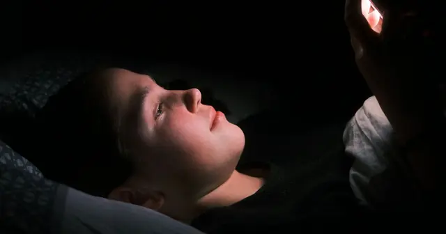

<!-- GENERATED from watch/issues/2026-03-23-review-platforms-tourist-traps.yml by scripts/build_watch.py. Edit the data file. -->

```{=html}
<p class="mw-kicker">Marketing in 3 · Issue 11 · Week of 23 March 2026</p>
<figure class="mw-hero"><picture><source type="image/webp" sizes="(max-width: 900px) 100vw, 900px" srcset="../../images/web/issue-11-review-platforms-tourist-traps-960.webp 960w, ../../images/web/issue-11-review-platforms-tourist-traps-1600.webp 1600w"></picture><figcaption>The hidden gem a few steps off the main square. Photo: Mariano Alvarez on Unsplash.</figcaption></figure>
<section class="mw-answer" aria-label="Short answer"><h2>The short answer</h2><p>Yes, in part. When the EU abolished mobile roaming charges in June 2017, European tourists in Rome could check Tripadvisor for free while out. Over the next two and a half years, restaurants near tourist sights with good ratings grew their revenue by up to 5.6%, while poorly rated ones saw their chance of closing double. Low-rated restaurants that stayed open hired more experienced staff, paid higher wages and raised their ratings.</p></section>
<section class="mw-takeaways"><h2>Key takeaways</h2><ul><li>After free mobile data, high-rated restaurants near tourist sights grew revenue by 5.6% and mid-rated ones by 3.6%; low-rated ones gained nothing.</li><li>The chance of a low-rated restaurant closing doubled, and in the most touristy areas the share of low-rated restaurants fell by 3.75 percentage points.</li><li>Surviving low- and mid-rated restaurants became 8% to 16% more likely to hire staff with restaurant experience, and their ratings rose by 0.08 to 0.10 stars.</li><li>The biggest winners were well-rated restaurants a short walk from the sights, not those right in front of them.</li></ul></section>
<section id="what-the-researcher-did"><h2>What the researcher did</h2><p>A tourist trap survives because visitors cannot tell good from bad before they sit down, and rarely come back.
Reviews should fix that, but proving it is hard: restaurants that get good reviews may simply have been good
already.</p><p><a class="mw-orcid-link" href="https://orcid.org/0000-0001-9661-7299" title="Dante Donati on ORCID">Dante Donati</a> (Columbia Business School) used a natural experiment. On 15 June 2017 the EU abolished roaming
charges, so European visitors could use mobile data abroad at no extra cost. Overnight, checking Tripadvisor on
the street became free for them, but not for Italians or for visitors from outside the EU. After the change, EU
reviewers became 1.4 times more likely to post from a phone rather than a computer.</p><p>He matched about 3 million Tripadvisor reviews to official social security and company records for restaurants
across the province of Rome, so he could see revenues, staff, wages, hiring and closures, not just ratings. He
then compared restaurants that tourists could easily reach with those they could not, before and after the change,
separately for restaurants rated below, around and above 4 stars.</p>
<dl class="mw-facts"><div><dt>Setting</dt><dd>Restaurants in the province of Rome, 2015–2019, around the EU roaming abolition of June 2017</dd></div><div><dt>Data</dt><dd>About 3 million Tripadvisor reviews matched to employer and tax records; 4,628 restaurants rated before the change</dd></div><div><dt>Rating groups</dt><dd>Low (below 3.85), mid (3.85 to 4.25) and high (4.25 and above), roughly below, around and above 4 stars as displayed</dd></div><div><dt>Measured</dt><dd>Revenue, staff numbers, closures, openings, hiring of experienced workers, wages and later ratings</dd></div></dl>
</section>
<section id="good-ratings-started-paying-off"><h2>Good ratings started paying off</h2><p>Once tourists could check reviews freely, demand moved toward better-rated places. Among restaurants that tourists
could easily reach, revenue rose by about 5% overall, roughly 28,500 euros a year for an average restaurant.
High-rated restaurants gained 5.6%, and 8% in the first year alone. Mid-rated ones gained 3.6% and grew their
staff by 10%. Low-rated restaurants gained nothing.</p><p>High-rated restaurants added little staff, which suggests they were already full. Their revenue per employee rose
by 4.3%, a sign that some of them raised prices once reviews vouched for their quality.</p><p>Location mattered in a surprising way. The well-rated restaurants that gained most were not those facing the
monuments but those tucked a short walk away, the kind tourists find by checking a map and reviews on their phone.
Restaurants in the most visible spots saw no clear gain.</p>
<figure class="mw-chart" id="chart-revenue"><figcaption class="mw-chart-title">Change in annual revenue after free roaming, by rating</figcaption><div class="mw-chart-svg"><svg viewBox="0 0 680 154" role="img" aria-labelledby="chart-revenue-t" font-family="Hanken Grotesk, Arial, sans-serif"><title id="chart-revenue-t">Change in annual revenue after free roaming, by rating</title><line x1="250.0" y1="4" x2="250.0" y2="128" stroke="#dde1e8" stroke-width="1"/><text x="250.0" y="146" font-size="12" text-anchor="middle" fill="#5b6476">0</text><line x1="340.0" y1="4" x2="340.0" y2="128" stroke="#dde1e8" stroke-width="1"/><text x="340.0" y="146" font-size="12" text-anchor="middle" fill="#5b6476">2</text><line x1="430.0" y1="4" x2="430.0" y2="128" stroke="#dde1e8" stroke-width="1"/><text x="430.0" y="146" font-size="12" text-anchor="middle" fill="#5b6476">4</text><line x1="520.0" y1="4" x2="520.0" y2="128" stroke="#dde1e8" stroke-width="1"/><text x="520.0" y="146" font-size="12" text-anchor="middle" fill="#5b6476">6</text><line x1="610.0" y1="4" x2="610.0" y2="128" stroke="#dde1e8" stroke-width="1"/><text x="610.0" y="146" font-size="12" text-anchor="middle" fill="#5b6476">8</text><g><title>Low rated (below 3.85): 0.7%</title><text x="238" y="27" font-size="13.5" text-anchor="end" fill="#15203b">Low rated (below 3.85)</text><rect x="250" y="12" width="31.5" height="22" rx="4" fill="#aab3c5"/><text x="289.5" y="28" font-size="13.5" fill="#15203b">0.7%</text></g><g><title>Mid rated (3.85 to 4.25): 3.6%</title><text x="238" y="67" font-size="13.5" text-anchor="end" fill="#15203b">Mid rated (3.85 to 4.25)</text><rect x="250" y="52" width="162.0" height="22" rx="4" fill="#aab3c5"/><text x="420.0" y="68" font-size="13.5" fill="#15203b">3.6%</text></g><g><title>High rated (4.25 and above): 5.6%</title><text x="238" y="107" font-size="13.5" text-anchor="end" fill="#15203b" font-weight="600">High rated (4.25 and above)</text><rect x="250" y="92" width="252.0" height="22" rx="4" fill="#e0a12a"/><text x="510.0" y="108" font-size="13.5" fill="#15203b" font-weight="600">5.6%</text></g></svg></div><div class="mw-sr"><table><caption>Change in annual revenue after free roaming, by rating</caption><tr><th>Group</th><th>Value (%)</th></tr><tr><th scope="row">Low rated (below 3.85)</th><td>0.7</td></tr><tr><th scope="row">Mid rated (3.85 to 4.25)</th><td>3.6</td></tr><tr><th scope="row">High rated (4.25 and above)</th><td>5.6</td></tr></table></div><p class="mw-chart-src">Restaurants tourists could easily reach vs others, 2015–2018. The low-rated change is not statistically different from zero.</p></figure>
</section>
<section id="tourist-traps-closed-survivors-upgraded"><h2>Tourist traps closed, survivors upgraded</h2><p>For poorly rated restaurants, the monthly chance of closing doubled after the change. Mid- and high-rated
restaurants were no more likely to close. Counting new openings as well, in the most touristy neighbourhoods the
share of low-rated restaurants fell by 3.75 percentage points while the share of high-rated ones rose by 4.6
points.</p><p>The low-rated restaurants that stayed open invested in quality, and the evidence comes from payroll records, not
just reviews. They became 8% more likely to hire someone with restaurant experience (16% for mid-rated ones) and
less likely to hire newcomers, and their daily wages rose by about 1 euro, or 2%. Their ratings then improved by
about 0.1 stars, even when reviews from EU tourists were left out of the count. High-rated restaurants changed
little.</p>
<figure class="mw-chart" id="chart-ratings"><figcaption class="mw-chart-title">Change in Tripadvisor rating after free roaming, by rating</figcaption><div class="mw-chart-svg"><svg viewBox="0 0 680 154" role="img" aria-labelledby="chart-ratings-t" font-family="Hanken Grotesk, Arial, sans-serif"><title id="chart-ratings-t">Change in Tripadvisor rating after free roaming, by rating</title><line x1="250.0" y1="4" x2="250.0" y2="128" stroke="#dde1e8" stroke-width="1"/><text x="250.0" y="146" font-size="12" text-anchor="middle" fill="#5b6476">0</text><line x1="310.0" y1="4" x2="310.0" y2="128" stroke="#dde1e8" stroke-width="1"/><text x="310.0" y="146" font-size="12" text-anchor="middle" fill="#5b6476">0.02</text><line x1="370.0" y1="4" x2="370.0" y2="128" stroke="#dde1e8" stroke-width="1"/><text x="370.0" y="146" font-size="12" text-anchor="middle" fill="#5b6476">0.04</text><line x1="430.0" y1="4" x2="430.0" y2="128" stroke="#dde1e8" stroke-width="1"/><text x="430.0" y="146" font-size="12" text-anchor="middle" fill="#5b6476">0.06</text><line x1="490.0" y1="4" x2="490.0" y2="128" stroke="#dde1e8" stroke-width="1"/><text x="490.0" y="146" font-size="12" text-anchor="middle" fill="#5b6476">0.08</text><line x1="550.0" y1="4" x2="550.0" y2="128" stroke="#dde1e8" stroke-width="1"/><text x="550.0" y="146" font-size="12" text-anchor="middle" fill="#5b6476">0.1</text><line x1="610.0" y1="4" x2="610.0" y2="128" stroke="#dde1e8" stroke-width="1"/><text x="610.0" y="146" font-size="12" text-anchor="middle" fill="#5b6476">0.12</text><g><title>Low rated (below 3.85): 0.10 stars</title><text x="238" y="27" font-size="13.5" text-anchor="end" fill="#15203b" font-weight="600">Low rated (below 3.85)</text><rect x="250" y="12" width="285.0" height="22" rx="4" fill="#e0a12a"/><text x="543.0" y="28" font-size="13.5" fill="#15203b" font-weight="600">0.10</text></g><g><title>Mid rated (3.85 to 4.25): 0.08 stars</title><text x="238" y="67" font-size="13.5" text-anchor="end" fill="#15203b" font-weight="600">Mid rated (3.85 to 4.25)</text><rect x="250" y="52" width="237.0" height="22" rx="4" fill="#e0a12a"/><text x="495.0" y="68" font-size="13.5" fill="#15203b" font-weight="600">0.08</text></g><g><title>High rated (4.25 and above): 0.01 stars</title><text x="238" y="107" font-size="13.5" text-anchor="end" fill="#15203b">High rated (4.25 and above)</text><rect x="250" y="92" width="42.0" height="22" rx="4" fill="#aab3c5"/><text x="300.0" y="108" font-size="13.5" fill="#15203b">0.01</text></g></svg></div><div class="mw-sr"><table><caption>Change in Tripadvisor rating after free roaming, by rating</caption><tr><th>Group</th><th>Value (stars)</th></tr><tr><th scope="row">Low rated (below 3.85)</th><td>0.095</td></tr><tr><th scope="row">Mid rated (3.85 to 4.25)</th><td>0.079</td></tr><tr><th scope="row">High rated (4.25 and above)</th><td>0.014</td></tr></table></div><p class="mw-chart-src">Five-month average rating, 2015–2018. The high-rated change is not statistically different from zero.</p></figure>
</section>
<section id="what-it-adds-up-to"><h2>What it adds up to</h2><p>Scaling the results to Italy as a whole, Donati estimates that giving every customer cheap access to reviews would
raise restaurant revenue by about 1.5% and employment by about 1.4%, around 174 million euros and 13,400 jobs,
while raising closures by 0.4 percentage points a year. These are rough, back-of-the-envelope figures based on
several assumptions, but the direction is clear: easier access to reviews made the whole market more
quality-driven.</p>
</section>
<section id="beyond-the-restaurant-table"><h2>Beyond the restaurant table</h2><p>Restaurants are a classic experience good: you only know the quality after paying. So are hotels, tradespeople,
clinics, salons, holiday rentals, courses and many business services. My reading, not tested in the paper, is
that the same pattern is likely wherever reviews suddenly become easier to see at the moment of choice, for
example when maps, AI assistants and search results start summarising ratings for you. Good providers that were
hard to find gain; weak providers that lived on location, passing trade or one-off customers lose their cover.</p><p>The study also shows what works for those on the wrong side of the ratings: not more marketing, but better
people and better service, which then show up in the reviews.</p>
</section>
<section id="how-to-apply-it" class="mw-howto"><p class="mw-rsg-kicker">Marketing in 3 steps</p><h2>Ready. Set. Market.</h2><div class="mw-rsg"><div class="mw-phase"><div class="mw-phase-dot" aria-hidden="true">1</div><div class="mw-phase-tag"><span class="mw-phase-name">Ready</span><span class="mw-phase-sub">Decide and prepare</span></div><ul class="mw-rsg-steps"><li><strong>Find out where you really stand.</strong> Check your average rating and recent reviews on the platforms your customers use, against the businesses they compare you with. In this study, the line that mattered was roughly 4 stars as displayed.</li><li><strong>Expect your cover to disappear.</strong> If you rely on location, one-off customers or a captive audience, assume that sooner or later every customer will check your reviews before buying, through maps, search or an AI assistant. Plan for that day now.</li></ul></div><div class="mw-phase"><div class="mw-phase-dot" aria-hidden="true">2</div><div class="mw-phase-tag"><span class="mw-phase-name">Set</span><span class="mw-phase-sub">Build it</span></div><ul class="mw-rsg-steps"><li><strong>Fix quality with people.</strong> The restaurants that recovered hired experienced staff and paid them more. Put money into skilled, stable front-line people and the service they deliver before you put it into promotion.</li><li><strong>Make good places easy to find.</strong> Well-rated places a short walk from the sights gained most. Keep your map listing, opening hours, photos and directions complete and accurate so people who check their phone can actually reach you.</li></ul></div><div class="mw-phase"><div class="mw-phase-dot" aria-hidden="true">3</div><div class="mw-phase-tag"><span class="mw-phase-name">Market</span><span class="mw-phase-sub">Launch and measure</span></div><ul class="mw-rsg-steps"><li><strong>Price your reputation carefully.</strong> Highly rated restaurants appear to have raised prices once reviews vouched for them. If your ratings are strong and you are full, test modest price rises, and watch whether ratings and repeat visits hold.</li><li><strong>Track ratings as a business result.</strong> Follow your rolling rating each month next to revenue and staff turnover, and reply to reviews. Treat a falling rating as an early warning, because in this study revenue followed reputation.</li></ul></div></div></section>
<div class="mw-coffee" role="complementary" aria-label="Support Marketing in 3"><div class="mw-coffee-text"><p class="mw-coffee-title">Found this useful?</p><p>Marketing in 3 is free, weekly and ad-free. A coffee keeps it that way.</p></div><a class="mw-coffee-btn" href="https://ko-fi.com/marketingin3" target="_blank" rel="noopener"><svg aria-hidden="true" focusable="false"
  class="lucide lucide-coffee"
  xmlns="http://www.w3.org/2000/svg"
  width="24"
  height="24"
  viewBox="0 0 24 24"
  fill="none"
  stroke="currentColor"
  stroke-width="2"
  stroke-linecap="round"
  stroke-linejoin="round"
>
  <path d="M10 2v2" />
  <path d="M14 2v2" />
  <path d="M16 8a1 1 0 0 1 1 1v8a4 4 0 0 1-4 4H7a4 4 0 0 1-4-4V9a1 1 0 0 1 1-1h14a4 4 0 1 1 0 8h-1" />
  <path d="M6 2v2" />
</svg><span>Buy me a coffee</span><span class="mw-coffee-price">€3</span></a></div>
<section id="what-to-expect"><h2>What to expect</h2><ul class="mw-list"><li><strong>Gains are modest but real.</strong> Revenue rose by about 4% to 6% for restaurants rated around or above 4 stars that tourists could reach.</li><li><strong>A short-lived boost at the top.</strong> High-rated restaurants gained 8% in the first year, but the longer-term gain was smaller and not statistically clear.</li><li><strong>Upgrading costs money.</strong> Low-rated survivors paid about 2% more in daily wages to hire experienced staff.</li><li><strong>Slow change in the market.</strong> Closures of low-rated restaurants picked up only about a year after the change, and the mix of restaurants kept shifting over time.</li></ul></section>
<section id="where-it-does-not-work"><h2>Where it does not work</h2><ul class="mw-list"><li><strong>One city, one sector.</strong> The study covers restaurants in the province of Rome, a city full of one-time visitors, where the effect of reviews may be unusually strong.</li><li><strong>Only some customers were affected.</strong> Only EU tourists got cheaper data, so the estimates capture the effect of a partial shift, and the Italy-wide figures rely on several assumptions.</li><li><strong>Prices were not observed.</strong> The evidence that high-rated restaurants raised prices comes from revenue per employee and regional price data, so it is suggestive.</li><li><strong>Ratings are an imperfect measure of quality.</strong> Ratings may also have risen because different people were reviewing, though the gains for low-rated restaurants held when EU reviews were left out.</li></ul></section>
<section id="questions"><h2>Questions marketers ask</h2><div class="mw-faq"><h3>Do online reviews drive bad restaurants out of business?</h3><p>Evidence from Rome says they help. When EU roaming charges ended in 2017 and tourists could check Tripadvisor for free, the chance of a low-rated restaurant near tourist sights closing doubled, while mid- and high-rated restaurants were unaffected (<a class="mw-orcid-link" href="https://orcid.org/0000-0001-9661-7299" title="Dante Donati on ORCID">Donati</a>, 2026, Marketing Science).</p></div><div class="mw-faq"><h3>How much do good online ratings increase restaurant revenue?</h3><p>In this study, restaurants rated 4.25 or higher that tourists could easily reach grew annual revenue by 5.6% after free mobile data made reviews easier to check, and mid-rated ones by 3.6%. Low-rated restaurants saw no gain.</p></div><div class="mw-faq"><h3>Do businesses improve quality because of online reviews?</h3><p>Yes. Low- and mid-rated restaurants in Rome became 8% to 16% more likely to hire workers with restaurant experience, paid higher wages, and saw their Tripadvisor ratings rise by about 0.1 stars.</p></div><div class="mw-faq"><h3>Is a prime location still an advantage when customers use reviews?</h3><p>Less than before. The well-rated restaurants that gained most were a short walk from tourist sights, not those directly in front of them, suggesting tourists used reviews and maps to find hidden gems.</p></div><div class="mw-faq"><h3>Can a business with good reviews charge more?</h3><p>The study suggests so. Revenue per employee in high-rated restaurants rose by 4.3% after the change, and restaurant prices rose slightly in provinces with major tourist sights, consistent with some price increases.</p></div></section>
<section id="also-new"><h2>Also new this week</h2><div class="mw-also"><article><p class="mw-also-src"><em>Marketing Science</em> · 2026</p><h3><a href="https://doi.org/10.1287/mksc.2023.0552">Safety reviews on Airbnb: An information tale</a></h3><p class="mw-also-au">Culotta, A., Jin, G. Z., Sun, Y., &amp; Wagman, L.</p><p>Using Airbnb listings and official crime data from five US cities, the authors show that guest reviews mentioning the safety of the neighbourhood reduce bookings. Their simulations suggest a platform could earn more by hiding such reviews, at the expense of guests who do not adjust their expectations. These reviews track crime more closely in low-income and minority areas, so hiding or highlighting them affects neighbourhoods unevenly. What a platform chooses to show is a marketing decision with ethical weight.</p></article><article><p class="mw-also-src"><em>Journal of Retailing</em> · 2026</p><h3><a href="https://doi.org/10.1016/j.jretai.2026.02.005">Standing out from adjacent reviews: How content similarity affects review helpfulness</a></h3><p class="mw-also-au">Gao, B., Wang, J., Liu, S., &amp; Cui, N.</p><p>Analysing about 3 million Tripadvisor hotel reviews, plus experiments, the authors find that a review is rated less helpful when the reviews just before and after it say much the same thing, because it feels less unique. The penalty is stronger for hedonic products and weaker for well-known reviewers. Platforms and retailers can make their review pages more useful by ordering reviews so that different experiences sit side by side.</p></article></div></section>
<section id="source" class="mw-source"><h2>Source</h2><p class="mw-cite"><a class="mw-orcid-link" href="https://orcid.org/0000-0001-9661-7299" title="Dante Donati on ORCID">Donati, D.</a> (2026). The end of tourist traps: The impact of review platforms on quality upgrading. <em>Marketing Science</em>, <em>45</em>(2), 386–427. <a href="https://doi.org/10.1287/mksc.2023.0482">https://doi.org/10.1287/mksc.2023.0482</a></p><p class="mw-note">This brief is written for practitioners from the published article. Open access (CC BY 4.0): free to read at the publisher. Numbers are as reported by the authors; read the article for full methods.</p></section>

<section id="keep-reading" class="mw-more"><h2>Keep reading</h2><p class="mw-more-topics">More issues on <a href="../../topics/ugc.html">UGC</a> · <a href="../../topics/service.html">Service</a> · <a href="../../topics/retail.html">Retail</a></p><div class="watch-list"><article class="watch-item"><a class="watch-thumb" href="../../posts/bad-review-experience/index.html" tabindex="-1" aria-hidden="true"></a><div><p class="watch-meta">Issue 27 · Week of <time datetime="2026-07-13">13 July 2026</time></p><h3><a href="../../posts/bad-review-experience/index.html">The review keeps working after the sale</a></h3><p>People who read bad reviews before listening paid $17.29 to see a show, against $20.45 for people who read none. The review changes the experience, not just the purchase.</p></div></article><article class="watch-item"><a class="watch-thumb" href="../../posts/weekend-effect-online-reviews/index.html" tabindex="-1" aria-hidden="true"></a><div><p class="watch-meta">Issue 7 · Week of <time datetime="2026-02-23">23 February 2026</time></p><h3><a href="../../posts/weekend-effect-online-reviews/index.html">Why weekend reviews are harsher, and when to ask for one</a></h3><p>Weekend reviews carry fewer 5-star ratings and more 1–3 star ratings, across 33 platforms. Why it happens, and why you should ask for reviews on weekdays.</p></div></article><article class="watch-item"><a class="watch-thumb" href="../../posts/agentic-marketing-relationships/index.html" tabindex="-1" aria-hidden="true"></a><div><p class="watch-meta">Issue 34 · Week of <time datetime="2026-08-31">31 August 2026</time></p><h3><a href="../../posts/agentic-marketing-relationships/index.html">When your customer&#x27;s AI agent does the shopping</a></h3><p>Customers are starting to delegate shopping to AI agents. A Journal of Marketing framework sets out five things firms must get right, and six KPIs.</p></div></article></div></section>
<div class="mw-author"><div><p><strong>Bruno Schivinski</strong> is Associate Professor of Marketing at Gdańsk University of Technology. He studies how consumers engage with brands in digital and social media.</p><p><a href="../../../index.html">About Bruno</a> · <a href="../../index.html">All Marketing in 3 issues</a> · <a href="../../subscribe.html">Subscribe</a></p></div></div>
<nav class="mw-pn" aria-label="More issues"><a class="mw-prev" href="../voice-shopping-default/index.html"><span>Previous issue</span>When the assistant speaks first, it sells</a><a class="mw-next" href="../ai-search-engines/index.html"><span>Next issue</span>AI search takes the questions, Google keeps the keywords</a></nav>
```
