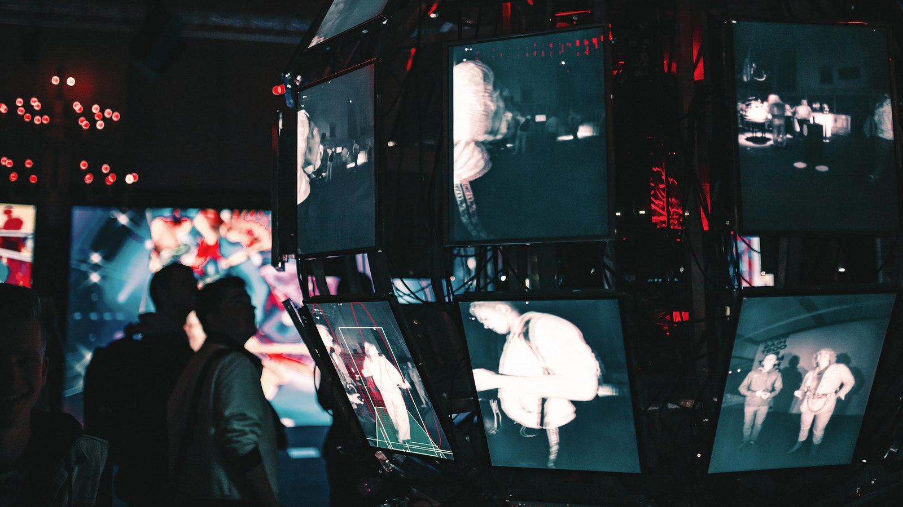

<!-- GENERATED from watch/issues/2026-06-08-video-thumbnails.yml by scripts/build_watch.py. Edit the data file. -->

```{=html}
<p class="mw-kicker">Marketing in 3 · Issue 22 · Week of 8 June 2026</p>
<figure class="mw-hero"><picture><source type="image/webp" sizes="(max-width: 900px) 100vw, 900px" srcset="../../images/web/issue-22-video-thumbnails-960.webp 960w, ../../images/web/issue-22-video-thumbnails-1600.webp 1600w"></picture><figcaption>Every picture competing with every other picture, a second each. Photo: Maxim Hopman on Unsplash.</figcaption></figure>
<section class="mw-answer" aria-label="Short answer"><h2>The short answer</h2><p>Two things, and they pull against each other. Across 22,958 real thumbnails and two experiments, pictures with a moderate amount going on beat both the sparse and the crowded ones by a wide margin. Colour harmony then behaved the other way round: fully matched worked, completely clashing worked, and the compromise between them scored 3.41 out of 7, the worst result anywhere in the study. Aim for the middle on how much you put in the frame, and avoid the middle on how well it hangs together.</p></section>
<section class="mw-takeaways"><h2>Key takeaways</h2><ul><li>A middling amount of detail won: 5.48 out of 7 for clicking, against 4.11 for sparse and 4.49 for crowded.</li><li>Colour harmony split the other way: 5.30 when every element matched, 4.89 when none did, and only 3.41 in between.</li><li>The two settings did not interact, so a thumbnail can be tuned on one without disturbing the other.</li><li>It made no difference whether the creator chose the image or the platform picked it automatically.</li></ul></section>
<section id="what-the-researchers-did"><h2>What the researchers did</h2><p>A thumbnail is the only part of a video most people ever see. Jiaming Fang, Qiqi Zheng, Miyan Liao, Lintong
Han and Lu Liu, working across three Chinese universities, set out to find what separates the ones that get
clicked from the ones that do not.</p><p>They scraped 22,958 videos from Bilibili, the Chinese platform closest to YouTube, across eight categories
from cookery to science, and tracked each one daily for a month. Then they turned the thumbnails over to two
trained models. One scored how much was going on in each picture: the number of objects, the colours, the
edges, the clutter. The other scored how well the colours and textures in a picture fitted together.</p><p>Popularity combined views, comments, likes, shares and saves. To check that the correlations meant something, they then built nine thumbnails of their
own, varying the same two qualities, and put them in front of 423 people browsing a mocked-up page.</p>
<dl class="mw-facts"><div><dt>Thumbnails</dt><dd>22,958 videos tracked daily for 31 days on Bilibili</dd></div><div><dt>Categories</dt><dd>Eight, from study and finance to cute pets, comedy and science</dd></div><div><dt>Two qualities measured</dt><dd>How much detail a picture holds, and how well its colours agree</dd></div><div><dt>Popularity</dt><dd>A combined measure of watching and reacting, with views counted only after five seconds</dd></div><div><dt>Experiments</dt><dd>423 people shown nine made-up thumbnails, then 322 more in a second test</dd></div></dl>
</section>
<section id="busy-is-better-up-to-a-point"><h2>Busy is better, up to a point</h2><p>The first rule is the one people half expect. More going on in a thumbnail earns more clicks, right up until
it does not. The curve rises and then falls, and the top of it sits in the middle.</p><p>In the experiment, the middling version was clicked far more readily than either extreme, and the margin was
wide. A nearly empty thumbnail gives the eye nothing to catch on. A packed one asks for more work than anyone
browsing is willing to do, so they scroll on.</p><p>This holds in the real data too, across all 22,958 videos, and it holds whether a human chose the frame or the
platform picked one automatically. That last point is worth sitting with. The same rule applies to the default
frame your platform grabs, which is the thumbnail most small creators and most brands are quietly running with.</p>
<figure class="mw-chart" id="chart-complexity"><figcaption class="mw-chart-title">How likely people were to click, by how much was in the thumbnail</figcaption><div class="mw-chart-svg"><svg viewBox="0 0 680 154" role="img" aria-labelledby="chart-complexity-t" font-family="Hanken Grotesk, Arial, sans-serif"><title id="chart-complexity-t">How likely people were to click, by how much was in the thumbnail</title><line x1="250.0" y1="4" x2="250.0" y2="128" stroke="#dde1e8" stroke-width="1"/><text x="250.0" y="146" font-size="12" text-anchor="middle" fill="#5b6476">0</text><line x1="301.4" y1="4" x2="301.4" y2="128" stroke="#dde1e8" stroke-width="1"/><text x="301.4" y="146" font-size="12" text-anchor="middle" fill="#5b6476">1</text><line x1="352.9" y1="4" x2="352.9" y2="128" stroke="#dde1e8" stroke-width="1"/><text x="352.9" y="146" font-size="12" text-anchor="middle" fill="#5b6476">2</text><line x1="404.3" y1="4" x2="404.3" y2="128" stroke="#dde1e8" stroke-width="1"/><text x="404.3" y="146" font-size="12" text-anchor="middle" fill="#5b6476">3</text><line x1="455.7" y1="4" x2="455.7" y2="128" stroke="#dde1e8" stroke-width="1"/><text x="455.7" y="146" font-size="12" text-anchor="middle" fill="#5b6476">4</text><line x1="507.1" y1="4" x2="507.1" y2="128" stroke="#dde1e8" stroke-width="1"/><text x="507.1" y="146" font-size="12" text-anchor="middle" fill="#5b6476">5</text><line x1="558.6" y1="4" x2="558.6" y2="128" stroke="#dde1e8" stroke-width="1"/><text x="558.6" y="146" font-size="12" text-anchor="middle" fill="#5b6476">6</text><line x1="610.0" y1="4" x2="610.0" y2="128" stroke="#dde1e8" stroke-width="1"/><text x="610.0" y="146" font-size="12" text-anchor="middle" fill="#5b6476">7</text><g><title>Almost nothing in it: 4.11 out of 7</title><text x="238" y="27" font-size="13.5" text-anchor="end" fill="#15203b">Almost nothing in it</text><rect x="250" y="12" width="211.4" height="22" rx="4" fill="#aab3c5"/><text x="469.4" y="28" font-size="13.5" fill="#15203b">4.11</text></g><g><title>A middling amount: 5.48 out of 7</title><text x="238" y="67" font-size="13.5" text-anchor="end" fill="#15203b" font-weight="600">A middling amount</text><rect x="250" y="52" width="281.8" height="22" rx="4" fill="#e0a12a"/><text x="539.8" y="68" font-size="13.5" fill="#15203b" font-weight="600">5.48</text></g><g><title>Packed: 4.49 out of 7</title><text x="238" y="107" font-size="13.5" text-anchor="end" fill="#15203b">Packed</text><rect x="250" y="92" width="230.9" height="22" rx="4" fill="#aab3c5"/><text x="488.9" y="108" font-size="13.5" fill="#15203b">4.49</text></g></svg></div><div class="mw-sr"><table><caption>How likely people were to click, by how much was in the thumbnail</caption><tr><th>Group</th><th>Value (out of 7)</th></tr><tr><th scope="row">Almost nothing in it</th><td>4.11</td></tr><tr><th scope="row">A middling amount</th><td>5.48</td></tr><tr><th scope="row">Packed</th><td>4.49</td></tr></table></div><p class="mw-chart-src">Experiment with 423 people shown nine constructed thumbnails on a simulated browsing page.</p></figure>
</section>
<section id="with-harmony-the-middle-is-the-worst-place"><h2>With harmony, the middle is the worst place</h2><p>The second rule is the surprise. Colour harmony does not simply help. Thumbnails where everything matched did
well, and so did thumbnails where nothing matched at all. The ones that lost were the half-hearted middle.</p><p>Two different things are going on. A harmonious picture is easy and pleasant to take in, so it reads fast. A
clashing one is jarring enough to be interesting, which stops the scroll for a different reason. A picture
that is neither does neither job.</p><p>The authors tested whether the two rules interfere with each other and found that they do not. You can set the
amount of detail and the degree of harmony separately, which makes this one of the rare design findings you
can act on without a trade-off.</p>
<figure class="mw-chart" id="chart-harmony"><figcaption class="mw-chart-title">How likely people were to click, by how well the thumbnail fitted together</figcaption><div class="mw-chart-svg"><svg viewBox="0 0 680 154" role="img" aria-labelledby="chart-harmony-t" font-family="Hanken Grotesk, Arial, sans-serif"><title id="chart-harmony-t">How likely people were to click, by how well the thumbnail fitted together</title><line x1="250.0" y1="4" x2="250.0" y2="128" stroke="#dde1e8" stroke-width="1"/><text x="250.0" y="146" font-size="12" text-anchor="middle" fill="#5b6476">0</text><line x1="301.4" y1="4" x2="301.4" y2="128" stroke="#dde1e8" stroke-width="1"/><text x="301.4" y="146" font-size="12" text-anchor="middle" fill="#5b6476">1</text><line x1="352.9" y1="4" x2="352.9" y2="128" stroke="#dde1e8" stroke-width="1"/><text x="352.9" y="146" font-size="12" text-anchor="middle" fill="#5b6476">2</text><line x1="404.3" y1="4" x2="404.3" y2="128" stroke="#dde1e8" stroke-width="1"/><text x="404.3" y="146" font-size="12" text-anchor="middle" fill="#5b6476">3</text><line x1="455.7" y1="4" x2="455.7" y2="128" stroke="#dde1e8" stroke-width="1"/><text x="455.7" y="146" font-size="12" text-anchor="middle" fill="#5b6476">4</text><line x1="507.1" y1="4" x2="507.1" y2="128" stroke="#dde1e8" stroke-width="1"/><text x="507.1" y="146" font-size="12" text-anchor="middle" fill="#5b6476">5</text><line x1="558.6" y1="4" x2="558.6" y2="128" stroke="#dde1e8" stroke-width="1"/><text x="558.6" y="146" font-size="12" text-anchor="middle" fill="#5b6476">6</text><line x1="610.0" y1="4" x2="610.0" y2="128" stroke="#dde1e8" stroke-width="1"/><text x="610.0" y="146" font-size="12" text-anchor="middle" fill="#5b6476">7</text><g><title>Nothing matches: 4.89 out of 7</title><text x="238" y="27" font-size="13.5" text-anchor="end" fill="#15203b">Nothing matches</text><rect x="250" y="12" width="251.5" height="22" rx="4" fill="#aab3c5"/><text x="509.5" y="28" font-size="13.5" fill="#15203b">4.89</text></g><g><title>Somewhere in between: 3.41 out of 7</title><text x="238" y="67" font-size="13.5" text-anchor="end" fill="#15203b" font-weight="600">Somewhere in between</text><rect x="250" y="52" width="175.4" height="22" rx="4" fill="#e0a12a"/><text x="433.4" y="68" font-size="13.5" fill="#15203b" font-weight="600">3.41</text></g><g><title>Everything matches: 5.30 out of 7</title><text x="238" y="107" font-size="13.5" text-anchor="end" fill="#15203b">Everything matches</text><rect x="250" y="92" width="272.6" height="22" rx="4" fill="#aab3c5"/><text x="530.6" y="108" font-size="13.5" fill="#15203b">5.30</text></g></svg></div><div class="mw-sr"><table><caption>How likely people were to click, by how well the thumbnail fitted together</caption><tr><th>Group</th><th>Value (out of 7)</th></tr><tr><th scope="row">Nothing matches</th><td>4.89</td></tr><tr><th scope="row">Somewhere in between</th><td>3.41</td></tr><tr><th scope="row">Everything matches</th><td>5.3</td></tr></table></div><p class="mw-chart-src">The same experiment: the lowest score belongs to the middle, not to either extreme.</p></figure>
</section>
<section id="who-this-matters-most-for"><h2>Who this matters most for</h2><p>The effects were sharpest for two kinds of video. Useful ones, where the viewer wants to learn or decide
something, mattered more than entertainment. So did typical ones, meaning videos that look like everything
else in their category, where the thumbnail is the only thing doing the separating.</p><p>Viewer type mattered too. People who were already interested in the subject reacted more strongly to how busy
the picture was. For them a crowded thumbnail is genuinely more work, because they are actually reading it
rather than glancing past.</p><p>Interestingly, that pattern did not repeat for harmony. Whether a picture hangs together seems to register the
same way for everyone, interested or not, which fits the idea that harmony is processed almost instantly while
detail has to be worked through.</p>
</section>
<section id="beyond-the-thumbnail"><h2>Beyond the thumbnail</h2><p>The study is about video, but the situation it describes is everywhere: a grid of competing images, a second
of attention each, one of them has to win. Product listings on a marketplace, creative variants in an ad
carousel, app icons on a crowded store page, the hero image at the top of an email.</p><p>Going past what was actually tested, the two rules translate neatly. Give the eye three or four things to look
at rather than one or ten. Then decide whether your picture is going to be the calm one or the loud one in the
grid, and commit, because the version that hedges is the version that gets scrolled past.</p><p>The caveat worth carrying is cultural. This is Chinese data, and interfaces there run busier than Western ones
by habit. The shape of the curves should travel. The exact place the peak sits probably does not.</p>
</section>
<section id="how-to-apply-it" class="mw-howto"><p class="mw-rsg-kicker">Marketing in 3 steps</p><h2>Ready. Set. Market.</h2><div class="mw-rsg"><div class="mw-phase"><div class="mw-phase-dot" aria-hidden="true">1</div><div class="mw-phase-tag"><span class="mw-phase-name">Ready</span><span class="mw-phase-sub">Decide and prepare</span></div><ul class="mw-rsg-steps"><li><strong>Start with one video.</strong> Pick your best performing video, or the next one you are about to post. Change one thumbnail at a time. If you change five at once you will never know which change worked.</li><li><strong>Count what is in the picture.</strong> Open your current thumbnail and count the separate things in it. A face, a product, a word, a background, an arrow. One or two is too bare. Six or more is a mess. Three or four is the target.</li></ul></div><div class="mw-phase"><div class="mw-phase-dot" aria-hidden="true">2</div><div class="mw-phase-tag"><span class="mw-phase-name">Set</span><span class="mw-phase-sub">Build it</span></div><ul class="mw-rsg-steps"><li><strong>Build it to three or four parts.</strong> Make a new version with three or four clear things in it and nothing else. Cut the rest. Then shrink it on your screen until it is the size of a stamp. If you cannot tell what it is at that size, it is still too busy.</li><li><strong>Pick calm or loud, not in between.</strong> Decide which one you are making. Calm means every colour in the picture goes together. Loud means one colour clearly fights the others. Both work. A picture that is a bit of each is the one people skip.</li></ul></div><div class="mw-phase"><div class="mw-phase-dot" aria-hidden="true">3</div><div class="mw-phase-tag"><span class="mw-phase-name">Market</span><span class="mw-phase-sub">Launch and measure</span></div><ul class="mw-rsg-steps"><li><strong>Swap it and wait a week.</strong> Change the picture and leave the title exactly as it is. Give it seven days. Then compare clicks with the week before, or with a similar video you did not touch.</li><li><strong>Keep the ones that win.</strong> Save every thumbnail that beat the one before it in a folder. After ten of them you will see your own pattern, and you can stop guessing.</li></ul></div></div></section>
<div class="mw-coffee" role="complementary" aria-label="Support Marketing in 3"><div class="mw-coffee-text"><p class="mw-coffee-title">Found this useful?</p><p>Marketing in 3 is free and ad-free, with new issues every Monday and Thursday. A coffee keeps it that way.</p></div><a class="mw-coffee-btn" href="https://ko-fi.com/marketingin3" target="_blank" rel="noopener"><svg aria-hidden="true" focusable="false"
  class="lucide lucide-coffee"
  xmlns="http://www.w3.org/2000/svg"
  width="24"
  height="24"
  viewBox="0 0 24 24"
  fill="none"
  stroke="currentColor"
  stroke-width="2"
  stroke-linecap="round"
  stroke-linejoin="round"
>
  <path d="M10 2v2" />
  <path d="M14 2v2" />
  <path d="M16 8a1 1 0 0 1 1 1v8a4 4 0 0 1-4 4H7a4 4 0 0 1-4-4V9a1 1 0 0 1 1-1h14a4 4 0 1 1 0 8h-1" />
  <path d="M6 2v2" />
</svg><span>Buy me a coffee</span><span class="mw-coffee-price">€3</span></a></div>
<section id="what-to-expect"><h2>What to expect</h2><ul class="mw-list"><li><strong>A click effect, not a watch effect.</strong> This changes who starts the video. It does nothing for what happens after that, which is still down to the content.</li><li><strong>Bigger gains on useful videos.</strong> How-to, review and explainer content responds more than entertainment.</li><li><strong>Most of the outcome is elsewhere.</strong> The models explained roughly a sixth of why some videos do better, so the thumbnail is a real lever and a small one.</li><li><strong>Default frames are costing you.</strong> The automatic frame a platform grabs follows the same rules and usually lands badly on both.</li></ul></section>
<section id="where-it-does-not-work"><h2>Where it does not work</h2><ul class="mw-list"><li><strong>One platform, one country.</strong> All the real-world data came from Bilibili in China, where interfaces and tastes run busier than in Europe or the United States.</li><li><strong>Machines judged the pictures.</strong> Detail and harmony were scored by trained models rather than by people, so the measures are consistent but not quite what a human eye would call busy or tidy.</li><li><strong>A month of data.</strong> Videos were tracked for 31 consecutive days, which says nothing about how a thumbnail performs over a longer life.</li><li><strong>Made-up thumbnails in the experiments.</strong> The causal tests used nine constructed images on a simulated page, not real videos competing in a real feed.</li></ul></section>
<section id="questions"><h2>Questions marketers ask</h2><div class="mw-faq"><h3>What makes a good video thumbnail?</h3><p>A moderate amount of detail and a decisive choice on colour. In a browsing test, pictures holding a moderate amount were clicked a good deal more often than either sparse or crowded ones, and the same shape showed up across nearly 23,000 live videos (Fang et al., 2026, Journal of the Academy of Marketing Science).</p></div><div class="mw-faq"><h3>Should a thumbnail be simple or detailed?</h3><p>Neither extreme. Too little and there is nothing to catch the eye. Too much and the viewer has to work, so they scroll past. Three or four clear elements is the practical version of the finding.</p></div><div class="mw-faq"><h3>Do colours in a thumbnail need to match?</h3><p>Either fully or not at all. Both extremes were clicked more than the compromise, which came last by a wide margin. Harmony reads as pleasant, clashing reads as interesting, and halfway reads as nothing at all.</p></div><div class="mw-faq"><h3>Does it matter if the platform picks the thumbnail automatically?</h3><p>The same rules applied to automatically selected frames as to ones creators chose, which means a default frame is usually an unmanaged risk rather than a neutral choice.</p></div><div class="mw-faq"><h3>Which videos benefit most from thumbnail work?</h3><p>Practical, information-led videos, and videos that sit in a crowded category where everything looks alike. In both cases the picture is doing most of the work of standing out.</p></div></section>
<section id="also-new"><h2>Also new this week</h2><div class="mw-also"><article><p class="mw-also-src"><em>Journal of Marketing Research</em> · 2026</p><h3><a href="https://doi.org/10.1177/00222437261460880">The three-dimensional effect in logo design: When depth cues improve brand purchase likelihood</a></h3><p class="mw-also-au">Togawa, T., &amp; Onzo, N.</p><p>Logos drawn with depth, through shading and perspective, raised purchase likelihood by reading as more real and so more trustworthy. The gain only appeared in visually simple surroundings and for physical products. Put the same logo in a busy layout or on something abstract and the advantage disappears.</p></article><article><p class="mw-also-src"><em>Psychology &amp; Marketing</em> · 2026</p><h3><a href="https://doi.org/10.1002/mar.70180">From real to artificial: How profile image realism shapes warmth, competence, and trade outcomes in swapping platforms</a></h3><p class="mw-also-au">Alhouti, S., Pierre, L., &amp; Liu, X.</p><p>On a swapping platform, people with realistic profile pictures traded more, and the effect was strongest where the listing itself gave little away. A third study swapped in AI-made portraits and found they persuaded less once other information was plentiful. When buyers cannot check the facts, they read the face.</p></article></div></section>
<section id="source" class="mw-source"><h2>Source</h2><p class="mw-cite">Fang, J., Zheng, Q., Liao, M., Han, L., &amp; Liu, L. (2026). Thumbnail power: Visual cues and video popularity on UGV platforms. <em>Journal of the Academy of Marketing Science</em>, <em>54</em>, 815-837. <a href="https://doi.org/10.1007/s11747-026-01152-6">https://doi.org/10.1007/s11747-026-01152-6</a></p><p class="mw-note">This brief is written for practitioners from the published article. Numbers are as reported by the authors; read the article for full methods.</p></section>

<section id="keep-reading" class="mw-more"><h2>Keep reading</h2><p class="mw-more-topics">More issues on <a href="../../topics/ugc.html">UGC</a> · <a href="../../topics/creative.html">Creative</a> · <a href="../../topics/social-media.html">Social media</a></p><div class="watch-list"><article class="watch-item"><a class="watch-thumb" href="../../posts/brand-followers-ai/index.html" tabindex="-1" aria-hidden="true"></a><div><p class="watch-meta">Issue 43 · <time datetime="2026-11-02">Monday 2 November 2026</time></p><h3><a href="../../posts/brand-followers-ai/index.html">Five kinds of brand follower, and why AI hasn&#x27;t changed them</a></h3><p>Schivinski&#x27;s machine learning study of 1,356 brand followers found five engagement patterns driven by commitment, and they still matter in the age of AI.</p></div></article><article class="watch-item"><a class="watch-thumb" href="../../posts/visual-consistency-influencers/index.html" tabindex="-1" aria-hidden="true"></a><div><p class="watch-meta">Issue 41 · <time datetime="2026-10-19">Week of 19 October 2026</time></p><h3><a href="../../posts/visual-consistency-influencers/index.html">Matching looks suit posts, a mix suits stories</a></h3><p>Boluki et al. studied 1,812 Instagram posts and stories from 182 influencer campaigns: matching looks suit posts, while stories do better with a mix.</p></div></article><article class="watch-item"><a class="watch-thumb" href="../../posts/trend-atypicality/index.html" tabindex="-1" aria-hidden="true"></a><div><p class="watch-meta">Issue 40 · <time datetime="2026-10-12">Week of 12 October 2026</time></p><h3><a href="../../posts/trend-atypicality/index.html">Trend videos with a twist beat close copies</a></h3><p>An analysis of 85,000 TikTok dance videos plus three experiments finds that putting your own spin on a trend earns more likes than copying it closely.</p></div></article></div></section>
<div class="mw-author"><div><p><strong>Bruno Schivinski</strong> is Associate Professor of Marketing at Gdańsk University of Technology. He studies how consumers engage with brands in digital and social media.</p><p><a href="../../../index.html">About Bruno</a> · <a href="../../index.html">All Marketing in 3 issues</a> · <a href="../../subscribe.html">Subscribe</a></p></div></div>
<nav class="mw-pn" aria-label="More issues"><a class="mw-prev" href="../deepfake-ugc-recognition/index.html"><span>Previous issue</span>Caught, not told: the worst way for an AI actor to be found out</a><a class="mw-next" href="../review-photo-quality/index.html"><span>Next issue</span>Nobody styles a photo of a bad cookie</a></nav>
```
