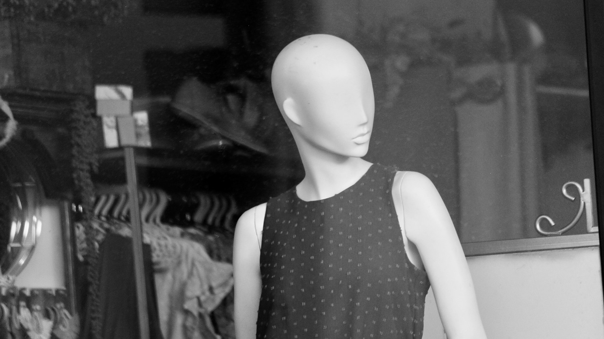

<!-- GENERATED from watch/issues/2026-09-21-virtual-influencer-meta-analysis.yml by scripts/build_watch.py. Edit the data file. -->

```{=html}
<p class="mw-kicker">Marketing in 3 · Issue 37 · Week of 21 September 2026</p>
<figure class="mw-hero"><picture><source type="image/webp" sizes="(max-width: 900px) 100vw, 900px" srcset="../../images/web/issue-37-virtual-influencer-meta-analysis-960.webp 960w, ../../images/web/issue-37-virtual-influencer-meta-analysis-1600.webp 1600w"></picture><figcaption>A figure that looks human without being one. How far a virtual influencer goes in that direction turns out to matter. Photo: Hennie Stander on Unsplash.</figcaption></figure>
<section class="mw-answer" aria-label="Short answer"><h2>The short answer</h2><p>They work differently from human influencers, and it depends on the design. Compared with human endorsers, virtual influencers drew similar engagement, more novelty, and less credibility, weaker attitudes and weaker purchase intentions. The more human they look, the more they win by being believable. The more cartoon-like they look, the more they win by being new. And as people get used to them, the novelty fades while believability gains ground.</p></section>
<section class="mw-takeaways"><h2>Key takeaways</h2><ul><li>Compared with human influencers, virtual ones rated lower on credibility, brand and ad attitudes and purchase intention, with no clear difference in engagement.</li><li>They did score higher on novelty. Cartoon-like characters had a much larger novelty boost than lifelike ones.</li><li>Lifelike characters persuade mainly through credibility. Cartoon-like ones persuade mainly through novelty.</li><li>Over time, the novelty advantage shrank by about two thirds across studies, while the credibility penalty roughly halved.</li></ul></section>
<section id="what-the-researchers-did"><h2>What the researchers did</h2><p>Virtual influencers are computer-generated characters with their own social media accounts and brand deals. Some look
almost like real people. Others are cartoons. Dozens of experiments have asked whether they sell as well as humans, and the answers
have disagreed. Some find they are better, some equal, some worse.</p><p>The authors searched every database they could find through the end of 2025 and kept only experiments that compared a virtual
influencer with a human one. That left 110 papers, 210 separate experiments and 643 measured effects, covering 91,058 consumers.
They put the results on a common scale and then asked what explains the differences between studies.</p><p>They tested two ideas. The first is that how human the character looks changes how it persuades. The second is that
novelty, which pulls in attention at first, wears off as people get used to the characters. They also
surveyed 204 marketing professionals for a practitioner view.</p>
<dl class="mw-facts"><div><dt>Papers</dt><dd>110 papers reporting 210 experiments and 643 effect sizes</dd></div><div><dt>Consumers</dt><dd>91,058 across all the experiments</dd></div><div><dt>Comparison</dt><dd>A virtual influencer against a human influencer, almost always</dd></div><div><dt>Search</dt><dd>1,289 papers screened from major databases, searched to the end of 2025</dd></div><div><dt>Practitioner check</dt><dd>A survey of 204 marketing and communication professionals</dd></div></dl>
</section>
<section id="novelty-up-credibility-down"><h2>Novelty up, credibility down</h2><p>On average, virtual influencers did worse than human ones on the outcomes that matter to a sale. They were rated less credible,
and produced weaker attitudes toward the ad and the brand and weaker intentions to buy. The gap was largest for
credibility.</p><p>Engagement was the exception. Likes, comments and shares showed no reliable difference. Virtual influencers can
hold an audience without persuading it as well.</p><p>The one clear advantage was novelty. Virtual influencers came across as newer and more unusual, which people respond to.</p><p>So the old question of whether virtual influencers are better or worse than humans has no single answer.
They trade trust for freshness, and the question is how much of each a campaign needs.</p>
</section>
<section id="how-human-it-looks-changes-how-it-persuades"><h2>How human it looks changes how it persuades</h2><p>The more useful finding is about design. The authors split characters into highly lifelike ones and low-likeness ones, such as
cartoons and obvious characters.</p><p>Lifelike influencers lost less credibility and gained less novelty. Their credibility shortfall was less than half the
cartoon-like one, and their novelty boost about a third of it. Credibility
also carried more weight in shaping attitudes for lifelike characters, while novelty carried more weight for
cartoon-like ones.</p><p>Put simply, a lifelike character is judged as if it were a person, using the usual yardsticks of
expertise and trustworthiness. A stylised character is judged as a curiosity, and it persuades by being interesting.</p>
<figure class="mw-chart" id="chart-design"><figcaption class="mw-chart-title">Virtual vs human influencer, by look of the character (correlation x 100)</figcaption><div class="mw-chart-svg"><svg viewBox="0 0 699 194" role="img" aria-labelledby="chart-design-t" font-family="Hanken Grotesk, Arial, sans-serif"><title id="chart-design-t">Virtual vs human influencer, by look of the character (correlation x 100)</title><line x1="269.0" y1="4" x2="269.0" y2="168" stroke="#dde1e8" stroke-width="1"/><text x="269.0" y="186" font-size="12" text-anchor="middle" fill="#5b6476">0</text><line x1="329.0" y1="4" x2="329.0" y2="168" stroke="#dde1e8" stroke-width="1"/><text x="329.0" y="186" font-size="12" text-anchor="middle" fill="#5b6476">10</text><line x1="389.0" y1="4" x2="389.0" y2="168" stroke="#dde1e8" stroke-width="1"/><text x="389.0" y="186" font-size="12" text-anchor="middle" fill="#5b6476">20</text><line x1="449.0" y1="4" x2="449.0" y2="168" stroke="#dde1e8" stroke-width="1"/><text x="449.0" y="186" font-size="12" text-anchor="middle" fill="#5b6476">30</text><line x1="509.0" y1="4" x2="509.0" y2="168" stroke="#dde1e8" stroke-width="1"/><text x="509.0" y="186" font-size="12" text-anchor="middle" fill="#5b6476">40</text><line x1="569.0" y1="4" x2="569.0" y2="168" stroke="#dde1e8" stroke-width="1"/><text x="569.0" y="186" font-size="12" text-anchor="middle" fill="#5b6476">50</text><line x1="629.0" y1="4" x2="629.0" y2="168" stroke="#dde1e8" stroke-width="1"/><text x="629.0" y="186" font-size="12" text-anchor="middle" fill="#5b6476">60</text><g><title>Novelty boost, lifelike: 21 </title><text x="257" y="27" font-size="13.5" text-anchor="end" fill="#15203b" font-weight="600">Novelty boost, lifelike</text><rect x="269" y="12" width="126.0" height="22" rx="4" fill="#e0a12a"/><text x="403.0" y="28" font-size="13.5" fill="#15203b" font-weight="600">21</text></g><g><title>Novelty boost, cartoon-like: 58 </title><text x="257" y="67" font-size="13.5" text-anchor="end" fill="#15203b">Novelty boost, cartoon-like</text><rect x="269" y="52" width="348.0" height="22" rx="4" fill="#aab3c5"/><text x="625.0" y="68" font-size="13.5" fill="#15203b">58</text></g><g><title>Credibility shortfall, lifelike: 9 </title><text x="257" y="107" font-size="13.5" text-anchor="end" fill="#15203b" font-weight="600">Credibility shortfall, lifelike</text><rect x="269" y="92" width="54.0" height="22" rx="4" fill="#e0a12a"/><text x="331.0" y="108" font-size="13.5" fill="#15203b" font-weight="600">9</text></g><g><title>Credibility shortfall, cartoon-like: 22 </title><text x="257" y="147" font-size="13.5" text-anchor="end" fill="#15203b">Credibility shortfall, cartoon-like</text><rect x="269" y="132" width="132.0" height="22" rx="4" fill="#aab3c5"/><text x="409.0" y="148" font-size="13.5" fill="#15203b">22</text></g></svg></div><div class="mw-sr"><table><caption>Virtual vs human influencer, by look of the character (correlation x 100)</caption><tr><th>Group</th><th>Value ()</th></tr><tr><th scope="row">Novelty boost, lifelike</th><td>21</td></tr><tr><th scope="row">Novelty boost, cartoon-like</th><td>58</td></tr><tr><th scope="row">Credibility shortfall, lifelike</th><td>9</td></tr><tr><th scope="row">Credibility shortfall, cartoon-like</th><td>22</td></tr></table></div><p class="mw-chart-src">Table 9, MASEM paths from virtual influencer to novelty and to credibility, high versus low anthropomorphism. Credibility bars show the size of the shortfall against human influencers.</p></figure>
</section>
<section id="what-to-pair-with-which"><h2>What to pair with which</h2><p>The authors then looked at which campaign choices fit which design. Lifelike characters did better with these:</p><p>- a character presented as acting on its own
- a brand positioned as futuristic
- a new, unfamiliar product
- rational messages
- emphasis on touch, taste or smell</p><p>Cartoon-like characters did better with the opposite choices: no claim of independence, a traditional brand, a familiar
product, emotional messages, and emphasis on sight and sound.</p><p>The logic is fit. Touch and taste claims need a character that could plausibly have a body to experience them, and sight and
sound claims do not. Several other factors made no difference to the result, including whether the brand sells function or
experience, whether the tone is entertaining or informative, and whether the product is high or low involvement.
So many everyday campaign choices do not need to be tuned to the character&#x27;s look.</p><p>Professionals in the survey agreed on the general picture: they rated virtual influencers best on novelty and worst on
credibility and purchase intention.</p>
</section>
<section id="novelty-wears-off"><h2>Novelty wears off</h2><p>The last test was over time. The authors compared earlier studies with more recent ones. The novelty advantage was
much smaller in the recent group, as people tend to habituate to anything new.</p><p>The credibility shortfall also eased. In recent studies, a virtual influencer&#x27;s credibility gap was roughly half what it was
earlier, and credibility did more to shape attitudes. The authors suggest that as the characters become familiar,
people judge them less as a novelty and more as a source of recommendations.</p><p>The practical consequence is that a campaign built mainly on novelty has a shelf life. A character that persuades by being unusual
will need something besides novelty as audiences get used to it.</p>
<figure class="mw-chart" id="chart-time"><figcaption class="mw-chart-title">Virtual vs human influencer, earlier and recent studies (correlation x 100)</figcaption><div class="mw-chart-svg"><svg viewBox="0 0 680 194" role="img" aria-labelledby="chart-time-t" font-family="Hanken Grotesk, Arial, sans-serif"><title id="chart-time-t">Virtual vs human influencer, earlier and recent studies (correlation x 100)</title><line x1="250.0" y1="4" x2="250.0" y2="168" stroke="#dde1e8" stroke-width="1"/><text x="250.0" y="186" font-size="12" text-anchor="middle" fill="#5b6476">0</text><line x1="310.0" y1="4" x2="310.0" y2="168" stroke="#dde1e8" stroke-width="1"/><text x="310.0" y="186" font-size="12" text-anchor="middle" fill="#5b6476">10</text><line x1="370.0" y1="4" x2="370.0" y2="168" stroke="#dde1e8" stroke-width="1"/><text x="370.0" y="186" font-size="12" text-anchor="middle" fill="#5b6476">20</text><line x1="430.0" y1="4" x2="430.0" y2="168" stroke="#dde1e8" stroke-width="1"/><text x="430.0" y="186" font-size="12" text-anchor="middle" fill="#5b6476">30</text><line x1="490.0" y1="4" x2="490.0" y2="168" stroke="#dde1e8" stroke-width="1"/><text x="490.0" y="186" font-size="12" text-anchor="middle" fill="#5b6476">40</text><line x1="550.0" y1="4" x2="550.0" y2="168" stroke="#dde1e8" stroke-width="1"/><text x="550.0" y="186" font-size="12" text-anchor="middle" fill="#5b6476">50</text><line x1="610.0" y1="4" x2="610.0" y2="168" stroke="#dde1e8" stroke-width="1"/><text x="610.0" y="186" font-size="12" text-anchor="middle" fill="#5b6476">60</text><g><title>Novelty boost, earlier studies: 58 </title><text x="238" y="27" font-size="13.5" text-anchor="end" fill="#15203b" font-weight="600">Novelty boost, earlier studies</text><rect x="250" y="12" width="348.0" height="22" rx="4" fill="#e0a12a"/><text x="606.0" y="28" font-size="13.5" fill="#15203b" font-weight="600">58</text></g><g><title>Novelty boost, recent studies: 20 </title><text x="238" y="67" font-size="13.5" text-anchor="end" fill="#15203b">Novelty boost, recent studies</text><rect x="250" y="52" width="120.0" height="22" rx="4" fill="#aab3c5"/><text x="378.0" y="68" font-size="13.5" fill="#15203b">20</text></g><g><title>Credibility shortfall, earlier: 25 </title><text x="238" y="107" font-size="13.5" text-anchor="end" fill="#15203b" font-weight="600">Credibility shortfall, earlier</text><rect x="250" y="92" width="150.0" height="22" rx="4" fill="#e0a12a"/><text x="408.0" y="108" font-size="13.5" fill="#15203b" font-weight="600">25</text></g><g><title>Credibility shortfall, recent: 12 </title><text x="238" y="147" font-size="13.5" text-anchor="end" fill="#15203b">Credibility shortfall, recent</text><rect x="250" y="132" width="72.0" height="22" rx="4" fill="#aab3c5"/><text x="330.0" y="148" font-size="13.5" fill="#15203b">12</text></g></svg></div><div class="mw-sr"><table><caption>Virtual vs human influencer, earlier and recent studies (correlation x 100)</caption><tr><th>Group</th><th>Value ()</th></tr><tr><th scope="row">Novelty boost, earlier studies</th><td>58</td></tr><tr><th scope="row">Novelty boost, recent studies</th><td>20</td></tr><tr><th scope="row">Credibility shortfall, earlier</th><td>25</td></tr><tr><th scope="row">Credibility shortfall, recent</th><td>12</td></tr></table></div><p class="mw-chart-src">Table 10, MASEM paths from virtual influencer to novelty and to credibility, earlier versus recent period. Credibility bars show the size of the shortfall against human influencers.</p></figure>
</section>
<section id="how-to-apply-it" class="mw-howto"><p class="mw-rsg-kicker">Marketing in 3 steps</p><h2>Ready. Set. Market.</h2><div class="mw-rsg"><div class="mw-phase"><div class="mw-phase-dot" aria-hidden="true">1</div><div class="mw-phase-tag"><span class="mw-phase-name">Ready</span><span class="mw-phase-sub">Decide and prepare</span></div><ul class="mw-rsg-steps"><li><strong>Choose one goal.</strong> Write one sentence stating what the campaign is for: to be trusted or to get noticed. If you write both, pick the one you would give up the other for.</li><li><strong>Match the character to the goal.</strong> If the goal is trust, pick a lifelike character. If the goal is attention, pick a stylised or cartoon-like one. Show your shortlist to five colleagues and ask which one they would believe.</li></ul></div><div class="mw-phase"><div class="mw-phase-dot" aria-hidden="true">2</div><div class="mw-phase-tag"><span class="mw-phase-name">Set</span><span class="mw-phase-sub">Build it</span></div><ul class="mw-rsg-steps"><li><strong>Check the product and brand fit.</strong> Lifelike suits a new product or a forward-looking brand. A stylised character suits a familiar product or a traditional brand. If your answers split, go with the product.</li><li><strong>Write the message to suit.</strong> For a lifelike character, lead with facts and, where it fits, touch, taste or smell. For a stylised one, lead with feeling and use sight and sound. Draft one post each way.</li></ul></div><div class="mw-phase"><div class="mw-phase-dot" aria-hidden="true">3</div><div class="mw-phase-tag"><span class="mw-phase-name">Market</span><span class="mw-phase-sub">Launch and measure</span></div><ul class="mw-rsg-steps"><li><strong>Test two versions.</strong> Show each version to a separate, equal audience of at least 1,000 people. Compare engagement and ask one trust question afterwards, such as &quot;How much do you trust this recommendation, from 1 to 7?&quot;.</li><li><strong>Check again after eight weeks.</strong> Repeat the trust question and the engagement count with the same character. If attention falls while trust holds, plan a new angle before novelty runs out.</li></ul></div></div></section>
<div class="mw-coffee" role="complementary" aria-label="Support Marketing in 3"><div class="mw-coffee-text"><p class="mw-coffee-title">Found this useful?</p><p>Marketing in 3 is free and ad-free, with new issues every Monday and Thursday. A coffee keeps it that way.</p></div><a class="mw-coffee-btn" href="https://ko-fi.com/marketingin3" target="_blank" rel="noopener"><svg aria-hidden="true" focusable="false"
  class="lucide lucide-coffee"
  xmlns="http://www.w3.org/2000/svg"
  width="24"
  height="24"
  viewBox="0 0 24 24"
  fill="none"
  stroke="currentColor"
  stroke-width="2"
  stroke-linecap="round"
  stroke-linejoin="round"
>
  <path d="M10 2v2" />
  <path d="M14 2v2" />
  <path d="M16 8a1 1 0 0 1 1 1v8a4 4 0 0 1-4 4H7a4 4 0 0 1-4-4V9a1 1 0 0 1 1-1h14a4 4 0 1 1 0 8h-1" />
  <path d="M6 2v2" />
</svg><span>Buy me a coffee</span><span class="mw-coffee-price">€3</span></a></div>
<section id="what-to-expect"><h2>What to expect</h2><ul class="mw-list"><li><strong>Attention without conversion.</strong> Expect engagement to look like a human campaign&#x27;s while purchase intentions lag.</li><li><strong>A fading edge.</strong> The novelty advantage shrinks as audiences see more of these characters, so plan fresh content.</li><li><strong>Design is the big lever.</strong> The look of the character is the main choice, and it is hard to change once a character is chosen.</li><li><strong>Many small choices do not matter.</strong> Tone, involvement and narrative voice did not interact with the design, so spend your testing time elsewhere.</li></ul></section>
<section id="where-it-does-not-work"><h2>Where it does not work</h2><ul class="mw-list"><li><strong>Experiments, not sales.</strong> The studies measure attitudes, intentions and engagement in controlled settings, not purchases or long-term brand value.</li><li><strong>Mostly human comparisons.</strong> Almost every experiment compared a virtual influencer with a human, so the results say less about virtual influencers versus other kinds of ads.</li><li><strong>A young field.</strong> The earlier and recent groups differ in more than time, such as the characters and platforms used.</li><li><strong>Survey is small.</strong> The 204 professionals offer a perspective, not a test of the effects.</li></ul></section>
<section id="questions"><h2>Questions marketers ask</h2><div class="mw-faq"><h3>Are virtual influencers as effective as human influencers?</h3><p>On engagement, about equal. On credibility, attitudes and purchase intention, they did worse, and on novelty they did better. That is the pattern across 210 experiments (Barari, Eisend &amp; Kulczynski, 2026, Journal of the Academy of Marketing Science).</p></div><div class="mw-faq"><h3>Should a virtual influencer look more human?</h3><p>It depends on the goal. A lifelike character does better where trust and credibility matter. A stylised one does better where attention matters. Neither design wins everywhere.</p></div><div class="mw-faq"><h3>Does the novelty of virtual influencers last?</h3><p>Not fully. The novelty advantage was much smaller in recent studies than in earlier ones, while the credibility gap narrowed.</p></div><div class="mw-faq"><h3>Which products suit a virtual influencer?</h3><p>New products suit lifelike characters, and familiar products suit stylised ones. Touch, taste and smell claims fit lifelike characters better, while sight and sound claims fit both.</p></div><div class="mw-faq"><h3>How reliable are these results?</h3><p>They rest on a large set of experiments and checks across journals and published or unpublished papers. They are still lab-style measures of attitudes and intentions, and not of actual sales.</p></div></section>
<section id="also-new"><h2>Also new this week</h2><div class="mw-also"><article><p class="mw-also-src"><em>Journal of the Academy of Marketing Science</em> · 2026</p><h3><a href="https://doi.org/10.1007/s11747-026-01185-x">What drives virtual influencers&#x27; impact?</a></h3><p class="mw-also-au">Cascio Rizzo, Villarroel Ordenes, &amp; Berger</p><p>Posts that show a virtual influencer with a human they seem to interact with drew more engagement and choice than posts with a human who is merely present. The mechanism is that the social tie makes the character seem more human and so more trustworthy. The boost was larger for less humanlike characters and absent when the companion was another virtual figure. If you use a virtual influencer, show it in company.</p></article><article><p class="mw-also-src"><em>Journal of Advertising Research</em> · 2026</p><h3><a href="https://doi.org/10.1080/00218499.2026.2620892">A Meta-Analytic Comparison of Human Influencers and Virtual Influencers Across Different Levels of Human-Likeness: Is Humanness More Persuasive?</a></h3><p class="mw-also-au">Chu, Looi, &amp; Liu</p><p>A second meta-analysis, of 46 experiments, finds virtual influencers matched humans on behavioural intentions and actual behaviour while trailing on attitudes. They fell short when follower counts were low or hidden and caught up when the count was high. Human-like characters beat anime-like ones on source perceptions and behavioural intentions. Show a large follower count.</p></article></div></section>
<section id="source" class="mw-source"><h2>Source</h2><p class="mw-cite">Barari, M., Eisend, M., &amp; Kulczynski, A. (2026). Virtual influencer marketing: A meta-analytic review. <em>Journal of the Academy of Marketing Science</em>, <em>54</em>(5), 1209-1233. <a href="https://doi.org/10.1007/s11747-026-01186-w">https://doi.org/10.1007/s11747-026-01186-w</a></p><p class="mw-note">This brief is written for practitioners from the published article. Open access (CC BY 4.0): free to read at the publisher. Numbers are as reported by the authors; read the article for full methods.</p></section>

<section id="keep-reading" class="mw-more"><h2>Keep reading</h2><p class="mw-more-topics">More issues on <a href="../../topics/influencers.html">Influencers</a> · <a href="../../topics/ai.html">AI</a> · <a href="../../topics/social-media.html">Social media</a></p><div class="watch-list"><article class="watch-item"><a class="watch-thumb" href="../../posts/brand-followers-ai/index.html" tabindex="-1" aria-hidden="true"></a><div><p class="watch-meta">Issue 43 · <time datetime="2026-11-02">Monday 2 November 2026</time></p><h3><a href="../../posts/brand-followers-ai/index.html">Five kinds of brand follower, and why AI hasn&#x27;t changed them</a></h3><p>Schivinski&#x27;s machine learning study of 1,356 brand followers found five engagement patterns driven by commitment, and they still matter in the age of AI.</p></div></article><article class="watch-item"><a class="watch-thumb" href="../../posts/visual-consistency-influencers/index.html" tabindex="-1" aria-hidden="true"></a><div><p class="watch-meta">Issue 41 · <time datetime="2026-10-19">Week of 19 October 2026</time></p><h3><a href="../../posts/visual-consistency-influencers/index.html">Matching looks suit posts, a mix suits stories</a></h3><p>Boluki et al. studied 1,812 Instagram posts and stories from 182 influencer campaigns: matching looks suit posts, while stories do better with a mix.</p></div></article><article class="watch-item"><a class="watch-thumb" href="../../posts/synthetic-person-disclosure/index.html" tabindex="-1" aria-hidden="true"></a><div><p class="watch-meta">Issue 36 · <time datetime="2026-09-14">Week of 14 September 2026</time></p><h3><a href="../../posts/synthetic-person-disclosure/index.html">The label that buys honesty, then spends it on artificiality</a></h3><p>A detailed &quot;this person does not exist&quot; label cut the sense of being manipulated and raised the sense of artificiality. The two effects cancelled out, except among younger viewers.</p></div></article></div></section>
<div class="mw-author"><div><p><strong>Bruno Schivinski</strong> is Associate Professor of Marketing at Gdańsk University of Technology. He studies how consumers engage with brands in digital and social media.</p><p><a href="../../../index.html">About Bruno</a> · <a href="../../index.html">All Marketing in 3 issues</a> · <a href="../../subscribe.html">Subscribe</a></p></div></div>
<nav class="mw-pn" aria-label="More issues"><a class="mw-prev" href="../synthetic-person-disclosure/index.html"><span>Previous issue</span>The label that buys honesty, then spends it on artificiality</a><a class="mw-next" href="../ar-previews-product-returns/index.html"><span>Next issue</span>AR try-ons can raise returns when the product disappoints</a></nav>
```
