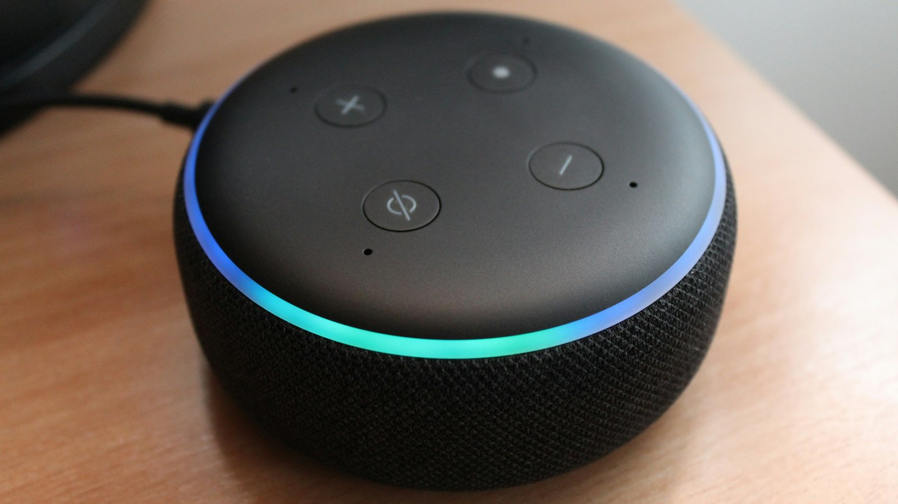

<!-- GENERATED from watch/issues/2026-03-16-voice-shopping-default.yml by scripts/build_watch.py. Edit the data file. -->

```{=html}
<p class="mw-kicker">Marketing in 3 · Issue 10 · Week of 16 March 2026</p>
<figure class="mw-hero"><figcaption>On a speaker there is no shelf, only the next suggestion. Photo: Lazar Gugleta on Unsplash.</figcaption></figure>
<section class="mw-answer" aria-label="Short answer"><h2>The short answer</h2><p>Often, yes. When 484 people bought AA batteries by talking to Alexa, half bought the first product it read out and 81% bought one of the first three. Whichever brand was placed first won most of the sales: 55% bought the store brand when it came first, 61% bought Duracell when it came first. People who heard fewer options were happier with their choice and more willing to let the assistant decide next time, but overall few were ready to hand over the decision.</p></section>
<section class="mw-takeaways"><h2>Key takeaways</h2><ul><li>Half of the shoppers bought the first batteries the assistant offered, and 81% bought one of the first three.</li><li>The brand read out first took most of the sales: 54.5% bought the store brand when it led and 61.2% bought Duracell when it led, against about 2% when the other one led.</li><li>Shoppers who heard fewer options were more satisfied with their decision and more willing to trust the assistant&#x27;s recommendations and let it choose next time.</li><li>Appetite for a full hand-over was still low: willingness to let Alexa decide averaged 2.71 out of 7.</li></ul></section>
<section id="what-the-researchers-did"><h2>What the researchers did</h2><p>On a screen you see the whole shelf. On a voice assistant you hear one product, then a question: &quot;Do you want me
to order this?&quot; To hear anything else, you have to say no, and remember what came before. Alex Mari (American
University of Bahrain), Andreina Mandelli (SDA Bocconi) and René Algesheimer (University of Zurich) wanted to know
what this does to choice.</p><p>They built an Alexa shopping app that copied the voice, wording and flow of Amazon&#x27;s own voice shopping. In
one-to-one video sessions, each participant sat alone with an Amazon Echo and bought a pack of four AA batteries
by searching for the category, then saying &quot;yes&quot; or &quot;no&quot; to each suggestion. The first suggestion was set by the
researchers: Amazon&#x27;s own brand, AmazonBasics, or Duracell, at either the cheapest or the most expensive price.
Every later suggestion was drawn at random from 35 brands and five prices, all with identical product
descriptions. Participants could keep what they bought.</p>
<dl class="mw-facts"><div><dt>Participants</dt><dd>484 people recruited through two Swiss universities, average age 25; 85% rarely or never used a voice assistant</dd></div><div><dt>Task</dt><dd>Buy one 4-pack of AA batteries by voice on an Amazon Echo, searching by category, not brand</dd></div><div><dt>First offer</dt><dd>AmazonBasics or Duracell, at CHF 4.95 or CHF 6.95 (121 people in each of the four groups)</dd></div><div><dt>Measured</dt><dd>How many options each person heard, what they bought, decision satisfaction, and willingness to let the assistant choose and to trust its suggestions</dd></div></dl>
</section>
<section id="the-first-option-wins"><h2>The first option wins</h2><p>Half of the shoppers (50%) said yes to the very first product, and 81% bought one of the first three. On average
people heard about two and a half options before buying.</p><p>The brand placed first did most of the selling. When AmazonBasics led, 54.5% bought AmazonBasics; when Duracell
led, 61.2% bought Duracell. Each brand was bought by only about 2% of people when the other one went first. Price
behaved the same way: when the first offer was the cheapest price, 71% paid the cheapest price; when it was the
premium price, 61% paid the premium price.</p><p>Brand equity still showed. Duracell, which more participants already knew, kept more buyers when it came first
than the store brand did (61% against 55%).</p>
<figure class="mw-chart" id="chart-brand"><figcaption class="mw-chart-title">Share who bought each brand, by which brand Alexa offered first</figcaption><div class="mw-chart-svg"><svg viewBox="0 0 680 194" role="img" aria-labelledby="chart-brand-t" font-family="Hanken Grotesk, Arial, sans-serif"><title id="chart-brand-t">Share who bought each brand, by which brand Alexa offered first</title><line x1="250.0" y1="4" x2="250.0" y2="168" stroke="#dde1e8" stroke-width="1"/><text x="250.0" y="186" font-size="12" text-anchor="middle" fill="#5b6476">0</text><line x1="352.9" y1="4" x2="352.9" y2="168" stroke="#dde1e8" stroke-width="1"/><text x="352.9" y="186" font-size="12" text-anchor="middle" fill="#5b6476">20</text><line x1="455.7" y1="4" x2="455.7" y2="168" stroke="#dde1e8" stroke-width="1"/><text x="455.7" y="186" font-size="12" text-anchor="middle" fill="#5b6476">40</text><line x1="558.6" y1="4" x2="558.6" y2="168" stroke="#dde1e8" stroke-width="1"/><text x="558.6" y="186" font-size="12" text-anchor="middle" fill="#5b6476">60</text><g><title>AmazonBasics, offered first: 54.5%</title><text x="238" y="27" font-size="13.5" text-anchor="end" fill="#15203b" font-weight="600">AmazonBasics, offered first</text><rect x="250" y="12" width="280.3" height="22" rx="4" fill="#e0a12a"/><text x="538.3" y="28" font-size="13.5" fill="#15203b" font-weight="600">54.5%</text></g><g><title>AmazonBasics, Duracell first: 2.1%</title><text x="238" y="67" font-size="13.5" text-anchor="end" fill="#15203b">AmazonBasics, Duracell first</text><rect x="250" y="52" width="10.8" height="22" rx="4" fill="#aab3c5"/><text x="268.8" y="68" font-size="13.5" fill="#15203b">2.1%</text></g><g><title>Duracell, offered first: 61.2%</title><text x="238" y="107" font-size="13.5" text-anchor="end" fill="#15203b" font-weight="600">Duracell, offered first</text><rect x="250" y="92" width="314.7" height="22" rx="4" fill="#e0a12a"/><text x="572.7" y="108" font-size="13.5" fill="#15203b" font-weight="600">61.2%</text></g><g><title>Duracell, AmazonBasics first: 2.1%</title><text x="238" y="147" font-size="13.5" text-anchor="end" fill="#15203b">Duracell, AmazonBasics first</text><rect x="250" y="132" width="10.8" height="22" rx="4" fill="#aab3c5"/><text x="268.8" y="148" font-size="13.5" fill="#15203b">2.1%</text></g></svg></div><div class="mw-sr"><table><caption>Share who bought each brand, by which brand Alexa offered first</caption><tr><th>Group</th><th>Value (%)</th></tr><tr><th scope="row">AmazonBasics, offered first</th><td>54.5</td></tr><tr><th scope="row">AmazonBasics, Duracell first</th><td>2.1</td></tr><tr><th scope="row">Duracell, offered first</th><td>61.2</td></tr><tr><th scope="row">Duracell, AmazonBasics first</th><td>2.1</td></tr></table></div><p class="mw-chart-src">484 shoppers, 242 per first-offer brand. Later options were drawn at random from 35 brands.</p></figure>
</section>
<section id="fewer-options-happier-shoppers"><h2>Fewer options, happier shoppers</h2><p>Research on screen-based shopping often finds that a very short list can leave people less satisfied with their
choice. Here the pattern ran the other way. The more options people heard, the less satisfied they were with
their decision, and the less willing they were to let the assistant decide for them or to trust its suggestions
next time. Those who accepted the first offer were the most satisfied. Satisfaction explained only a small part
of the link to trust and delegation.</p><p>But nobody should read this as consumers handing over the keys. On a 1 to 7 scale, willingness to let Alexa
choose averaged 2.71 and trust in its suggestions 3.29, both below the midpoint. Decision satisfaction sat just
above it, at 4.06.</p>
<figure class="mw-chart" id="chart-attitudes"><figcaption class="mw-chart-title">How shoppers felt after one voice purchase (average)</figcaption><div class="mw-chart-svg"><svg viewBox="0 0 680 154" role="img" aria-labelledby="chart-attitudes-t" font-family="Hanken Grotesk, Arial, sans-serif"><title id="chart-attitudes-t">How shoppers felt after one voice purchase (average)</title><line x1="250.0" y1="4" x2="250.0" y2="128" stroke="#dde1e8" stroke-width="1"/><text x="250.0" y="146" font-size="12" text-anchor="middle" fill="#5b6476">1</text><line x1="310.0" y1="4" x2="310.0" y2="128" stroke="#dde1e8" stroke-width="1"/><text x="310.0" y="146" font-size="12" text-anchor="middle" fill="#5b6476">2</text><line x1="370.0" y1="4" x2="370.0" y2="128" stroke="#dde1e8" stroke-width="1"/><text x="370.0" y="146" font-size="12" text-anchor="middle" fill="#5b6476">3</text><line x1="430.0" y1="4" x2="430.0" y2="128" stroke="#dde1e8" stroke-width="1"/><text x="430.0" y="146" font-size="12" text-anchor="middle" fill="#5b6476">4</text><line x1="490.0" y1="4" x2="490.0" y2="128" stroke="#dde1e8" stroke-width="1"/><text x="490.0" y="146" font-size="12" text-anchor="middle" fill="#5b6476">5</text><line x1="550.0" y1="4" x2="550.0" y2="128" stroke="#dde1e8" stroke-width="1"/><text x="550.0" y="146" font-size="12" text-anchor="middle" fill="#5b6476">6</text><line x1="610.0" y1="4" x2="610.0" y2="128" stroke="#dde1e8" stroke-width="1"/><text x="610.0" y="146" font-size="12" text-anchor="middle" fill="#5b6476">7</text><g><title>Satisfied with the decision: 4.06 out of 7</title><text x="238" y="27" font-size="13.5" text-anchor="end" fill="#15203b">Satisfied with the decision</text><rect x="250" y="12" width="183.6" height="22" rx="4" fill="#aab3c5"/><text x="441.6" y="28" font-size="13.5" fill="#15203b">4.06</text></g><g><title>Would trust its suggestions: 3.29 out of 7</title><text x="238" y="67" font-size="13.5" text-anchor="end" fill="#15203b">Would trust its suggestions</text><rect x="250" y="52" width="137.4" height="22" rx="4" fill="#aab3c5"/><text x="395.4" y="68" font-size="13.5" fill="#15203b">3.29</text></g><g><title>Would let Alexa choose: 2.71 out of 7</title><text x="238" y="107" font-size="13.5" text-anchor="end" fill="#15203b" font-weight="600">Would let Alexa choose</text><rect x="250" y="92" width="102.6" height="22" rx="4" fill="#e0a12a"/><text x="360.6" y="108" font-size="13.5" fill="#15203b" font-weight="600">2.71</text></g></svg></div><div class="mw-sr"><table><caption>How shoppers felt after one voice purchase (average)</caption><tr><th>Group</th><th>Value (out of 7)</th></tr><tr><th scope="row">Satisfied with the decision</th><td>4.06</td></tr><tr><th scope="row">Would trust its suggestions</th><td>3.29</td></tr><tr><th scope="row">Would let Alexa choose</th><td>2.71</td></tr></table></div><p class="mw-chart-src">484 shoppers; 1 = strongly disagree, 7 = strongly agree. The midpoint is 4.</p></figure>
</section>
<section id="brand-price-and-the-retailer-s-own-label"><h2>Brand, price and the retailer&#x27;s own label</h2><p>Whether the first offer was the store brand or Duracell, cheap or premium, made no clear difference to how
satisfied people were or how willing they were to rely on the assistant. One pattern did stand out: people were
more willing to let the assistant choose when brand and price matched what they would expect, Duracell at the
premium price or AmazonBasics at the low price. The authors suggest a mismatch, such as a cheap leading brand,
may look suspicious.</p><p>For the retailer, leading with its own label paid slightly: shoppers paid CHF 5.92 per pack on average when
AmazonBasics came first, against CHF 5.81 when Duracell did. The authors&#x27; explanation is that people who turned
down the less familiar store brand then settled for the next good-enough option rather than hunting for a
bargain.</p>
</section>
<section id="beyond-the-smart-speaker"><h2>Beyond the smart speaker</h2><p>This study is about batteries on Alexa, but the set-up it tests is spreading: an assistant that offers one
answer at a time and waits for a yes. AI chat assistants that recommend &quot;the best option&quot;, shopping agents
built into retail apps, in-car assistants, and AI search summaries that name one product all work this way.
My reading, not tested in the paper, is that the same logic is likely to apply wherever choices are low-stakes
and alternatives are hard to compare: the first suggestion does most of the selling, and the brand that is not
in it barely gets heard.</p><p>That shifts the marketing question from &quot;how do we stand out on the shelf?&quot; to &quot;how do we become the answer?&quot;
for brands, and to &quot;how do we use that power without losing trust?&quot; for whoever runs the assistant.</p>
</section>
<section id="how-to-apply-it" class="mw-howto"><p class="mw-rsg-kicker">Marketing in 3 steps</p><h2>Ready. Set. Market.</h2><div class="mw-rsg"><div class="mw-phase"><div class="mw-phase-dot" aria-hidden="true">1</div><div class="mw-phase-tag"><span class="mw-phase-name">Ready</span><span class="mw-phase-sub">Decide and prepare</span></div><ul class="mw-rsg-steps"><li><strong>Map your one-answer moments.</strong> List where your customers now get a single suggestion instead of a shelf: voice speakers, AI chat and shopping assistants, in-car systems, auto-reorder and AI search summaries. In those places, the first slot is the shelf.</li><li><strong>Decide whether you can win the first slot.</strong> In this study, being read out first was worth more than half of the sales. Work out what puts a product there in each channel, such as retailer agreements, stock, ratings and clear product data, and where it is out of reach, plan for being the strong second option.</li></ul></div><div class="mw-phase"><div class="mw-phase-dot" aria-hidden="true">2</div><div class="mw-phase-tag"><span class="mw-phase-name">Set</span><span class="mw-phase-sub">Build it</span></div><ul class="mw-rsg-steps"><li><strong>Keep brand and price consistent.</strong> People were more willing to rely on the assistant when a leading brand came at a premium price and a value brand at a low price. Avoid offers that clash with what customers expect of the brand, such as deep-discounting a premium name in a first recommendation.</li><li><strong>Make the first offer easy to say yes to.</strong> If you run the assistant, put a genuinely good fit first and describe it in a few clear words with the price. Satisfaction and future trust were highest among people who accepted the first offer, so a poor first pick is costly.</li></ul></div><div class="mw-phase"><div class="mw-phase-dot" aria-hidden="true">3</div><div class="mw-phase-tag"><span class="mw-phase-name">Market</span><span class="mw-phase-sub">Launch and measure</span></div><ul class="mw-rsg-steps"><li><strong>Start with low-stakes repeat buys.</strong> Willingness to let an assistant choose was low overall. Launch assisted ordering on simple, repeat categories such as refills and household basics before asking customers to delegate bigger decisions.</li><li><strong>Track first-offer acceptance.</strong> Measure how often orders go to the first suggestion, how many options people hear before buying, and whether they come back to order again. Report these by category, and check that your defaults would look fair if customers or regulators saw how they were set.</li></ul></div></div></section>
<section id="what-to-expect"><h2>What to expect</h2><ul class="mw-list"><li><strong>A strong first-offer effect for everyday items.</strong> About half of buyers took the first product and four in five bought one of the first three.</li><li><strong>Defaults steer price as well as brand.</strong> When the first offer was cheap, most people paid the cheapest price; when it was premium, most paid the premium price.</li><li><strong>Small revenue gains, not windfalls.</strong> Leading with the store brand raised the average price paid by CHF 0.11 per pack.</li><li><strong>Slow growth in trust.</strong> Satisfied shoppers were more open to delegating, but willingness to let the assistant choose stayed below the midpoint.</li></ul></section>
<section id="where-it-does-not-work"><h2>Where it does not work</h2><ul class="mw-list"><li><strong>Association, not proof of cause.</strong> The researchers set the first offer, but people chose how many options to hear, so the link between fewer options and satisfaction may partly reflect who stops early.</li><li><strong>One low-stakes product.</strong> Batteries are cheap and similar. For expensive, emotional or complex purchases, hearing only one option may well leave people less satisfied.</li><li><strong>First-time, unpersonalised use.</strong> Most participants were young, new to voice shopping and could not ask for a brand by name, and the assistant knew nothing about their past purchases.</li><li><strong>No comparison with screens.</strong> The study did not include a website, a chat interface or another assistant, so it cannot say how much of the effect is due to voice itself.</li></ul></section>
<section id="questions"><h2>Questions marketers ask</h2><div class="mw-faq"><h3>Do people just buy the first product a voice assistant recommends?</h3><p>For simple products, often. When 484 people bought AA batteries through Alexa, half bought the first option read out and 81% bought one of the first three (Mari et al., 2026, Journal of Interactive Marketing).</p></div><div class="mw-faq"><h3>Does offering fewer options make shoppers more satisfied?</h3><p>In this voice-shopping study, yes: people who heard fewer options were more satisfied with their decision. This differs from some screen-based research, and it was shown for a cheap, everyday product, not for major purchases.</p></div><div class="mw-faq"><h3>Do voice assistants favour store brands?</h3><p>The study did not test how Alexa really ranks products. It showed that whichever brand is placed first, store brand or market leader, wins most of the sales, which is why the authors note concerns raised by the European Commission about retailers promoting their own labels.</p></div><div class="mw-faq"><h3>How can a brand get recommended by an AI shopping assistant?</h3><p>The paper does not test this. My inference: the factors that decide the first suggestion in each channel, such as retailer relationships, availability, ratings and complete product data, now matter as much as shelf placement, because the first suggestion does most of the selling.</p></div><div class="mw-faq"><h3>Are consumers willing to let AI assistants shop for them?</h3><p>Not yet, in this sample. On a 1 to 7 scale, willingness to let Alexa decide averaged 2.71 and trust in its recommendations 3.29, although both were higher among people who were satisfied with their first voice purchase.</p></div></section>
<section id="also-new"><h2>Also new this week</h2><div class="mw-also"><article><p class="mw-also-src"><em>Journal of Research in Interactive Marketing</em> · 2026</p><h3><a href="https://doi.org/10.1108/jrim-05-2025-0276">Design matters! The impact of design affordance of conversational virtual shopping assistants on consumers&#x27; recommendation adoption</a></h3><p class="mw-also-au">Han, X., Li, S., Liu, H., Li, H., &amp; Zhang, M.</p><p>Interviews, three online experiments and an eye-tracking study show that shoppers are more likely to follow a virtual shopping assistant&#x27;s recommendation when it answers with more than text alone, such as images alongside words, and when it looks warm rather than coolly competent, because the advice then feels more valuable.</p></article><article><p class="mw-also-src"><em>Journal of Research in Interactive Marketing</em> · 2026</p><h3><a href="https://doi.org/10.1108/jrim-06-2025-0311">I&#x27;m learning and improving! The impact of chatbot learning evidence on customer tolerance of chatbot service failure</a></h3><p class="mw-also-au">Liu, W., Qiu, X., Ma, K., &amp; Jiang, Z.</p><p>Across four experiments, customers were more forgiving of a chatbot&#x27;s mistakes when it showed evidence that it learns, especially in numbers rather than words, because they felt less frustrated. The evidence worked best when shared after the failure. A short &quot;here is how I have improved&quot; message can soften a chatbot slip.</p></article></div></section>
<section id="source" class="mw-source"><h2>Source</h2><p class="mw-cite">Mari, A., Mandelli, A., &amp; Algesheimer, R. (2026). AI-assisted shopping on voice assistants: The efficiency–autonomy consumer decision trade-off. <em>Journal of Interactive Marketing</em>, <em>61</em>(3), 327–344. <a href="https://doi.org/10.1177/10949968251400616">https://doi.org/10.1177/10949968251400616</a></p><p class="mw-note">This brief is written for practitioners from the authors&#x27; accepted manuscript (pre-print) of the article, so wording and figures may differ slightly in the final typeset version. Numbers are as reported by the authors; read the article for full methods.</p></section>
<section id="related-research" class="mw-related"><h2>Related research on this site</h2><ul><li><a href="../../../papers/utilitarian-products-high-status-brand-coolness.html">What if utilitarian products are regarded as high-status? The moderate role of iconic and popular as two dimensions of brand coolness</a><span>Journal of Marketing Communications</span></li></ul></section>
<div class="mw-author"><div><p><strong>Bruno Schivinski</strong> is Associate Professor of Marketing at Gdańsk University of Technology. He studies how consumers engage with brands in digital and social media.</p><p><a href="../../../index.html">About Bruno</a> · <a href="../../index.html">All Marketing in 3 issues</a> · <a href="../../subscribe.html">Subscribe</a></p></div></div>
<nav class="mw-pn" aria-label="More issues"><a class="mw-prev" href="../social-media-feed-testing/index.html"><span>Previous issue</span>Test your ads in the feed, not on a slide</a><a class="mw-next" href="../review-platforms-tourist-traps/index.html"><span>Next issue</span>Reviews close tourist traps and lift the hidden gems</a></nav>
```
