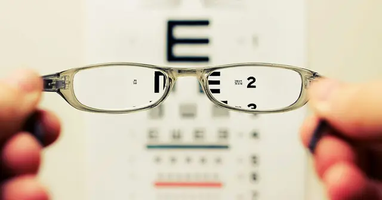

<!-- GENERATED from watch/issues/2026-02-23-weekend-effect-online-reviews.yml by scripts/build_watch.py. Edit the data file. -->

```{=html}
<p class="mw-kicker">Marketing in 3 · Issue 7 · Week of 23 February 2026</p>
<figure class="mw-hero"><picture><source type="image/webp" sizes="(max-width: 900px) 100vw, 900px" srcset="../../images/web/issue-07-weekend-effect-reviews-960.webp 960w, ../../images/web/issue-07-weekend-effect-reviews-1600.webp 1600w"></picture><figcaption>Weekend reviewers are a different crowd. Photo: Kajetan Sumila on Unsplash.</figcaption></figure>
<section class="mw-answer" aria-label="Short answer"><h2>The short answer</h2><p>Yes, slightly but consistently. Across almost 400 million reviews on 33 platforms, reviews submitted on weekends had a 3% smaller share of 5-star ratings and a 6% larger share of 1- to 3-star ratings than weekday reviews, even for the same product or business. The main reason is who writes them: people who review only at weekends rate lower and appear less socially connected. Businesses that send review requests on weekdays can avoid part of the effect.</p></section>
<section class="mw-takeaways"><h2>Key takeaways</h2><ul><li>Weekend reviews were more negative on 26 of 33 platforms, by 0.04 stars on average and by up to a third of a star for employer reviews.</li><li>About one reviewer in six (17%) reviews only at weekends, and these reviewers give lower ratings than people who review only on weekdays.</li><li>Reviews requested by email and written at the weekend averaged 3.69 stars, against 3.86 for those written on weekdays.</li><li>Small differences matter for products with few reviews: for up to 6% of products with three or four reviews, leaving out weekend reviewers would lift the average by half a star.</li></ul></section>
<section id="what-the-researchers-did"><h2>What the researchers did</h2><p>People are generally happier at weekends, and social media posts are more positive on Saturdays and Sundays. So
when the authors asked managers at review platforms, most expected weekend reviews to be kinder. <a class="mw-orcid-link" href="https://orcid.org/0000-0002-7248-5444" title="Andreas Bayerl on ORCID">Andreas Bayerl</a>
(Erasmus University Rotterdam), <a class="mw-orcid-link" href="https://orcid.org/0000-0001-6285-1415" title="Verena Schoenmueller on ORCID">Verena Schoenmueller</a> (ESADE), <a class="mw-orcid-link" href="https://orcid.org/0009-0001-3631-4533" title="Jacob Goldenberg on ORCID">Jacob Goldenberg</a> (Reichman University) and Florian
Stahl (University of Mannheim) checked.</p><p>They gathered almost 400 million reviews of more than 20 million products, businesses, films and employers,
written by more than 60 million people on 33 platforms in Europe, the Americas, Asia and Africa. They then tested
where the effect comes from and ran five studies on what businesses can do about it, including a randomised test
of review requests and a preregistered field experiment.</p>
<dl class="mw-facts"><div><dt>Data</dt><dd>Almost 400 million reviews on 33 platforms, including Amazon, Google, Yelp, Tripadvisor, Booking.com, Trustpilot, Glassdoor, Indeed, IMDb and Sephora</dd></div><div><dt>Categories</dt><dd>E-commerce and products; travel, restaurants and experiences; employers and workplace software; entertainment; professional services</dd></div><div><dt>Request studies</dt><dd>282,881 emailed and 76,323 ad-prompted employer reviews, lawyer reviews, a randomised test with 1,000 people, and a field experiment with 12,500 users</dd></div><div><dt>Analysis</dt><dd>Model-free comparisons, regressions with product and reviewer fixed effects, public holidays as a test, and text analysis of review language</dd></div></dl>
</section>
<section id="what-they-found"><h2>What they found</h2><p>Reviews written on Saturdays and Sundays were more negative on 26 of the 33 platforms (79%). The average gap was
0.04 stars, but the shape matters more than the average: weekends brought 3% fewer 5-star reviews and 6% more
1-, 2- and 3-star reviews, relative to weekdays.</p><p>The effect was largest for employer reviews: on the German employer site kununu, weekend reviews were a third of
a star lower, and Glassdoor and Indeed also showed it. It appeared on Amazon, Google, Yelp and Tripadvisor, held
for the same product or business reviewed on different days, and followed local weekends: on the Iranian
marketplace BaSalam the worst day was Friday, and for businesses in Israel it was Saturday. Public holidays had
the same effect as weekends on 11 of 14 platforms.</p>
<figure class="mw-chart" id="chart-platforms"><figcaption class="mw-chart-title">How many stars lower weekend reviews are than weekday reviews</figcaption><div class="mw-chart-svg"><svg viewBox="0 0 680 354" role="img" aria-labelledby="chart-platforms-t" font-family="Hanken Grotesk, Arial, sans-serif"><title id="chart-platforms-t">How many stars lower weekend reviews are than weekday reviews</title><line x1="250.0" y1="4" x2="250.0" y2="328" stroke="#dde1e8" stroke-width="1"/><text x="250.0" y="346" font-size="12" text-anchor="middle" fill="#5b6476">0</text><line x1="340.0" y1="4" x2="340.0" y2="328" stroke="#dde1e8" stroke-width="1"/><text x="340.0" y="346" font-size="12" text-anchor="middle" fill="#5b6476">0.1</text><line x1="430.0" y1="4" x2="430.0" y2="328" stroke="#dde1e8" stroke-width="1"/><text x="430.0" y="346" font-size="12" text-anchor="middle" fill="#5b6476">0.2</text><line x1="520.0" y1="4" x2="520.0" y2="328" stroke="#dde1e8" stroke-width="1"/><text x="520.0" y="346" font-size="12" text-anchor="middle" fill="#5b6476">0.3</text><line x1="610.0" y1="4" x2="610.0" y2="328" stroke="#dde1e8" stroke-width="1"/><text x="610.0" y="346" font-size="12" text-anchor="middle" fill="#5b6476">0.4</text><g><title>kununu (employers, Germany): 0.33 stars</title><text x="238" y="27" font-size="13.5" text-anchor="end" fill="#15203b" font-weight="600">kununu (employers, Germany)</text><rect x="250" y="12" width="297.0" height="22" rx="4" fill="#e0a12a"/><text x="555.0" y="28" font-size="13.5" fill="#15203b" font-weight="600">0.33</text></g><g><title>Olist (e-commerce, Brazil): 0.19 stars</title><text x="238" y="67" font-size="13.5" text-anchor="end" fill="#15203b">Olist (e-commerce, Brazil)</text><rect x="250" y="52" width="171.0" height="22" rx="4" fill="#aab3c5"/><text x="429.0" y="68" font-size="13.5" fill="#15203b">0.19</text></g><g><title>Trustpilot: 0.09 stars</title><text x="238" y="107" font-size="13.5" text-anchor="end" fill="#15203b">Trustpilot</text><rect x="250" y="92" width="81.0" height="22" rx="4" fill="#aab3c5"/><text x="339.0" y="108" font-size="13.5" fill="#15203b">0.09</text></g><g><title>Glassdoor: 0.05 stars</title><text x="238" y="147" font-size="13.5" text-anchor="end" fill="#15203b">Glassdoor</text><rect x="250" y="132" width="45.0" height="22" rx="4" fill="#aab3c5"/><text x="303.0" y="148" font-size="13.5" fill="#15203b">0.05</text></g><g><title>Google: 0.05 stars</title><text x="238" y="187" font-size="13.5" text-anchor="end" fill="#15203b">Google</text><rect x="250" y="172" width="45.0" height="22" rx="4" fill="#aab3c5"/><text x="303.0" y="188" font-size="13.5" fill="#15203b">0.05</text></g><g><title>Tripadvisor: 0.03 stars</title><text x="238" y="227" font-size="13.5" text-anchor="end" fill="#15203b">Tripadvisor</text><rect x="250" y="212" width="27.0" height="22" rx="4" fill="#aab3c5"/><text x="285.0" y="228" font-size="13.5" fill="#15203b">0.03</text></g><g><title>Yelp: 0.03 stars</title><text x="238" y="267" font-size="13.5" text-anchor="end" fill="#15203b">Yelp</text><rect x="250" y="252" width="27.0" height="22" rx="4" fill="#aab3c5"/><text x="285.0" y="268" font-size="13.5" fill="#15203b">0.03</text></g><g><title>Amazon: 0.01 stars</title><text x="238" y="307" font-size="13.5" text-anchor="end" fill="#15203b">Amazon</text><rect x="250" y="292" width="9.0" height="22" rx="4" fill="#aab3c5"/><text x="267.0" y="308" font-size="13.5" fill="#15203b">0.01</text></g></svg></div><div class="mw-sr"><table><caption>How many stars lower weekend reviews are than weekday reviews</caption><tr><th>Group</th><th>Value (stars)</th></tr><tr><th scope="row">kununu (employers, Germany)</th><td>0.33</td></tr><tr><th scope="row">Olist (e-commerce, Brazil)</th><td>0.19</td></tr><tr><th scope="row">Trustpilot</th><td>0.09</td></tr><tr><th scope="row">Glassdoor</th><td>0.05</td></tr><tr><th scope="row">Google</th><td>0.05</td></tr><tr><th scope="row">Tripadvisor</th><td>0.03</td></tr><tr><th scope="row">Yelp</th><td>0.03</td></tr><tr><th scope="row">Amazon</th><td>0.01</td></tr></table></div><p class="mw-chart-src">Average weekday rating minus average weekend rating, 1–5 scale, selected platforms from Table 1 of the article.</p></figure>
</section>
<section id="who-writes-weekend-reviews"><h2>Who writes weekend reviews</h2><p>The authors tested several explanations: worse products being reviewed at weekends, crowded restaurants giving
worse service, people having more time or a different mood. None fully explained the pattern. The strongest
driver was who writes the reviews.</p><p>Across platforms, 64% of reviewers reviewed only on weekdays, 19% on both, and 17% only at weekends. The gap
between weekend-only and weekday-only reviewers was about twice as large as the change in a mixed reviewer&#x27;s own
ratings from weekday to weekend, and more consistent across platforms. Weekend-only reviewers used fewer words
about friends, family and social life, more words of sadness, and had fewer friends on Yelp and Dianping. The
authors read this as a sign that people who review only at weekends are less socially connected.</p>
<figure class="mw-chart" id="chart-who"><figcaption class="mw-chart-title">When reviewers write their reviews</figcaption><div class="mw-chart-svg"><svg viewBox="0 0 680 154" role="img" aria-labelledby="chart-who-t" font-family="Hanken Grotesk, Arial, sans-serif"><title id="chart-who-t">When reviewers write their reviews</title><line x1="250.0" y1="4" x2="250.0" y2="128" stroke="#dde1e8" stroke-width="1"/><text x="250.0" y="146" font-size="12" text-anchor="middle" fill="#5b6476">0</text><line x1="322.0" y1="4" x2="322.0" y2="128" stroke="#dde1e8" stroke-width="1"/><text x="322.0" y="146" font-size="12" text-anchor="middle" fill="#5b6476">20</text><line x1="394.0" y1="4" x2="394.0" y2="128" stroke="#dde1e8" stroke-width="1"/><text x="394.0" y="146" font-size="12" text-anchor="middle" fill="#5b6476">40</text><line x1="466.0" y1="4" x2="466.0" y2="128" stroke="#dde1e8" stroke-width="1"/><text x="466.0" y="146" font-size="12" text-anchor="middle" fill="#5b6476">60</text><line x1="538.0" y1="4" x2="538.0" y2="128" stroke="#dde1e8" stroke-width="1"/><text x="538.0" y="146" font-size="12" text-anchor="middle" fill="#5b6476">80</text><line x1="610.0" y1="4" x2="610.0" y2="128" stroke="#dde1e8" stroke-width="1"/><text x="610.0" y="146" font-size="12" text-anchor="middle" fill="#5b6476">100</text><g><title>Only on weekdays: 64%</title><text x="238" y="27" font-size="13.5" text-anchor="end" fill="#15203b">Only on weekdays</text><rect x="250" y="12" width="230.4" height="22" rx="4" fill="#aab3c5"/><text x="488.4" y="28" font-size="13.5" fill="#15203b">64%</text></g><g><title>On weekdays and weekends: 19%</title><text x="238" y="67" font-size="13.5" text-anchor="end" fill="#15203b">On weekdays and weekends</text><rect x="250" y="52" width="68.4" height="22" rx="4" fill="#aab3c5"/><text x="326.4" y="68" font-size="13.5" fill="#15203b">19%</text></g><g><title>Only at weekends: 17%</title><text x="238" y="107" font-size="13.5" text-anchor="end" fill="#15203b" font-weight="600">Only at weekends</text><rect x="250" y="92" width="61.2" height="22" rx="4" fill="#e0a12a"/><text x="319.2" y="108" font-size="13.5" fill="#15203b" font-weight="600">17%</text></g></svg></div><div class="mw-sr"><table><caption>When reviewers write their reviews</caption><tr><th>Group</th><th>Value (%)</th></tr><tr><th scope="row">Only on weekdays</th><td>64</td></tr><tr><th scope="row">On weekdays and weekends</th><td>19</td></tr><tr><th scope="row">Only at weekends</th><td>17</td></tr></table></div><p class="mw-chart-src">Average share of reviewers across the datasets with reviewer IDs.</p></figure>
</section>
<section id="what-this-means-for-review-requests"><h2>What this means for review requests</h2><p>Businesses cannot choose who reviews them, but they can choose when to ask. On kununu, reviews prompted by an
email and written at the weekend averaged 3.69 stars, against 3.86 for those written on weekdays; reviews
prompted by social media ads showed the same gap (3.42 against 3.59).</p><p>In a randomised test, 1,000 people were invited to review a restaurant, software and a hotel either on a
Wednesday or a Saturday. More of the Wednesday group took part (406 against 296), the Saturday respondents felt
slightly more socially disconnected and had written fewer reviews before, and their ratings were 0.05 stars
lower. A preregistered field
experiment with 12,500 users of a software review platform pointed the same way. Both tests were too small to be
statistically significant on their own, but the size of the gap matched the large-scale data.</p>
<figure class="mw-chart" id="chart-requests"><figcaption class="mw-chart-title">Average rating of requested employer reviews, by day written</figcaption><div class="mw-chart-svg"><svg viewBox="0 0 680 194" role="img" aria-labelledby="chart-requests-t" font-family="Hanken Grotesk, Arial, sans-serif"><title id="chart-requests-t">Average rating of requested employer reviews, by day written</title><line x1="250.0" y1="4" x2="250.0" y2="168" stroke="#dde1e8" stroke-width="1"/><text x="250.0" y="186" font-size="12" text-anchor="middle" fill="#5b6476">1</text><line x1="295.0" y1="4" x2="295.0" y2="168" stroke="#dde1e8" stroke-width="1"/><text x="295.0" y="186" font-size="12" text-anchor="middle" fill="#5b6476">1.5</text><line x1="340.0" y1="4" x2="340.0" y2="168" stroke="#dde1e8" stroke-width="1"/><text x="340.0" y="186" font-size="12" text-anchor="middle" fill="#5b6476">2</text><line x1="385.0" y1="4" x2="385.0" y2="168" stroke="#dde1e8" stroke-width="1"/><text x="385.0" y="186" font-size="12" text-anchor="middle" fill="#5b6476">2.5</text><line x1="430.0" y1="4" x2="430.0" y2="168" stroke="#dde1e8" stroke-width="1"/><text x="430.0" y="186" font-size="12" text-anchor="middle" fill="#5b6476">3</text><line x1="475.0" y1="4" x2="475.0" y2="168" stroke="#dde1e8" stroke-width="1"/><text x="475.0" y="186" font-size="12" text-anchor="middle" fill="#5b6476">3.5</text><line x1="520.0" y1="4" x2="520.0" y2="168" stroke="#dde1e8" stroke-width="1"/><text x="520.0" y="186" font-size="12" text-anchor="middle" fill="#5b6476">4</text><line x1="565.0" y1="4" x2="565.0" y2="168" stroke="#dde1e8" stroke-width="1"/><text x="565.0" y="186" font-size="12" text-anchor="middle" fill="#5b6476">4.5</text><line x1="610.0" y1="4" x2="610.0" y2="168" stroke="#dde1e8" stroke-width="1"/><text x="610.0" y="186" font-size="12" text-anchor="middle" fill="#5b6476">5</text><g><title>Emailed request, weekday: 3.86 stars</title><text x="238" y="27" font-size="13.5" text-anchor="end" fill="#15203b">Emailed request, weekday</text><rect x="250" y="12" width="257.4" height="22" rx="4" fill="#aab3c5"/><text x="515.4" y="28" font-size="13.5" fill="#15203b">3.86</text></g><g><title>Emailed request, weekend: 3.69 stars</title><text x="238" y="67" font-size="13.5" text-anchor="end" fill="#15203b" font-weight="600">Emailed request, weekend</text><rect x="250" y="52" width="242.1" height="22" rx="4" fill="#e0a12a"/><text x="500.1" y="68" font-size="13.5" fill="#15203b" font-weight="600">3.69</text></g><g><title>Social media ad, weekday: 3.59 stars</title><text x="238" y="107" font-size="13.5" text-anchor="end" fill="#15203b">Social media ad, weekday</text><rect x="250" y="92" width="233.1" height="22" rx="4" fill="#aab3c5"/><text x="491.1" y="108" font-size="13.5" fill="#15203b">3.59</text></g><g><title>Social media ad, weekend: 3.42 stars</title><text x="238" y="147" font-size="13.5" text-anchor="end" fill="#15203b" font-weight="600">Social media ad, weekend</text><rect x="250" y="132" width="217.8" height="22" rx="4" fill="#e0a12a"/><text x="475.8" y="148" font-size="13.5" fill="#15203b" font-weight="600">3.42</text></g></svg></div><div class="mw-sr"><table><caption>Average rating of requested employer reviews, by day written</caption><tr><th>Group</th><th>Value (stars)</th></tr><tr><th scope="row">Emailed request, weekday</th><td>3.86</td></tr><tr><th scope="row">Emailed request, weekend</th><td>3.69</td></tr><tr><th scope="row">Social media ad, weekday</th><td>3.59</td></tr><tr><th scope="row">Social media ad, weekend</th><td>3.42</td></tr></table></div><p class="mw-chart-src">kununu, 282,881 email-prompted and 76,323 ad-prompted reviews (Studies 1 and 2 of the managerial section).</p></figure>
</section>
<section id="how-to-apply-it" class="mw-howto"><p class="mw-rsg-kicker">Marketing in 3 steps</p><h2>Ready. Set. Market.</h2><div class="mw-rsg"><div class="mw-phase"><div class="mw-phase-dot" aria-hidden="true">1</div><div class="mw-phase-tag"><span class="mw-phase-name">Ready</span><span class="mw-phase-sub">Decide and prepare</span></div><ul class="mw-rsg-steps"><li><strong>Protect listings with few reviews.</strong> A single weekend 1-star review can pull a three-review product from 4 to 3.25 stars. Prioritise weekday requests for new or niche products, locations and job listings.</li><li><strong>Watch employer reviews closely.</strong> Employer and workplace platforms showed the largest effect. HR teams prompting staff to review on Glassdoor, Indeed or kununu should do it on working days.</li></ul></div><div class="mw-phase"><div class="mw-phase-dot" aria-hidden="true">2</div><div class="mw-phase-tag"><span class="mw-phase-name">Set</span><span class="mw-phase-sub">Build it</span></div><ul class="mw-rsg-steps"><li><strong>Send review requests on weekdays.</strong> Schedule post-purchase, post-stay or post-service review emails, texts and app prompts for Monday to Friday. Weekday requests drew more responses and slightly better ratings.</li><li><strong>Mind public holidays too.</strong> Holidays behaved like weekends. Avoid sending requests on public holidays in your customers&#x27; country or region.</li></ul></div><div class="mw-phase"><div class="mw-phase-dot" aria-hidden="true">3</div><div class="mw-phase-tag"><span class="mw-phase-name">Market</span><span class="mw-phase-sub">Launch and measure</span></div><ul class="mw-rsg-steps"><li><strong>Read weekend reviews in context.</strong> When monitoring ratings, compare weekday and weekend averages before reacting. A dip after a weekend may reflect who reviewed, not a fall in quality.</li><li><strong>For platforms: show the pattern.</strong> The authors suggest platforms could show ratings by day of the week or let users filter weekday and weekend reviews, as some already show the star distribution.</li></ul></div></div></section>
<div class="mw-coffee" role="complementary" aria-label="Support Marketing in 3"><div class="mw-coffee-text"><p class="mw-coffee-title">Found this useful?</p><p>Marketing in 3 is free, weekly and ad-free. A coffee keeps it that way.</p></div><a class="mw-coffee-btn" href="https://ko-fi.com/marketingin3" target="_blank" rel="noopener"><svg aria-hidden="true" focusable="false"
  class="lucide lucide-coffee"
  xmlns="http://www.w3.org/2000/svg"
  width="24"
  height="24"
  viewBox="0 0 24 24"
  fill="none"
  stroke="currentColor"
  stroke-width="2"
  stroke-linecap="round"
  stroke-linejoin="round"
>
  <path d="M10 2v2" />
  <path d="M14 2v2" />
  <path d="M16 8a1 1 0 0 1 1 1v8a4 4 0 0 1-4 4H7a4 4 0 0 1-4-4V9a1 1 0 0 1 1-1h14a4 4 0 1 1 0 8h-1" />
  <path d="M6 2v2" />
</svg><span>Buy me a coffee</span><span class="mw-coffee-price">€3</span></a></div>
<section id="what-to-expect"><h2>What to expect</h2><ul class="mw-list"><li><strong>A small shift per review.</strong> The average gap is 0.04 stars, so timing will not transform a rating on its own.</li><li><strong>Bigger effects where reviews are few.</strong> For up to 6% of products with three or four reviews, the weekend reviewers alone cost half a star, a difference known to move demand.</li><li><strong>Better rankings.</strong> On Amazon software, one extra 1-star review moved a typical three-review product from rank 938 to 1,114 out of 1,962.</li><li><strong>More responses.</strong> In the randomised test, weekday invitations produced more completed reviews than weekend invitations (406 against 296 out of 500 each).</li></ul></section>
<section id="where-it-does-not-work"><h2>Where it does not work</h2><ul class="mw-list"><li><strong>Why, not fully known.</strong> Temporal self-selection is the best-supported explanation, but the authors can only speculate about why weekend-only reviewers are harsher.</li><li><strong>Small experiments.</strong> The randomised request test and the field experiment matched the expected gap but lacked the sample size for statistical significance.</li><li><strong>Not universal.</strong> Five platforms showed a small reversed effect, including Rotten Tomatoes, Coursera and the doctor-review site Jameda.</li><li><strong>Weekdays vary too.</strong> Some platforms rated highest on Thursdays; differences between weekdays were not studied in detail.</li></ul></section>
<section id="questions"><h2>Questions marketers ask</h2><div class="mw-faq"><h3>Are online reviews more negative on weekends?</h3><p>Yes. Across almost 400 million reviews on 33 platforms, weekend reviews had a 3% smaller share of 5-star ratings and a 6% larger share of 1- to 3-star ratings than weekday reviews, an average gap of 0.04 stars (Bayerl et al., 2026).</p></div><div class="mw-faq"><h3>When is the best time to ask customers for a review?</h3><p>On a weekday. In a Journal of Marketing Research study, reviews requested by email and written at weekends averaged 3.69 stars against 3.86 on weekdays, and weekday invitations drew more responses.</p></div><div class="mw-faq"><h3>Why are weekend reviews lower?</h3><p>Mainly because different people write them. About 17% of reviewers review only at weekends; they give lower ratings than weekday reviewers and show signs of being less socially connected, such as fewer social words in their reviews and fewer friends on Yelp.</p></div><div class="mw-faq"><h3>Which review sites show the biggest weekend effect?</h3><p>Employer review sites. On kununu, weekend reviews were a third of a star lower than weekday reviews, and Glassdoor and Indeed showed the same pattern. Product and restaurant sites showed smaller gaps.</p></div><div class="mw-faq"><h3>Do public holidays affect review ratings?</h3><p>Yes. On 11 of 14 platforms where holidays could be identified, reviews written on public holidays were lower, by about as much as weekend reviews.</p></div></section>
<section id="also-new"><h2>Also new this week</h2><div class="mw-also"><article><p class="mw-also-src"><em>Journal of Interactive Marketing</em> · 2026</p><h3><a href="https://doi.org/10.1177/10949968251380114">Age-related effects on electronic word-of-mouth persuasion</a></h3><p class="mw-also-au">Gambicorti, A., Peluso, A. M., &amp; Pino, G.</p><p>Older consumers are less persuaded by online reviews than younger ones. Across three studies, prompting people aged 65 and over to feel younger, through instructions or communication cues, increased their sense of control and made reviews more persuasive. With ageing populations moving online, how reviews are presented to older shoppers matters, though the authors note the ethical limits of such cues.</p></article><article><p class="mw-also-src"><em>European Journal of Marketing</em> · 2026</p><h3><a href="https://doi.org/10.1108/ejm-09-2023-0668">More than meets the eye: Visual salience in online word of mouth and consumer decision-making</a></h3><p class="mw-also-au">He, S. X., &amp; Wen, N.</p><p>How a rating distribution looks changes what people choose. Across four studies with 583 participants, when the ends of the rating bar chart stood out visually, shoppers favoured products with more mixed reviews as average ratings rose; colour gradients had the same effect. Review displays are not neutral: the design of the star histogram can steer choices.</p></article></div></section>
<section id="source" class="mw-source"><h2>Source</h2><p class="mw-cite">Bayerl, A., Schoenmueller, V., Goldenberg, J., &amp; Stahl, F. (2026). The weekend effect in online reviews. <em>Journal of Marketing Research</em>, <em>63</em>(2), 211–233. <a href="https://doi.org/10.1177/00222437251391808">https://doi.org/10.1177/00222437251391808</a></p><p class="mw-note">This brief is written for practitioners from the published article. Open access (CC BY-NC 4.0): free to read at the publisher. Numbers are as reported by the authors; read the article for full methods.</p></section>

<section id="keep-reading" class="mw-more"><h2>Keep reading</h2><p class="mw-more-topics">More issues on <a href="../../topics/ugc.html">UGC</a> · <a href="../../topics/service.html">Service</a> · <a href="../../topics/retail.html">Retail</a></p><div class="watch-list"><article class="watch-item"><a class="watch-thumb" href="../../posts/bad-review-experience/index.html" tabindex="-1" aria-hidden="true"></a><div><p class="watch-meta">Issue 27 · Week of <time datetime="2026-07-13">13 July 2026</time></p><h3><a href="../../posts/bad-review-experience/index.html">The review keeps working after the sale</a></h3><p>People who read bad reviews before listening paid $17.29 to see a show, against $20.45 for people who read none. The review changes the experience, not just the purchase.</p></div></article><article class="watch-item"><a class="watch-thumb" href="../../posts/review-platforms-tourist-traps/index.html" tabindex="-1" aria-hidden="true"></a><div><p class="watch-meta">Issue 11 · Week of <time datetime="2026-03-23">23 March 2026</time></p><h3><a href="../../posts/review-platforms-tourist-traps/index.html">Reviews close tourist traps and lift the hidden gems</a></h3><p>After EU roaming fees ended, low-rated restaurants in Rome were twice as likely to close and high-rated ones sold 5.6% more. What reviews do to quality.</p></div></article><article class="watch-item"><a class="watch-thumb" href="../../posts/agentic-marketing-relationships/index.html" tabindex="-1" aria-hidden="true"></a><div><p class="watch-meta">Issue 34 · Week of <time datetime="2026-08-31">31 August 2026</time></p><h3><a href="../../posts/agentic-marketing-relationships/index.html">When your customer&#x27;s AI agent does the shopping</a></h3><p>Customers are starting to delegate shopping to AI agents. A Journal of Marketing framework sets out five things firms must get right, and six KPIs.</p></div></article></div></section>
<div class="mw-author"><div><p><strong>Bruno Schivinski</strong> is Associate Professor of Marketing at Gdańsk University of Technology. He studies how consumers engage with brands in digital and social media.</p><p><a href="../../../index.html">About Bruno</a> · <a href="../../index.html">All Marketing in 3 issues</a> · <a href="../../subscribe.html">Subscribe</a></p></div></div>
<nav class="mw-pn" aria-label="More issues"><a class="mw-prev" href="../cart-abandonment/index.html"><span>Previous issue</span>Treats in the cart, guilt at checkout</a><a class="mw-next" href="../ai-negotiation-bots/index.html"><span>Next issue</span>The AI negotiator that wins the deal and loses the relationship</a></nav>
```
